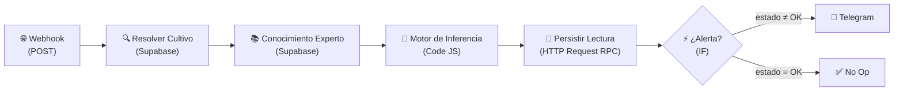

# Sistema Experto Agrícola — Plan de Implementación (v73)

> [!NOTE]
> Enfoque híbrido: nodos **Supabase nativos** para consultas simples y **HTTP Request** para RPC y vistas filtradas. Todas las referencias corresponden al esquema **real** auditado en Supabase y en los workflows exportados de n8n.

---

## Guía del documento

Este archivo es la **fuente de verdad** del proyecto. Está organizado en cinco bloques, en este orden:

| Bloque | Qué contiene | Cuándo se lee |
|---|---|---|
| **Estado Actual** | Tablero de workflows, hallazgos abiertos, cierre de la última sesión y próximos pasos | **Al abrir cada sesión** |
| **Índice** · Índice** y **Changelog** · Changelog** | Navegación y la historia versionada del proyecto (v3 → v41) | Para ubicar algo o reconstruir por qué se decidió algo |
| **Fases 1 → 15** | El diseño y la construcción del sistema, nodo por nodo, con el SQL y el código exactos | Cuando se va a construir o modificar algo |
| **Fase 16 · Registro de Hallazgos** | Los 38 hallazgos de auditoría (16.1 → 16.38), en orden numérico, cada uno con su estado | Cuando algo falla, o para elegir en qué trabajar |
| **Fase 17**, **Backlog** y **Anexos** | Trazabilidad de la base de conocimiento, lo diferido a propósito (B.1 → B.12) y material de referencia | Para la tesis, y antes de proponer algo "nuevo" |

### Convenciones

- **Severidad:** 🔴 crítica (daña el cultivo o corrompe datos) · 🟠 alta (pierde un dato o un aviso) · 🟡 media · 🟢 baja o cosmética · ❌ descartado tras verificarlo.
- **`CONTEXTO_AGENTE.md`** es el paquete comprimido de este documento, pensado para que un agente arranque sin leerlo entero. **Se regenera desde acá, nunca se edita a mano.** Si los dos discrepan, manda este documento.
- **Numeración estable.** Los identificadores `16.x` y `B.x` **no se reasignan nunca**: están referenciados desde los workflows y desde el changelog. Un hallazgo resuelto conserva su número y cambia de estado.
- **Lo diferido tiene número propio.** El backlog (`B.x`) no es deuda olvidada: son decisiones conscientes de priorización. Antes de proponer algo como hallazgo nuevo, revisar si ya está ahí.
- **Estado ≠ afirmación.** Cuando una sección dice que algo está aplicado, eso se verifica contra el artefacto (el JSON exportado, la base), no contra el documento. Las contradicciones encontradas viven en **Contradicciones**.

### Protocolo de arranque de sesión

1. Comparar el `mtime` de `WORKFLOWS/*.json` contra el de este archivo. Es la señal más barata de que se desincronizaron — así se destapó una sesión entera sin documentar (v36).
2. Leer **Tablero**, **Hallazgos abiertos** y **Cierre de sesión**.
3. Mirar **Contradicciones** antes de dar por buena cualquier afirmación de estado.
4. Revisar el **Backlog** antes de reportar un hallazgo como nuevo.
5. Correr `git log --oneline -5` y `git status`: si el árbol no está limpio, la sesión anterior dejó algo sin commitear — y eso es, por definición, algo sin documentar (ver **Versionado**).

---

## Estado Actual

> [!NOTE]
> **Tablero verificado el 27/08/2026 contra `WORKFLOWS/*.json` (export del 24/08), no contra lo que afirmaba el documento.** La verificación refutó cuatro afirmaciones de la tabla anterior sobre WF3 — ver **Contradicciones**. La tabla "Estado Actual" original se conserva íntegra y sin editar en **Historial de sesiones**.

### Tablero

| WF | `active` | Última auditoría | Hallazgos abiertos | Lo que falta |
|---|---|---|---|---|
| **WF1** — Pipeline Telemetría | ✅ `true` | 04/11 | ~~16.8~~ ✅ (04/11) · ~~16.39~~ ✅ (27/10) · ~~16.48~~ ✅ · ~~16.47~~ ✅ (03/11) · ~~sin número~~ ✅ (04/11, Storage caído ya no frena Telegram ni riego) · ~~16.33~~ ✅ (11/11, en la base) · 16.37 🟡 (sin ejercitar) · ~~16.52~~ ✅ (20/10) | **19/10: 13.7.2 aplicado** (Motor con recheck y freno, `Consolidar datos`, nodo `Registrar Recheck de Riego`), 19 nodos. **20/10: la puerta del contrato aplicada y verificada en vivo** (Fase 18.2), 26 nodos. Cierra 16.52. **20/10 (sesión 18): una medición que decide, en `null`, ya avisa** ("Lectura Incompleta - Revisar Sensor", solo en el Motor), y el Telegram muestra "sin dato". **27/10 (sesión 20, 16.51):** `Dispara WF5` lee `riego_automatico_disponible` (de la vista) en vez de `tiene_actuador_riego`, y el Motor avisa si hay sequía, bomba y falta un dato. **27/10 (sesión 20, 16.39):** las dos guardas del Motor pasan la foto y `Preparar Foto binaria` corta con nombre si le llega sin foto. **27/10 (Telegram):** pH con un decimal como mínimo y hora de Argentina. **03/11 (sesión 21, 16.48):** `Consolidar datos` manda temperatura y conductividad a `fn_registrar_telemetria` (se guardan, no deciden). **03/11 (sesión 21, 16.47):** la lectura se registra con su DNI **antes** de la foto (orden nuevo: Motor → `Consolidar datos` → `fn_registrar_telemetria` → foto → recheck); un reintento lo rechaza la base y WF1 se detiene ahí. **04/11 (sesión 21, Storage):** `Subir Foto a Storage` sale por su salida de error; `Resultado de la foto` (nuevo) junta los tres caminos y decide si la foto se guardó; `Foto no guardada?` → `Aviso Foto no Guardada` (Telegram aparte); `Trigger a WF2` manda la ruta solo si la foto se guardó. **04/11 (sesión 21, paso 3):** responde después de guardar; `Lectura Duplicada?` → `Responder Duplicada` o `Responder Aceptada`. 31 nodos |
| **WF7** — Registro de arranque | ✅ `true` | 20/10 | — | **20/10: importado, activado y probado** (Fase 18.1): `/webhook/arranque`, 8 nodos. *(WF6 está reservado para 13.13)* |
| **WF8** — Entrega de Ordenes | ✅ `true` | 10/11 | — | **10/11 (sesión 22, 16.63): importado, activado y probado en vivo.** Dos webhooks con la clave de la placa (`ESP32 Telemetra Key`): `/webhook/ordenes` (`Validar Pedido` → `fn_tomar_ordenes`) y `/webhook/orden-acuse` (`Validar Acuse` → `fn_acusar_orden`), las dos con `Sup S`. 14 nodos. Diseño en 13.6 |
| **WF2** — Diagnóstico IA Emergencia | ✅ `true` | 26/10 | 16.15 🟠 (aplicado acá, falta en WF3) · ~~`undefined%`~~ ✅ (26/10) · **sin número** 🟢 (el respaldo lite es menos preciso) | **26/10 (sesión 19): respaldo de Gemini** — `IA Vision Gemini` (`gemini-3.8-flash`) sale por la salida de error a `IA Vision Gemini Respaldo` (`gemini-3.5-flash-lite`); tope de 60 s en los dos; 8 nodos. Probado forzado (`404`) y con `503` real. El prompt dice "sin dato" en vez de `undefined%` y lleva los **rangos de la etapa** |
| **WF3** — Validación Fenológica | ✅ `true` | 26/10 | 16.31 🟠 (**confirmado en producción**) · ~~16.42~~ ✅ (01/10) · 16.21 🟡 (a medias) · **sin número** 🟢 (`duplicado` miente) · **sin número** 🟢 (respaldo con 2 o más cultivos mezclados corta la corrida) | **26/10 (sesión 19): ejercido con `gemini-3.8-flash`** (evaluación 14, `no_avanza`, a mano: el 25/10 n8n estaba apagado) y **respaldo de Gemini** igual que WF2 (`IA Vision Fenologica Respaldo`, lee de `Foto Descargada`), 18 nodos; probado forzado (evaluación 15, `no_avanza`, por el lite). Tiene foto nueva sin evaluar. **23/09: primer `avanza` de punta a punta** (evaluación id 12) |
| **WF4** — Análisis Preventivo | ⬜ `false` **a propósito** | parcial (16.3/16.4, 05/08) | 16.30 🟢 | Sin ESP32 no hay telemetría fresca. Es una decisión, no un pendiente |
| **WF5** — Control de Riego | ✅ `true` | 19/09 (primera auditoría) · 19/10 (13.7.2) · 27/10 (16.51) | ~~16.51~~ ✅ · 16.55 🟠 · 16.53 · 16.56 · 16.62 🟡 · ~~dosis entregada~~ ✅ | **19/10: tope duro en la base + `Riego Registrado?` + `Aviso Tope de Riego`**, 9 nodos. **27/10 (sesión 20):** `Calcular Dosis` ya no inventa volumen ni caudal (corta con error) y `dosis_ml` es la entregada. Endurecer: 16.55 |

**Verificado en los exports (WF1 y WF5 del 27/10, sesión 20; WF2 y WF3 del 26/10, al cierre de la sesión 19; WF7 del 20/10; WF4 del 24/08):** WF1 26 nodos · WF2 8 · WF3 18 · WF4 10 · WF5 9 · WF7 8. **WF8 (export del 10/11, sesión 22): 14 nodos**, idéntico al JSON importado (parámetros y conexiones comparados). Gemini: `gemini-3.8-flash` con respaldo `gemini-3.5-flash-lite` en WF2 y WF3 desde el 26/10; **WF4 quedó en `2.5`, sin respaldo** (16.30).

| Fase | Estado |
|---|---|
| **Fase 11** — Testing integral | ✅ Cerrada (05/08). Los 3 escenarios de WF4 validados de punta a punta |
| **Fase 12** — Migración a producción | 🟡 12.1 ✅ · 12.2 ✅ · 12.3 ✅ · 12.5 ✅ · **12.4 pendiente**, bloqueado por el ESP32 físico · 12.6 diferido |
| **Fase 13** — Riego Automático | 🟢 **Lazo cerrado del lado del sistema (19/10, v60):** recheck, freno con rearme y tope duro, verificados en vivo (13.7.2). **Entrega de órdenes (10/11, v71, 16.63):** la placa pide sus órdenes y avisa cómo terminaron por WF8, sin la Secret key; verificado en vivo con el simulador. Falta WF6 (13.13) y el firmware |
| **Fase 14** — Anticipación de Etapa (NPK/pH) | 🆕 Diseñada, sin implementar |
| **Fase 15** — Recomendación de Fertirriego | 🆕 Rediseñada (06/08, ver 15.1.1), sin implementar |
| **Fase 16** — Registro de Hallazgos | 🟡 38 hallazgos · 18 resueltos · 1 descartado · **19 abiertos** (ver **Hallazgos abiertos**) |
| **Fase 17** — Base de conocimiento | 🆕 Volcada del handoff del 24/08, sin ejecutar ninguno de sus 6 pasos |
| **Fase 18** — Contrato de telemetría en vigencia | ✅ **Pasos 1 y 2 aplicados y verificados en vivo (20/10); pasos 5 y 4 (03/11, 16.48 y 16.47); paso 3 (04/11, 16.8).** Queda el paso 6 (llevar el simulador a "Cómo probar") |

**El ESP32 físico sigue sin armarse, y nada de lo anterior depende de él.** La orquestación digital se construye primero, a propósito desacoplada del hardware: el sistema solo habla vía HTTP contra Supabase, nunca al revés (contrato en 13.6).

---

### Hallazgos abiertos

Índice de lo que queda por hacer. El detalle completo de cada uno, con su fundamentación y su fix, está en **Fase 16** (hallazgos `16.x`) y en el **Backlog** (`B.x`).

| # | Sev. | Dónde | Qué | Estado |
|---|---|---|---|---|
| ~~**16.33**~~ | ✅ | WF1 · BD | Un dispositivo con dos cultivos activos pierde uno en silencio | **Cerrado 11/11 (sesión 23, v72):** índice único parcial `uq_cultivo_activo_por_dispositivo` (`SQL/sesion23_16.33_un_cultivo_activo_por_placa.sql`). Test corrido antes y después del cambio, OK 6 de 6 después; verificado por MCP. El alta del segundo cultivo activo de una placa falla en el momento |
| ~~**16.38**~~ | ✅ | BD | Nada impedía que el catálogo se cargara mal | **Cerrado 20/10 (sesión 18, v63):** 10 reglas en la base (`SQL/sesion18_16.38_restricciones_catalogo.sql`). Test: falló antes del cambio, 13 de 13 después. Lo único que no impide es una etapa sin fila de umbrales (16.37) |
| ~~**16.40**~~ | ✅ | Seguridad | Un JWT `service_role` estaba en texto plano en el plan | **Cerrado 01/10 (v54):** claves JWT heredadas deshabilitadas, verificado |
| **16.64** | 🟠 | Infra · Producto | El orquestador apagado es monitoreo apagado, y no deja señal | n8n no recupera corridas perdidas. Causa del silencio de WF3. **Indicio 06/10:** ~5 días apagado (01/10 → 06/10), ver v57. **Otra vez el 25/10:** Docker apagado, WF3 no evaluó en la ventana. **Decisión del autor (26/10):** Docker a mano mientras se desarrolla; un VPS si pasa a producto |
| ~~**16.42**~~ | ✅ | WF3 | El prompt no nombraba las transiciones hacia Fructificación ni Cosecha | **Cerrado 01/10 (v54–v55):** el criterio visual vive en `etapas_especie.criterio_visual` y el prompt lo toma de ahí. Test en vivo `no_avanza` ✅ |
| **16.43** | 🟠 | WF1·WF2 | Una foto sin alerta de umbral no la analiza nadie | Falta un consumidor disparado por foto nueva |
| **16.44** | 🟠 | Todos | El silencio del dispositivo no existe como estado | 29 días sin lecturas y cero avisos |
| **B.17** | 🟠 | Arquitectura | Falta la capa de tendencia: el sistema ve estados, no procesos | Los datos ya existen; falta quien los lea |
| **16.45** | 🟡 | WF4 | El prompt le pide al modelo que invente la tendencia | Corregir al reactivar WF4 |
| **B.15 · B.16** | 🟡 | BD | No existe cierre de ciclo ni reinicio de maceta | Diferidos |
| **B.18** | 🟢 | Hardware | Sin temperatura, humedad ambiente ni luz | Diferido, bloqueado por hardware |
| ~~**16.46**~~ | ✅ | WF5·WF1 | Riegos consecutivos sin tope; el circuit breaker era inalcanzable | **Cerrado 19/10 (13.7.2, v60):** tope en `fn_registrar_riego` + recheck en el Motor, verificados en vivo |
| ~~**16.51**~~ | ✅ | WF5·WF1·BD | Volumen y caudal inventados; el tope de 30 s hereda el invento | **Cerrado 27/10 (sesión 20, v65):** ejercido antes (riego de 13 s con el caudal en `null`), `riego_automatico_disponible` en la vista, WF1 no llama a WF5 sin los datos y avisa, WF5 corta en vez de inventar. Verificado en vivo. Queda: el tope sigue en tiempo, así que hereda un caudal **mal medido** (lo resuelve medirlo: `/calibrar`, 13.13) |
| ~~**16.63**~~ | ✅ | Lazo de riego | Abierto en dos lugares: entrega y recheck | **Recheck cerrado 19/10 (13.7.2). Entrega cerrada 10/11 (sesión 22, v71):** WF8 + `fn_tomar_ordenes` y `fn_acusar_orden`; cada orden una sola vez, vence a los 10 min, el acuse se puede repetir. Verificado en vivo con el simulador (13.6). Queda: la clave es la misma para todas las placas (B.23) y el firmware |
| ~~**sin número**~~ | ✅ | WF5 · BD | `dosis_ml` es la dosis calculada, no la entregada después del tope de 30 s | **Resuelto 27/10 (sesión 20, v65):** `dosis_ml` = pulso × caudal. Verificado en vivo: humedad 40 → 30 s y 1200 ml (antes registraba 1375) |
| ~~**sin número**~~ | ✅ | WF5 | Con la humedad en `null` en el cuerpo, `Calcular Dosis` regaba 30 s: el `null` se volvía 0 %, el déficit máximo | **Resuelto 27/10 (sesión 20, v65)**, encontrado al probar 16.51 en local. Solo alcanzable llamando a WF5 directo (desde WF1 no hay sequía sin humedad). Ahora corta con error. Es de la familia de 16.55 |
| ~~**16.47**~~ | ✅ | Contrato·BD | Sin tiempo de dispositivo ni secuencia | **Cerrado 03/11 (sesión 21, v68):** paso 4 del contrato. Tabla `lectura` con DNI único `(arranque_id, seq)`, hora de la placa y de recepción; un reintento lo rechaza la base. Verificado en vivo |
| ~~**sin número**~~ | ✅ | WF1 | Con Storage caído, `Subir Foto a Storage` detiene el workflow: no llegan el Telegram ni el riego (y hasta el 03/11 tampoco se guardaba la lectura) | **Resuelto 04/11 (sesión 21, v69).** Ejercido el 03/11 (sequía 55 % + foto con la URL rota → `200 "aceptada"` y nada más). La lectura ya se guardaba antes de la foto (v68); ahora `Subir Foto a Storage` sale por su salida de error, el resto sigue y llega un Telegram aparte, "FOTO NO GUARDADA". Verificado en vivo con Storage roto (lectura 9: alerta, aviso, riego y diagnóstico de WF2 sin foto guardada) y sano (lectura 10: foto guardada, sin avisos). **Queda fuera, a propósito:** si falla `Actualizar Ultima Foto Cultivo` (la base, no Storage) el workflow se sigue deteniendo |
| ~~**16.52**~~ | ✅ | WF1 | El Motor decidía sobre el valor crudo: `""` → sequía | **Cerrado 20/10 (Fase 18):** confirmado en vivo el 19/10 (T0: sequía falsa; el riego solo no ocurrió porque 16.56 rompía WF5) y verificado el 20/10: el mismo `""` vuelve `400` y no llega al Motor |
| ~~**sin número**~~ | ✅ | WF1 | Una medición que decide, en `null`, se salteaba sin aviso: con solo la humedad en `null` la lectura salía `OK` y no se regaba | **Resuelto 20/10 (sesión 18, v63):** ejercido antes y después del arreglo. Costo aceptado: avisa en cada lectura mientras el sensor no mida (B.7) |
| **sin número** | 🟡 | WF2 · WF3 · WF4 | Un solo modelo de Gemini, sin alternativa: un `503` o un modelo retirado deja la lectura sin diagnóstico, y el cambio es manual en cada workflow | **Respaldo aplicado en WF2 y WF3 (26/10, sesión 19, v64):** `gemini-3.5-flash-lite` por la salida de error, tope de 60 s, probado forzado y con `503` real. **Sigue abierto:** WF4 sin respaldo (apagado), y el nombre de cada modelo escrito en la URL de cada nodo (6 lugares): cuando Google da de baja un modelo, ese nodo pasa a `404` sin aviso. Falta tenerlos en un solo lugar y revisar las fechas de baja |
| ~~**sin número**~~ | ✅ | WF2 | El prompt mandaba `undefined%` a Gemini cuando un valor llegaba en `null`, y también con `0` (el `\|\|` trata el 0 como falta) | **Resuelto 26/10 (sesión 19, v64):** ejercido antes (`undefined%` en la vista previa) y después (`sin dato`); `??` en lugar de `\|\|` |
| **sin número** | 🟢 | WF3 | Con 2 o más cultivos, si a uno le responde el principal y a otro el respaldo, `Parsear y decidir` corre dos veces con la mitad de los ítems y corta con "Desalineación" | Seguro (no guarda nada mal y reintenta en el próximo turno), inalcanzable con un solo cultivo. Aceptado a sabiendas el 26/10 |
| **sin número** | 🟢 | WF2 · WF3 | El respaldo `gemini-3.5-flash-lite` es menos preciso | Visto el 26/10: dijo "elevar la acidez" con pH 5.2 (es al revés) e inventó un síntoma en las hojas que la foto no muestra. Mantiene el servicio con menos calidad |
| ~~**sin número**~~ | ✅ | WF1 | El Telegram de WF1 muestra "mínimo (6)" en vez de 6.0 y la hora en UTC ISO (`2026-10-26T21:41:33Z`) | **Resuelto 27/10 (sesión 20, v65):** el Motor muestra el pH con un decimal como mínimo (`fmtPh`) y `Alerta Telegram` pasa la hora a Argentina con Luxon. En vivo (27/10, 18:24): pH 5.2 sin foto → "pH = 5.2 está por debajo del mínimo (6.0)", "pH: 5.2" y "🕐 27/10/2026 18:24 (hora de Argentina)", la misma hora que guardó la base; sin WF2 ni riego |
| **16.55** | 🟠 | WF5 | Ejecuta lo que le mandan sin verificar contra la base | Compone con B.23 |
| ~~**B.22**~~ | ✅ | Contrato | El contrato del webhook no estaba escrito | **Escrito 13/10 (v58):** `docs/contrato_telemetria.md`. Hacerlo cumplir son 6 pasos aparte (sección 9 del contrato) |
| ~~**16.48**~~ | ✅ | Contrato·BD | Temperatura y conductividad descartadas | **Cerrado 03/11 (sesión 21, v67):** paso 5 del contrato. Se guardan, no deciden. Verificado en vivo: 7 filas con las dos, 5 con las dos en `null` |
| **16.53 · 16.54 · 16.56 · 16.61 · 16.62** | 🟡 | varios | Ver Fase 16 | — |
| **16.57 · 16.58 · 16.59 · 16.49 · 16.60** | 🟡·🟢 | WF4 | Cardinalidad, ruteo, degradación silenciosa, criterios | **No encender WF4** hasta resolverlos |
| **B.19 · B.20 · B.21 · B.23** | 🟡·🟢 | varios | Cadencia, trazabilidad, retención, separación de credenciales | Diferidos |
| ~~**16.39**~~ | ✅ | WF1 | Sensor desconectado + foto: la lectura se pierde entera y sin aviso | **Cerrado 27/10 (sesión 20, v65):** fix de 2 capas aplicado. En vivo, todo en 0 + foto: Telegram "LECTURA SOSPECHOSA", lecturas 482 a 486 guardadas, foto subida, sin WF2 ni riego |
| **16.31** | 🟠 | WF3 | `etapa_no_coincide` es un estado absorbente y nadie se entera | Sin aplicar. Depende de decidir el canal del aviso operativo |
| **16.15** | 🟠 | WF3 | La degradación no deja señal operativa — aplicado solo en WF2 | Falta el equivalente en WF3 |
| ~~**B.13**~~ | ✅ | Infra | El volumen `n8n_storage` concentraba workflows, credenciales y su clave, sin respaldo | **Aplicado 06/10 (v57):** respaldo verificado fuera del repo, clave en `.env`, nombre del volumen fijado, simulacro de restauración ✅. Falta solo la copia fuera de la laptop |
| ~~**B.14**~~ | ✅ | Infra | n8n corría con `:latest`: una actualización podía pasar sola | **Aplicado 06/10 (v57):** fijado en `2.19.5`, mismo ID de imagen que el que corría. Actualizar pasa a ser una decisión |
| **B.7** | 🟠 | Producto | Fatiga de alertas: notifica por nivel, no por transición | Diferido a propósito |
| **16.1** | 🟡 | Todos | Secretos en texto plano | Supabase ✅ · Gemini: la sección dice ⏳, el tablero decía ✅ → ver **Contradicciones** |
| **16.6** | 🟡 | n8n | Mínimo privilegio | Parcial por limitación del nodo nativo de Supabase |
| **16.13** | 🟡 | BD | `anon`/`authenticated` con `ALL` sobre las 18 tablas y vistas | SQL propuesto, sin aplicar (regla 2) |
| **16.21** | 🟡 | WF3 | Re-análisis de la misma foto | Aplicado a medias (opción 2). Camino de fallo cubierto por 16.27.1 |
| **sin número** | 🟢 | WF3 · BD | En el camino `duplicado`, `fn_registrar_evaluacion_fenologica` devuelve `foto_marcada: true` **sin marcar la foto** | Solo alcanzable a mano. **Fix descartado (v56)** por agregar código para defender una redundancia; solución de fondo: derivar la marca. Regla: para reevaluar, foto nueva; la marca no se toca a mano |
| **16.65** | 🟡 | WF3 | La ventana de evaluación escala con la etapa: Fructificación deja 32 días ciegos | **Visto en vivo:** el cultivo entró a Fructificación el 23/09 y la primera evaluación posible fue el 25/10; se hizo el 26/10 (`no_avanza`) |
| ~~**B.9**~~ | ✅ | BD | `fn_registrar_telemetria` es `SECURITY DEFINER` ejecutable por `anon` | **Resuelto 03/11 (sesión 21, paso 4 del contrato) y no anotado:** se recreó sin `SECURITY DEFINER` y solo para `service_role`. Verificado en `pg_proc` el 10/11. Ver **Contradicciones**, fila h |
| **B.10** | 🟡 | WF3 | La foto que no se descarga sigue sin deduplicar | Diferido hasta tener el camino de fallo de 16.27 probado |
| ~~**16.8**~~ | ✅ | WF1 | Sin registro ante dispositivo desconocido | **Cerrado 04/11 (sesión 21, v70):** una MAC desconocida y una placa sin cultivo activo reciben 400 y quedan en `lectura_rechazada`. La placa sin cultivo, verificada en el test de la base, no en vivo |
| **16.9** | 🟢 | WF1 · WF4 | Limpieza cosmética | Resto en B.4 |
| **16.29** | 🟢 | WF3 | `"condition": "=eq"` sin reintento | Sin aplicar |
| **16.30** | 🟢 | WF4 | Deriva de modelo: quedó en `gemini-2.5-flash` | Aplicar al reactivar WF4 |
| **B.2 · B.3 · B.4 · B.5 · B.6 · B.8 · B.11 · B.12** | 🟢 | varios | Ver Backlog | Diferidos a propósito |

**Bloqueantes reales, en orden:** ~~`13.7.2` + `16.46`~~ ✅ 19/10 → ~~`16.63`~~ ✅ 10/11 (la entrega, por WF8) → ~~`16.33`~~ ✅ 11/11 (la base impide dos cultivos activos por placa). ~~`16.38`~~ ✅ 20/10.

> **Cerrados el 23/09:** `B.1` (Fructificación cargada) y `16.41` (Cosecha con umbrales). **`16.38` se cerró el 20/10** (sesión 18), cuando ya no quedaban etapas sin umbrales (la especie 4 se dio de baja el 01/10).

---

### Cierre de sesión y próximos pasos
> [!IMPORTANT]
> **Sesión 23 (11/11): una placa, un solo cultivo activo (16.33 ✅).** Detalle en el changelog **v72** y en **16.33**.
>
> - **Decisión de alcance del autor (11/11):** la tesis **no promete la placa física funcionando**. El hardware no sube al carril que bloquea la tesis (era la pregunta abierta de `REVISION_04_hoja_de_ruta.md`). Orden: 16.33 → las fuentes de los números (Fase 17) → el informe.
> - **Base** (`SQL/sesion23_16.33_un_cultivo_activo_por_placa.sql`): índice único parcial `uq_cultivo_activo_por_dispositivo` sobre `cultivo (dispositivo_id) where active`. Si alguien da de alta un segundo cultivo activo en la misma placa, el alta falla en ese momento, en vez de que WF1 tome uno cualquiera con su `limit: 1`. Test que se deshace solo, 6 casos: corrido en la base antes y después del cambio, OK 6 de 6 después; probado antes en PGlite (falló antes, detectó tres índices mal hechos). Verificado por MCP.
> - **Ciclo nuevo en la misma maceta, desde ahora:** primero `active = false` en el cultivo viejo y después el alta del nuevo. El resto del procedimiento sigue en B.16.
> - **Sin datos de prueba nuevos:** el test no deja filas.
> - **Backlog en GitHub (12/11, v73):** Project número 2, público, con 32 issues y el campo Status en castellano (Por hacer, En curso, Hecho, Fuera de alcance). Al cerrar una pieza, cerrar su issue.
> - **Alcance según la propuesta (Anexo II), leído el 11/11:** quedan fuera la placa física y su firmware, el riego físico, entrenar modelos propios, la validación agronómica experimental, el fertirriego, una interfaz web o móvil y el multiusuario. Promete comandos de inspección por Telegram (WF6), análisis proactivo y un orquestador accesible para la evaluación. **El servidor queda como decisión abierta del autor (12/11):** se define cerca de la defensa; mientras tanto, para desarrollar WF6 alcanza con un túnel gratis.
> - **Orden propuesto (12/11), sin confirmar todavía por el autor:** WF6 → análisis proactivo (16.43) → Fase 17 corta → informe → el servidor.
> - **Lo que sigue:** las fuentes de los números (Fase 17), y después el informe. Otros candidatos: probar el paso 3 de la página en vivo (antes, una lectura sana para levantar el freno), una clave por placa (B.23), WF6 (13.13).
>
> [!IMPORTANT]
> **Sesión 22 (09/11 → 10/11), cerrada: la placa recibe sus órdenes (16.63 ✅).** El autor eligió la entrega de órdenes; el informe (Anexo III) quedó en pausa, sin tocar. Detalle en el changelog **v71** y en **13.6**.
>
> - **Decisiones del autor (09/11):** la placa pide sus órdenes **a n8n** (WF8, misma `X-Device-Key`; la Secret key no sale de n8n); cada orden se entrega **una sola vez** (se prefiere perder un riego a regar dos veces la misma orden); una orden **vence a los 10 minutos**.
> - **Por qué el vencimiento:** había 10 órdenes en `pendiente` (8 de agosto, de 30 s, y las 27 y 28). Un consumidor ingenuo habría regado 10 veces apenas se conectara. El vencimiento se deriva de `creado_en`: no hay estado nuevo ni se tocó ninguna fila vieja.
> - **Base** (`SQL/sesion22_16.63_entrega_ordenes.sql`): `fn_tomar_ordenes` y `fn_acusar_orden`, sin `SECURITY DEFINER` y solo para `service_role` (el `REVOKE` es explícito porque Supabase da `EXECUTE` a `anon` y `authenticated` por defecto). Test: FALLÓ (1 bien) antes, OK 10 de 10 después. Probado antes en un Postgres local (PGlite) con 4 defectos metidos a propósito: el test detectó los 4. Verificado por MCP: permisos, y las 10 órdenes viejas intactas.
> - **WF8** importado, activado y exportado (`WORKFLOWS/WF8.json`, 14 nodos, idéntico al importado).
> - **En vivo (10/11, `SQL/sesion22_test_ordenes_en_vivo.sql`, arranque 22):** antes de aplicar, `/webhook/ordenes` daba 404. Después: las 10 viejas no se entregaron. La orden 37 venció en vivo (se pidió a los 45 min y volvió vacío). La orden 38 llegó una vez y el segundo pedido volvió vacío; `E 38` → `aceptado`, otra vez → `duplicado` (sin mover la hora de ejecución), `E 38 "error"` → `400`. **Las dos ramas del diagnóstico de 13.7.2, en vivo:** el riego 29 (orden 37 sin entregar) → "Revisar primero la conexión de la placa"; el riego 30 (orden 38 ejecutada) → "¿hay agua en el tanque?, ¿la bomba funciona?…". Hasta hoy esas ramas se habían probado con un `UPDATE`.
> - **Página del simulador:** paso 3 nuevo, "Recibir órdenes" (pedir, regar, avisar error, reintentar el aviso). **Probada contra un servidor de prueba local, no en vivo.**
> - **Contradicciones nuevas (filas h e i):** B.9 ya estaba resuelto desde el 03/11 sin anotar; B.23 dice que telemetría y riego comparten clave, y no es así desde que WF5 usa `n8n interno`.
> - **Límites conocidos, no resueltos:** la clave es la misma para todas las placas (una placa podría pedir con la MAC de otra si la conoce: B.23); la placa tiene que pedir más seguido que cada 10 minutos (cadencia, B.19); el control del riego cuenta los 15 minutos desde que se creó la orden, no desde que se ejecutó; una orden vencida queda en `pendiente` para siempre (no hay estado "vencida": se deriva de la hora).
> - **Datos de prueba, sin limpiar a propósito:** arranque 22, lecturas 26 a 30, riegos 29 y 30 (los dos `fallo_sistema`), órdenes 37 (`pendiente`, vencida) y 38 (`ejecutado`). Los números 29 a 36 de `comando_dispositivo` son huecos de los tests. **El freno quedó puesto** (riego 30 en falla): la próxima sequía no riega hasta que una lectura muestre humedad ≥ 60.
> - **Lo que sigue:** a definir con el autor. Candidatos: probar el paso 3 de la página en vivo; 16.33 (✅ 11/11, sesión 23); una clave por placa (B.23); WF6 (13.13).
>
> [!IMPORTANT]
> **Sesión 21 (03/11 → 04/11), cerrada: el contrato.** El autor eligió seguir con el contrato (pasos 3 a 5), uno por vez. **Pasos 5, 4 y 3 cerrados, y Storage caído ya no frena el resto.**
>
> - **Paso 5 ✅ (16.48 cerrado):** temperatura y conductividad se guardan, no deciden. Base (`SQL/sesion21_contrato_paso5_temp_cond.sql`: FALLÓ antes, OK 4 de 4 después) → `Consolidar datos` de WF1 → export idéntico → en vivo: 7 filas con las dos, 5 con las dos en `null`. Detalle en el changelog **v67**.
> - **Decisión del autor:** los dos campos siguen obligatorios con `null` permitido, para un sensor que no los mide.
> - **Corrección de estado:** la foto de la prueba de 16.39 **ya está evaluada** (WF3, 01/11 01:01 de Argentina, evaluación 16, `no_avanza`, 0,95).
> - **Hallazgo nuevo, SIN número (ejercido el 03/11): una falla de Storage se llevaba la lectura entera.** Con la URL de `Subir Foto a Storage` rota a propósito y sequía 55 % + foto: la página recibió `200 "aceptada"`, la ejecución murió en ese nodo (*On Error* por defecto: detener) y no se guardó la lectura, ni hubo Telegram ni riego. Como ya se había respondido 200, una placa real no la reintentaría: se pierde para siempre. **Arreglado en parte con el paso 4:** la lectura se guarda antes de la foto. **Resuelto del todo el 04/11 (v69):** ver el punto de Storage, abajo.
> - **Paso 4 ✅ (16.47 cerrado):** cada lectura con su DNI y su hora. Base (`SQL/sesion21_contrato_paso4_dni_lectura.sql`: FALLÓ antes del cambio y OK 7 de 7 después) → WF1 con el orden nuevo (la lectura se registra antes de la foto; JSON importado, export comparado: mismos parámetros y conexiones) → en vivo: lecturas 5 y 6 (arranque 15, `seq` 0 y 1) con hora de la placa, hora de recepción, motivo y 7 mediciones cada una; la foto subida después; y el reintento de `seq` 0 rechazado por la base ("Lectura duplicada… (lectura 5)"), con WF1 detenido en `fn_registrar_telemetria`: sin mediciones, foto, Telegram ni riego. Detalle en el changelog **v68**.
> - **Storage caído ya no frena el resto ✅ (04/11):** si falla `Subir Foto a Storage`, la lectura se evalúa igual, salen la alerta y el riego, WF2 diagnostica con la foto que le llega en el pedido (sin ruta, porque no quedó guardada) y llega un Telegram aparte, "FOTO NO GUARDADA", aunque la lectura esté sana. JSON importado, export idéntico (29 nodos, 31 conexiones). Probado en local (5 casos) y en vivo con Storage roto (lectura 9) y sano (lectura 10). Detalle en el changelog **v69**.
> - **Datos de prueba nuevos, sin limpiar a propósito:** arranques 10 y 15 (11 a 14 son huecos de los tests), lecturas 5, 6, 9 y 10 (1 a 4, 7 y 8 son huecos), mediciones 520 a 531 y 545 en adelante, el riego 27 (comando 27) y el seguimiento del 04/11 sin foto.
> - **Paso 3 ✅ (16.8 cerrado, 04/11):** primero guardar, después contestar. Reintento → `200 duplicada`, sin error, Telegram ni riego; placa sin cultivo activo → `400` registrado. Base (`SQL/sesion21_contrato_paso3_respuestas.sql`: FALLÓ 6 de 10 antes, OK 10 de 10 después) → WF1 (31 nodos, export idéntico) → en vivo: arranque 21, `seq` 0, 1 y 2 con sus reintentos. Detalle en el changelog **v70**.
> - **Decisión del autor (04/11):** una falla antes de guardar llega como **`200` vacío** (comportamiento de n8n, ejercido). Regla 7 del contrato: la placa da una lectura por entregada solo si dice `aceptada` o `duplicada`.
> - **Datos de prueba del paso 3, sin limpiar a propósito:** arranques 18 y 21, lecturas 13, 20, 22 y 24, mediciones 574 en adelante, riego 28 (comando 28), rechazo 10 y una foto sin evaluar (WF3, en su próximo turno).
> - **Lo que sigue:** a definir con el autor.
>
> [!IMPORTANT]
> **Sesión 20 (26/10 → 29/10), cerrada: 16.51 ✅, la dosis entregada ✅, 16.39 ✅, el Telegram de WF1 más prolijo ✅ y la simulación de defensa expuesta (28/10).** Detalle en el changelog **v65** y **v66**, en **16.51** y en **16.39**. El bloque de la sesión 19, abajo, sigue valiendo para todo lo demás.
>
> - **Lo hecho:** ejercido antes (riego de 13 s con el caudal en `null`) → script en la base (reglas > 0 y `riego_automatico_disponible`; test FALLÓ antes, OK 7 de 7 después) → WF1 (Motor y `Dispara WF5`) → WF5 (`Calcular Dosis`) → verificado en vivo: sin caudal no riega y avisa; con caudal 40, 16 s; con humedad 40, 30 s y 1200 ml.
> - **16.39 (27/10):** ejercido antes otra vez (todo en 0 + foto: nada guardado, sin Telegram, la última lectura seguía en la 481) → Motor (las dos guardas pasan `foto_base64` y `etapas_especie_id`) y `Preparar Foto binaria` (corta con nombre si falta la foto) → probado en local, 5 casos, nuevo contra actual → export idéntico → en vivo: Telegram "LECTURA SOSPECHOSA", lecturas 482 a 486 en 0, `ultima_foto_path` nueva, sin WF2 ni riego. En `test/simulador.html` se sacó el aviso de 16.39 y su segunda confirmación (foto + todo sin dato ya funciona).
> - **Telegram de WF1 (27/10):** el Motor muestra el pH con un decimal como mínimo ("mínimo (6.0)", "pH = 7.0"; 5.25 queda igual) y `Alerta Telegram` muestra la hora de Argentina (`DateTime.fromISO(…).setZone('America/Argentina/Buenos_Aires')`; el contenedor está en UTC), el pH de "Valores medidos" con el mismo formato y las observaciones alineadas. Probado en local (6 casos, solo cambian `observaciones` y `detalle_metricas`; el texto armado con el Luxon del contenedor). Export idéntico. En vivo (27/10, 18:24): pH 5.2 sin foto → "pH = 5.2 está por debajo del mínimo (6.0)", "pH: 5.2" y "🕐 27/10/2026 18:24 (hora de Argentina)", la misma hora que guardó la base; sin WF2 ni riego.
> - **Datos:** el caudal de la placa de demo se dejó en `null` para la prueba y **se repuso en 40** (verificado: `riego_automatico_disponible = true`). Los riegos de prueba 24, 25 y 26 se borraron. Quedan sin limpiar, a propósito, las lecturas 462 a 496 y el arranque 9. La foto de la prueba de 16.39 quedó como `ultima_foto_path`: WF3 la va a evaluar en su próximo turno (1 pedido a Gemini).
> - **Lección:** **el export se compara antes de probar.** En WF1 se pegó la condición en el lugar equivocado (se perdió la de sequía) y con un salto de línea al final, que n8n puede tomar como texto. Con el caudal cargado, WF1 habría llamado a WF5 en cada lectura. Se vio comparando el JSON contra lo entregado, no probando. Y el `.txt` para un campo de expresión no lleva salto de línea al final.
> - **Simulación de defensa (28/10): expuesta.** El tiempo pasó de 10 a 5 minutos ese mismo día, así que se expuso **sin demo en vivo**. Apoyo: una página de claude.ai, privada y fuera del repo (el autor decidió conservarla), con introducción, objetivos, la arquitectura (diagrama de los flujos), tres casos (humedad 150, sin dato, sequía 55 % → 16 s y 640 ml), avances desde el último relevamiento (12/09), cumplimiento, limitaciones, conclusión y un anexo de cálculos y reglas. La propuesta original de la tesis (`ANEXO II - Lago .docx`, con datos personales del autor) y el logo de la facultad quedaron **fuera del repo** por decisión del autor (03/11). **Commit de la sesión 20: `c1066d1` (03/11).**
> - **Descartado por decisión del autor (29/10):** el guion de la demo (se borraron los borradores `docs/guion_demo.md` y `SQL/sesion18_demo.sql`, que nunca se commitearon) y el entregable en PDF + editable de la simulación.
> - **Corrección de estado, encontrada al preparar la exposición:** el paso 5 del contrato **no está aplicado**. Temperatura y conductividad llegan y se validan en la puerta, pero no se guardan (**16.48** sigue abierto). "Se guardan, no deciden" es el diseño, no el estado.
> - **Estado verificado al cierre (29/10):** `lectura_sensores` 347 (max id 496) · `evento_riego` 8 (max id 10, del 20/08) · `comando_dispositivo` 8 · `arranque_dispositivo` 6 a 9 · `lectura_rechazada` 7 a 9 · `evaluacion_fenologica` 11 a 15 · `seguimiento_fenologico` 29. Cultivo en Fructificación. La foto de la prueba de 16.39 **sigue sin evaluar** (no hay evaluación 16).
> - **Lo que sigue:** a definir con el autor. Candidatos: la limpieza única de los datos de prueba (lecturas id > 289, arranques 6 a 9, rechazadas 7 a 9, seguimientos 27 a 29; las fotos de Storage desde el dashboard), WF6 (13.13), los pasos 3 a 5 del contrato y 16.33. 16.63 sigue bloqueado por la placa.
>
> [!IMPORTANT]
> **Cierre de la sesión 19 (21/10 → 26/10): página del simulador, respaldo de Gemini en WF2 y WF3, `undefined%` cerrado, rangos de la etapa en el prompt de WF2.** *Reemplaza al bloque de la sesión 18, que pasa al Historial de sesiones.* El detalle está en el changelog **v64**.
>
> **Qué se cerró:**
>
> 1. **Página del simulador, `test/simulador.html`.** Se abre con doble clic; la clave se escribe al abrirla y vive solo en memoria, nunca en el archivo. Tiene: encender placa (`/arranque`), casos de lectura (sana, sequía, exceso, pH 5.2, sin dato, todo sin dato y tres rechazos), carga de la foto (`test/foto_demo_base64.txt`), avisos antes de mandar (riego real, cupo de Gemini, 16.39 con segunda confirmación), un registro con lo enviado y lo recibido, y una **ficha del cultivo** (la planta dibujada según la etapa, la línea de etapas con la ventana de WF3 y su cuenta regresiva). **La ficha es una foto de la base del 21/10:** etapa, inicio y umbrales están escritos en la página; los días se calculan con la fecha de hoy. Verla en vivo pediría un webhook de solo lectura en n8n (no hecho: una clave de Supabase en la página no es aceptable). **CORS verificado:** el pedido previo da `204` (`Allow-Origin: null`, `Allow-Headers: content-type,x-device-key`) y la respuesta real se lee desde la página; n8n acepta cualquier origen, así que la protección sigue siendo la clave. **Probado en vivo el 26/10:** arranque 7 (y 8), sana sin Telegram, pH 5.2 con Telegram, humedad sin dato, foto, y los 3 rechazos.
> 2. **WF3 ejercido con `gemini-3.8-flash` (26/10, a mano).** El 25/10 no corrió: Docker estaba apagado (última ejecución, 22/10; ver 16.64). Con *Execute workflow*: evaluación 14, `no_avanza`, 0,98, foto marcada. Tardó casi 4 minutos: el nodo no tenía tope de tiempo.
> 3. **El `undefined%` del prompt de WF2 ✅.** *Ejercido antes de arreglar:* foto + humedad `null` + pH 5.2 → la vista previa de `IA Vision Gemini` decía `Humedad del suelo: undefined%`. *Arreglo:* `||` → `??` y la unidad dentro de la regla (`x == null ? 'sin dato' : x + '%'`), más una línea para que el modelo no suponga el valor que falta. *Después:* `Humedad del suelo: sin dato`. Probado en local con `null`, `0` (sale `0%`) y valores normales.
> 4. **Respaldo de Gemini en WF2 y WF3** (decisión del autor: **`gemini-3.5-flash-lite`**). El nodo principal sale por la **salida de error** si falla (2 intentos, 5 s); `IA Vision Gemini Respaldo` / `IA Vision Fenologica Respaldo` repite el pedido al lite y entrega a `Parsear …`; si fallan los dos, el camino de siempre (`Diagnostico Fallido` en WF2, `diagnostico_fallido` en WF3). **Los cuatro nodos con tope de 60 s.** El respaldo lee los datos de `Webhook` (WF2, `.first()`) y de `Foto Descargada` (WF3, `.item`), porque por la salida de error solo llega el error. *Probado forzando el principal con un modelo inexistente (`404`):* en WF2, Telegram de WF2 por el lite; en WF3, evaluación 15, `no_avanza`, 0,95, por el lite (la planta sigue en Fructificación). **Y con un `503` real:** el 26/10, 3 de las 4 llamadas al 3.8 en WF2 dieron `503`; la lectura de N bajo se diagnosticó por el respaldo.
> 5. **Los rangos de la etapa en el prompt de WF2** (lo planteó el autor). Bloque "RANGOS SANOS PARA ESTA ETAPA", leído de `umbrales`, que el Motor ya mandaba para trazabilidad y nadie le daba al modelo (verificado en el `Webhook`: 60–75, 6–6.8, 25 · 40 · 60). Si faltan, dice "No informados: no supongas rangos". En los dos nodos. Probado con N = 10: el diagnóstico habló solo del nitrógeno.
> 6. **Contrato, rechazos verificados otra vez desde la página:** humedad 150, humedad `""` y arranque 999999 → `400` con su error, filas 7, 8 y 9 de `lectura_rechazada`, la foto no se guarda en el rechazo.
> 7. **Decisión del autor sobre 16.64 (26/10):** Docker se prende a mano para trabajar; si el sistema pasa a producto, va a un VPS. No se automatiza el arranque en la laptop.
> 8. **Exports:** WF2 (8 nodos) y WF3 (18 nodos) re-exportados el 26/10 y auditados: textos iguales a los probados (salvo espacios del copiado), modelos, conexiones, reintentos y tope; sin claves en texto plano.
>
> **Estado verificado al cierre (consultado el 26/10):** `lectura_sensores` 312 (max id 461) · `evento_riego` 8 · `comando_dispositivo` 8 · `arranque_dispositivo` 3 (ids 6, 7 y 8) · `lectura_rechazada` 3 (ids 7 a 9) · `evaluacion_fenologica` 5 (14 y 15 del 26/10) · `seguimiento_fenologico` 29. Lo agregado es de los tests, **sin limpiar a propósito** (se limpia una vez, al final del desarrollo). Cultivo en Fructificación desde el 23/09 23:18 UTC, **con foto nueva sin evaluar** (la de N bajo): WF3 la evalúa en su próximo turno con n8n prendido (1 pedido de Gemini).
>
> **Ojo al probar:**
>
> - **La página reemplaza a las funciones de PowerShell** para el día a día (siguen en la sección Cómo probar del contexto). Cada caso carga todos los valores: tildar "sin dato" **después** de elegir el caso. "Sin dato" manda `null` (válido); la humedad vacía manda `""` (se rechaza).
> - **El código para n8n se copia desde los `.txt`, no desde la terminal:** copiar de la terminal agregó 2 espacios por renglón y cortó líneas largas (sin efecto en lo que lee Gemini).
> - **El cupo de Gemini es por modelo:** el respaldo suma otros 20 pedidos por día. El lite es menos preciso (ver Hallazgos abiertos).
> - **Una prueba que rompe la URL del principal se deshace:** volver a poner `gemini-3.8-flash` y publicar.
> - Después de cambiar un workflow, **publicarlo**.
>
> **Lo que sigue** (el autor trabaja con el **28/10** como límite; la simulación de defensa es el 27/10):
>
> 1. ~~**Telegram más prolijo**~~ ✅ (27/10, sesión 20).
> 2. ~~**El guion de la demo**~~ **descartado** (29/10, sesión 20): la simulación se expuso sin demo en vivo y los borradores se borraron.
> 3. **Después del 28/10:** ~~16.51~~ ✅ (27/10, sesión 20); respaldo en WF4 al reactivarlo; los nombres de los modelos en un solo lugar; 16.64 con un VPS.
>
> **Pendientes chicos:** ~~`git rm implementation_plan.md` y borrar `.git/COMMIT_MSG_sesion17_cierre`~~ ✅ (en el commit `1df9f10`); copia de la clave y del respaldo de n8n fuera de la laptop; verificar las referencias BBCH (17.3).
>
> **Lecciones de la sesión:**
>
> - **Un respaldo se prueba rompiendo el principal a propósito**, no esperando a que falle: el camino quedó probado el mismo día, y el `503` real llegó después a confirmarlo.
> - **`||` no quiere decir "si falta":** también reemplaza el `0`. Donde 0 % de humedad es el dato más grave, el operador equivocado borra justo la alarma.
> - **El dato ya estaba; faltaba usarlo.** Los umbrales viajaban a WF2 desde hace semanas, para trazabilidad, y nadie se los daba al modelo.
> - **La saturación de un servicio gratis no es un caso raro:** 3 de 4 `503` en un día es la condición normal, y se diseña para ella.

### Nombres reales de los nodos

> [!NOTE]
> **Nombres reales de los nodos nuevos (exportados 12/08) — usar estos, no los del diseño.** Los nombres del documento eran propuestas; en n8n quedaron con pequeñas diferencias, y como `$('...')` resuelve por coincidencia literal (13.3.2), lo que vale es el nombre real:
> - **WF1:** `Esta en mantenimiento` · `Dispara WF 2` (con espacio) · `Dispara WF5` · `Trigger WF5`
> - **WF5:** `Webhook` · **`Get many rows`** (quedó el nombre por defecto de n8n; funciona porque ningún nodo lo referencia por nombre, pero conviene renombrarlo a `Obtener Ultimo Riego` — ver B.4) · `Verificar Cooldown` · `Cooldown Activo` · `Calcular Dosis` · `Registrar Riego` · `Enviar Mensaje de riego`
> - **WF2:** el IF nuevo del Fix 3 se llama `Diagnostico Valido`, y el nodo de escritura se llama **`Persistir Diagnotico`** (sin la `s` — el documento decía `Persistir Diagnostico`, corregido el 17/08)
> - **WF3:** `Convertir a Base64` · `Parsear y decidir` · `Persistir Seguimiento Fenologico` · `Generar URL Firmada` · `Obtener Orden Etapas` · `Validacion de foto` · `Cambio de etapa?`
>
> **Corrección de documentación (17/08):** el archivo `WORKFLOWS/WF1 - Motor de Inferencia.js` que este documento mencionaba como copia versionada del código **no existe**; en `WORKFLOWS/` hay únicamente los JSON de los workflows. El código del motor vive dentro del JSON de WF1, que sí está al día (incluye `fotoPlausible`).
>
> Auditoría automática de los 5 exports del 12/08: **0 referencias `$('...')` rotas** en los 5 workflows; `alwaysOutputData` presente en `Conocimiento Experto` y `Obtener Ultimo Riego` (WF1) y en `Get many rows` (WF5); `retryOnFail` en los 3 nodos de Gemini y en los dos triggers de WF1.
>
> **Exports del 18/08:** los 5 JSON fueron re-exportados (todos con fecha 18/08). **Solo WF3 fue auditado** — ver "Auditoría del export de WF3 (18/08/2026)". WF1, WF4 y WF5 siguen con export fresco del 18/08 **sin cruzar todavía contra el plan**.
>
> **Exports del 20/08 (WF2 y WF3):** re-exportados el 20/08 a las 23:54 UTC, o sea **más de dos días después de la última grabación del plan** (18/08 19:30 UTC). Esa diferencia de mtime es lo que destapó una sesión de trabajo sin documentar: entre el 18 y el 20 se aplicaron 16.20, 16.21, 16.22 y 16.24 en WF3, 16.15 en WF2, y un upgrade de modelo de Gemini en los dos — nada de eso estaba anotado. Auditado y sincronizado el 21/08. **Nombres de nodo nuevos en WF3 (usar estos):** `Diagnostico util?`, `Marcar Foto Evaluada`, `Foto Descargada` (sin signo de pregunta — el diseño de 16.22 lo llamaba `Foto descargada?`, y el código de `Parsear y decidir` referencia correctamente el nombre real). **En WF2:** `Diagnostico Fallido`.
>
> **Método, para el marco teórico:** el drift no se detectó leyendo el documento ni los workflows, sino **comparando la fecha de modificación de los artefactos entre sí**. El plan afirmaba un estado; los archivos tenían timestamps posteriores a esa afirmación. Cuando la fuente de verdad es un documento escrito a mano y el sistema real son archivos y una base, la única señal barata de que se desincronizaron es la **marca temporal**, no el contenido — comparar contenido es caro y solo se hace si algo indica que vale la pena. Práctica adoptada: al abrir sesión, cruzar `mtime` de `WORKFLOWS/*.json` contra el `mtime` del plan **antes** de leer nada.

---

### Notas de estado

Cada una de estas secciones ya tiene el código/SQL exacto escrito en el documento — se puede ir sección por sección sin necesitar que yo intervenga en cada paso, y avisarme cuando algo no ande como se espera en vivo (regla 3: siempre confirmar contra n8n real, no asumir que el documento es lo que hay).

Fase 15 (fertirriego) ya quedó rediseñada y documentada (ver v18 y 15.1.1) — falta implementarla en Supabase/n8n, puede hacerse en paralelo o después de Fase 13. Sigue pendiente, sin bloquear nada por ahora, la decisión de auth del ESP32 real para `comando_dispositivo` (Edge Function proxy vs. RLS por dispositivo vs. aceptar el riesgo) — se revisará recién antes de escribir firmware real, no antes. Ver también el backlog de mejoras futuras al final del documento.

> [!NOTE]
> **✅ Exports al día (12/08):** los **5** JSON de `WORKFLOWS/` (WF1, WF2, WF3, WF4 y **WF5**) fueron re-exportados al cierre de la sesión 5 y auditados automáticamente: 0 referencias `$('...')` rotas en los 5. El código del `Motor de Inferencia` está además versionado aparte en `WORKFLOWS/WF1 - Motor de Inferencia.js` — **ojo: ese archivo quedó en la versión del 11/08**, le faltan `fotoPlausible` y el `tiene_foto` del Fix 4 de 16.14; regenerarlo la próxima vez que se toque el nodo.
> **Estado de los exports en `WORKFLOWS/` (11/08, mañana):** los 4 JSON (WF1, WF2, WF3, WF4) fueron re-exportados y reflejan el estado real usado para la auditoría de v25/13.3.2. WF1 y WF4 mantienen `active` tal como documentado (WF1 `true`, WF4 `false` a propósito). Ojo: en cuanto se apliquen los 2 fixes de 13.3.2 y el diseño de 13.4, estos exports vuelven a quedar desactualizados — re-exportar de nuevo después.

> [!NOTE]
> El ESP32 físico todavía no está armado — se está construyendo la orquestación digital primero, a propósito desacoplada del hardware (el sistema solo habla vía HTTP contra Supabase, nunca al revés — ver el contrato en 13.6). Ninguna fase nueva depende de tener el ESP32 para poder programarse y testearse con datos simulados.

---

### Contradicciones

Al reordenar el documento se cruzaron sus afirmaciones de estado contra los artefactos reales (`WORKFLOWS/*.json` del 24/08). **Siete no coinciden** (a–g; h e i se agregaron el 10/11). Se listan acá en vez de corregirse en silencio dentro de cada sección: cambiar un `**Estado:**` es afirmar algo sobre el sistema, y eso se confirma, no se asume (reglas 3 y 4).

Las cuatro primeras están **verificadas contra el export** y el documento es el que está atrasado. Las tres últimas son contradicciones **internas** del documento, que solo se pueden cerrar mirando n8n o la base.

| # | El documento dice | El artefacto dice | Veredicto |
|---|---|---|---|
| **a** | La tabla "Estado Actual" daba WF3 en `active: false` "hasta cerrar tres pendientes" | `"active": true` en el export del 24/08 | 📄 **Documento atrasado.** El bloque de cierre de la sesión 8 ya lo decía bien; la tabla no se actualizó |
| **b** | WF3 tiene "**4 nodos huérfanos a propósito** — borrarlos antes de dar 16.25 por cerrado" | 17 nodos, **0 huérfanos**. `Diagnostico util?`, `Marcar Foto Evaluada`, `Actualizar etapa en cultivo` y `Persistir Seguimiento Fenologico` **ya no existen** en el JSON | 📄 **Pendiente ya ejecutado.** La estrategia de rollback se cerró y no se anotó |
| **c** | "Confirmar que la URL de Gemini volvió a `gemini-3.5-flash`" tras el test de inyección de fallos (WF3) | `gemini-3.5-flash` en WF2 y WF3. WF4 sigue en `2.5` (16.30, sigue abierto) | 📄 **Confirmado.** Pendiente cerrado |
| **d** | 16.26 🟠 figura como "identificado, **sin aplicar**" en su sección y en el tablero | `Validacion de foto` tiene `={{ $json.ultima_foto_path }}` **sin el `=` de más**, y hay **0 ocurrencias** del patrón `"={{ =` en todo el JSON | 📄 **Ya aplicado.** El bloque de cierre de la sesión 8 lo marcaba ✅; su propia sección quedó desactualizada |
| **e** | 16.19 🟡: "identificado, **sin aplicar**" | **16.28** afirma: *"RESUELTO (23/08), **y con ello también 16.19**"* — `fn_registrar_evaluacion_fenologica` recibe el objeto `jsonb` completo | ⚠️ **Contradicción interna.** Verificar contra la base qué forma tiene hoy `diagnostico_ia` escrita por cada workflow, y cerrar 16.19 o reabrir 16.28 |
| **f** | 16.1: el subtítulo `#### ⏳ Gemini — pendiente` sigue abierto | La tabla "Estado Actual" afirmaba *"Gemini rotada y confirmada en los 3 workflows ✅"*, y v14 lo da por hecho | ⚠️ **Contradicción interna.** Mirar las credenciales en n8n y cerrar el subtítulo, o corregir el tablero |
| **g** | 16.5 conserva 🔴 y "**bug activo**" en su título | Su diseño definitivo se trasladó a 12.2, que figura ✅ aplicado en los tres workflows | ⚠️ **Título desactualizado.** Si 12.2 está cerrado, 16.5 lo está |
| **h** | B.9 🟡: `fn_registrar_telemetria` es `SECURITY DEFINER` y la ejecuta `anon`, "diferido" | `pg_proc` (10/11): `prosecdef = false`, `EXECUTE` solo `postgres` y `service_role`. Se recreó así en el paso 4 del contrato (03/11, `SQL/sesion21_contrato_paso4_dni_lectura.sql`) | 📄 **Pendiente ya ejecutado** y no anotado. B.9 cerrado el 10/11 |
| **i** | B.23: "los tres webhooks autentican con la misma credencial": quien manda una lectura puede ordenar un riego | Exports del 10/11: WF1, WF7 y WF8 usan `ESP32 Telemetra Key`; **WF5 (`/control-riego`) usa `n8n interno`**, la misma que usa WF1 para llamarlo | 📄 **Documento atrasado.** Con la clave de la placa no se ordena un riego. Lo que sigue valiendo de B.23: la clave es una sola para todas las placas |

> **Nota de método, para el marco teórico.** Las cuatro primeras filas tienen la misma forma: **el documento registró bien el hallazgo y bien la decisión, pero no el cierre**. Un sistema de trazabilidad escrito a mano tiene un sesgo estructural hacia el falso positivo — abrir un ítem cuesta una línea en el momento en que duele, cerrarlo cuesta acordarse cuando ya no duele. El efecto acumulado es un backlog que sobreestima el trabajo pendiente, y eso no es inocuo: hace que el próximo lector priorice contra un mapa equivocado. Es el mismo argumento por el que 16.25 prefirió un `CHECK` en la base antes que un `IF` en el flujo — **el estado conviene derivarlo del artefacto, no repetirlo a mano en un segundo lugar**. La contramedida barata, ya adoptada en el protocolo de arranque, es cruzar los `**Estado:**` contra los JSON en cada auditoría, no solo los hallazgos nuevos.

---

### Historial de sesiones
<details>
<summary><b>Cierre de la sesión 18 (20/10 → 21/10) — histórico</b></summary>

> [!IMPORTANT]
> **Cierre de la sesión 18 (20/10, de 18:46 a ~00:00): una medición que decide, en `null`, ya avisa; WF2 probado con el contrato v1; 16.38 cerrado.** *Reemplazado por el cierre de la sesión 19.* El detalle está en el changelog **v63** y en **16.38**.
>
> **Qué se cerró:**
>
> 1. **La medición en `null` sin aviso (🟠 sin número) ✅.** *Ejercido antes de arreglar:* `L $null` daba `aceptada`, sin Telegram, sin humedad guardada y sin riego. *Arreglo, solo en `Motor de Inferencia`* (ningún IF tocado): al final de la rama C lista cuáles de las 5 que deciden (humedad, pH, N, P, K) llegaron en `null` → `medicion_faltante` / `mediciones_faltantes`; una observación "❓ SIN DATO DE …" por cada una (la de humedad dice que no se puede evaluar sequía ni regar); `requiere_alerta` la incluye; `estado` = `Lectura Incompleta - Revisar Sensor` **solo si** no había otro diagnóstico. Las ramas A y B emiten `false` / `[]`. *Probado:* en local, el Motor viejo contra el nuevo en 6 casos (solo cambian los 2 con faltantes); en vivo, `L $null` → "Lectura Incompleta", `M $null 5.2` → "Estrés Químico" + la observación, `L` → sin Telegram. **Decisión del autor (opción A):** una lectura incompleta con foto dispara WF2 igual. Temperatura y conductividad no entran (no deciden, 16.48).
> 2. **"sin dato" en el Telegram de WF1** (`Alerta Telegram`): `valor == null ? 'sin dato' : valor + unidad`; el 0 se muestra como 0. Probado: `M $null 5.2` → `Humedad: sin dato`; `L 80` → `Humedad: 80%`. Se apagó *Append n8n Attribution* en los Telegram de WF1, WF2 y WF3.
> 3. **WF2 ejercido de punta a punta con el contrato v1** (`F 68 5.2`): Telegram de WF1 + Telegram de WF2, fila 26 de `seguimiento_fenologico` con `path_foto` y `etapas_especie_id` 14. Antes, dos intentos dieron `503` de Gemini ("high demand"): WF2 degradó bien (cortó en `Diagnostico Fallido`, no guardó fila, WF1 siguió).
> 4. **Gemini: WF2 y WF3 pasaron de `gemini-3.5-flash` a `gemini-3.8-flash`** (lo cambió el autor; verificado en los JSON). WF3 todavía no corrió con él. **Cupo gratis: 20 pedidos por día por modelo Flash, compartido entre WF2 y WF3.**
> 5. **16.38 ✅:** la base rechaza un catálogo mal cargado. Test que se deshace solo: antes del cambio `TEST FALLÓ: la base ACEPTÓ …`, después `TEST OK: 13 de 13`.
> 6. **Abiertos nuevos, sin número:** 🟠 un solo modelo de Gemini, sin alternativa; 🟡 el prompt de WF2 manda `undefined%` con un valor en `null` o en `0`.
>
> **Estado verificado al cierre (consultado el 21/10):** `lectura_sensores` 280 (las 50 con id > 289 son de los tests, **sin limpiar a propósito**: se limpia una vez, al final del desarrollo) · `evento_riego` 8 · `comando_dispositivo` 8 · `arranque_dispositivo` 1 (id 6, del test) · `lectura_rechazada` 0 · `evaluacion_fenologica` 3 · `seguimiento_fenologico` 26 · 10 restricciones de 16.38. Cultivo en Fructificación desde el 23/09 23:18 UTC, **con foto nueva sin evaluar**. **WF1, WF2 y WF3 re-exportados el 20/10** y auditados contra lo probado. Commit `15a5c91`.
>
> **Ojo al probar:**
>
> - **Funciones nuevas del simulador:** `M($h, $ph)` (pH elegible, sin foto) y `F($h, $ph)` (con foto; antes cargar `$FOTO` desde `test/foto_demo_base64.txt` y comprobar que `$FOTO.Length` ≈ 89.800). `F 68` prepara WF3 sin gastar Gemini; `F 68 5.2` dispara WF2. **No mandar `N` con foto** (es el camino de 16.39).
> - **Cada `F` con alerta gasta hasta 2 pedidos del cupo diario de Gemini.** No quemarlo el 25/10 ni el día de la defensa.
> - **Después de cambiar un workflow en n8n, publicarlo:** si no, sigue corriendo la versión vieja (pasó el 20/10).
> - **No borrar la fila 26 de `seguimiento_fenologico` ni tocar `ultima_foto_path`:** son la foto que WF3 evalúa el 25/10. Ya no hace falta mandar otra.
> - **El 25/10, la PC y n8n prendidos después de las 20:18 (Argentina) = 23:18 UTC** (16.64). Lo esperable es `no_avanza` (frutos verdes). Será la primera corrida de WF3 con `gemini-3.8-flash`.
>
> **Lo que sigue** (sesión 19, en curso; la simulación de defensa es el **27/10**):
>
> 1. ~~Anotar la sesión 18 en el plan~~ ✅ (v63).
> 2. **Página HTML local para el simulador**, en `test/`: se abre desde el navegador y la clave se escribe al abrirla, **nunca** se guarda en el archivo. Probar primero el CORS del Webhook de n8n (`X-Device-Key` provoca un pedido previo del navegador).
> 3. **El `undefined%` del prompt de WF2:** ejercerlo (`F $null 5.2`, gasta cupo) y después arreglarlo.
> 4. **16.51** (WF5 inventa volumen y caudal): toca el riego, mejor después del 27/10 salvo que el autor diga otra cosa.
> 5. **El modelo de respaldo de Gemini:** discutir el diseño primero.
>
> **Decisión del autor (20/10): primero se desarrolla; el guion de la demo se arma al final.** Hay un borrador sin commitear (`docs/guion_demo.md`, `SQL/sesion18_demo.sql`). **Pendientes chicos:** `git rm implementation_plan.md` (la copia vieja de la raíz) y borrar `.git/COMMIT_MSG_sesion17_cierre` (los hace el autor); copia de la clave y del respaldo de n8n fuera de la laptop; confirmar 16.64; verificar las referencias BBCH (17.3).
>
> **Lecciones de la sesión:**
>
> - **"OK" tiene que querer decir "evalué todo y está bien", no "no encontré nada malo".** Una medición que falta no es una medición sana: hasta esta sesión, la humedad en `null` salía `OK`.
> - **Ejercer antes de arreglar, también en la base.** El test de 16.38 se corrió antes del cambio y falló; si no, un `TEST OK` posterior no habría probado nada.
> - **Un servicio externo con un solo proveedor es un punto único de falla.** Dos `503` seguidos de Gemini dejaron dos lecturas sin diagnóstico: degradar bien no alcanza si no hay alternativa.
> - **Una regla de la base se entiende con un ejemplo del sistema** ("una segunda fila de umbrales para Fructificación"), no en abstracto.

</details>

<details>
<summary><b>Cierre de la sesión 17 (19/10 → 20/10) — histórico</b></summary>

> [!IMPORTANT]
> **Cierre de la sesión 17 (19/10 → 20/10): el contrato de telemetría se hace cumplir. Pasos 1 y 2 aplicados y verificados en vivo; 16.52 cerrado.** *Reemplazado por el cierre de la sesión 18.* El detalle completo está en la **Fase 18** y en el changelog **v61 y v62**.
>
> **Qué se cerró:**
>
> 1. **16.52 ✅.** Se ejerció antes de arreglarlo (T0, 19/10): `humedad: ""` dio una sequía falsa por Telegram, y el riego no ocurrió **solo porque 16.56 rompía WF5** antes de escribir. Dos defectos que se enmascaraban. Desde el 20/10 la puerta lo rechaza con `400` y el Motor no lo ve.
> 2. **Paso 1 del contrato, el arranque.** Tabla `arranque_dispositivo` (el `id` es el `arranque_id`: identity `GENERATED ALWAYS` + clave primaria), `fn_registrar_arranque`, `vista_ultimo_arranque` y **WF7 - Registro de arranque** (`/webhook/arranque`, 8 nodos; WF6 sigue reservado para 13.13). **`dispositivo.version_firmware` se borró:** el firmware vigente se deriva del último arranque.
> 3. **Paso 2, la puerta de WF1** (26 nodos): `Validar Contrato` → `Contrato Valido?` → `Verificar Arranque` → `Arranque Valido?` → `Responder Aceptada` (200) → `Resolver Cultivo`; los rechazos van a `Responder Rechazo` (400) → `Registrar Rechazo` (tabla `lectura_rechazada`). El Motor lee la lectura validada, nunca el cuerpo crudo. Una lectura con las 5 mediciones en `null` sale "Lectura Sin Datos - Revisar Sensor".
> 4. **Contrato corregido:** clave incorrecta = `403` (lo que responde n8n), `fw` se guarda en el arranque, los rechazos quedan registrados. **Desde el 20/10 el formato viejo se rechaza.**
> 5. **Abiertos nuevos:** 🟠 sin número, una medición en `null` se saltea sin aviso (con solo la humedad en `null` la lectura sale `OK` y no se riega). **16.8 a medias** (MAC desconocida ya se registra; un dispositivo sin cultivo activo sigue mudo). 🟢 el Telegram muestra los `null` vacíos.
>
> **Estado verificado al cierre (20/10):** `evento_riego` 8 · `comando_dispositivo` 8 · `lectura_sensores` 230 · `lectura_rechazada` 0 · `arranque_dispositivo` 0 (el **próximo arranque será el 6**: los contadores no vuelven atrás). Cultivo en Fructificación desde el 23/09. **WF1 26 nodos y WF7 8, exportados el 20/10** y auditados contra el código probado: en WF1 solo cambiaron `Webhook`, `Resolver Cultivo` y el Motor. Commit `d30dfe8`, árbol limpio y al día con `origin/main`.
>
> **Ojo al probar:**
>
> - **La función `T` ya no sirve: devuelve `400`.** El simulador nuevo está en `SQL/sesion17_test_puerta_en_vivo.sql`: `Pedir`, `A` (la placa enciende y guarda su arranque en `$a`), `L <humedad>` y `N` (todo `null`). **Siempre `A` primero** en cada ventana de PowerShell, y después de cada limpieza (la limpieza borra los arranques).
> - Un `500 "Unused Respond to Webhook node found in the workflow"` quiere decir que el `Webhook` de WF1 o WF7 volvió a *Respond: Immediately*.
> - La limpieza de un test ahora incluye `lectura_rechazada` y `arranque_dispositivo` (bloque LIMPIEZA FINAL del test).
> - **WF3 no tiene foto para evaluar:** `ultima_foto_path` = `ultima_foto_evaluada_path` (verificado el 20/10). La ventana abre el **25/10 a las 23:18 UTC (20:18 en Argentina)**, pero sin una foto nueva WF3 la saltea en silencio. **Para tener un resultado real de WF3, mandar una foto nueva por WF1 antes de esa hora**, con la PC y n8n prendidos (16.64). El simulador `L` no manda foto: hace falta una variante con `foto_base64`. La foto de demo tiene frutos verdes, así que lo esperable es `no_avanza` (Cosecha pide cambio de color).
>
> **Arrancar la sesión 18 por acá.** **El 27/10/2026 Agustín da una simulación de defensa de tesis.**
>
> 1. **Guion de demo y ensayo (24 y 25/10)**, con el simulador nuevo: lectura sana → OK; sequía → alerta, riego y control; riego sin efecto → freno; lectura inválida → rechazo (mostrar la fila en `lectura_rechazada`); todo `null` → Sin Datos; foto → diagnóstico IA; y el resultado de WF3 del 25/10 (ver arriba). Contar T0 como ejemplo de defectos que se enmascaran.
> 2. Llevar el simulador nuevo a la sección de pruebas del plan (paso 6 del contrato), con una función que mande foto.
> 3. **Trabajo futuro, con diseño escrito:** pasos 3 a 5 del contrato; la entrega de órdenes a la placa (16.63, D-auth/B.23); 16.51 y la dosis entregada; 16.56 (ya no tapa nada); la medición en `null` sin aviso; 16.38; endurecer WF5; WF4.
> 4. **Pendientes chicos:** copia de la clave y del respaldo de n8n fuera de la laptop (usuario); confirmar 16.64; sacar el `implementation_plan.md` duplicado de la raíz; verificar las referencias BBCH (17.3); los emojis perdidos de los Telegram de WF5; "sin dato" en vez de vacío en el Telegram.
>
> **Lecciones de la sesión:**
>
> - **Ejercer antes de arreglar destapó un enmascaramiento.** 16.52 decidía mal y 16.56 rompía la escritura: el resultado visible era "no pasó nada". Arreglar 16.56 primero habría convertido a 16.52 en un riego real. El orden de los arreglos no es indiferente.
> - **El identificador lo da el registro, también para los nombres.** El nombre WF6 ya estaba reservado; se detectó leyendo el tablero antes de entregar, no de memoria.
> - **Hacer de `null` un valor de primera clase obliga a decidir qué significa.** Al aceptarlo en la puerta aparecieron dos casos que antes eran invisibles: todo `null` (resuelto) y una sola medición en `null` (hallazgo).
> - **Una configuración contradictoria en n8n puede fallar antes de ejecutar nada** (`Unused Respond to Webhook node`). Es el modo de fallo preferible: ruidoso y sin escribir datos.
> - **Agustín quiere entender y, cuando se pueda, construir cada workflow.** Antes de darle un JSON para importar, explicarle nodo por nodo qué hace y por qué, y ofrecerle armarlo guiado.

</details>

<details>
<summary><b>Cierre de la sesión 16 (16/10 → 19/10) — histórico</b></summary>

> [!IMPORTANT]
> **Cierre de la sesión 16 (16/10 → 19/10): el lazo de riego quedó cerrado del lado del sistema, y verificado en vivo.** *Reemplazado por el cierre de la sesión 17.* El detalle completo está en **13.7.2** y en el changelog **v59 y v60**.
>
> **Qué se cerró:**
>
> 1. **13.7.2 ✅. Cierra 16.46, 13.7.1 y la mitad de 16.63 que corresponde al control del riego.** El control ("recheck") del último riego se evalúa en el Motor con la misma lectura, antes de decidir, y tiene tres resultados (`exitoso` / `insuficiente` / `fallo_sistema`). Lo guarda el nodo nuevo `Registrar Recheck de Riego`. El freno se activa solo cuando el riego **no tuvo efecto**, y se suelta por evidencia: cuando se vuelve a ver la maceta húmeda. El tope duro (4 riegos automáticos en 6 h) vive dentro de `fn_registrar_riego`. Los tiempos de absorción y de vencimiento del control viven en un solo lugar, `vista_ultimo_riego`. El mensaje de falla distingue "la placa no tomó la orden" de "la tomó y la humedad no subió".
> 2. **El diseño de 13.7.1 tenía tres defectos, encontrados leyendo la topología antes de construirlo:** el freno seguía sin activarse nunca por el orden de los nodos; confundía "no alcanzó" con "no tuvo efecto"; y no tenía rearme. Se corrigieron antes de escribir una línea en n8n.
> 3. **Test en vivo, seis caminos con filas en la base:** tope, freno en la misma lectura y persistido, diagnóstico según el estado de la orden, rearme, espera de 15 min y `exitoso`. Datos del test limpiados.
> 4. **Hallazgo nuevo sin número (🟢):** `dosis_ml` guarda la dosis calculada, no la entregada después del tope de 30 s.
>
> **Estado verificado al cierre (19/10):** cultivo en **Fructificación** desde el 23/09 23:18 UTC · `lectura_sensores` 230 (última 01/10) · `evento_riego` 8 y `comando_dispositivo` 8: son los de agosto, siguen en `pendiente` y su control ya venció, así que no frenan nada · `evaluacion_fenologica` 3 · `seguimiento_fenologico` 25. **WF1 19 nodos y WF5 9 nodos, exportados el 19/10** y cruzados contra el código.
>
> **Ojo al probar:**
>
> - **Simulador mínimo de PowerShell:** la función `T($h)` (en 13.7.2, en `SQL/sesion16_test_lazo_riego_en_vivo.sql`). Un **403** significa que la clave está mal; está en la credencial `ESP32 Telemetra Key`. "Execute workflow" no hace falta: WF1 está activo y escucha en `/webhook/`.
> - **Tests de riego:** antes de empezar, anotar el `max(id)` de `evento_riego`, `comando_dispositivo` y `lectura_sensores`, y limpiar por encima de esos números. Hay que limpiar también **entre escenarios**, porque el tope cuenta los riegos de las últimas 6 h. Para no esperar 15 min reales, se usa el **ATRASAR** (el último riego, 20 min hacia atrás).
> - **Humedad entre 53 y 59 después de regar desde 50 es `insuficiente`**, y vuelve a regar. **Menos de 3 puntos de suba es `fallo_sistema`**, y frena.
> - **La ventana de WF3 abre el 25/10 a las 23:18 UTC** (20:18 hora argentina). WF3 no recupera corridas perdidas (16.64).
>
> **Arrancar la sesión 17 por acá.** **El 27/10/2026 Agustín da una simulación de defensa de tesis.**
>
> 1. **Revisión en la puerta de WF1 + pedido de arranque** (pasos 1 y 2 de `docs/contrato_telemetria.md`; **cierra 16.52**), más el **simulador nuevo** (paso 6), que pasa a ser el guion de la demo. Después, volver a correr una versión corta del test de riego con ese simulador.
> 2. **Guion de demo y ensayo, 24 y 25/10:** lectura sana → OK; sequía → alerta, riego y control; riego sin efecto → freno; lectura inválida → rechazo; foto → diagnóstico IA; y el resultado real de WF3 si la PC queda prendida el 25/10.
> 3. **Trabajo futuro, con diseño escrito:** la entrega de órdenes a la placa (la otra mitad de 16.63; falta decidir cómo lee la placa sus órdenes sin la clave maestra, D-auth/B.23); 16.51 y la dosis entregada; pasos 3 a 5 del contrato; 16.38; endurecer WF5; WF4.
> 4. **Pendientes chicos:** copia de la clave y del respaldo de n8n fuera de la laptop (usuario); confirmar 16.64; sacar el `implementation_plan.md` duplicado de la raíz del repo; verificar las referencias BBCH (17.3); los emojis perdidos al principio de los dos Telegram de WF5 (cosmético).
>
> **Lecciones de la sesión:**
>
> - **Revisar el diseño contra la topología real antes de construirlo.** El defecto 1 no aparecía leyendo el diseño: aparecía siguiendo el orden de ejecución de los nodos. El plan describía un freno que, una vez construido, habría seguido sin activarse, igual que el de agosto.
> - **Un test que no puede fallar no prueba nada, y eso se verifica.** Al test de la base se le inyectaron tres defectos y los detectó los tres. Además termina con un error a propósito, que deshace los datos de prueba aunque nadie se acuerde de limpiar.
> - **Las marcas de tiempo son evidencia de orden.** Que el riego 17 se cerrara dos segundos antes de que se creara el 18 prueba el defecto 1 corregido mejor que cualquier explicación.
> - **Separar "cuánto" de "si funciona".** El tope acota la cantidad de riegos; el freno detecta que el actuador no tiene efecto. Con un solo mecanismo para las dos cosas, el sistema confundía "regué poco" con "la bomba no anda".

</details>

<details>
<summary><b>Cierre de la sesión 15 (06/10 → 16/10) — histórico</b></summary>

> [!IMPORTANT]
> **Cierre de la sesión 15 (06/10 → 16/10) — el runtime de n8n dejó de ser la única pieza sin respaldo ni versión, y el borde de entrada tiene contrato escrito.** *Reemplazado por el cierre de la sesión 16.* Detalle completo en el changelog **v57 y v58**.
>
> **Qué se cerró:**
>
> 1. **B.13 ✅ (v57).** Respaldo del volumen real (`tesis_n8n_storage`, no `n8n_storage`) con n8n detenido y la carpeta entera (la base está en modo WAL), en `D:\respaldos_n8n`, fuera del repo. Clave existente copiada a `.env` sin mostrarla; compose con `${N8N_ENCRYPTION_KEY:?}` y nombre del volumen fijado. **Simulacro de restauración ✅** en un volumen descartable: 5 workflows con sus IDs. Falta solo la copia de la clave y del `.tgz` fuera de la laptop (tarea del usuario).
> 2. **B.14 ✅ (v57).** `n8nio/n8n:2.19.5`, **mismo ID de imagen** que corría con `:latest`. Credenciales verificadas del lado de Supabase (logs, 21:27 UTC del 06/10).
> 3. **B.22 ✅ (v58).** Contrato de telemetría v1 en `docs/contrato_telemetria.md`: pedido de **arranque** (el servidor asigna `arranque_id` y recibe `fw`) y pedido de **lectura** (`ts`, `seq`, `motivo`, las 7 mediciones como número o `null`, sin `planta`). DNI de la lectura = `(arranque_id, seq)`, **irrepetible por construcción**. Temperatura y conductividad **se guardan, no deciden**. Define 16.47 y 16.48 y ataca la causa de 16.52. **Todavía no lo hace cumplir nadie**: los 6 pasos están en su sección 9.
> 4. **Correcciones de documentación.** El repo **sí tiene remoto** en GitHub (el plan decía "sin remoto"), y GitHub estaba un commit atrás. Regla nueva: **commits y push los hace el usuario, sin líneas de coautoría del agente** — el GitHub es entregable de la tesis. El agente no corre git que escribe (deja `.git/index.lock` trabado en la carpeta montada).
>
> **Estado verificado al cierre (16/10):** cultivo en **Fructificación** desde el 23/09 23:18 UTC · `lectura_sensores` 230 (última 01/10) · `evento_riego` 8, **las 8 `pendiente`** · `comando_dispositivo` 8 · `evaluacion_fenologica` 3 · `seguimiento_fenologico` 25 · 1 especie, 0 etapas sin umbrales. n8n 2.19.5. Ningún workflow cambió en esta sesión. `git status` limpio y al día con GitHub.
>
> **Ojo al probar:**
>
> - Umbrales vigentes de WF1: los de **Fructificación** (humedad 60–75, pH 6.0–6.8, N 25, P 40, K 60). **Humedad 55 o 58 es Sequía y dispara WF5.** Lectura sana: humedad 68, pH 6.4, N 25, P 40, K 60.
> - **El contrato no está vigente todavía**: el simulador de PowerShell sigue con el formato viejo hasta el paso 2 del contrato.
> - **La ventana de WF3 abre el 25/10 a las 23:18 UTC** (20:18 hora argentina). WF3 corre cada 8 h y **no recupera corridas perdidas** (16.64): si n8n no está levantado en el tick siguiente, esa evaluación no ocurre.
>
> **Arrancar la sesión 16 por acá.** **El 27/10/2026 Agustín da una simulación de defensa de tesis.** Orden propuesto el 16/10 para llegar (confirmarlo con él al arrancar): **(1) cerrar el lazo de riego** — 13.7.1 (recheck) y 16.46 (tope duro): es la pregunta obvia del jurado ("¿y si riega de más?") y el único 🔴 que daña la planta; **(2) revisión en la puerta de WF1 + pedido de arranque** (pasos 1 y 2 del contrato; cierra 16.52); **(3) guión de demo y ensayo** el 24–25/10: lectura sana → OK; sequía → alerta, riego y recheck; lectura inválida → rechazo; foto → diagnóstico IA; y el resultado real de WF3 si la PC queda prendida el 25/10. **Queda como trabajo futuro, con diseño escrito:** pasos 3 a 5 del contrato, 16.38, endurecer WF5 y WF4. Ordenado para que, si no alcanza el tiempo, lo que quede afuera sea lo que menos se ve en una demo.
>
> Orden general, sin la fecha:
>
> 1. **Contrato, pasos 1 a 5** (sección 9 de `docs/contrato_telemetria.md`): arranque asignado por el servidor, revisión en la puerta de WF1 (**cierra 16.52**), respuestas con código, `ts`/`arranque_id`/`seq` en la base (**16.47**), temperatura y conductividad (**16.48**).
> 2. **Cerrar el lazo de riego con simulador:** 13.7.1 (recheck), 16.63 (entrega y acuse) y 16.46 (tope duro por ventana).
> 3. **16.38** — la restricción que impide que vuelva el hueco de umbrales. SQL chico, con confirmación (regla 2). Quedó sin hacer en esta sesión.
> 4. **Endurecer WF5** (16.51, 16.52, 16.55, 16.53) y **no encender WF4**.
> 5. **Pendientes chicos:** copia de la clave y del respaldo fuera de la laptop (usuario); confirmar 16.64 (indicio de ~5 días apagado, 01/10 → 06/10); sacar el `implementation_plan.md` duplicado de la raíz; verificar las referencias BBCH antes de citarlas (17.3); regenerar `CONTEXTO_AGENTE.md` al cerrar.
>
> **Lecciones de la sesión:**
>
> - **Un test que no puede fallar no prueba nada.** El comando de respaldo del plan apuntaba a un volumen inexistente: Docker lo habría creado vacío, lo habría respaldado y habría dado verde. Se detectó leyendo el nombre real antes de ejecutar.
> - **Ver el archivo no es ver el dato.** `database.sqlite` decía 03/09; el último mes estaba en el `-wal`. Un respaldo "del archivo de la base" habría parecido completo.
> - **Un identificador único lo asigna un registro, no la suerte.** El DNI de la lectura pasó por tres diseños: contador en la placa (se resetea), número sorteado (efecto cumpleaños: ~1 en 600 en 10 años con 32 bits) y, a pedido del usuario de "cero margen", **asignado por la base**. Es 16.25 aplicado al borde.
> - **El documento también deriva.** "Git local, sin remoto" era verdad el 27/08 y dejó de serlo sin que nadie lo anotara.

</details>

<details>
<summary><b>Cierre de la sesión 14 (23/09 → 05/10) — histórico</b></summary>

> [!IMPORTANT]
> **Cierre de la sesión 14 (23/09 → 05/10) — el ciclo de etapas corrió de punta a punta en los dos sentidos, y el conocimiento visual pasó del prompt al catálogo.** *Reemplazado por el cierre de la sesión 15.* Detalle completo en el changelog **v53 a v56**.
>
> **Qué se cerró:**
>
> 1. **Primer `avanza` de punta a punta pasando por el modelo (v53).** Floración → Fructificación, 0,98, evaluación 12, las tres escrituras de la transacción con el mismo timestamp. El primer intento devolvió `duplicado`: limpiar `ultima_foto_evaluada_path` no alcanza, porque la RPC tiene su propia clave de idempotencia `(cultivo_id, path_foto)`. Se resolvió por el camino real, con una foto nueva por WF1.
> 2. **16.40 ✅ (v54).** Claves JWT heredadas deshabilitadas, confirmado por el usuario y por MCP.
> 3. **Baja de la Albahaca (v54), decisión de alcance.** El modelo supone un **ciclo lineal** hasta una cosecha final; la albahaca es de cosecha continua. Tiene que figurar en el marco metodológico como límite declarado. Destraba **16.38**; deja **16.37** sin forma de ejercerse con datos reales.
> 4. **16.42 ✅ (v54–v55).** Columna `etapas_especie.criterio_visual` (`NOT NULL` + `CHECK`), criterios redactados sobre los estadios BBCH, y WF3 los toma del catálogo: pregunta solo por la transición del cultivo, sin lista escrita a mano y con un ejemplo de respuesta sin valores. **Test `no_avanza` ✅** (evaluación 13): la `evidencia_visual` del modelo reproduce el criterio de Cosecha, que el prompt viejo no contenía. Es la separación **base de conocimiento / motor de inferencia** de un sistema experto: agregar una especie pasa a ser cargar conocimiento, no programar.
> 5. **Hallazgo nuevo sin número (🟢):** el camino `duplicado` de la RPC afirma `foto_marcada: true` sin marcar. **Fix escrito y descartado (v56)** por agregar código para defender una redundancia; la solución de fondo es derivar la marca, no parcharla.
>
> **Estado verificado al cierre (05/10):** cultivo en **Fructificación** desde el 23/09 23:18 UTC, foto marcada · `evaluacion_fenologica` 3 · `seguimiento_fenologico` 25 · `lectura_sensores` 230 (última 01/10) · `evento_riego` 8, **las 8 `pendiente`** · `comando_dispositivo` 8 · 1 especie, 6 etapas, todas con umbrales y criterio. `WF3.json` re-exportado el 01/10; el resto sin cambios.
>
> **Ojo al probar:** los umbrales vigentes de WF1 son los de **Fructificación** (humedad 60–75, pH 6.0–6.8, N 25, P 40, K 60). **Humedad 55 o 58 ahora es Sequía y dispara WF5.** Una lectura sana: humedad 68, pH 6.4, N 25, P 40, K 60. La próxima evaluación de etapa posible es el **25/10** (16.65).
>
> **Arrancar la sesión 15 por acá:**
>
> 1. **16.38** — la restricción que impide que vuelva el hueco de umbrales. Ya no la bloquea nada: 0 etapas sin umbrales. SQL con confirmación (regla 2).
> 2. ✅ **Hecho el 06/10 (v57).** **B.13 y B.14** — respaldar el volumen `n8n_storage` y fijar la versión de n8n. Respaldo verificado, clave en `.env`, n8n fijado en `2.19.5` con el mismo binario. Simulacro de restauración ✅. De B.13 queda solo la copia de la clave y del `.tgz` fuera de la laptop.
> 3. ✅ **Hecho el 13/10 (v58).** **Contrato del webhook (B.22)** escrito en `docs/contrato_telemetria.md`, con tiempo de dispositivo y secuencia (16.47) y temperatura y conductividad (16.48). **Lo que sigue es hacerlo cumplir** (sección 9 del contrato): el arranque asignado por el servidor y la revisión en la puerta de WF1, que cierra 16.52.
> 4. **Cerrar el lazo con simulador:** 13.7.1, 16.63 y 16.46.
> 5. **Endurecer WF5** (16.51, 16.52, 16.55, 16.53) y **no encender WF4**.
> 6. **Pendientes chicos:** confirmar en Executions o con `docker ps` si hubo un segundo episodio de **16.64** (el 23/09 los logs de Supabase mostraron cero pedidos de n8n en 24 h); sacar el duplicado `implementation_plan.md` de la raíz del repo (el vigente es `docs/`); verificar las referencias BBCH exactas antes de citarlas (17.3).
>
> **Lecciones de la sesión:**
>
> - **Un mecanismo de dos capas no se resetea tocando una.** El procedimiento "limpiar la marca para reevaluar" salió verde y no hizo nada. Lo reveló verificar contra el estado persistido, no contra el verde del nodo.
> - **Un test tiene dos mitades.** v53 probó que el sistema *puede* avanzar; v55 que *sabe no avanzar* cuando la evidencia no alcanza. Con una sola no se puede afirmar que decide bien.
> - **Agregar más a veces es menos.** El fix de la RPC era correcto y aun así no valía lo que costaba: defendía con código una redundancia que se puede eliminar. **No se mantiene sincronizado a mano lo que se puede derivar.**
> - **Forma de trabajo con la base:** los cambios destructivos o de esquema los ejecuta el usuario en el SQL Editor con un script versionado en `SQL/`; el agente verifica por MCP en modo lectura. Fue así porque el control de permisos de la sesión bloqueó la ejecución directa, y resultó un buen reparto: el que confirma es el que ejecuta.

</details>

<details>
<summary><b>Cierre de la sesión 13 (23/09) — histórico</b></summary>

> [!IMPORTANT]
> **Cierre de la sesión 13 (23/09) — la anomalía de WF3 se cerró sin ser un bug, y el sistema evaluó por primera vez.** *Reemplazado por el cierre de la sesión 14.*
>
> **La anomalía de WF3 no existía.** Dos datos del usuario la cerraron: WF3 figuraba *Active*, y la corrida del 28/08 estaba en verde y cortada en `Hay cultivos a evaluar?`. Verificado contra el código de `Calcular Dias en Etapa`, ese corte **era correcto** — la ventana se abría a las 19:39 UTC de ese día y la corrida fue antes, con 15 días contra 16 de umbral. Y `docker ps` devolvió `Up 8 minutes`: **el contenedor había estado apagado.** Como el Schedule Trigger de n8n **no recupera las corridas perdidas**, las ~66 ejecuciones que correspondían entre el 28/08 y el 19/09 no fallaron: no ocurrieron, y no dejaron rastro. Se descartó el borrado automático de ejecuciones por un argumento simple: si la del 28/08 sigue visible con 22 días, cualquiera posterior también lo estaría.
>
> **Lo que queda de eso es 16.64 🟠**, y es de producto más que de infraestructura: el orquestador apagado es monitoreo apagado, la pantalla sigue diciendo *Active*, y no hay aviso, ni error, ni ejecución roja. Es **16.44 un piso más arriba** — no el sensor que se calla, el orquestador.
>
> **El 19/09 a las 20:01 UTC WF3 evaluó una foto de verdad, por primera vez en la historia del proyecto.** Ocurrió en el tick de cron que se había predicho. El resultado fue `etapa_no_coincide`: el modelo devolvió `"Fructificación"` con 0,95 de confianza contra una `etapa_siguiente` de "Cosecha". Tres cosas cambiaron de estado con esa sola corrida:
>
> 1. **16.42 dejó de ser hipótesis.** El documento decía explícitamente *"esto es una hipótesis sobre el comportamiento del modelo, no una observación"*. Ahora está observado, y con la respuesta exacta que se había anticipado.
> 2. **16.31 quedó confirmado en producción**, no ya en un test armado. El cultivo entró en estado absorbente con todas las ejecuciones en verde.
> 3. **16.25 se vio en vivo.** La deduplicación marcó la foto como consumida aunque la decisión tomada con ella fuera la equivocada. Estaba escrito como riesgo teórico desde agosto.
>
> **B.1 y 16.41 quedan cerrados.** Se cargó Fructificación (orden 5, 40 días) y `parametro_etapa` para Fructificación y Cosecha, en una sola transacción. Cosecha se corrió al orden 6 **conservando su `id`**, para que las filas históricas que la referencian sigan significando lo mismo. Verificado: 6 etapas, órdenes 1 a 6 sin huecos ni repetidos, ninguna sin umbrales.
>
> **La investigación corrigió tres de los cuatro valores que se habían propuesto a ojo**, que es la razón de haberla hecho: la humedad de Fructificación sube a **60–75** (un ensayo por etapa muestra que 60–70 % de capacidad de campo ya produce estrés en desarrollo de fruto — la fructificación es la etapa de **mayor** demanda hídrica, no menor), el K baja a **60** (el exceso en maduración perjudica el rendimiento) y la duración pasa de 25 a **40 días** (la expansión celular va del día 10 al 40 post-antesis). La relación K:N quedó 1,00 · 0,75 · 0,60 · 2,00 · 2,40 · 2,25, donde se lee el viraje reproductivo en el salto de Vegetativo a Floración.
>
> ⚠️ **Advertencia de método, y es lo más importante de la carga.** Ningún número se copió de las fuentes. Las columnas de `parametro_etapa` **no tienen unidad declarada** —el problema que **17.2** ya tenía registrado— y la literatura publica % de capacidad de campo, tensión en kPa o ppm en solución, ninguna de las cuales coincide con la escala cargada. Lo que se transfirió de las fuentes es **dirección y magnitud relativa entre etapas**; los valores absolutos siguen siendo internos al sistema hasta que se declare la unidad y se calibre el sensor. La bibliografía nueva se sumó a **17.3**.
>
> **Nace 16.65 🟡** como efecto lateral de la carga: la ventana de evaluación de WF3 es el 80 % de la duración de la etapa, así que Fructificación con 40 días deja **32 días sin que nadie mire la planta**, justo en la etapa donde se define el fruto.
>
> **Declaración de alcance, incorporada el 23/09.** El cultivo **no existe físicamente**: no hay planta, ni sensor, ni temporada. Lo que el proyecto validó es **la lógica de control del software** —que el motor decide bien, que las guardas frenan, que las escrituras son atómicas, que el circuit breaker abre—, y eso está probado con evidencia. Lo que **no** está validado es el modelo agronómico. Son dos cosas legítimas y distintas; el riesgo es mezclarlas. **Tiene que estar escrito en el marco metodológico** antes de la defensa, en la forma *"se verificó el comportamiento del sistema de control; la validación agronómica de los umbrales queda fuera del alcance"*. La trazabilidad de Fase 17 es lo que sostiene esa declaración.
>
> **Arrancar la sesión 14 por acá:**
>
> 1. ✅ **Hecho el 23/09 (v53) — ver Changelog.** **Verificar la reevaluación.** Se limpió `ultima_foto_evaluada_path` para que WF3 vuelva a mirar la foto con el catálogo nuevo. Lo esperado es `resultado = 'avanza'` y el cultivo en Fructificación. Si sale así, es **la primera vez que el camino `avanza` corre de punta a punta pasando por el modelo** — en agosto se probó llamando la RPC directo. Si sale otra cosa, es un hallazgo nuevo.
> 2. 🔴 **16.40** — verificar en el panel si las claves heredadas siguen habilitadas, y rotarlas.
> 3. **16.42** — agregar al prompt de WF3 las dos transiciones que ahora existen (Floración → Fructificación y Fructificación → Cosecha). Ya no protege de nada y el catálogo se movió sin él.
> 4. **B.13 y B.14** — respaldar el volumen `n8n_storage` y fijar la versión del orquestador.
> 5. **Escribir el contrato del webhook (B.22)** con tiempo de dispositivo y secuencia (16.47) y temperatura y conductividad (16.48). **Sigue siendo la tarea con ventana de cierre.**
> 6. **Cerrar el lazo con simulador**: 13.7.1, 16.63 y 16.46.
> 7. **16.38** — el índice que impide que el hueco de umbrales vuelva **ya no tiene violaciones en el tomate**, pero sigue bloqueado por las dos etapas sin umbrales de la especie 4. Cargarlas o excluirlas explícitamente es lo que lo destraba.
> 8. **Endurecer WF5** (16.51, 16.52, 16.55, 16.53) y **no encender WF4**.
>
> **Lección de la sesión — el costo de no distinguir el silencio de la calma.** Tres semanas de sospecha sobre un bug que no existía se explicaban con una línea de `docker ps`. El sistema tenía toda la información para decirlo y no la exponía: no hay ningún lugar donde consultar *"¿cuándo fue la última vez que este workflow corrió?"* salvo el historial de ejecuciones, que hay que ir a mirar a mano. **Un sistema que no registra sus propios latidos obliga a investigar cada silencio desde cero**, y la investigación es cara aunque la causa sea trivial. Es el mismo argumento de 16.53 y 16.62 —contar lo que no se hizo— aplicado al proceso entero en vez de a un nodo.
>
> Y una segunda, más incómoda: **la hipótesis de 16.42 estaba bien planteada y aun así el proyecto se movió como si no lo estuviera**. El documento decía "esto hay que ejercerlo" desde el 18/09; lo que lo ejerció no fue una decisión, fue que alguien prendió Docker. **Un pendiente verificable que nadie programa no es un pendiente, es una apuesta.**

</details>

<details>
<summary><b>Cierre de la sesión 12 (19/09) — histórico</b></summary>


> [!IMPORTANT]
> **Cierre de la sesión 12 (19/09) — ronda de revisión externa completa.** *Reemplaza al bloque de la sesión 11, que queda en Historial de sesiones.*
>
> **Qué se hizo.** Cuatro revisiones externas independientes, ejecutadas por un agente que leyó `CONTEXTO_AGENTE.md` y los workflows pero **no este documento**. Produjeron **23 hallazgos nuevos** (16.41 a 16.63) y **10 diferidos** (B.15 a B.23), todos integrados acá. La quinta —economía unitaria— no se completó por agotamiento de créditos; es la de menor valor y no bloquea nada.
>
> **Los tres 🔴 nuevos, en el orden en que importan:**
> 1. **16.46** — riegos consecutivos sin tope. El cooldown de 15 min es el único freno y el circuit breaker es inalcanzable. **Es el único hallazgo que daña el cultivo con el código actual.**
> 2. **16.51** — WF5 inventa volumen y caudal cuando faltan, y el tope de seguridad de 30 s hereda el invento porque está expresado en tiempo y no en volumen.
> 3. **16.63** — el lazo está abierto en **dos** lugares, no en uno: además del recheck, nadie consume `comando_dispositivo`. El lado de entrega **nunca se ejerció ni con el simulador**, pese a que 13.6 afirma que toda la Fase 13 se puede probar sin hardware.
>
> **WF4 y WF5 fueron auditados por primera vez.** WF5 abrió seis hallazgos y WF4 cuatro. En WF4 reaparecen intactos dos bugs que ya habían costado sesiones en otros workflows —pérdida de cardinalidad (**16.57**, es 16.16) y el error del modelo guardado como dato (**16.59**, es 16.14)—, porque nunca se había cruzado contra el diseño.
>
> **Regla nueva, incorporada a partir de 16.56:** cuando una corrección establece un criterio, hay que **propagarlo a todos los consumidores**, no solo al que mostró el síntoma. La construcción de cuerpos por interpolación se corrigió en WF1 y en WF3 y sobrevivió en WF5 dos meses.
>
> **Arrancar la sesión 13 por acá.** La hoja de ruta completa está en `docs/revisiones/REVISION_04_hoja_de_ruta.md`, con tres carriles (bloquea la tesis / bloquea la venta / deuda tolerable) y un mínimo viable para un primer cliente. En orden:
>
> 1. 🔴 **Resolver la anomalía de WF3.** Sigue abierta: 0 evaluaciones con la ventana abierta desde el 28/08. `docs/revisiones/REVISION_03_workflows.md` §1 la acotó a cuatro causas y da la observación que las distingue. Es un chequeo de dos minutos en el historial de ejecuciones.
> 2. 🔴 **16.40 — verificar en el panel si las claves heredadas siguen habilitadas, y rotarlas si es así.**
> 3. **B.13 y B.14** — respaldar el volumen `n8n_storage` y fijar la versión del orquestador. Una tarde cada uno y desbloquean todo lo que toque el contenedor.
> 4. **Escribir el contrato del webhook (B.22)** incluyendo desde ya tiempo de dispositivo y secuencia (16.47) y temperatura y conductividad (16.48). **Es la tarea con ventana de cierre:** después de grabar firmware en placas, cambiar el contrato cuesta una actualización en campo.
> 5. **Cerrar el lazo con simulador**: 13.7.1 (recheck), 16.63 (entrega y acuse) y 16.46 (tope duro por ventana, que no depende de que llegue ninguna lectura).
> 6. **B.1 + 16.37 + 16.41 + 16.42 juntos** — cargar Fructificación en el catálogo **y** los umbrales de Cosecha en la misma transacción, más la transición en el prompt de WF3. Ver la advertencia dentro de B.1.
> 7. **Endurecer WF5**: 16.51, 16.52, 16.55, 16.53.
> 8. **Restricciones en la base**: 16.33, 16.38, 16.61.
> 9. **No encender WF4** hasta resolver 16.57, 16.58, 16.59, 16.49, 16.60 y 16.30.
>
> **Lección de la sesión, para el marco teórico — el costo de numerar sin un registro compartido.** Las cuatro revisiones corrieron en paralelo leyendo un archivo de contexto **estático** que decía "los hallazgos llegan a 16.40". Cuando los de la primera se integraron al plan como 16.41–16.45, las otras seguían leyendo la misma afirmación congelada, y la segunda volvió a usar 16.41–16.45 para hallazgos distintos. Ninguna se equivocó: **cada una numeró correctamente respecto de lo que podía ver.**
>
> Es la misma forma que el documento ya tenía registrada para el código —una corrección válida en aislamiento puede ser incorrecta en composición— aplicada esta vez al proceso de documentar. Y la conclusión práctica es idéntica a la de 16.25: **un identificador único no se garantiza con una convención escrita, se garantiza con un registro que lo asigne.** Mientras el único árbitro sea un archivo que cada autor lee por su cuenta, la unicidad depende de que nadie avance en paralelo.
>
> Lo que salva el episodio es que **las revisiones 3 y 4 detectaron el choque solas**, dejaron libres los números necesarios para renumerar la segunda y propusieron la fusión del hallazgo duplicado. Esa es la conducta que el proyecto pide de sus propias auditorías: cruzar el artefacto contra lo que el documento afirma, y creerle al artefacto.
>
> **Renumeración aplicada:** los hallazgos de `docs/revisiones/REVISION_02_medicion.md` pasaron de 16.41–16.44 a **16.46–16.49**, su 16.45 se fusionó con **16.44**, y sus B.15–B.17 pasaron a **B.19–B.21**. Los de las revisiones 3 y 4 conservan los números que eligieron. **16.50 queda sin asignar a propósito**: un hueco es inocuo, reasignar un número no lo es.

---

</details>

<details>
<summary><b>Cierre de la sesión 11 (17/09) — histórico</b></summary>


> [!IMPORTANT]
> **Cierre de la sesión 11 (17/09) — sesión corta, de verificación y empaquetado.** *Reemplaza al bloque de la sesión 10, que queda en **Historial de sesiones** como historia.*
>
> **Lo que se hizo:**
> 1. ✅ **Estado verificado contra Supabase tras 14 días de inactividad.** Nada se movió: 220 / 8 (todas `pendiente`) / 24 / 0, última lectura del **20/08**, `ultima_foto_evaluada_path` en `null`, 3 etapas sin umbrales.
> 2. ✅ **Creado `CONTEXTO_AGENTE.md`** (28 KB, 355 líneas) — un paquete de contexto autosuficiente para que un agente trabaje **sin leer este plan**. Comprime arquitectura, mapa real de los 5 workflows, modelo de datos, las 11 reglas de semántica de n8n que el proyecto aprendió pagando, los principios de diseño, el estado verificado, los hallazgos abiertos, cómo probar y las reglas de trabajo. Es **96 % más chico** que este documento (6.600 tokens contra ~160.000) y lleva al final el mapa para abrir solo la sección que haga falta.
> 3. ✅ **Corregido el Tablero**, que seguía diciendo que el batch de WF1 estaba sin aplicar cuando se había aplicado el 31/08. Tercera aparición del mismo sesgo que describe **Contradicciones**.
>
> **⚠️ La anomalía de WF3 sigue abierta y se agravó.** El cultivo lleva **35 días** en una Floración de 20; la ventana de evaluación (80 % = 16 días) está abierta desde el **28/08**; WF3 figura `active: true` con Schedule cada 8 h. **`evaluacion_fenologica` sigue en 0.** Dato aportado por el usuario: la última ejecución de WF3 fue el **28/08**, y el **31/08 n8n estuvo corriendo** (se ejecutaron las pruebas de WF1 esa noche), así que "la máquina estaba apagada" **no explica** el silencio posterior.
>
> Falta responder dos preguntas, de dos minutos cada una: **¿WF3 figura Active ahora?** y **la ejecución del 28/08, ¿verde o roja, a qué hora y en qué nodo terminó?** La etapa empezó el 12/08 a las 19:39 UTC, o sea que la ventana se abrió el 28/08 a las 19:39 UTC: una corrida anterior a esa hora daba 15 días y se cortaba correctamente en `Hay cultivos a evaluar?`.
>
> **Por qué esto no es un detalle operativo.** Si WF3 figura *Active* y no dispara, es la peor forma de fallar para el producto: **el sistema afirma que está funcionando y no está**. No hay aviso, no hay error, no hay ejecución en rojo. Un productor que ve el interruptor en verde asume que su planta está siendo vigilada. Es la misma familia que 16.39 —el silencio que se lee como salud— pero un escalón peor, porque no depende de que falle un sensor: **el monitoreo se apaga solo y sigue diciendo que está prendido.** Si se confirma, entra como hallazgo 🔴 y probablemente sea el más grave del proyecto para la venta.
>
> **Arrancar la sesión 12 por acá:**
> 1. 🔴 **Resolver la anomalía de WF3.** Antes que nada.
> 2. **B.13 — respaldar el volumen `n8n_storage`.** Precondición de cualquier cosa que toque el contenedor.
> 3. **B.14 — fijar la versión de n8n** (hoy `:latest`).
> 4. **B.1 + 16.37 juntos** — el dato que desbloquea probar la guarda aplicada a ciegas.
> 5. **16.39** — el fix de dos capas.
> 6. **13.7.1** — el recheck de riego. Sigue siendo lo más importante que queda.
> 7. **16.33 y 16.38** — los índices únicos.
> 8. **Auditar WF5 y WF4.**
> 9. **Rotar la clave del webhook** (diferido a pedido del usuario, sin apuro).
>
> **Lección de la sesión — la documentación tiene el mismo modo de fallo que el sistema que documenta. Tablero** afirmaba un pendiente ya resuelto, igual que las cuatro filas de **Contradicciones** y que **Cierre de sesión** dos sesiones atrás. Siempre en la misma dirección: **el hallazgo y la decisión se registran; el cierre, no.** No es descuido, es estructural — abrir un ítem cuesta una línea justo cuando duele, cerrarlo cuesta acordarse cuando ya no duele. El efecto es un mapa que sobreestima el trabajo pendiente, y eso hace que el próximo lector priorice mal. La contramedida no es más disciplina sino **derivar el estado del artefacto en lugar de repetirlo a mano**: el mismo argumento por el que 16.25 prefirió un `CHECK` en la base antes que un `IF` en el flujo. `CONTEXTO_AGENTE.md` nace con esa deuda encima y hay que tratarlo igual: **se regenera, no se edita a mano.**


---

</details>

<details>
<summary><b>Cierre de la sesión 10 (31/08) — histórico</b></summary>


> [!IMPORTANT]
> **Cierre de la sesión 10 (31/08) — estado y próximos pasos.** *Reemplaza al bloque de la sesión 9, que queda en **Historial de sesiones** como historia.*
>
> **Lo que se hizo:**
> 1. ✅ **El batch de WF1 aplicado entero**, los 5 cambios en un solo ciclo. Re-exportado a `WORKFLOWS/WF1.json` y commiteado. El diff confirma que cambiaron exactamente los 4 nodos esperados y que `Alerta Telegram` **no** cambió — o sea que el paso 1 era un no-op y el `chatId` ya estaba bien.
> 2. ✅ **16.34 cerrado y verificado contra la base:** una telemetría deliberadamente parcial (sin pH) escribió **4 filas y ninguna de pH**. Con el código anterior se perdía la lectura **entera**.
> 3. ✅ **16.36 cerrado y verificado en vivo:** llegó la alerta de Telegram, o sea que `Requiere Alerta?` ya rutea sobre `requiere_alerta` y no sobre el string `estado`.
> 4. 🟡 **16.35 y 16.37 aplicados pero sin ejercitar.** 16.37 no se puede probar hasta cargar el dato que falta (**B.1**): hoy no hay ningún cultivo en una etapa sin umbrales.
> 5. 🟠 **16.39 abierto y confirmado en vivo.** La hipótesis que la sesión 9 dejó a propósito sin numerar resultó cierta.
> 6. ✅ **Residuos limpiados** (`SQL/sesion10_limpieza_residuos.sql`) y las dos fotos huérfanas de Storage borradas a mano.
>
> **Estado verificado contra Supabase (03/09):** `evento_riego` **8** (las 8 `pendiente`), `comando_dispositivo` **8**, `seguimiento_fenologico` **24**, `evaluacion_fenologica` **0**, `lectura_sensores` **220**, cultivo en **Floración** desde el 12/08, `ultima_foto_evaluada_path` en `null`. Idéntico al cierre de la sesión 10: **nadie tocó nada en tres días** (árbol de git limpio y `mtime` de los workflows anterior al del plan).
>
> **⚠️ Anomalía a investigar antes que nada.** El cultivo lleva **22 días** en una Floración de 20, o sea que la ventana de evaluación de WF3 (80 % = 16 días) está abierta **desde el 28/08**. WF3 está `active: true` y corre cada 8 h, así que debería haber evaluado unas nueve veces entre el 31/08 y el 03/09. **`evaluacion_fenologica` sigue en 0 y `ultima_foto_evaluada_path` sigue en `null`.** La explicación más probable es que n8n no estuvo corriendo (máquina apagada), y en ese caso no hay nada roto. La alternativa es que WF3 esté fallando en silencio, que sería un hallazgo. Se distinguen mirando el historial de ejecuciones de WF3 en n8n: **si no hay ejecuciones, fue la máquina; si las hay y están en rojo, es un bug.**
>
> **Arrancar la sesión 11 por acá, en este orden:**
> 1. ⚠️ **Rotar la clave del webhook.** Quedó expuesta en el chat de la sesión 10. Hoy es barato: el único cliente es PowerShell y el ESP32 no existe.
> 2. **Resolver la anomalía de WF3** (arriba). Es un chequeo de dos minutos y decide si hay un hallazgo nuevo o no.
> 3. **B.13 — respaldar el volumen `n8n_storage`.** Es precondición de cualquier cosa que toque el contenedor, incluida la actualización de n8n.
> 4. **B.14 — fijar la versión de n8n** en `docker-compose.yaml`. Una línea, y convierte la actualización en un acto deliberado en vez de un efecto secundario.
> 5. **B.1 + 16.37 juntos** — cargar `parametro_etapa` de Cosecha y agregar Fructificación. Es lo que **desbloquea poder probar 16.37**, que hoy está aplicado a ciegas.
> 6. **16.39** — el fix de dos capas (cerrar el contrato en las ramas de guarda, y que `Preparar Foto binaria` falle nombrando la causa).
> 7. **13.7.1** — el recheck de riego. Sigue siendo la última precondición antes de conectar una bomba real, y sigue siendo lo más importante que queda.
> 8. **16.33 y 16.38** — los dos índices únicos. Requieren SQL en producción y confirmación previa (regla 2).
> 9. **Auditar WF5 y WF4**, los dos últimos con estado desconocido.
>
> **Lección de la sesión, para el marco teórico — el mismo procedimiento, resultados opuestos.** 16.32 y 16.39 nacieron igual: una deducción sobre el modelo de ejecución de n8n, barata de ejercer, ejercida antes de tocar nada. Uno quedó **refutado** y el otro **confirmado**. La regla que el proyecto adoptó tras 16.32 —*ningún hallazgo entra como cierto sin ejercerlo si ejercerlo es barato*— no es un filtro que solo descarta: es un procedimiento que **también promueve**, y con evidencia de las **dos mitades** de la afirmación. Acá las dos mitades fueron "se cortó en el nodo predicho" **y** "no escribió nada": un test que solo hubiera mirado el color de la ejecución habría confirmado la mitad barata y dejado abierta la que importa.
>
> **Segunda lección, sobre el orden entre el fix y el test.** El batch de la sesión 9 dejó escrito *"no apliques el fix de una línea antes de correr esto"*, y tenía razón. Con `foto_base64` ya agregado a las guardas, la corrida habría dado verde y **no habría distinguido "la hipótesis era falsa" de "era cierta y el fix la tapó"**. Un fix aplicado antes del test convierte al test en una tautología.

---

</details>

<details>
<summary><b>Cierre de la sesión 9 (24/08) — histórico</b></summary>

> [!IMPORTANT]
> **Cierre de la sesión 9 (24/08) — estado y próximos pasos.** *Reemplaza al bloque de la sesión 8, que queda abajo como historia.*
>
> **Base restaurada y verificada contra Supabase, no contra el documento:** `evento_riego` **8** (todas `pendiente`), `comando_dispositivo` **8**, `seguimiento_fenologico` **24**, `evaluacion_fenologica` **0**, `lectura_sensores` **220**, `cultivo.ultima_foto_path` de vuelta en la foto del 20/08, `ultima_foto_evaluada_path` en `null`, cultivo en Floración (`etapa_actual_id = 4`) desde el 12/08.
>
> **Lo que se hizo:**
> 1. ✅ **Limpieza de los residuos del test de 16.32.** Eran **cinco**, no dos: el plan documentó `evento_riego`/`comando_dispositivo` #9 y omitió la fila 25 de `seguimiento_fenologico` (WF2 diagnosticando la foto del test), las 5 filas de `lectura_sensores` y el par **objeto de Storage + `cultivo.ultima_foto_path`**. Borrado en una sola transacción, con el `DELETE` de `evento_riego` antes que el de `comando_dispositivo` por la FK `evento_riego_comando_id_fkey`.
> 2. ✅ **Auditoría de WF1 completada con 16.34/16.35/16.36 traducidos a cambios exactos**, fusionados con 16.37 en un solo pegado (`SESION9/`). **Sin aplicar.**
> 3. ✅ **Volcado del handoff de la sesión paralela de base de conocimiento** (`HANDOFF_base_conocimiento_2026-08-24.md`), con tres correcciones: la urgencia de 16.37 estaba mal fechada, el script de B.1 no es ejecutable como estaba, y el análisis de sensibilidad necesita un cambio de método (ver Fase 17).
>
> **Arrancar la sesión 10 por acá, en este orden:**
> 1. ⚠️ **Confirmar el `chatId` de `Alerta Telegram` en n8n** (`5593622386`). Es lo único del test que no se puede verificar desde acá.
> 2. **Aplicar el batch fusionado de WF1** — 5 nodos, un solo ciclo (ver `SESION9/SESION9_WF1_batch.md`), y **re-exportar WF1** al terminar.
> 3. **Ejercer la hipótesis de la rama sospechosa + foto** (16.37, sección "hipótesis abierta"). Dos minutos, y hay que hacerlo **antes** de uniformar `foto_base64` en las guardas: el fix y el test se anulan mutuamente.
> 4. **Cargar `parametro_etapa` de Cosecha y agregar Fructificación** (B.1 + 16.37, acciones 1 y 2). Aplicar el `INSERT` del catálogo **sin** sus parámetros es construir a mano el escenario de 16.37.
> 5. **16.33 🟠** — índice único parcial sobre `cultivo(dispositivo_id) where active`.
> 6. **16.38 🟠** — unicidad en `etapas_especie` y `parametro_etapa`.
> 7. **16.31 🟠** — aviso ante `etapa_no_coincide` repetido.
> 8. **13.7.1** — recheck + tope duro. Sigue siendo la última precondición antes de conectar una bomba real.
> 9. **Auditar WF5 y WF4**, los dos últimos con estado desconocido.
> 10. Diferidos con fecha abierta: 12.6, 16.13 + B.9, B.7/B.8, B.10, B.11, B.12, 16.29, 16.30 y el renombre de `Get many rows` (B.4).
>
> **Lección transversal de la sesión, para el marco teórico — el defecto de composición por concurrencia.** El proyecto ya tenía documentado que *un fix correcto en aislamiento puede ser incorrecto en composición* (sesión 8, a partir de 16.25/16.26/16.27). Esta sesión produjo el mismo defecto por una causa **nueva**: no un fix aplicado y no ejercido, sino **dos autores trabajando en paralelo sin canal entre ellos**. El handoff propuso una guarda de umbrales que termina en *"y que `Requiere Alerta?` lo trate como alerta"* — verdadero mientras ese IF ruteara sobre `estado !== 'OK'`, y **falso desde el momento en que 16.36 lo pasó a rutear sobre un booleano de dominio**. Los dos cambios son correctos; su composición produce exactamente el silencio que ambos venían a eliminar. La conclusión práctica es que **el contrato de salida uniforme no es solo una regla de escritura, es la superficie de acoplamiento entre autores**: cuando dos personas tocan el mismo nodo, lo único que las mantiene compatibles es que el conjunto de campos y tipos que ese nodo emite esté declarado y sea el mismo por todos los caminos. Sin eso, la única forma de detectar la incompatibilidad es ejecutarla.
>
> **Segunda lección, sobre cómo se fecha un riesgo.** El handoff fechó 16.37 como *"🔴 antes del 28/08"*, razonando que WF3 avanzaría el cultivo a Cosecha —la etapa sin umbrales— al abrirse la ventana de evaluación. **La topología del código lo refuta:** `Parsear y decidir` exige `etapaCoincide`, la foto produce `"Fructificación"` y la etapa esperada es `"Cosecha"`, así que da `etapa_no_coincide` y no avanza — comportamiento **ya ejercido dos veces**, el 23/08 y el 24/08. Pero la corrección **agrava** el hallazgo en vez de aliviarlo: `vista_cultivos_activos` usa `LEFT JOIN` contra `etapas_especie`, así que **un alta de Albahaca en Germinación o Plántula dispara 16.37 hoy mismo**, sin esperar nada. El riesgo no tenía fecha: tenía un **disparador**, y el disparador es la acción más común del producto. Un riesgo con fecha se administra; uno que se activa con el primer alta de un cliente nuevo, no. Nota de método: **fechar un riesgo es una afirmación sobre el sistema y hay que verificarla igual que cualquier otra** — acá la fecha era falsa en las dos direcciones a la vez, tarde para el disparador real y temprano para el que se creía.

---

</details>

<details>
<summary><b>Cierre de la sesión 8 (21/08) — histórico</b></summary>

> [!IMPORTANT]
> **Cierre de la sesión 8 (21/08) — histórico, superado por el bloque de la sesión 9.**
> **WF3 quedó cerrado y reactivado.** ✅ 16.25 (campaña de tests completa), ✅ 16.26 (el `=` de más), ✅ 16.27, ✅ 16.19/16.23/16.28, ✅ 16.21 en su camino feliz. Export del 24/08 verificado: `active: true`, modelo `gemini-3.5-flash` restaurado, 17 nodos, **0 huérfanos, 0 referencias rotas, 0 dobles `==` en todo el JSON**. Se abrió **16.31 🟠**.
>
> **Arrancar la sesión 9 por acá, en este orden:**
> 1. ⚠️ **Limpieza pendiente del test de WF1**, antes de tocar nada: devolver el `chatId` de `Alerta Telegram` a `5593622386` si quedó en `1`, y decidir si se borra el `evento_riego`/`comando_dispositivo` **#9** que creó la inyección de fallos (el plan venía usando "8 filas, todas `pendiente`" como referencia de 13.7.1).
> 2. **16.33 🟠** — índice único que impida dos cultivos activos por dispositivo. Requiere SQL en producción y confirmación previa (regla 2), y verificar antes que ningún dato existente lo viole.
> 3. **16.34 🟠** — el JSON por concatenación en `fn_registrar_telemetria`.
> 4. **16.35 🟡 y 16.36 🟢** — dos caracteres y una condición; se aplican junto con cualquier otro cambio a WF1.
> 5. **16.31 🟠 y B.1 juntos** — agregar "Fructificación" al catálogo (dato) **y** el aviso ante `etapa_no_coincide` repetido (control). Son complementarios, no alternativos.
> 6. **13.7.1** — recheck + tope duro. Sigue siendo la última precondición antes de conectar una bomba real.
> 7. **Auditar WF5 y WF4**, los dos últimos con estado desconocido. Sus exports del 24/08 son **byte a byte idénticos** a los del 18/08, así que lo que se audite será el estado real.
>
> *⚠️ **Residuo de edición.** Lo que sigue hasta el próximo separador son **dos versiones anteriores de los puntos 5–8 de esta misma lista**, que quedaron duplicadas al reescribirla. Se conservan sin tocar por trazabilidad; la lista vigente de la sesión 8 es la de los puntos 1–7 de arriba.*
>
> 5. **Auditar WF1, WF4 y WF5** contra el plan. Sus exports son del 18/08 y nunca se cruzaron; WF1 es el único `active: true` que mueve datos en cada telemetría.
> 6. **13.7.1** — recheck + tope duro de riegos por ventana. **`evento_riego` ya tiene 8 filas, todas en `resultado = 'pendiente'`** (eran 5 el 17/08): el loop nunca se cerró ni una vez, así que `falla_riego_persistente` sigue siendo código inalcanzable. Última precondición antes de conectar una bomba real.
> 7. **13.13 (WF6)** — `/pausar` y `/calibrar` por Telegram.
> 8. Diferidos con fecha abierta: 12.6 (Claim Check), 16.13 + B.9 (permisos), B.1 (Fructificación), B.7/B.8, 16.29 y 16.30, y el renombre de `Get many rows` en WF5 (B.4).
>
> 5. **13.7.1** — recheck + tope duro de riegos por ventana. `evento_riego` sigue en **8 filas, todas `pendiente`**: el loop nunca se cerró, así que `falla_riego_persistente` sigue siendo código inalcanzable. Última precondición antes de conectar una bomba real.
> 6. **13.13 (WF6)** — `/pausar` y `/calibrar` por Telegram.
> 7. **Auditar WF1, WF4 y WF5** contra el plan. Sus exports son del 18/08 y nunca se cruzaron; WF1 es el único `active: true` que mueve datos en cada telemetría.
> 8. Diferidos con fecha abierta: 12.6 (Claim Check), 16.13 + B.9 (permisos), B.1 (Fructificación, ahora con evidencia acumulable — ver abajo), B.7/B.8, 16.29, 16.30, B.10, y el renombre de `Get many rows` en WF5 (B.4).
>
> **Estado de la base al cierre del 23/08 (verificado contra Supabase, no asumido):** 1 cultivo (Tomate Cherry demo, Floración desde el 12/08 — restaurado tras el test), `seguimiento_fenologico` con **24 filas**, `evaluacion_fenologica` con **0 filas** (limpiada tras el test), `evento_riego` con **8 filas** todas `pendiente`, y `cultivo.ultima_foto_evaluada_path` en `null`.
>
> **Lección transversal de la sesión, para el marco teórico:** los tres hallazgos nuevos de peso (16.25, 16.26, 16.27) **no son bugs de los fixes del 20/08: son bugs de la costura entre un fix y el resto del sistema**. 16.21 introdujo una marca de idempotencia y no definió en qué momento del ciclo de vida se commitea; 16.22 introdujo un filtro y una guarda, y el `=` de más de 16.26 sobrevivió porque la guarda nueva lo tapa aguas abajo; 16.15 se aplicó en un workflow y no en el otro. La conclusión de ingeniería es que **un fix correcto en aislamiento puede ser incorrecto en composición**, y que el momento de mayor riesgo de un sistema no es cuando está roto sino **justo después de arreglarlo**, cuando el arreglo todavía no fue ejercido y la confianza ya subió.
>
> **Segunda lección, del propio proceso de arreglarlo:** durante esta sesión el defecto de composición **se repitió dos veces más, en el arreglo del arreglo**. Al recablear WF3 quedó conectado `Persistir Seguimiento Fenologico`, que habría duplicado la fila de la historia clínica; y la función nueva rompió, en su `RETURN` temprano, el mismo contrato de salida uniforme que su camino principal respetaba. Ninguno de los dos era un error de concepto: los dos eran **el borde de un cambio que no se revisó con el mismo cuidado que su centro**. De ahí la práctica que esta sesión deja instalada: **auditar el artefacto exportado antes de ejecutarlo**. No reemplaza al test —los dos defectos habrían aparecido igual en la verificación contra la base— pero cambia el costo del diagnóstico: leído en el JSON cuesta un cable, encontrado en la base cuesta limpiar filas y descartar hipótesis sobre el componente equivocado.

</details>

<details>
<summary><b>Cierre de la sesión 6 (17/08) y sesión 7 (18/08) — histórico, ya ejecutado</b></summary>

> [!IMPORTANT]
> **Cierre de la sesión 6 (17/08) — próximos pasos, en orden.** *Actualizado el 18/08 (sesión 7): el punto 1 está hecho y auditado; los hallazgos que abrió la auditoría (16.20 a 16.24) se intercalan abajo.*
> 1. ✅ **Hecho (18/08). Re-exportar WF3** a `WORKFLOWS/` con los 6 cambios de la sesión (4 de 16.16 + `Execute Once` de 16.17 + Batching de 16.18) y **reactivarlo**. Auditado contra este documento y contra Supabase: los 6 cambios confirmados, 0 referencias rotas, 0 `.first()`. **Abrió 5 hallazgos nuevos:** 16.20 🔴 (la decisión de avanzar de etapa no valida `etapa_detectada`), 16.21 🔴 (la misma foto se re-analiza cada 8 h sin límite), 16.22 🟠 (una foto rota aborta la corrida de todos los cultivos), 16.23 🟡 (dual-write sin atomicidad, converge con 16.19) y 16.24 🟢 (`limit` faltante en el catálogo de etapas).
> 2. **16.15 — señal operativa ante degradación** (`Stop and Error` en la rama FALSE de `Diagnostico Valido` en WF2, y equivalente en `Cambio de etapa?` de WF3). Confirmado en vivo dos veces esta sesión: el sistema degrada bien y no deja rastro. Es el hallazgo más barato de arreglar que queda.
> 3. **16.19 — heterogeneidad de `diagnostico_ia`**: WF2 guarda un objeto JSON y WF3 un string concatenado en la misma columna `jsonb`. Arreglarlo resuelve de paso la pérdida de `etapa_detectada` que agrava B.1.
> 4. **13.7.1** — recheck (`Cerrar Loop de Riego`) + tope duro de riegos por ventana. Sigue siendo la última precondición antes de conectar una bomba real. **Los 5 `evento_riego` existentes están todos en `resultado = 'pendiente'`**: el loop nunca se cerró ni una sola vez, así que el circuit breaker de 13.3.1 (`falla_riego_persistente`, que se activa con `resultado = 'insuficiente'`) es hoy código inalcanzable — nunca puede dispararse porque nadie escribe ese valor.
> 5. **13.13 (WF6)** — `/pausar` y `/calibrar` por Telegram.
> 6. **Hallazgos abiertos por la auditoría del 18/08**, en orden de gravedad para el producto: **16.20** (tercer término en `debe_actualizar` — es el más barato de los tres 🔴/🟠 y el único de la categoría "daña el cultivo"), **16.21** (bucle de costo por foto no refrescada — el de mayor impacto en economía unitaria, y conviene pensarlo junto con 16.15 porque comparten la raíz de "los negativos no se registran"), **16.23 + 16.19** juntos vía `fn_registrar_avance_etapa`, **16.24** (un minuto), y **16.22** cuando haya más de un cultivo activo.
> 7. Diferidos con fecha abierta: 12.6 (Claim Check), 16.13 + B.9 (permisos), B.1 (Fructificación), B.7/B.8, y el renombre de `Get many rows` en WF5 (B.4).
>
> **Estado del sistema al cierre:** WF1, WF2 y WF5 activos; **WF3 desactivado** tras el test N=2 (reactivar, punto 1); WF4 inactivo a propósito. El riego automático funciona de punta a punta con datos simulados y **WF3 quedó verificado para múltiples cultivos**, cosa que hasta esta sesión no se podía afirmar. Base restaurada al estado previo al test: 1 cultivo, 1 dispositivo, `seguimiento_fenologico` con **23 filas y 0 corruptas**, y la historia clínica terminando coherentemente en Floración, igual que el cultivo. El ESP32 sigue sin construirse, y nada de lo anterior depende de él.
>
> **Lección transversal de la sesión, para el marco teórico:** los tres bugs de WF3 (16.16, 16.17, 16.18) eran **el mismo bug latente visto en tres capas**: código, datos y carga. Ninguno era observable con un solo cultivo, y los tres aparecieron en cascada al hacer que la rama llevara dos ítems por primera vez. La conclusión de ingeniería es que **N=1 no es un caso de prueba de un sistema que itera**: es el caso donde todas las formas de romper la iteración dan el mismo resultado correcto.

</details>

<details>
<summary><b>Siguiente paso recomendado al cierre de la sesión 4 (11/08) — histórico, ya ejecutado</b></summary>

**Siguiente paso recomendado (11/08, segunda pasada):** los 4 JSON de `WORKFLOWS/` fueron re-exportados y auditados **dos veces**: contra el plan (v25) y contra el estado vivo de Supabase + la semántica de ejecución de n8n (v26). **WF1 está `active: true` pero no funciona hoy.** Antes de tocar nada de 13.4 hay 4 fixes pendientes en WF1, los tres primeros bloqueantes:

1. **🔴 Bloqueante** — cambiar `$('Obtener Último Riego')` por `$('Obtener Ultimo Riego')` (sin tilde, nombre real del nodo) en `Motor de Inferencia`. Sin este fix, WF1 tira error en cualquier lectura que no sea "Lectura Sospechosa" — telemetría real rota hoy. Ver 13.3.2.
2. **🔴 Bloqueante y silencioso** — activar **Always Output Data** en `Obtener Ultimo Riego` + lectura defensiva en el Code. `vista_ultimo_riego` devuelve 0 filas hoy (`evento_riego` vacía) y un nodo que emite 0 ítems corta la cadena entera **sin marcar error**. Ver 13.3.3.
3. **🔴 Bloqueante para 13.4** — contrato de salida uniforme en `Motor de Inferencia`: mover `enMantenimiento` al principio del nodo y completar el `return` de `Lectura Sospechosa` con los campos que los IF de 13.4 leen. Ver 13.3.3.
4. **🟡 Silencioso** — cambiar `$('Preparar Foto Binaria')` por `$('Preparar Foto binaria')` (b minúscula) en `Consolidar datos`. No rompe nada (está en try/catch), pero `seguimiento_fenologico.path_foto` de WF2 queda siempre `null` para diagnósticos de emergencia. Ver 13.3.2.

**Después de esos 4 fixes, en este orden:**

3. **13.4** (reescrito 11/08 con la topología real, ver más abajo) — agregar 3 IFs nuevos después de `fn_registrar_telemetria` (no después de `Motor de Inferencia`, como decía la versión vieja del diseño) + el nodo HTTP nuevo "Trigger WF5 Control de Riego". El nodo `Obtener Ultimo Riego` que pedía 13.4 **ya existe y está cableado** — no hace falta agregarlo.
4. **13.5** — construir WF5 completo (8 nodos, todos con código/config detallados).
5. **13.7.1** — implementar el recheck (`Cerrar Loop de Riego`) y el tope duro de riegos por ventana. **No es opcional antes de que WF5 riegue un cultivo real**: sin esa señal el circuit breaker de 13.3.1 nunca abre y el sistema puede regar indefinidamente.
6. **13.13** — construir WF6 (Telegram Trigger + Code + Switch, código completo en el documento) para modo mantenimiento y calibración guiada.
7. **13.6/13.10** — testear todo con el simulador PowerShell, sin necesidad de ESP32 físico.
8. **Re-exportar WF1** a `WORKFLOWS/` una vez aplicados los fixes y 13.4 (el export actual del 11/08 ya sirvió para esta auditoría, pero quedará desactualizado en cuanto se peguen los cambios).

</details>

<details>
<summary><b>Tabla "Estado Actual" original (v40, 24/08) — conservada sin editar, superada por **Tablero**</b></summary>

| Área | Estado |
|---|---|
| WF1 — Pipeline Telemetría | ✅ Activo. **Auditado el 24/08 por primera vez** (ver "Auditoría de WF1"): 18 nodos, todos alcanzables, **0 referencias `$('...')` rotas**, y los 6 fixes históricos confirmados en el JSON. **4 hallazgos nuevos abiertos: 16.33 🟠 · 16.34 🟠 · 16.35 🟡 · 16.36 🟢**. Un quinto (**16.32**) quedó **descartado**: las tres ramas de `Requiere Alerta?` son paralelas e independientes y un fallo de Telegram no bloquea el riego — confirmado por inyección de fallos y por la topología real. ✅ **Residuos del test limpiados el 24/08 (sesión 9)** — resultaron ser **cinco y no dos**: `evento_riego`/`comando_dispositivo` #9 (id 11), la fila 25 de `seguimiento_fenologico` que escribió WF2, las 5 filas de `lectura_sensores` (271-275) y el par foto de Storage + `cultivo.ultima_foto_path`. Base restaurada exacta y verificada: 8 / 8 / 24 / 0 / 220. ⚠️ **Queda el `chatId` de `Alerta Telegram`**, que solo se puede confirmar mirando n8n: el export del 24/08 es de las 16:28 UTC y la inyección de fallos corrió a las 16:39. **Batch de cambios preparado y fusionado, sin aplicar: 16.34 + 16.35 + 16.36 + 16.37** (ver `SESION9/`). Historial — verificado de punta a punta el 11/08 a las 19:56 tras aplicar los 4 fixes de 13.3.2/13.3.3; **cambios de nodos del 06/08:** `Motor de Inferencia` ampliado con los 4 cambios de 13.3 (riego, falla persistente, modo mantenimiento con fix de `!!`, chequeo de lectura sospechosa) — confirmado pegado y corregido por el usuario. **Pendiente re-exportar el JSON de WF1 a `WORKFLOWS/`** — el export actual ya no refleja el nodo real |
| WF2 — Diagnóstico IA Emergencia | ✅ Activo. **16.14 cerrado el 17/08 por inyección de fallos. Re-exportado el 20/08 con dos cambios que no estaban documentados** (auditados el 21/08, ver sección de la sesión 8): **16.15 aplicado acá** — nodo nuevo `Diagnostico Fallido` (Stop and Error) colgando de la rama FALSE de `Diagnostico Valido` — y el modelo subido a **`gemini-3.5-flash`**. El nombre real del nodo de escritura sigue siendo `Persistir Diagnotico`, sin la `s` |
| WF3 — Validación Fenológica | 🟡 **Reconstruido con la escritura transaccional de 16.25 y verificado de punta a punta el 24/08**: N=2, camino `avanza`, camino de fallo y política de terminación, con la base restaurada exacta al terminar. `active: false` hasta cerrar tres pendientes: **confirmar que la URL de Gemini volvió a `gemini-3.5-flash`** tras el test de inyección de fallos, aplicar **16.26**, y **borrar los 4 huérfanos**. El test abrió **16.31 🟠** (`etapa_no_coincide` como estado absorbente). Topología nueva: `Parsear y decidir` → `Registrar Evaluacion` (RPC) → `Cambio de etapa?` → Telegram. 17 nodos alcanzables, 0 referencias `$('...')` rotas, y **4 nodos huérfanos a propósito** (`Diagnostico util?`, `Marcar Foto Evaluada`, `Actualizar etapa en cultivo`, `Persistir Seguimiento Fenologico`) que quedaron desconectados en vez de borrados como estrategia de rollback — **borrarlos antes de dar 16.25 por cerrado**. Cierra 16.25, 16.23, 16.19, 16.28 y 16.21 en su camino feliz. Sigue abierto **16.26** (el `=` de más). Historial — **re-exportado el 20/08 con 16.20, 16.21, 16.22 y 16.24 ya aplicados** (sin documentar en su momento; auditado el 21/08). Los 6 cambios de la sesión 6 siguen intactos, 0 referencias `$('...')` rotas, 0 `.first()`. **Abre 6 hallazgos nuevos: 16.25 🔴 · 16.26 🟠 · 16.27 🟠 · 16.28 🟡 · 16.29 🟢 · 16.30 🟢.** 16.23 sigue sin aplicar y **empeoró**: ahora son tres escrituras independientes, no dos. **Ojo para testear:** el cultivo está en Floración desde el 12/08 y la ventana se abre recién el 28/08 — hoy el workflow se corta en `Hay cultivos a evaluar?`, y `cultivo.ultima_foto_evaluada_path` está en `null`, o sea que **nada de lo aplicado el 20/08 se ejerció todavía ni una vez** |
| WF4 — Análisis Preventivo | ✅ Corregido y **validado en los 3 escenarios** (seria/leve/óptimo, 05/08) — ver Fase 11. `active: false` **a propósito**: sin ESP32 real no hay telemetría fresca que analizar, activarlo hoy solo generaría ejecuciones vacías. Activación diferida hasta haber telemetría real y periódica. No es un pendiente, es una decisión |
| Fase 11 — Testing integral | ✅ **Cerrada (05/08)**. Los 3 escenarios de WF4 validados de punta a punta, Gemini confirmado en WF2/WF3, datos de test borrados (`lectura_sensores` 156-160, confirmado 0 filas) |
| Fase 12 — Migración a producción | 🟡 12.1 ✅ · 12.2 ✅ · 12.3 ✅ · **12.5 ✅ resuelto (05/08, ver sección 12.5 actualizada)** · 12.4 pendiente, bloqueado por ESP32 físico |
| Fase 13 — Riego Automático | 🟢 **Riego automático funcionando de punta a punta (12/08)** — WF1 operativo con los 6 fixes, 13.4 construido y verificado, `fn_registrar_riego` aplicada, **WF5 activo y validado** (riego + cooldown). Pendientes: 16.14 (4 fixes en WF2), 13.7.1 (recheck + tope duro), WF6 (13.13), re-exportar los JSON. SQL de 13.1, 13.2 y 13.12/13.13 aplicado y verificado — 6 tablas nuevas + `vista_cultivos_activos` ampliada (16 columnas) + `mantenimiento_hasta` + `CALIBRAR_BOMBA` en Supabase, RLS activo. **13.3 implementado en n8n**, pero la auditoría del 11/08 (ver 13.3.2) encontró **2 bugs reales sin corregir todavía**: referencia rota a `Obtener Ultimo Riego` (🔴 crítico — rompe WF1 completo, `active: true` en producción) y a `Preparar Foto binaria` (silencioso, pero `seguimiento_fenologico.path_foto` de WF2 queda siempre `null`). El nodo `Obtener Ultimo Riego` de 13.4 **ya está insertado y cableado** en WF1 real (hallazgo, no documentado antes). **13.4 reescrito (11/08)** con la topología real y los 3 IF + HTTP nuevos listos para pegar — nada de esto aplicado todavía. WF5, WF6 y contrato ESP32 diseñados, sin construir |
| Fase 14 — Anticipación de Etapa (NPK/pH) | 🆕 Diseñada, sin implementar |
| Fase 15 — Recomendación de Fertirriego | 🆕 **Rediseñada (06/08, ver 15.1.1)**, sin implementar — corrige confusión óxido/elemental en fertilizantes y doble conteo en productos combinados |
| Fase 16 — Seguridad y Buenas Prácticas | 🟡 Gemini rotada y confirmada en los 3 workflows (WF2/WF3/WF4) ✅ · **16.12 nuevo bug encontrado y resuelto (05/08)** · 16.9: 2 ítems cosméticos menores pendientes, centralización de chatId diferida a pedido del usuario (evalúa reemplazar Telegram por app propia) · **16.13 nuevo (11/08):** auditoría de GRANTs — `anon`/`authenticated` tienen `ALL` sobre las 18 tablas y vistas por las *default privileges* de Supabase; no explotable hoy (RLS lo tapa) pero deja la seguridad en una sola capa. SQL de corrección propuesto, sin aplicar |

</details>

---

## Índice

- [Guía del documento](#guía-del-documento)
    - [Convenciones](#convenciones)
    - [Protocolo de arranque de sesión](#protocolo-de-arranque-de-sesión)
- [Estado Actual](#estado-actual)
    - [Tablero](#tablero)
    - [Hallazgos abiertos](#hallazgos-abiertos)
    - [Cierre de sesión y próximos pasos](#cierre-de-sesión-y-próximos-pasos)
    - [Nombres reales de los nodos](#nombres-reales-de-los-nodos)
    - [Notas de estado](#notas-de-estado)
    - [Contradicciones](#contradicciones)
    - [Historial de sesiones](#historial-de-sesiones)
- [Changelog](#changelog)
- [Versionado y ritual de sesión](#versionado-y-ritual-de-sesión)
    - [Por qué se versiona](#por-qué-se-versiona)
    - [Lo que git no resuelve](#lo-que-git-no-resuelve)
    - [Ritual de cierre](#ritual-de-cierre)
    - [Qué queda fuera del repositorio](#qué-queda-fuera-del-repositorio)
- [Diagnóstico de tu Base de Datos Actual](#diagnóstico-de-tu-base-de-datos-actual)
- [Fase 1 · Ajustes SQL en Supabase](#fase-1-ajustes-sql-en-supabase)
- [Fase 2 · Bot de Telegram](#fase-2-bot-de-telegram)
- [Fase 3 · Credenciales en n8n](#fase-3-credenciales-en-n8n)
- [Fase 4 · Workflow n8n (Nodo por Nodo)](#fase-4-workflow-n8n-nodo-por-nodo)
- [Fase 5 · Pruebas con cURL](#fase-5-pruebas-con-curl)
- [Fase 6 · Producción](#fase-6-producción)
- [Fase 7 · Setup Google Gemini (Gratis)](#fase-7-setup-google-gemini-gratis)
- [Fase 8 · WF2 — Diagnóstico IA de Emergencia (Nodo por Nodo)](#fase-8-wf2-diagnóstico-ia-de-emergencia-nodo-por-nodo)
- [Fase 9 · WF3 — Validación Fenológica (Nodo por Nodo)](#fase-9-wf3-validación-fenológica-nodo-por-nodo)
- [Fase 10 · WF4 — Análisis Preventivo de Rutina (Nodo por Nodo)](#fase-10-wf4-análisis-preventivo-de-rutina-nodo-por-nodo)
- [Fase 11 · Testing Integral](#fase-11-testing-integral)
- [Fase 12 · Migración de Demo a Producción (Eliminar Hardcodes)](#fase-12-migración-de-demo-a-producción-eliminar-hardcodes)
- [Fase 13 · Riego Automático — Control de Humedad en Loop Cerrado](#fase-13-riego-automático-control-de-humedad-en-loop-cerrado)
- [Fase 14 · Anticipación de Etapa Fenológica por NPK/pH](#fase-14-anticipación-de-etapa-fenológica-por-npkph)
- [Fase 15 · Recomendación de Fertirriego (N/P/K/pH) — Asistido, No Automatizado](#fase-15-recomendación-de-fertirriego-npkph-asistido-no-automatizado)
- [Fase 16 · Registro de Hallazgos](#fase-16-registro-de-hallazgos)
    - [16.0 — Índice de hallazgos](#160-índice-de-hallazgos)
    - [16.A — Procedencia: las auditorías que produjeron estos hallazgos](#16a-procedencia-las-auditorías-que-produjeron-estos-hallazgos)
- [Fase 17 · Trazabilidad y validación de la base de conocimiento](#fase-17-trazabilidad-y-validación-de-la-base-de-conocimiento)
- [Fase 18 · Contrato de telemetría en vigencia](#fase-18-contrato-de-telemetría-en-vigencia)
- [Backlog — Mejoras futuras diferidas](#backlog-mejoras-futuras-diferidas)
- [Anexos](#anexos)

---

## Changelog

Una fila por versión, **de la más reciente a la más antigua**. Cada entrada dice qué cambió en el sistema, no solo en el documento.

<details>
<summary><b>Changelog completo (v41 → v3) — click para expandir</b></summary>

| Versión | Fecha | Cambio |
|---------|-------|--------|
| v73 | 12/11 | **Sesión 23: backlog en GitHub Projects.** **(1) Qué hay:** el Project "Sistema Experto Agrícola · Backlog" (número 2, público, enlazado al repo) con 32 issues (#1 a #32, etiqueta `backlog`), uno por fase o pieza de trabajo, y el campo **Status** de GitHub pasado a castellano (las opciones se renombraron conservando su id, así las automatizaciones siguen andando: ítem agregado → Por hacer, ítem cerrado → Hecho): 14 Hecho (cerrados como completados: Fases 1 a 13 y Fase 18 pasos 1 a 5), 1 En curso (Fase 16), 14 Por hacer (WF6, análisis proactivo, Fase 17, informe, Fase 18 paso 6, servidor, siete arreglos y "Opcional · Reactivar WF4"), 3 Fuera de alcance (cerrados como no planeados: placa física y riego físico, Fases 14 y 15). Verificado leyendo con `gh`: los 32 en el Project con su estado. **Ojo:** un issue cerrado como "no planeado" también cae en Hecho por la automatización; hay que pasarlo a mano a Fuera de alcance. **(2) Regla:** el detalle sigue en este documento; el issue es el índice visible. Al cerrar una pieza, cerrar también su issue (un commit puede hacerlo con `closes #N`). **(3) README:** enlace al Project en "Estado". El script que lo creó quedó fuera del repo. |
| v72 | 11/11 | **Sesión 23: una placa, un solo cultivo activo (cierra 16.33).** **(1) Decisión de alcance (autor, 11/11):** la tesis no promete la placa física funcionando; se defiende con el simulador. Orden que sigue: 16.33, las fuentes de los números (Fase 17) y el informe. **(2) Base** (`SQL/sesion23_16.33_un_cultivo_activo_por_placa.sql`): `create unique index uq_cultivo_activo_por_dispositivo on cultivo (dispositivo_id) where active`, con un comentario que dice cómo se hace un ciclo nuevo. Ninguna tabla, columna, dato, vista ni workflow cambia. **(3) Verificado antes por MCP:** ningún dato lo violaba; la vista lee `active = true`, lo mismo que cubre el índice; la MAC ya era única; nada en los workflows ni en las funciones cambia `active` ni `dispositivo_id` (WF1 escribe `ultima_foto_path`; `fn_registrar_evaluacion_fenologica`, la etapa y `ultima_foto_evaluada_path`). **(4) Test que se deshace solo**, 6 casos (dos que la regla frena y cuatro que no tiene que frenar), con una especie de prueba para distinguir un índice por (placa, especie): en PGlite, FALLÓ (4 bien) antes, OK 6 de 6 después, y detectó tres índices mal hechos a propósito; en la base real, el autor lo corrió antes y después del cambio, y después dio OK 6 de 6. Verificado por MCP: índice único y válido, sin filas de prueba. **(5) B.16** anotado: el ciclo nuevo ahora tiene un orden obligatorio (desactivar primero el viejo). **Visto al pasar, sin tocar:** `cultivo.active` admite vacío (un cultivo así no está en la vista ni en el índice) |
| v71 | 10/11 | **Sesión 22: la placa recibe sus órdenes (cierra 16.63).** **(1) Qué cambia:** la placa pide sus órdenes a WF8 (`/webhook/ordenes`) y avisa cómo terminó cada una (`/webhook/orden-acuse`), con la misma `X-Device-Key` de las lecturas. La Secret key no sale de n8n. Decisiones del autor (09/11): por n8n, cada orden una sola vez, vencimiento de 10 minutos. **(2) Base** (`SQL/sesion22_16.63_entrega_ordenes.sql`): `fn_tomar_ordenes` pasa a `entregado` y devuelve, en un solo `UPDATE`, las órdenes `pendiente` de esa placa de menos de 10 minutos (dos pedidos simultáneos no se llevan la misma); `fn_acusar_orden` solo pasa de `entregado` a `ejecutado` o `error`, un acuse repetido da `duplicado` y uno contradictorio se rechaza. Las dos validan MAC y arranque, sin `SECURITY DEFINER`, solo `service_role`. Ninguna tabla cambia. Test: FALLÓ (1 bien) antes, OK 10 de 10 después; antes, en PGlite, detectó 4 defectos metidos a propósito. **(3) WF8**, 14 nodos, export idéntico al importado. **(4) En vivo (10/11):** las 10 órdenes viejas no se entregan; la 37 venció; la 38 llega una vez, `aceptado`, `duplicado`, `400`. El control del riego dijo "revisar la conexión" (riego 29, orden sin entregar) y "tanque, bomba, fuga o sensor" (riego 30, orden ejecutada): las dos ramas de 13.7.2, por primera vez sin un `UPDATE` a mano. **(5) Página del simulador:** paso 3, "Recibir órdenes", probado contra un servidor de prueba, no en vivo. **(6) Contrato:** sección 10 y reglas 8 a 11, sin subir `v`. **(7) 13.6 reescrito:** el simulador con la Secret key queda descartado. **(8) Contradicciones h e i:** B.9 ya estaba resuelto (03/11) y B.23 estaba mal descrito (WF5 usa `n8n interno`). **Límites:** una clave para todas las placas; pedir más seguido que cada 10 min; las vencidas quedan en `pendiente` |
| v70 | 04/11 | **Sesión 21: contrato, paso 3 (cierra 16.8).** **(1) Qué cambia:** WF1 responde **después de guardar**, así `aceptada` quiere decir "ya está en la base". Reintento → `200 duplicada`, sin error, Telegram ni riego. Placa registrada sin cultivo activo → `400` y fila en `lectura_rechazada`. **(2) Base** (`SQL/sesion21_contrato_paso3_respuestas.sql`): `fn_registrar_telemetria` devuelve `lectura_id` y `duplicada` (`on conflict` solo sobre el DNI: las otras reglas siguen cortando); `fn_verificar_arranque` mira `vista_cultivos_activos`, la misma de `Resolver Cultivo`. Test: FALLÓ 6 de 10 antes, OK 10 de 10 después. Antes de entregarlo se corrió en un Postgres local con una réplica mínima: 6 defectos inyectados, los 6 detectados; dos reintentos simultáneos guardan uno; el reverso funciona. **(3) WF1** (31 nodos, JSON importado, export idéntico, 33 conexiones): `fn_registrar_telemetria` → `Lectura Duplicada?` → `Responder Duplicada` (termina) o `Responder Aceptada` → `Hay foto nueva?`. **(4) Orden:** WF1 antes que el SQL, porque el WF1 viejo con la función nueva no mira `duplicada` y un reintento volvería a avisar y a regar. **(5) La predicción que falló:** con el WF1 nuevo y la función vieja, el reintento debía dar `500` según una lectura parcial del código de n8n; **dio `200` vacío** (ejecución 422, en error en `fn_registrar_telemetria`; nada guardado). Antes de la rama del `500`, n8n cierra el pedido con una respuesta vacía. Una placa que mirara solo el número borraría una lectura no guardada. **(6) Decisión del autor (opción A):** regla 7 del contrato, la placa da una lectura por entregada solo si dice `aceptada` o `duplicada` (con `400` tampoco reintenta). Se descartó la salida de error por nodo: suma 8 nodos con salida de error y 2 nuevos, deja casos sin cubrir (un IF que falla) y, en los nodos Supabase, un error sin descripción sale por la salida normal: en `Obtener Ultimo Riego` se confundiría con "no hay riego anterior" y saltearía el freno (leído en el código, sin ejercer). **(7) En vivo (04/11, 20:03 de Argentina), arranque 21:** `seq` 0 sana → lectura 20; repetida → `Responder Duplicada`. `seq` 1 con 55 → lectura 22, alerta y riego 28; repetida → `Responder Duplicada`, sin alerta ni riego. `seq` 2 sana con foto → lectura 24, foto subida; repetida → `Responder Duplicada`, ninguna foto más. Arranque ajeno → rechazo 10. Verificado en la base y en los nodos que corrió cada ejecución (424 a 431). **La placa sin cultivo no se probó en vivo** (pediría crear una placa en la base): solo en el test. **(8) Simulador:** `200 duplicada` en verde, `200 sin estado` en rojo. **(9) Límites aceptados:** si algo falla después de `aceptada`, la lectura queda guardada sin evaluar y un reintento recibe `duplicada`; un `seq` repetido con valores distintos (un error de firmware) también sale `duplicada`, sin aviso; la respuesta tarda unos segundos (2 a 5 s medidos). **Datos de prueba, sin limpiar a propósito:** arranques 18 y 21, lecturas 13, 20, 22 y 24, mediciones 574 en adelante, riego 28 (comando 28), rechazo 10 y la foto `…/1793833455650.jpg`, sin evaluar. |
| v69 | 04/11 | **Sesión 21: Storage caído ya no frena el Telegram ni el riego (hallazgo sin número, abierto en v68, resuelto).** **(1) Por qué:** archivar la foto es secundario; no poder hacerlo no puede dejar a la planta sin riego ni al agricultor sin aviso. La IA no necesita Storage: WF2 recibe la foto dentro del pedido. Lo que se pierde es la copia (historial y WF3), y eso se avisa. **(2) WF1, JSON importado (26 → 29 nodos):** `Subir Foto a Storage` con *On Error* "Continue (using error output)"; `Resultado de la foto` (Code, nuevo) recibe los tres caminos (sin foto, foto guardada, error de Storage) y devuelve `foto_guardada` (`null` / `true` / `false`), `aviso_foto` (siempre booleano, lo lee un IF estricto), `foto_error` y `path_foto_guardada`. Cuenta como guardada solo si `Actualizar Ultima Foto Cultivo` devolvió el cultivo con **esa** ruta (validación positiva, no "no hubo error"). Sigue a `Registrar Recheck de Riego` y a `Foto no guardada?` → `Aviso Foto no Guardada` (Telegram aparte, con el número de lectura y el error; aparte para que avise también con una lectura sana). `Trigger a WF2` manda `path_foto_evento` = la ruta solo si se guardó, si no `null`. Probado en local, 5 casos (sin foto, guardada, error como objeto y como texto, ruta distinta). Export comparado: idéntico (29 nodos, 31 conexiones). **(3) En vivo, Storage roto** (URL con el bucket `fotos-cultivos-NOEXISTE`), sequía 55 % + foto, lectura 9: Telegram "FOTO NO GUARDADA" con el error real ("Bucket not found"), alerta de sequía, riego 27 (640 ml, 16 s) y diagnóstico de WF2 por el respaldo de Gemini, guardado con `path_foto` en `null`; `ultima_foto_path` sin cambios. **En vivo, Storage sano**, humedad 65 + foto, lectura 10: foto en `fotos-cultivos` (67 KB), `ultima_foto_path` actualizada, ningún Telegram, sin riego ni WF2 (confirma que el nodo de Supabase devuelve la fila actualizada, lo único que no se podía probar en local). La URL se repuso. **Queda fuera, a propósito:** `Preparar Foto binaria` sigue cortando si le llega una foto vacía (es un error de programa, 16.39, no de infraestructura) y si falla `Actualizar Ultima Foto Cultivo` el workflow se sigue deteniendo (la base caída también frena `fn_registrar_telemetria`, antes). |
| v68 | 03/11 | **Sesión 21: contrato v1, paso 4 ✅ — 16.47 cerrado: cada lectura con su DNI y su hora.** **(1) Ejercido antes, hallazgo nuevo sin número:** con la URL de `Subir Foto a Storage` rota a propósito, sequía 55 % + foto → `200 "aceptada"`, la ejecución murió en ese nodo y no quedó nada (ni lectura, ni Telegram, ni riego); la lectura se guardaba después de la foto. **(2) Base** (`SQL/sesion21_contrato_paso4_dni_lectura.sql`, corrido por el autor): tabla `lectura` (DNI `unique (arranque_id, seq)`, `ts_dispositivo` en segundos Unix tal como llega, `fecha_recepcion`, `motivo`; FK `(arranque_id, dispositivo_id)` → `arranque_dispositivo`, que suma un `unique (id, dispositivo_id)`; RLS, solo `service_role`); `lectura_sensores.lectura_id` con `unique (lectura_id, metrica_id)` y un `check (lectura_id is not null) NOT VALID` (las 359 filas viejas quedan en `null`); `fn_registrar_telemetria` crea lectura + mediciones en una transacción, devuelve `lectura_id`, corta si falta el DNI y con "Lectura duplicada" (23505) ante un reintento. **Permisos:** la función deja de ser `SECURITY DEFINER` y pasa a ser solo de `service_role` (si no, anon podía escribir en la tabla cerrada a través de ella; parte de B.9). Test que se deshace solo: FALLÓ antes del cambio, **TEST OK 7 de 7** después. **(3) WF1, JSON importado:** la lectura se registra **antes** de la foto (Motor → `Consolidar datos` → `fn_registrar_telemetria` → `Hay foto nueva?` → foto → `Registrar Recheck de Riego`); `Consolidar datos` agrega el DNI y decide el nombre de la foto; `Hay foto nueva?` lee `tiene_foto` del Motor; `Preparar Foto binaria` lee de `Consolidar datos`. Probado en local, nuevo contra actual, 6 casos. Export comparado: mismos parámetros, configuración y conexiones (al pegar, n8n cambió los `id` internos de los nodos; el `webhookId` no). **(4) En vivo:** lecturas 5 y 6 (arranque 15, `seq` 0 y 1) con sus horas, motivo y 7 mediciones; la foto se subió después de guardar; el reintento de `seq` 0 desde la página → "Lectura duplicada: el arranque 15 ya tiene la seq 0 (lectura 5)", WF1 en rojo en `fn_registrar_telemetria`, sin mediciones, foto, Telegram ni riego (el contador de `lectura` avanzó a 7: la base recibió el intento y lo descartó). **Queda:** el reintento todavía responde `"aceptada"` (paso 3), y con Storage caído el workflow se sigue deteniendo antes del Telegram y del riego (la lectura ya no se pierde). |
| v67 | 03/11 | **Sesión 21: contrato v1, paso 5 ✅ — 16.48 cerrado: temperatura y conductividad se guardan (no deciden).** **(1) Base** (`SQL/sesion21_contrato_paso5_temp_cond.sql`, corrido por el autor): `fn_registrar_telemetria` pasa de 7 a 9 parámetros (`p_temperatura`, `p_conductividad`, `DEFAULT NULL`; un `null` no se guarda, un `0` sí). Se borró y se creó en la misma transacción (con parámetros nuevos, `CREATE OR REPLACE` habría dejado dos versiones y la API no sabría a cuál llamar); mismos permisos y `SECURITY DEFINER` (B.9 sin tocar, a propósito). Va primero la base: la función nueva acepta también la llamada vieja. Test que se deshace solo: **TEST FALLÓ (1 bien)** antes del cambio, **TEST OK 4 de 4** después (las 7; sin temperatura ni conductividad; solo conductividad en 0; la llamada de WF1 sin cambiar). Deja el hueco de ids 497 a 519 en `lectura_sensores`. **(2) WF1, `Consolidar datos`:** lee la temperatura y la conductividad de `$('Validar Contrato').first().json.lectura` (el Motor no las emite: no deciden) y corta con nombre si la puerta no las trae; `metricas_presentes` cuenta las 7. Probado en local, nuevo contra actual, 8 casos: solo cambian los dos campos nuevos y el conteo. Export comparado: idéntico (26 nodos; solo cambió ese código y el `versionId`). **(3) En vivo (03/11, 17:21 de Argentina), desde la página:** arranque 10; lectura sana → 7 filas (520 a 526, temperatura 22.5 y conductividad 1.2); la misma con las dos en "sin dato" → 5 filas (527 a 531). Sin riego, rechazo ni WF2. **Decisión del autor:** los dos campos siguen obligatorios con `null` permitido (un sensor que no los mide manda `null`; un campo ausente no distingue "no lo mide" de "el firmware se olvidó", como en 16.52). **De paso:** WF3 evaluó solo la foto de la prueba de 16.39 el 01/11 a las 01:01 de Argentina (evaluación 16, `no_avanza`, 0,95). `total_lecturas` de `vista_promedios_recientes` (16.49) ahora cuenta ×7 en una lectura completa. |
| v66 | 28/10 → 29/10 | **Sesión 20, cierre: simulación de defensa expuesta (28/10).** 5 minutos (se redujo de 10 ese día), sin demo en vivo. Apoyo: una página de claude.ai fuera del repo (arquitectura, tres casos, avances desde el 12/09, cumplimiento, conclusión y anexo de cálculos). **Descartados por el autor (29/10):** el guion de la demo (borradores `docs/guion_demo.md` y `SQL/sesion18_demo.sql` borrados, nunca commiteados) y el PDF de la simulación. La propuesta original de la tesis (`ANEXO II - Lago .docx`, con datos personales del autor) y el logo de la facultad quedaron **fuera del repo** por decisión del autor (03/11). **Corrección de estado:** el paso 5 del contrato no está aplicado (temperatura y conductividad se validan, no se guardan; 16.48 abierto). Sin cambios en los workflows ni en la base. Estado al cierre: `lectura_sensores` 347 (max id 496) · `evento_riego` 8 (max id 10, del 20/08) · `comando_dispositivo` 8 · `arranque_dispositivo` 6 a 9 · `lectura_rechazada` 7 a 9 · `evaluacion_fenologica` 11 a 15 · `seguimiento_fenologico` 29. |
| v65 | 26/10 → 27/10 | **Sesión 20: 16.51 ✅ y la dosis entregada ✅.** **(1) Ejercido antes de arreglar (26/10):** con `caudal_bomba_ml_s` en `null` y humedad 55, WF5 registró el riego 24 con un pulso de **13 s** (625 ml / 50 inventado); con el caudal real (40 ml/s) correspondían 16 s. **(2) Base** (`SQL/sesion20_16.51_riego_disponible.sql`, corrido por el autor): reglas `caudal_bomba_ml_s > 0` y `volumen_maceta_litros > 0` (vacío permitido: una bomba sin calibrar es un estado real), y columna `riego_automatico_disponible` al final de `vista_cultivos_activos` (bomba Y volumen > 0 Y caudal > 0, nunca `null`). Test que se deshace solo: **TEST FALLÓ** antes del cambio (3 de 3 problemas), **TEST OK 7 de 7** después. **(3) WF1:** el Motor valida que la columna llegue, la emite en las tres salidas y, con sequía + bomba + dato faltante, agrega "⚠️ RIEGO AUTOMÁTICO NO DISPONIBLE: (…) falta cargar el caudal de la bomba"; `Dispara WF5` pasa a mirar `riego_automatico_disponible` en vez de `tiene_actuador_riego`. Probado en local (8 casos, código nuevo contra el actual). **Un export intermedio tenía la condición equivocada** (se reemplazó la de `hay_sequia`, y con un salto de línea al final): se detectó comparando el JSON antes de probar, y se corrigió. **(4) WF5, `Calcular Dosis`:** sin volumen, sin caudal, con 0 o sin humedad corta con error en vez de inventar; `dosis_ml` pasa a ser la **entregada** (pulso × caudal) y la calculada queda como `dosis_calculada_ml`. Probado en local (9 casos). **De paso, sin número:** con la humedad en `null`, el código viejo regaba **30 s** (el `null` se volvía 0 %); solo alcanzable llamando a WF5 directo. **(5) En vivo (27/10):** sin caudal + 55 → alerta con el aviso, **ningún riego** (8 eventos antes y después); caudal 40 + 55 → riego 25, **16 s**; humedad 40 → riego 26, **30 s y `dosis_ml` 1200** (antes registraba 1375). Riegos 24 a 26 borrados entre pruebas. Exports de WF1 y WF5 comparados contra el código entregado: idénticos. **(6) 16.39 ✅ (27/10).** *Ejercido antes de arreglar:* todo en 0 + foto → ni lecturas, ni Telegram, ni foto (la última lectura seguía en la 481). *Arreglo, en dos capas:* (a) las dos guardas del Motor (`Lectura Sospechosa`/`Sin Datos` y `Sin Umbrales`) pasan `foto_base64` y `etapas_especie_id`; (b) `Preparar Foto binaria` corta con un error que nombra la causa ("salida incompleta del Motor, no un problema de Storage") si le llega `tiene_foto` sin foto. Probado en local encadenando los dos nodos: 5 casos, el código actual da el binario vacío en los 3 de guarda y el nuevo no; la capa (b) sola corta con nombre. *En vivo:* Telegram "LECTURA SOSPECHOSA", lecturas 482 a 486 en 0, foto subida (`ultima_foto_path` nueva), sin `seguimiento_fenologico` nuevo (WF2 no corrió), sin riego ni comando. Export comparado: idéntico. En `test/simulador.html` se sacó el aviso de 16.39 y la segunda confirmación del botón. **(7) Telegram de WF1 más prolijo ✅ (27/10, sin número).** El "mínimo (6)" venía de que `ph_min` es `double precision`: 6.0 llega como el número 6. El Motor agrega `fmtPh` (un decimal como mínimo, sin redondear: 6 → "6.0", 5.25 → "5.25") en las dos observaciones de pH y en su `rango`. `Alerta Telegram`: la hora pasa de ISO UTC a `dd/MM/yyyy HH:mm (hora de Argentina)` con Luxon y zona explícita (el contenedor está en UTC); el pH de "Valores medidos" con el mismo formato; las observaciones desde la segunda salen alineadas (`join('
  ')`). Probado en local, motor actual contra nuevo en 6 casos: solo cambian `observaciones` y `detalle_metricas`, ningún hecho de dominio; el texto se armó con el Luxon del contenedor, incluido un caso que cruza la medianoche (02:30 UTC → 23:30 del día anterior). Export idéntico. En vivo (27/10, 18:24): pH 5.2 sin foto → "pH = 5.2 está por debajo del mínimo (6.0)", "pH: 5.2" y "🕐 27/10/2026 18:24 (hora de Argentina)", la misma hora que guardó la base; sin WF2 ni riego. |
| v64 | 21/10 → 26/10 | **Sesión 19: página del simulador; respaldo de Gemini en WF2 y WF3; `undefined%` ✅; rangos de la etapa en el prompt de WF2.** **(1) `test/simulador.html`:** página local (doble clic) con la clave solo en memoria; encender placa, casos de lectura y de rechazo, foto, avisos antes de mandar (riego, Gemini, 16.39), registro de lo enviado y recibido, y una ficha del cultivo con la planta dibujada por etapa y la ventana de WF3. La ficha es una foto de la base del 21/10 (verla en vivo pediría un webhook de solo lectura). CORS verificado: pedido previo `204` y respuesta real legible. Probada en vivo el 26/10. **(2) WF3 el 25/10 no corrió** (Docker apagado, última ejecución 22/10; 16.64). Ejecutado a mano el 26/10: evaluación 14, `no_avanza`, 0,98, primera corrida con `gemini-3.8-flash`; casi 4 minutos, sin tope. `seguimiento_id` en `null` es correcto: solo se crea fila en `avanza`. **(3) `undefined%` ✅:** ejercido antes (vista previa de `IA Vision Gemini`: `undefined%`), arreglo `\|\|` → `??` con la unidad dentro de la regla y una línea para no suponer el valor faltante; después, `sin dato`; el `0` se respeta. **(4) Respaldo de Gemini (decisión del autor: `gemini-3.5-flash-lite`):** en WF2 y WF3, el principal sale por la salida de error al nodo `… Respaldo`, que entrega a `Parsear …`; 2 intentos de 5 s y tope de 60 s en los cuatro nodos; el respaldo lee de `Webhook` (WF2) y de `Foto Descargada` (WF3). Probado forzando un `404` en WF2 (Telegram por el lite) y en WF3 (evaluación 15, `no_avanza`, 0,95). Con `503` real: 3 de 4 llamadas al 3.8 en WF2 fallaron el 26/10 y el respaldo diagnosticó la de N bajo. **(5) Rangos de la etapa en el prompt de WF2:** de `umbrales`, que el Motor ya mandaba (verificado en el `Webhook`); probado con N = 10. **(6) Rechazos desde la página:** humedad 150, `""` y arranque 999999 → `400`, filas 7 a 9 de `lectura_rechazada`, sin foto guardada. **(7) 16.64, decisión del autor:** Docker a mano; VPS si pasa a producto. **Hallazgos sin número:** ✅ `undefined%`; el de "un solo modelo" baja a 🟡 (queda WF4 y los nombres repartidos en 6 nodos); nuevos 🟢: respaldo con 2 o más cultivos mezclados corta la corrida de WF3, el lite es menos preciso, Telegram con "(6)" y hora UTC. **Datos de prueba sin limpiar, a propósito:** `lectura_sensores` hasta id 461, `arranque_dispositivo` 6 a 8, `lectura_rechazada` 7 a 9, `seguimiento_fenologico` 27 a 29. WF2 (8 nodos) y WF3 (18 nodos) re-exportados el 26/10 y auditados contra lo probado. |
| v63 | 20/10 → 21/10 | **Sesión 18: una medición que decide, en `null`, ya avisa; WF2 ejercido con el contrato v1; 16.38 ✅ cerrado.** **(1) La medición en `null` sin aviso (🟠 sin número, Fase 18.5) ✅.** *Ejercido antes de arreglar:* `L $null` daba `aceptada`, sin Telegram, sin humedad guardada y sin riego. *Arreglo, solo en `Motor de Inferencia`* (ningún IF tocado): al final de la rama C, `medicion_faltante` / `mediciones_faltantes` con las que llegaron en `null` de las 5 que deciden; una observación "❓ SIN DATO DE …" por cada una; `requiere_alerta` la incluye; `estado` = `Lectura Incompleta - Revisar Sensor` solo si no había otro diagnóstico; las ramas A y B emiten `false` / `[]`. *Probado:* en local, viejo contra nuevo en 6 casos (solo cambian los 2 con faltantes); en vivo, `L $null` → "Lectura Incompleta", `M $null 5.2` → "Estrés Químico" + la observación, `L` → sin Telegram. **Decisión del autor (opción A):** una lectura incompleta con foto dispara WF2 igual. Temperatura y conductividad no entran (16.48). Costo aceptado: avisa en cada lectura mientras el sensor no mida (B.7). **(2) "sin dato" en `Alerta Telegram`** (el 🟢 de Fase 18.5): `valor == null ? 'sin dato' : valor + unidad`, el 0 se muestra como 0; probado con `M $null 5.2` y `L 80`. Se apagó *Append n8n Attribution* en los Telegram de WF1, WF2 y WF3. **(3) WF2 ejercido de punta a punta con el contrato v1** (`F 68 5.2`): los dos Telegram y la fila 26 de `seguimiento_fenologico` (`path_foto`, `etapas_especie_id` 14). Antes, dos `503` de Gemini ("high demand"): WF2 cortó en `Diagnostico Fallido` sin guardar fila y WF1 siguió. **(4) Gemini:** WF2 y WF3 pasaron de `gemini-3.5-flash` a `gemini-3.8-flash` (el autor; verificado en los JSON). En AI Studio `3.5 Flash` ya no figura; hipótesis no confirmada de que el nombre viejo se redirigía. Cupo gratis: 20 pedidos por día por modelo Flash, compartido entre WF2 y WF3. WF3 no se ejerció con el modelo nuevo. **(5) WF3 tiene foto nueva sin evaluar** (la de (3)) para el 25/10. **(6) 16.38 ✅:** 10 restricciones en `etapas_especie`, `parametro_etapa`, `especie_planta` y `tipo_etapa` (`SQL/sesion18_16.38_restricciones_catalogo.sql`, aplicado por el autor); test que se deshace solo: `TEST FALLÓ` antes del cambio, `TEST OK: 13 de 13` después. El control de permisos bloqueó que el agente corriera el DDL, como en la sesión 14. **(7) Limpieza:** se borró `test/demo_clase.md`; se descartó el posible secreto en `test/test_escenarios.txt` (el autor confirmó que no es la clave). **Hallazgos nuevos, sin número:** 🟠 un solo modelo de Gemini, sin alternativa; 🟡 el prompt de WF2 manda `undefined%` con un valor en `null` o en `0`. **Datos de prueba sin limpiar, a propósito:** `lectura_sensores` id > 289 (50 filas) y `arranque_dispositivo` id 6. WF1, WF2 y WF3 re-exportados el 20/10 y auditados contra lo probado. Commit `15a5c91`. |
| v62 | 20/10 | **Contrato v1, pasos 1 y 2: aplicados y verificados en vivo. 16.52 ✅ cerrado.** **T0 (19/10), con WF1 sin tocar:** `humedad: ""` → Telegram de Sequía falsa; WF5 disparado y cortado en `Registrar Riego` por 16.56; base: 4 mediciones (sin humedad), 0 riegos. **16.52 confirmado, y enmascarado por 16.56**: el riego no ocurrió por diseño sino porque otro defecto rompía WF5. **Aplicado (20/10, por el autor):** SQL bloque 1 (verificado por MCP) y bloque 3 (contadores en 4 y 2: llegó al final); **WF7 - Registro de arranque** importado y activado (A1 → arranque 5, A2 → 404, A3 → 400); la puerta en WF1 (26 nodos). Primer intento de la puerta: `500 "Unused Respond to Webhook node found"`, porque el `Webhook` seguía en *Immediately*; n8n lo frena antes de ejecutar nada. **Test en vivo, 8 casos** (Fase 18.3): 4 rechazos 400 con errores distintos y guardados; lectura sana aceptada; todo `null` → "Lectura Sin Datos"; sequía → riego 23 → control → `exitoso`. Datos del test limpiados (8 · 8 · 230 · 0 · 0). **Exports del 20/10 auditados:** WF1 26 nodos, solo cambiaron `Webhook`, `Resolver Cultivo` y el Motor; el resto idéntico al commit anterior; código de los nodos Code = código probado; 0 referencias rotas, 0 huérfanos. WF7 8 nodos. |
| v61 | 19/10 | **Sesión 17: contrato de telemetría, pasos 1 y 2, escritos y probados fuera de línea; sin aplicar (Fase 18).** **Paso 1:** tabla `arranque_dispositivo` (el `id` es el `arranque_id`: identity `GENERATED ALWAYS` + clave primaria, no se repite por construcción), `fn_registrar_arranque`, `vista_ultimo_arranque` y **WF7 — Registro de Arranque** (`/webhook/arranque`; WF6 estaba reservado para 13.13). **Paso 2:** la puerta de WF1 (`Validar Contrato`, `Verificar Arranque` con `fn_verificar_arranque`, respuestas 200/400, `Registrar Rechazo` en la tabla nueva `lectura_rechazada`); el Motor lee la lectura validada y no el cuerpo crudo (**cierra 16.52** al aplicarse). **Decisiones del autor:** el firmware vigente se **deriva** del último arranque y se borra `dispositivo.version_firmware` (nadie la leía); los rechazos van a una tabla; una lectura con las 5 mediciones en `null` se trata como sospechosa. **Contrato corregido:** clave incorrecta = **403** (lo que responde n8n, verificado en su código), y `fw` se guarda en el arranque. **Pruebas fuera de línea:** test SQL `TEST OK` en un Postgres local, y con 3 defectos inyectados los detectó los 3; 29 casos del validador; el Motor original lee `""` como Sequía. **Hallazgo nuevo sin número (🟠):** una medición en `null` se saltea sin aviso. **16.8** queda a medias. **Hipótesis para T0:** WF5 se rompe por 16.56 y eso tapa a 16.52. |
| v60 | 19/10 | **13.7.2 aplicado y verificado en vivo: 16.46 ✅ cerrado, 13.7.1 ✅ cerrado, y la mitad de 16.63 del recheck ✅.** SQL aplicado por el autor; el test de la base dio `TEST OK`. WF5: `Verificar Cooldown` lee `absorcion_completa`, más el IF `Riego Registrado?` y el Telegram `Aviso Tope de Riego` (9 nodos). WF1: el Motor y `Consolidar datos` nuevos, más el nodo `Registrar Recheck de Riego` (19 nodos). Los exports se cruzaron contra el código: idénticos y sin referencias rotas. **Test en vivo, seis caminos con filas en la base:** tope (4 riegos `insuficiente` y el 5º frenado, sin comando), freno en la misma lectura y persistido (`fallo_sistema`), diagnóstico según el estado de la orden, rearme por evidencia, espera de 15 min leída de la vista, y `exitoso`. El cierre del riego 17 dos segundos antes de la creación del 18 prueba que el control ocurre antes de la decisión. **Hallazgo nuevo sin número (🟢):** `dosis_ml` guarda la dosis calculada, no la entregada después del tope. Datos del test limpiados. |
| v59 | 16/10 | **Sesión 16 — el lazo de riego, rediseñado y escrito (13.7.2), sin aplicar todavía.** Al revisar el diseño de 13.7.1 contra la topología real de WF1, antes de construirlo, aparecieron **tres defectos sin número**: (1) el nodo de recheck iba *después* de que el Motor decide, así que el freno miraba siempre un riego `pendiente` y seguía sin activarse con lecturas cada ≥15 min; (2) el freno saltaba con un solo `insuficiente`, y con el pulso topeado a 30 s una dosis corta es esperable (los 8 riegos de agosto salieron recortados); (3) el freno no tenía rearme. **Decisiones confirmadas por Agustín:** recheck con 3 resultados (`exitoso` / `insuficiente` puede volver a regar / `fallo_sistema` frena), evaluado **en el Motor y en la misma lectura**, y guardado por un nodo nuevo con una RPC idempotente (`fn_registrar_recheck_riego`); **tope duro de 16.46 dentro de `fn_registrar_riego`** (4 riegos automáticos en 6 h, con bloqueo por cultivo; si se alcanza, no crea la orden); rearme **por evidencia** (`humedad_max_posterior`); tiempos de absorción y vencimiento definidos una sola vez, en `vista_ultimo_riego`; y el mensaje de falla distingue conectividad de bomba usando el estado de la orden (mitad de **16.63**). No se toca ninguna tabla: el `CHECK` de `resultado` ya tenía los cuatro valores. **Probado fuera de n8n:** SQL en un Postgres local con una copia del esquema (el test detecta tres defectos inyectados, y el reverso funciona); Motor 16/16 escenarios, y el Motor viejo falla en los que importan. Artefactos: `SQL/sesion16_lazo_riego.sql`, `SQL/sesion16_test_lazo_riego_en_vivo.sql`. **Falta:** aplicar SQL → WF5 → WF1, el test en vivo y re-exportar. |
| v58 | 13/10 | **B.22 cerrado: el contrato de telemetría está escrito** (`docs/contrato_telemetria.md`, versión 1). Define el pedido, 15 campos con tipo, unidad y obligatoriedad, y la respuesta del sistema a cada caso. **Lo que agrega respecto del formato de hecho:** `v` (versión del contrato); un **pedido de arranque** nuevo (`/webhook/arranque`), con el que la placa recibe del servidor un `arranque_id` al encender e informa `fw` (la versión de firmware que `dispositivo.version_firmware` ya esperaba); `ts`, `arranque_id` y `seq` en cada lectura (**16.47**: la identidad de una lectura pasa a ser `(arranque_id, seq)`, que habilita deduplicar reintentos, detectar lecturas perdidas y trazar un riego hasta su lectura, B.20); `motivo` (`programada` / `recheck`, para el lazo de 13.7); y `temperatura` y `conductividad` (**16.48**). **Lo que quita:** `planta` — el dispositivo informa lo que mide y el cultivo se resuelve por la MAC; la definición vive en un solo lugar. **Reglas clave:** las 7 mediciones van siempre, como número o `null`, nunca `""` (ataca la causa de **16.52**: la ausencia se declara en el origen); un valor fuera del rango físico del sensor se manda `null`; una lectura que no cumple se **rechaza entera** con los errores; un reintento se manda idéntico y vuelve `duplicada`; los campos desconocidos se ignoran. **Cómo se llegó a que el servidor asigne el arranque, en tres pasos.** (1) La primera versión usaba un contador de arranques guardado en la placa. Al escribirla apareció el problema: si se borra la memoria, el contador vuelve a 0 y las lecturas nuevas repiten DNI viejos; tratarlas como duplicadas las descartaría en silencio. (2) Se consideró aceptarlas y avisar, pero el usuario lo cuestionó: **dos lecturas con el mismo DNI** rompen todo lo que se apoya en él (la unicidad en la base, la trazabilidad del riego, el conteo de pérdidas); eso tapaba el síntoma. (3) Un número sorteado por la placa achica el riesgo pero no lo elimina — por el efecto cumpleaños, con 32 bits y un arranque diario durante 10 años la chance de una repetición es del orden de 1 en 600 —, y el usuario pidió cero margen. **Solución adoptada: el `arranque_id` lo asigna la base**, de un contador que solo sube; no puede repetirse por construcción, y una respuesta perdida solo deja un hueco. Es la regla de **16.25**: un identificador único no se garantiza con una convención, se garantiza con un registro que lo asigne. Efecto lateral útil: cada arranque queda registrado con fecha y firmware, así que el sistema sabe cuándo y cada cuánto se reinicia cada placa. **Decisión de alcance, del usuario:** temperatura y conductividad **se guardan, pero no deciden** — usarlas exige umbrales con fuentes y queda como trabajo futuro, sin número asignado. Verificado contra la base: las métricas 2 y 7 existen en `tipos_metricas` con unidad, tienen **0 lecturas**, y `parametro_etapa` no tiene columnas para ellas. **Nota para la tesis:** en la mayoría de los sensores 7 en 1 de bajo costo el NPK se calcula a partir de la conductividad; verificarlo en la hoja de datos antes de elegir el sensor. **La cadencia (B.19) no se fija**, sale del piloto. **Nada del sistema cambió todavía:** WF1 sigue aceptando el formato anterior; los 6 pasos para hacerlo cumplir están en la sección 9 del contrato. |
| v57 | 06/10 | **Sesión 15 — B.13 y B.14 aplicados: el runtime de n8n deja de ser la única pieza del sistema sin respaldo ni versión.** Relevado primero en modo lectura: n8n **2.19.5**, imagen `sha256:b1b0c592…`, base SQLite en modo WAL, volumen real **`tesis_n8n_storage`**. **Dos correcciones al plan antes de ejecutar.** (1) El comando de respaldo de B.13 usaba `n8n_storage`, pero Compose antepone el nombre del proyecto: el comando habría creado un volumen vacío, lo habría respaldado y habría dado verde — **un test que no puede fallar**. (2) `database.sqlite` tenía fecha 03/09 y `database.sqlite-wal` pesaba 4,4 MB: el último mes de cambios vivía en el WAL, así que copiar solo el `.sqlite` habría dado un respaldo que parece completo y no lo es. **Respaldo:** con el contenedor detenido (base quieta) y el volumen montado `:ro`, `tar` de la carpeta entera a `D:\respaldos_n8n\n8n_storage_2026-10-06_v2.19.5.tgz`, **fuera del repo** porque contiene las credenciales y su clave. Verificado listando el `.tgz`: `config` 56 B, `database.sqlite` 21,7 MB, `-wal` 4,4 MB, binarios de ejecuciones. **Clave:** se copió la clave existente de `/home/node/.n8n/config` a `.env` sin mostrarla en pantalla. No se generó una nueva: eso habría dejado irrecuperables las credenciales. Verificado el formato y que `.gitignore` la cubre. **Compose:** `image: n8nio/n8n:2.19.5`; `N8N_ENCRYPTION_KEY=${N8N_ENCRYPTION_KEY:?…}`, para que si la clave falta o está vacía **compose se niegue a arrancar** en vez de dejar que n8n invente otra; y `volumes.n8n_storage.name: tesis_n8n_storage`, **agregado que no estaba en el plan**: el nombre derivado de la carpeta era una dependencia implícita, y renombrar `D:\tesis` habría levantado n8n sobre un volumen vacío. `.env.example` nuevo. **Verificación, con dos pruebas que podían fallar.** Tras `docker compose up -d`: mismo ID de imagen `sha256:b1b0c592…` —no solo el mismo número de versión, el mismo binario— y arranque limpio con WF1, WF2, WF3 y WF5 activos (n8n no arranca si la clave del entorno difiere de la de `config`). Después, WF3 ejecutado a mano: con la ventana cerrada hasta el 25/10 lee y no escribe, y se cortó en `Hay cultivos a evaluar?` con 1 cultivo. Los logs de Supabase registran `GET vista_cultivos_activos` (credencial `Supabase account`) y `GET etapas_especie` (credencial `Sup S`), los dos 200 desde `n8n` a las 21:27 UTC: **verificado del otro lado, no por el verde del nodo**. Sin datos de prueba que limpiar. **Indicio para 16.64:** el contenedor arrancó el 06/10 a las 20:49 UTC y el log de eventos anterior se cortó el 01/10 a las 23:34: compatible con ~5 días de n8n apagado, sin ninguna señal. **Simulacro de restauración ✅:** el `.tgz` volcado a un volumen descartable devolvió por CLI los 5 workflows con sus IDs, con la clave del `.env` aceptada contra el `config` restaurado (detalle en B.13). **Pendiente de B.13:** la clave en un gestor de contraseñas y el `.tgz` fuera de la laptop (hoy clave, respaldo y volumen comparten disco). **Principio para el marco teórico:** separar el secreto de lo que protege, y que una actualización sea una decisión y no un efecto secundario. **Regla de operación nueva: el agente no corre comandos de git que escriben** (`add`, `commit`). La carpeta montada no le permite borrar archivos, así que git deja `.git/index.lock` sin poder quitarlo y el repo queda trabado; pasó en esta sesión. El agente lee con `--no-optional-locks` y le deja el commit armado al usuario. **Corrección de documentación: el repositorio sí tiene remoto.** `origin` apunta a `github.com/AgustinLago22/Sistema-Experto-Agricola` (rama `main`). Lo que dicen v42 y la sección Versionado ("local, sin remoto") era cierto el 27/08 y dejó de serlo cuando se publicó, después del barrido de secretos de 16.40. Al abrir esta sesión, `main` estaba **un commit adelante** de GitHub: la sesión 14 no se había subido. Se revisó el historial publicado buscando JWT: la única coincidencia es el **encabezado genérico** `eyJhbGciOi…` (`{"alg":"HS256","typ":"JWT"}`) citado como texto en el plan, que no es un secreto. **El ritual de cierre pasa a ser: commit y `git push`.** **Desde esta sesión, los commits no llevan líneas de coautoría ni de sesión del agente**, por decisión del usuario: **el repositorio de GitHub es un entregable de la tesis**, porque muestra el historial del trabajo, y el autor es él. Los commits de las sesiones 14 y 15 conservan esas líneas: se decidió no reescribir historia ya publicada. |
| v56 | 05/10 | **Cierre de la sesión 14. El fix de la RPC para el camino `duplicado` se descarta a propósito.** El script `SQL/sesion14_fix_rpc_duplicado_marca_foto.sql` (re-marcar la foto en el camino `duplicado`, con guarda contra retroceder el cursor y `foto_marcada` leída en vez de constante) quedó escrito y **no se aplica**: verificado que la función sigue con el md5 `58e3d114…` del 01/10. El usuario lo cuestionó con el criterio de que agregar más a veces es menos, y el argumento se sostiene: (1) el defecto **solo es alcanzable por intervención manual** —en operación normal la RPC escribe la evaluación y mueve la marca en la misma transacción, así que no divergen—; (2) agregaba ~10 líneas, un camino nuevo y un caso borde, para defender una **redundancia**: `ultima_foto_evaluada_path` es un **caché** de la consulta "¿existe una evaluación no fallida para esta foto?", que es exactamente la clave de idempotencia de la RPC, y los cachés se desincronizan. La solución de fondo, si alguna vez hace falta, **resta en vez de sumar**: derivar la marca de `evaluacion_fenologica` (una columna calculada en `vista_cultivos_activos`) y eliminar la columna — una sola fuente de verdad. No se hace ahora porque toca la vista que consumen tres workflows por un 🟢. Mientras tanto rige una **regla de operación**: *para reevaluar una foto se manda una foto nueva; la marca no se toca a mano.* El hallazgo sigue abierto como 🟢 y sin número. **Principio para el marco teórico: no se mantiene sincronizado a mano lo que se puede derivar.** La redundancia se elimina, no se defiende con más código. Estado verificado al cierre: cultivo en Fructificación desde el 23/09 23:18 UTC con la foto marcada, `evaluacion_fenologica` 3, `seguimiento_fenologico` 25, `lectura_sensores` 230 (última 01/10 23:10), `evento_riego` 8 (las 8 `pendiente`), `comando_dispositivo` 8, 1 especie con 6 etapas, todas con umbrales y criterio visual. |
| v55 | 01/10 | **16.42 ✅ cerrado: el criterio visual llega del catálogo al modelo, verificado en vivo.** Cambios en WF3 (3 nodos, confirmados en el diff del export re-exportado: ningún otro nodo tocado, 17 nodos, 0 referencias `$(...)` rotas, 0 secretos): `Obtener Orden Etapas` pide `criterio_visual`; `Calcular Dias en Etapa` pasa `criterio_etapa_actual` y `criterio_etapa_siguiente` con **validación positiva** (corta con error si llega vacío, que solo puede pasar si el `select` pierde la columna); `IA Vision Fenologica` con prompt nuevo: sin lista de transiciones escrita a mano, pregunta solo por la transición del cultivo con los dos criterios, **define `cambio_confirmado`** ("la planta ya dejó la etapa actual"), conserva la señal de 16.31 (si ve otra etapa, la nombra), justificación de 1–2 oraciones, y **un ejemplo sin valores** — el anterior traía `true` y `0.90`, que sugieren la respuesta. El contrato de salida no cambió, así que `Parsear y decidir` no se tocó. **Test diseñado para poder fallar** (`SQL/sesion14_test_16.42_criterio_visual.sql`): la foto de demo muestra frutos verdes, así que frente al criterio de Cosecha lo correcto es `no_avanza`; `avanza` habría probado que el criterio no se usaba. Para que el workflow llegara a los nodos (regla 5) hizo falta una foto nueva por WF1 (la marca y la clave de la RPC ya cubrían la anterior, lección de v53) y atrasar `fecha_inicio_etapa` 35 días (la ventana de Fructificación se abre a los 32, 16.65). **Resultado, verificado contra la base:** evaluación 13, `no_avanza`, `etapa_detectada` Fructificación, `cambio_confirmado` false, 0,98, transición 14 → 8, cultivo sigue en etapa 6, foto marcada, sin Telegram, seguimientos 25 y riegos 8 sin cambio. **La evidencia de que el criterio llegó al modelo está en el dato persistido, no en la pantalla:** la `evidencia_visual` dice *"sin ningún fruto que presente cambio de color hacia rojo, naranja o rosado"*, que reproduce casi literal el `criterio_visual` de Cosecha — texto que el prompt anterior no contenía. Fecha restaurada (verificada: 2026-09-23 23:18:15.868662+00). Se conservan a propósito la foto nueva, sus 5 lecturas y la evaluación 13, mismo criterio que v53 (lectura_sensores 230, evaluacion_fenologica 3). **Nota de método:** el test de la v53 confirmó que el sistema *puede* avanzar; éste confirma que *sabe no avanzar* cuando la evidencia no alcanza. Son las dos mitades de la misma afirmación, y con una sola no alcanza. |
| v54 | 01/10 | **Criterio visual en el catálogo, baja de la Albahaca y 16.40 cerrado.** **16.40 ✅:** las claves JWT heredadas están deshabilitadas (confirmado por el usuario en el panel y por MCP: la `anon` legacy figura `disabled: true`; Supabase deshabilita las dos claves legacy juntas). El JWT `service_role` que estuvo en texto plano ya no autentica, y n8n opera con las claves nuevas (WF3 corrió bien el 23/09). **Baja de la Albahaca (especie 4), decisión de alcance:** el modelo del sistema supone un **ciclo lineal** (etapas en orden hasta una única cosecha final) y la albahaca es de **cosecha continua**. Se registra como límite de alcance para el marco metodológico, no como especie a medio cargar. Matiz: el tomate cherry también se aparta del modelo lineal por ser de crecimiento indeterminado (flores y frutos conviven); los criterios visuales lo contemplan. Dependencias verificadas antes de borrar: 0 cultivos, 0 macetas, 0 seguimientos, 0 evaluaciones. Cascada: 3 etapas y 1 umbral. **Efectos:** 16.38 se destraba (era su único bloqueo) y la guarda de 16.37 queda sin forma de ejercerse con datos reales — si se aplica 16.38, el hueco es imposible por construcción, que es una garantía más fuerte que una guarda nunca ejercida. **Columna `etapas_especie.criterio_visual` (parte de base de 16.42):** la descripción de cómo se reconoce cada etapa en una foto deja de estar escrita a mano en el prompt de WF3 y pasa al catálogo, por especie (no en `tipo_etapa`: "Floración" no se ve igual en todas las plantas). `NOT NULL` + `CHECK` de no vacío: ninguna etapa futura se carga sin criterio. Criterios redactados sobre los estadios principales de la escala **BBCH** para solanáceas (Feller et al., 1995; Meier, 2001) — a incorporar en 17.3. **Lectura para el marco teórico:** es la separación clásica de un sistema experto entre **base de conocimiento** y **motor de inferencia**; parte del conocimiento estaba metido en el motor (el prompt) y vuelve a la base. Agregar una especie pasa a ser cargar conocimiento, no programar. Script: `SQL/sesion14_criterio_visual_y_baja_albahaca.sql`, con estado previo y reverso. El bloque 1 lo aplicó el usuario desde el SQL Editor (el MCP quedó bloqueado por el control de permisos de la sesión); la verificación del bloque 2 se hizo por MCP. **Pendiente para cerrar 16.42:** el lado n8n (`Obtener Orden Etapas` pide la columna, `Calcular Dias en Etapa` pasa los dos criterios con validación positiva, prompt nuevo de `IA Vision Fenologica`) y su test. |
| v53 | 23/09 | **El camino `avanza` corrió de punta a punta pasando por el modelo, por primera vez en el proyecto.** Hasta hoy solo se había probado llamando la RPC directo (v38). **El primer intento no avanzó, y el motivo es instructivo.** Se había limpiado `cultivo.ultima_foto_evaluada_path` para que WF3 volviera a mirar la foto del 19/09 con el catálogo nuevo. Antes de eso, los logs de Supabase mostraron **cero pedidos de n8n en 24 horas** pese al Schedule de 8 h: indicio de un segundo episodio de **16.64**, no confirmado todavía contra `docker ps` ni el historial de ejecuciones. Ejecutado a mano, WF3 pasó `Validacion de foto`, Gemini analizó la foto, y **la RPC devolvió `duplicado`**: su guarda de idempotencia busca `(cultivo_id, path_foto)` en `evaluacion_fenologica` y encontró la fila 11. **La deduplicación tiene dos capas (v37) y el procedimiento de reevaluación limpió solo una.** No es un defecto: para la clave natural, reevaluar la misma foto con otro catálogo es la misma operación, y la idempotencia protege el historial. Lo que sí aparece es un **hallazgo nuevo, sin número** (se asigna al integrarlo): en ese camino la RPC devuelve `foto_marcada: true` pero no ejecuta ningún `UPDATE`, así que la marca queda en `null` y, mientras esa foto sea la última, **WF3 la mandaría a Gemini cada 8 h para recibir siempre `duplicado`**, sin señal. **Se descartó borrar la fila 11** para destrabar: es la primera evaluación del proyecto y la evidencia de B.1 y 16.42. Se usó el camino real, **foto nueva por WF1** (telemetría con los ideales de Floración para no disparar alerta, WF2 ni riego: humedad 58, pH 6,5, N 30, P 50, K 60, más la foto de demo), que genera otro `path` para la misma imagen. Segunda corrida de WF3: `resultado = avanza`, `etapa_detectada` "Fructificación" con **0,98**, Telegram con la notificación y la foto. **Verificado contra la base, no contra Telegram:** `evaluacion_fenologica` id 12 (`avanza`, origen 9 → destino 14); `cultivo` en etapa 6 con `fecha_inicio_etapa` 23:18:15 UTC y `ultima_foto_evaluada_path` = `ultima_foto_path`; fila nueva en `seguimiento_fenologico` con `etapas_especie_id` 14; **las tres escrituras con el mismo timestamp exacto**, que es la firma de la transacción única de 9.14; `vista_cultivos_activos` ya devuelve Fructificación (40 días) y `vista_conocimiento_experto` tiene su fila, así que WF1 no cae en la rama *Sin Umbrales* (16.37). `evento_riego` sigue en 8: la telemetría de prueba no disparó riego, como se había previsto. **Los datos de la prueba se conservan a propósito** (5 lecturas de las 23:17 y la foto nueva): son el estado vigente del cultivo, y borrarlos dejaría la evaluación 12 apuntando a un objeto inexistente — es el dual-write foto + puntero de v40. **Consecuencia para las pruebas:** los umbrales vigentes de WF1 pasan a ser los de Fructificación (humedad 60–75, pH 6.0–6.8, N 25, P 40, K 60); **los comandos de prueba con humedad 55 o 58 ahora disparan Sequía y WF5**. Una lectura sana pasa a ser, por ejemplo, humedad 68, pH 6,4, N 25, P 40, K 60. **16.42 no se cierra:** el modelo nombró bien la etapa sin que el prompt la mencionara, y eso es un resultado, no una garantía. **16.65 pasa a estar en curso:** la próxima evaluación posible es el 25/10. **Nota de método.** Un procedimiento de operador ("limpiar la marca para reevaluar") que actúa sobre una sola capa de un mecanismo de dos capas no falla de forma visible: la corrida sale verde y el resultado dice `duplicado`. Lo que lo reveló fue **verificar contra el estado persistido** en vez de contra el verde del nodo. |
| v52 | 23/09 | **Sesión 13 — la anomalía de WF3 se cerró sin ser un bug, y el sistema evaluó una foto por primera vez en producción.** Dos datos del usuario cerraron tres semanas de sospecha: WF3 figuraba *Active* y la corrida del 28/08 estaba en verde, cortada en `Hay cultivos a evaluar?`. Verificado contra el código, ese corte **era correcto** —la ventana se abría a las 19:39 UTC de ese día y la corrida fue antes, con 15 días contra 16 de umbral—. Y `docker ps` mostró `Up 8 minutes`: **el contenedor había estado apagado**. Como el Schedule Trigger de n8n **no recupera las corridas que se perdió**, las ~66 ejecuciones que correspondían entre el 28/08 y el 19/09 no se saltearon con error, se saltearon sin dejar rastro. Se descartó además el borrado automático de ejecuciones: si la del 28/08 sigue visible con 22 días, cualquiera posterior también lo estaría. **El código estaba sano** — se verificó contra la base que `etapa_actual` resolvía bien contra el catálogo y que con 42 días contra 16 de ventana el IF pasaba. Nace **16.64 🟠**: el orquestador apagado es monitoreo apagado, la pantalla sigue diciendo *Active*, y nadie se entera; es 16.44 un piso más arriba —no el sensor que se calla, el orquestador—. **El 19/09 a las 20:01 UTC WF3 evaluó de verdad, la primera vez en la historia del proyecto**, en el tick de cron que se había predicho. Resultado `etapa_no_coincide`: el modelo devolvió `"Fructificación"` con 0,95 frente a una `etapa_siguiente` de "Cosecha". **Eso convierte la hipótesis de 16.42 en observación** —el prompt no nombra la transición y el modelo nombra una etapa que el catálogo no tiene— y confirma **16.31 en producción**, no ya en un test: el cultivo quedó en estado absorbente, con todas las ejecuciones en verde. También se vio **16.25 por primera vez en vivo**: la deduplicación marcó la foto como consumida aunque la decisión tomada con ella fuera la equivocada. **Se cargó el catálogo (cierra B.1 y 16.41)** en una sola transacción: Fructificación en el orden 5 con 40 días, Cosecha corrida al 6 conservando su `id` —para no romper las filas históricas que la referencian— y `parametro_etapa` para las dos. Verificado: 6 etapas, órdenes 1 a 6 sin huecos ni repetidos, **ninguna sin umbrales**, y la relación K:N quedando 1,00 · 0,75 · 0,60 · 2,00 · 2,40 · 2,25 —se ve el viraje reproductivo en el salto de Vegetativo a Floración—. **Los valores salieron de fuentes citadas y la investigación corrigió tres de los cuatro que se habían propuesto a ojo**: la humedad de Fructificación sube a 60–75 en vez de 55–70 (un ensayo por etapa muestra que 60–70 % de capacidad de campo **ya produce estrés** en desarrollo de fruto), el K baja a 60 en vez de 80 (el exceso en maduración perjudica el rendimiento) y la duración pasa de 25 a 40 días (la expansión celular va del día 10 al 40 post-antesis). **Advertencia de método incorporada:** ningún número se copió de las fuentes, porque las columnas de `parametro_etapa` **no tienen unidad declarada** —es el problema que Fase 17 ya tenía registrado en 17.2— y la literatura publica % de capacidad de campo o ppm en solución. Se transfirió **dirección y magnitud relativa**, no valores; la bibliografía nueva se suma a 17.3. Nace **16.65 🟡**: la ventana de evaluación es el 80 % de la duración de la etapa, así que Fructificación con 40 días deja **32 días sin que nadie mire la planta**. Se limpió `ultima_foto_evaluada_path` para que WF3 reevalúe con el catálogo nuevo. **Y quedó declarado el alcance real:** el cultivo **no existe físicamente**, así que lo validado es la lógica de control del software, no el modelo agronómico — distinción que tiene que estar escrita en el marco metodológico antes de la defensa. |
| v51 | 19/09 | **Ronda completa de revisión externa integrada: 23 hallazgos y 10 diferidos nuevos.** Cuatro revisiones independientes —cobertura del ciclo, medición y anticipación, workflows, hoja de ruta— ejecutadas por un agente que leyó el paquete de contexto y los workflows pero **no este documento**. **WF4 y WF5 auditados por primera vez.** En WF4 reaparecen intactos dos bugs que ya habían costado sesiones en otros workflows: pérdida de cardinalidad (16.57, es 16.16) y el error del modelo guardado como dato (16.59, es 16.14). **Tres 🔴 nuevos:** 16.46 (riegos sin tope, el único que daña con el código actual), 16.51 (volumen y caudal inventados, con el tope de seguridad expresado en tiempo en vez de volumen) y 16.63 (el lazo abierto en dos lugares: nadie consume `comando_dispositivo`, y el lado de entrega nunca se ejerció pese a que 13.6 afirma lo contrario). **Choque de numeración y su lección:** las cuatro revisiones leyeron un contexto estático que decía «los hallazgos llegan a 16.40»; al integrarse los de la primera, la segunda ya había reutilizado esos números. Ninguna se equivocó respecto de lo que podía ver. Es composición aplicada al proceso de documentar, y la conclusión es la de 16.25: **un identificador único no se garantiza con una convención escrita sino con un registro que lo asigne.** Las revisiones 3 y 4 detectaron el choque solas y propusieron la renumeración, que es la aplicada. 16.50 queda sin asignar a propósito. La quinta revisión (economía unitaria) no se completó por agotamiento de créditos; es la de menor valor y no bloquea nada |
| v50 | 18/09 | **Revisión externa de cobertura del ciclo del cultivo — la primera del proyecto.** Nadie había recorrido nunca la vida de una planta de punta a punta preguntando qué momentos quedaron afuera; el sistema creció por hallazgos, arreglando lo que se rompía. **Abre 16.41 🔴, 16.42 🟠, 16.43 🟠, 16.44 🟠, 16.45 🟡 y B.15 a B.18.** Verificados de forma independiente antes de incorporarlos: el prompt de `IA Vision Fenologica` nombra tres transiciones y **la palabra «Cosecha» no aparece en ninguna parte**; el de `Request a Gemini` pide una tendencia *«a tu mejor criterio ya que no hay historial»*; `Dispara WF 2` está aguas abajo de `Requiere Alerta?`, así que exige alerta **y** foto. **El hallazgo de método es 16.42:** la ausencia de Fructificación es hoy lo único que **protege** a la planta de 16.41, porque impide que llegue a una Cosecha sin umbrales. Cargar una sin la otra empeora las cosas — advertencia incorporada a B.1. Es una inversión de dependencia que ninguna auditoría por componentes podía encontrar, porque el riesgo vive en la relación entre dos huecos y no en ninguno de los dos. **B.17** consolida la conclusión de fondo: el diseño cubre **estados**, no **eventos** ni **procesos**, y la capa de tendencia no necesita más sensores ni más frecuencia sino un consumidor de `lectura_sensores`. Nota sobre la validez: la base está congelada desde el 20/08, y eso no invalidó nada porque la evidencia que sostiene cada hallazgo es estructural —esquema, JSON, prompts— y los datos se usaron como ilustración. Lo que el congelamiento sí produce es **omisión**: lo que solo aparece tras meses de operación continua no puede encontrarse en una base detenida. Y en un caso la **subestima**: si WF3 hubiera estado corriendo, el cultivo habría avanzado a Cosecha a fines de agosto y 16.41 sería daño activo, no latente |
| v49 | 18/09 | **Hallazgo 16.40 🔴 — un JWT `service_role` estaba en texto plano dentro de este documento, cuatro veces.** Apareció en el barrido de secretos previo a publicar el repositorio en un servidor remoto, y es el hallazgo de seguridad más grave del proyecto: `service_role` omite por completo las políticas de seguridad a nivel de fila. **Sobrevivió a 16.1 porque aquella verificación se hizo sobre los archivos equivocados**: se comprobó que no hubiera claves en los JSON de los workflows, y el documento que los describe quedó fuera del alcance. De ahí la regla que se incorpora: **el alcance de una verificación de secretos es el conjunto de archivos que se publican, no el de los que se editaron.** Las cuatro ocurrencias fueron redactadas. **El secreto nunca salió de la máquina**: el repositorio jamás tuvo servidor remoto y el historial que lo contenía se eliminó al reconstruirlo desde cero — pero esa contención fue accidental, porque ninguna de las razones para diferir el remoto era ésta. Queda pendiente verificar en el panel del proveedor si las claves heredadas siguen habilitadas y rotarlas si es así |
| v48 | 18/09 | **Cierre de estados atrasados y desacople de los archivos de trabajo.** Cinco secciones seguían declarando "sin aplicar" un trabajo ya hecho y verificado: **16.34** (verificado contra la base: 4 filas y ninguna de pH), **16.36** (verificado en vivo: llegó la alerta), **16.35** (aplicado, sin ejercitar), **16.37** (guarda aplicada pero **inalcanzable** hasta cargar el dato de B.1) y **16.26** (verificado contra el export: 0 ocurrencias del patrón). Es la **cuarta** aparición del mismo sesgo estructural que describe **Contradicciones** —el hallazgo se registra, el cierre no— y la primera vez que se corrige en bloque en lugar de de a uno. Se eliminaron además las referencias a `SESION9/` y al handoff de base de conocimiento del texto vivo, porque esos archivos se retiran de la carpeta de trabajo; las menciones dentro de bloques históricos y del changelog se conservan, ya que describen lo que ocurrió y no dónde buscarlo. El material de tesis se separó a una carpeta propia fuera del repositorio, con la fundamentación técnica, el esquema comentado y los cinco flujos exportados |
| v47 | 17/09 | **Eliminada la notación `§`, a pedido del usuario.** La había introducido la v42 para resolver un choque real —al numerar la guía 0 a 4, `1.1` pasó a significar a la vez "Tablero" y "Agregar columna `etapa_actual_id`" de la Fase 1, y `4.3` otras dos cosas—, pero el símbolo **falló en su propósito**: el dueño del documento no lo reconocía, y se lo venía usando en cada mensaje como si fuera vocabulario compartido. La solución que lo reemplaza no necesita ningún símbolo: **las secciones de la guía pasan a llamarse por su nombre** (Tablero, Hallazgos abiertos, Cierre de sesión, Contradicciones, Historial de sesiones, Ritual de cierre), que se leen solas y no chocan con nada. **Los números de Fase y de hallazgo no se tocaron** (`1.1`, `13.7.1`, `16.39`, `B.1`): están referenciados en los workflows, en `SESION9/` y en todo el changelog. Índice regenerado con 39 entradas y enlaces verificados. **Nota de método:** una convención de notación es una decisión de interfaz, no de corrección. Era correcta —el choque de numeración existía— y aun así estaba mal, porque el criterio que decide no es si resuelve el problema sino si la entiende quien la usa. El mismo razonamiento que el proyecto aplica a los mensajes de Telegram: la calidad percibida de un sistema es en buena medida la calidad de lo que comunica |
| v46 | 17/09 | **Sesión 11 — verificación tras 14 días y creación del paquete de contexto.** Estado confirmado contra Supabase, **sin cambios**: 220 lecturas (última del 20/08), 8 riegos todos `pendiente`, 24 / 0, 3 etapas sin umbrales. **Nuevo `CONTEXTO_AGENTE.md`** (28 KB): paquete autosuficiente para que un agente opere sin leer este plan — arquitectura, mapa real de los 5 workflows extraído de los JSON, modelo de datos, las 11 reglas de semántica de n8n del proyecto, principios de diseño, estado, hallazgos abiertos, protocolo de testing y reglas de trabajo, más un mapa para abrir solo la sección necesaria. **96 % más chico** que este documento. Nace con una condición: **se regenera, no se edita a mano**, justamente para no heredar el sesgo de staleness. **Corregido el Tablero**, que seguía dando el batch de WF1 por aplicar cuando se aplicó el 31/08 — tercera aparición del patrón de **Contradicciones**. **La anomalía de WF3 se agrava:** 35 días en una Floración de 20, ventana abierta desde el 28/08, última ejecución el 28/08, y n8n confirmadamente corriendo el 31/08. `evaluacion_fenologica` sigue en 0. Si WF3 figura Active y no dispara, es un 🔴 y probablemente el hallazgo más grave del proyecto de cara a la venta: el sistema afirma estar funcionando y no lo está |
| v45 | 03/09 | **Corrección del bloque de arranque, que había quedado dos sesiones atrasado. Cierre de sesión** —la sección que el propio protocolo de **Guía del documento** manda leer primero— seguía siendo el cierre de la **sesión 9** aunque la 10 ya estaba documentada en el changelog y en **Hallazgos abiertos**. Es el mismo sesgo estructural que **Contradicciones** describe: **el hallazgo y la decisión se registran, el cierre no**, y acá el que no se registró fue el del propio documento. Reescrito con el cierre de la sesión 10 y los 9 próximos pasos; el bloque de la sesión 9 pasa a **Historial de sesiones** como histórico. **Anomalía anotada, sin resolver:** el cultivo lleva 22 días en una Floración de 20 y la ventana de WF3 está abierta desde el 28/08, pero `evaluacion_fenologica` sigue en **0** y `ultima_foto_evaluada_path` en `null` — WF3 está activo y debería haber corrido unas nueve veces. Se distingue mirando el historial de ejecuciones: sin ejecuciones fue la máquina apagada, con ejecuciones en rojo es un bug. Estado verificado el 03/09, idéntico al cierre del 31/08: 220 / 8 / 24 / 0, árbol de git limpio y `mtime` de los workflows anterior al del plan, o sea que **nadie tocó nada en tres días** |
| v44 | 31/08 | **Cierre de la sesión 10.** WF1 re-exportado y commiteado: el diff confirma que cambiaron exactamente los 4 nodos esperados (`Motor de Inferencia`, `Requiere Alerta?`, `Consolidar datos`, `fn_registrar_telemetria`), 18 nodos sin altas ni bajas, y **`Alerta Telegram` sin cambios** — que confirma que el paso 1 del batch era un no-op y el `chatId` ya estaba bien. Es la primera vez que el proyecto responde *qué* cambió entre dos exports en lugar de solo *que* algo cambió: el beneficio concreto de los nombres estables de **Versionado**. Las dos fotos huérfanas de Storage fueron borradas. **Abre B.14 🟠**: `docker-compose.yaml` usa `image: n8nio/n8n:latest`, así que un salto de 16 versiones puede ocurrir como efecto secundario de cualquier recreate del contenedor, sobre un sistema cuya corrección depende de la semántica de ejecución observada de n8n y que no tiene tests automáticos. Pendiente declarado: rotar la clave del webhook, expuesta en el chat de esta sesión |
| v43 | 31/08 | **Sesión 10 — el batch de WF1 aplicado y verificado en vivo, y una hipótesis abierta que resultó cierta.** Los 5 cambios de `SESION9/` se pegaron en un solo ciclo. **Verificado contra la base, no contra el verde del nodo:** una telemetría deliberadamente parcial (sin pH) escribió **exactamente 4 filas** en `lectura_sensores` y ninguna de pH — con el código anterior el JSON interpolado quedaba con un hueco y se perdía la lectura **entera**, así que **16.34 queda cerrado**. El test además llegó con foto y ejercitó el camino completo: llegó la alerta de Telegram, lo cual **cierra 16.36** (el IF ya rutea sobre `requiere_alerta` y no sobre el string `estado`), WF2 diagnosticó por Gemini, y el diagnóstico se guardó como **objeto** y con **ruta** —no URL firmada—, o sea que 16.14 y 12.2 siguen sanos. `evento_riego` no se movió de 8: humedad 55 quedó en rango y WF5 no se disparó, como estaba previsto. **16.35 y 16.37 quedan aplicados pero sin ejercitar**: 16.37 necesita además el dato de B.1 para poder probarse. **Abre 16.39 🟠, confirmado en vivo:** la hipótesis que la sesión 9 dejó deliberadamente sin numerar resultó cierta — una lectura de sensor desconectado que además trae foto entra al camino de la foto por `tiene_foto` sin llevar `foto_base64`, `Preparar Foto binaria` no valida y termina en verde con un binario vacío, y `Subir Foto a Storage` corta el workflow con su `onError` por defecto. **Se pierde la lectura entera y no llega ninguna alerta**, justo en el escenario que el propio nodo describe como frecuente tras un trasplante. Verificado por las dos mitades: se cortó en el nodo predicho **y** no escribió nada (220 / 24 / 8 sin cambios, sin objeto huérfano en Storage). Residuos del primer test limpiados en una transacción (`SQL/sesion10_limpieza_residuos.sql`) con la base restaurada exacta a 8 / 8 / 24 / 0 / 220. Quedan **dos fotos huérfanas en Storage** por borrar a mano: la de hoy y la del 24/08 que la sesión 9 dejó marcada y nunca se borró. **Nota de método:** 16.32 y 16.39 son el mismo procedimiento con resultados opuestos — la regla de no dar por cierto un hallazgo sin ejercerlo no solo descarta hipótesis, también las promueve, y con evidencia de las dos mitades de la afirmación |
| v42 | 27/08 | **El proyecto pasa a estar versionado con git** (local, sin remoto, alcance mínimo deliberado: sin CI, sin ramas, sin migraciones del CLI de Supabase). Fundamentación completa en la **sección Versionado**: el plan, los JSON y el esquema son un **triple-write sin atomicidad**, y cada drift que costó una sesión (v22, v36, las siete contradicciones de la sección Contradicciones) fue una escritura parcial de ese triple-write — el mismo patrón que 13.5.2 y 16.25 ya habían resuelto dentro de la base, resuelto ahora con el commit como unidad atómica. Los 5 exports se renombraron a **`WF1.json` … `WF5.json`**: con el nombre anterior (`WF1 8-24-26 .json`) cada export estrenaba archivo y git veía borrado+alta en vez de modificación, o sea que se perdía el diff, que es el único motivo para versionar. Verificado antes de inicializar: **cero secretos en claro** en los 5 JSON (credenciales por `id`+`nombre`), `pinData` vacío, `docker-compose.yaml` y `.claude/settings.local.json` limpios. Historia inicial de dos commits — `baseline` con el estado de la sesión 9 (plan v40) y la reorganización encima — para que **el diff de la v41 quede verificable**. Ritual de cierre de sesión en **Versionado**. Abre **B.13 🟠**: el volumen `n8n_storage` concentra workflows, credenciales y la clave que las descifra, no está respaldado y git no puede cubrirlo. Motivación empírica adicional: durante la sesión desapareció `infografia_tesis_corta.html`, que nunca llegó a estar versionado y no es recuperable |
| v41 | 27/08 | **Reorganización estructural del documento, sin cambios en el sistema.** El changelog salió de adentro de `## Índice` (donde ocupaba el 14 % del archivo bajo un `<summary>` que decía "v3 → v10") y quedó ordenado de v41 a v3 — venía subiendo de v3 a v17 y después bajando de v40 a v18. El **backlog**, partido en dos bloques y desordenado (`B.1–B.4` en el medio, `B.10, B.11, B.12, B.9, B.7, B.8, B.6, B.5` al final), quedó unificado en `B.1 → B.12`. Las **secciones 16.14 a 16.38**, que colgaban por accidente de jerarquía de `## Mejoras Futuras (Backlog)` y de cuatro encabezados `## Auditoría de…` al mismo nivel que las Fases, se consolidaron en **Fase 16 · Registro de Hallazgos** en orden numérico, con las auditorías conservadas como procedencia en 16.A. `Solución aplicada: fn_registrar_riego` bajó a **13.5.3** (estaba en `##` y dejaba huérfanas a 13.6–13.14) y `Solución aplicada: evaluacion_fenologica` a **9.14**. Fase 12 quedó en orden (12.4, 12.5, 12.6 — estaba 12.6, 12.4, 12.5). El bloque de cierre de la sesión 8 tenía los puntos 5–8 **triplicados** por un error de edición: se marcaron como residuo en vez de borrarlos. La tabla "Estado Actual", con celdas de hasta 1.700 caracteres que mezclaban estado vigente e historial, se reemplazó por el tablero de **Tablero** y **Hallazgos abiertos** y se conserva íntegra en 1.7. **Nada de contenido se borró.** Al cruzar las afirmaciones de estado contra los exports aparecieron **siete contradicciones** — cuatro en las que el documento está atrasado respecto del artefacto (WF3 `active`, los 4 huérfanos ya borrados, el modelo de Gemini confirmado, **16.26 ya aplicado**) y tres internas (16.19 vs 16.28, 16.1, 16.5) — documentadas en **Contradicciones**, sin editar las secciones. Respaldo del estado previo en `implementation_plan_v40_pre-reorg.bak.md` |
| v40 | 24/08 | **Sesión 9 — limpieza de residuos, batch de WF1 fusionado, y volcado del handoff de base de conocimiento con tres correcciones. (1) Los residuos del test de 16.32 eran cinco y no dos.** Además de `evento_riego`/`comando_dispositivo` #9, el test había dejado la fila **25** de `seguimiento_fenologico` (WF2 diagnosticando la foto del test a las 16:40:30 UTC), **5 filas** de `lectura_sensores` (271-275, formato largo: una por métrica) y el par **objeto de Storage + `cultivo.ultima_foto_path`**. Nota de método: el plan se grabó a las **16:48** afirmando "24 filas" cuando la 25 existía desde las **16:40** — no fue un error de conteo sino **un número arrastrado en vez de re-verificado**, que es el modo de fallo exacto que apunta la regla 4. **El residuo tenía consecuencia futura:** WF3 quedó activo con `ultima_foto_evaluada_path` en `null`, así que al abrirse la ventana (~28/08) habría evaluado **la foto de una inyección de fallos como si fuera una observación real del cultivo**. Y limpiarlo a medias era peor que no limpiarlo: borrar el objeto de Storage dejando el puntero produce exactamente **B.10** —descarga fallida 3 veces por día, para siempre, sin registro ni tope—, porque foto y puntero son un **dual-write que se escribe junto y se revierte junto**, la misma forma que 13.5.2 y 16.25 resolvieron con transacción, ahora del lado del rollback. Todo borrado en una transacción (`evento_riego` antes que `comando_dispositivo` por la FK) y **verificado contra el estado persistido**: 8 / 8 / 24 / 0 / 220, todos los riegos en `pendiente`, cultivo en Floración. **(2) Batch de WF1 preparado y fusionado, sin aplicar: 16.34 + 16.35 + 16.36 + 16.37.** Se aparta del plan en dos puntos, los dos discutidos en sus secciones: en **16.35** se normaliza en el borde (`{ ...cultivoRaw, tiene_actuador_riego: !!… }`) en vez de agregar el quinto `!!`, que es lo que la propia sección concluye tras verlo aparecer cuatro veces; y en **16.36** el fix que proponía el plan —rutear sobre `total_alertas > 0`— **era más débil que el principio que invocaba**, porque `total_alertas` es literalmente `observaciones.length`, la longitud del array de presentación. Buscando el predicado correcto apareció el hueco real: **`Exceso Hídrico` no tenía ninguna bandera de dominio**, era el único estado distinto de `'OK'` que ningún booleano representaba, así que el fix "correcto" habría metido un falso negativo en el camino del exceso de agua. Se agregó `hayExcesoHidricoFlag` y el Motor pasa a exponer `requiere_alerta`, equivalente por construcción a `estado !== 'OK'` sobre los cinco casos que sacan a `estadoGlobal` de `'OK'`. **Hallazgo lateral de 16.34:** la normalización obvia (`Number.isFinite(Number(v))`) habría convertido un sensor ausente en **0**, porque `Number(null) === 0` y `Number('') === 0` — y 0 de humedad no es un dato faltante, es **sequía**, que dispara riego real. El fix que venía a arreglar el sensor roto habría introducido un daño de categoría "mata la planta"; por eso la ausencia se decide **antes** de convertir. Verificado además contra `pg_proc` que `fn_registrar_telemetria` **filtra con `WHERE v.valor IS NOT NULL`**: la función no solo acepta lecturas parciales, las contempla explícitamente, y el contrato de la base era más amplio que el del cliente. **(3) Volcado del handoff de la sesión paralela de base de conocimiento**, con **16.37 🔴** y **16.38 🟠** nuevos, la corrección de **B.1** (punto 1.2 del handoff), **B.11** y **B.12** nuevos, y **Fase 17** para el material académico. Tres correcciones al handoff: la **urgencia de 16.37 estaba mal fechada** —16.20 bloquea el avance a Cosecha, ejercido dos veces, y el disparador real es un alta de Albahaca disponible hoy—, el **script de B.1 no es ejecutable** (`:ee_fruct` es un bind de `psql` y `RETURNING id` "debería dar 6" es una suposición sobre una secuencia), y el **análisis de sensibilidad barre sobre 220 lecturas sintéticas**, muchas construidas a mano para caer en escenarios específicos, así que mide la distribución del simulador y no la del cultivo. **Lección transversal: el defecto de composición apareció por primera vez por concurrencia y no por olvido** — la guarda del handoff terminaba en "y que `Requiere Alerta?` lo trate como alerta", verdadero con el IF viejo y falso con el de 16.36. |
| v39 | 24/08 | **Cierre de la sesión 8 — WF3 cerrado y reactivado, y primera auditoría de WF1 en la historia del proyecto. WF3:** 16.26 aplicado (el `=` de más), los 4 huérfanos borrados, modelo restaurado a `gemini-3.5-flash` tras la inyección de fallos, y el export del 24/08 verificado — `active: true`, 17 nodos, **0 huérfanos, 0 referencias rotas y 0 dobles `==` en todo el JSON**. Con eso quedan cerrados **16.25, 16.26, 16.27, 16.19, 16.23 y 16.28**, y **16.21** en su camino feliz. **Auditoría de WF1:** los exports del 24/08 de WF1, WF2, WF4 y WF5 son **byte a byte idénticos** a los del 18/08 (verificado por hash), o sea que no hubo drift y lo auditado es el estado real. WF1 sano en lo estructural — 18 nodos, todos alcanzables, 0 referencias `$('...')` rotas, y los 6 fixes históricos confirmados. **Cuatro hallazgos nuevos: (16.33 🟠)** `Resolver Cultivo` usa `limit: 1` + `.first()` sobre un filtro por MAC, y **nada en el esquema impide dos cultivos activos por dispositivo** — el caso más natural del producto (replantar la misma maceta sin desactivar el cultivo anterior) hace que la telemetría se atribuya a cualquiera de los dos sin orden determinístico, con los umbrales, el riego y la historia clínica de la planta equivocada, y sin un solo error; el `limit: 1` **no implementa el invariante, lo oculta**, misma familia que 16.24, y el fix va en la capa que no se puede esquivar (índice único parcial sobre `cultivo(dispositivo_id) where active`); **(16.34 🟠)** el `jsonBody` de `fn_registrar_telemetria` se arma **concatenando texto**, así que un sensor que no reporta deja el cuerpo como `"p_humedad": ,` y rompe la telemetría — y lo llamativo es que **la función sí acepta lecturas parciales** (sus 5 parámetros son `DEFAULT NULL`): el contrato de la base es más amplio que el del cliente que la consume; es el mismo principio de 16.25 (nunca construir un formato estructurado por concatenación, la razón de ser de las *prepared statements*) y hoy no muerde solo por **sesgo del caso feliz en los datos de prueba**, igual que 13.4.3; **(16.35 🟡)** `tiene_actuador_riego` sale con `!!` en una rama del Motor y crudo en la otra — **cuarta aparición** del patrón de 16.12/v23/13.3.3-Bug 4, y violación del contrato uniforme *dentro del mismo nodo*: las ramas deben coincidir en campos **y en tipos**; que reaparezca cuatro veces sugiere normalizar en el borde en vez de revisar caso por caso; **(16.36 🟢)** `Requiere Alerta?` sigue ruteando sobre el string `estado !== 'OK'` cuando 13.4.2 estableció lo contrario y se aplicó a los otros tres IF — otro criterio que no se propagó del todo. **(16.32 ⚪) Una hipótesis 🔴 que el test refutó, y es la parte más instructiva de la sesión.** Se razonó, desde el JSON y el modelo de ejecución documentado de n8n, que `Alerta Telegram` —sin `onError` y ubicado **entre** los dos triggers por posición de canvas— podía abortar la ejecución y **impedir el riego**, con la peor asimetría posible: la presentación bloqueando la acción. El usuario lo cuestionó antes de aceptarlo; la inyección de fallos (`chatId = 1` + telemetría de sequía) costó dos minutos y mostró que **el riego se disparó igual** (`evento_riego` 8 → 9, `comando_dispositivo` 8 → 9, dos segundos después de la lectura). El diagrama del canvas lo cerró: las tres salidas de `Requiere Alerta?` son **ramas paralelas independientes** y un fallo en una no corta las otras. **El fix que había propuesto habría sido peor que el problema**: un `onError` en un nodo terminal no protege nada y en cambio silencia un error real — 16.15 al revés. Se corrigió además una segunda afirmación errónea de la primera redacción: esto **no** obliga a revisar 16.22, que es un mecanismo distinto (un nodo procesando N ítems dentro de una cadena lineal, no ramas hermanas); **16.22 queda intacto**. Regla que queda: **un modelo mental del runtime es una hipótesis, no evidencia**; ningún hallazgo entra como 🔴 sin haber sido ejercido, si ejercerlo es barato. **Residuos del test a limpiar al abrir la sesión 9:** el `chatId` de `Alerta Telegram` y el `evento_riego`/`comando_dispositivo` **#9**. |
| v38 | 24/08 | **Sesión 8 (cierre) — campaña de tests de 16.25 completa: cardinalidad, camino `avanza`, camino de fallo y terminación, todo verificado en vivo. Y un hallazgo nuevo que solo podía aparecer con N=2.** Escenario: cultivo B de test en **Vegetativo** (no en Floración) con dispositivo propio y foto distinta — la etapa se eligió a propósito para que los dos ítems llevaran prompts distintos, esperaran destinos distintos (`ee_id` 9 vs 8) y pudieran tomar ramas distintas; si los dos hicieran lo mismo, un cruce entre ellos sería indetectable (16.16). **La verificación que impedía el falso verde:** `vista_cultivos_activos` tiene `JOIN dispositivo` (inner), así que un cultivo mal armado no aparece y N seguiría siendo 1 — el test de cardinalidad daría verde **sin haberse ejecutado**; por eso el script exige confirmar dos filas evaluables en la vista antes de correr nada. Es la regla 5 un nivel más arriba: no alcanza con que el workflow llegue a los nodos, tienen que llegar los **datos** que hacen que el nodo se ejerza. **Resultados:** cardinalidad ✅ (2 filas, cada una con su `path_foto` y su par origen→destino, sin cruzarse; **evidencia extra**: confianzas distintas —0.98 vs 0.99— sobre la **misma imagen**, o sea dos inferencias independientes y no una respuesta duplicada); dedup con N=2 ✅ (los dos filtrados; con N=2 el test **puede fallar de una forma que con N=1 no existía**: una dedup global habría dejado exactamente una fila nueva); camino `avanza` ✅ probado por **llamada directa a la RPC y no vía Gemini**, porque **una aserción no puede depender de una dependencia no determinística** —si el test esperaba "Floración" y el modelo decía otra cosa, el resultado no distinguiría "la transacción está rota" de "el modelo contestó distinto"—, con el `seguimiento_id` devuelto coincidiendo con el `id` real de la fila (las dos escrituras enlazadas en la misma transacción) y `jsonb_typeof(diagnostico_ia) = 'object'`, que es el valor concreto que cierra 16.19 y 16.28; camino de fallo ✅ (2 corridas → 4 filas `diagnostico_fallido`, **2 por cultivo contadas contra su propia foto**, las dos fotos **sin marcar**); terminación ✅ (3ª corrida → `agotada` y recién ahí las fotos marcadas); **bucle cortado ✅ (4ª corrida: 0 filas nuevas)**. Base restaurada exacta. **Dos supuestos del diseño convertidos en hechos:** que `IA Vision Fenologica` con `onError: continueRegularOutput` emite **un ítem de error por ítem de entrada** (si emitiera uno solo, la corrida de fallo habría dejado una fila y no dos), y que el contador va por `(cultivo_id, path_foto)` y no global (si fuera global, cada cultivo habría mostrado 4 fallidos y no 2). **Es el primer circuit breaker del proyecto que efectivamente abre** — el de `falla_riego_persistente` sigue inalcanzable con los 8 `evento_riego` en `pendiente` (13.7.1); y la diferencia entre *tener un contador* y *tener un circuit breaker* es exactamente esa cuarta corrida. **16.31 🟠 nuevo, hallazgo del test:** el cultivo B, en Vegetativo, recibió `etapa_detectada: "Fructificación"` con 0.99 — la planta pasó Vegetativo pero el sistema no la avanza, y **no saldrá nunca de ahí por sí solo**, porque cada foto futura produce el mismo resultado. `etapa_no_coincide` es un **estado absorbente**: sin bucle de costo (la dedup lo corta) pero sin avance **ni señal**, con el cultivo operando indefinidamente con los umbrales de la etapa vieja y todas las ejecuciones en verde. 16.20 cambió falsos positivos por falsos negativos —decisión correcta, porque el falso positivo daña— pero un falso negativo **indefinido y silencioso** deja de ser una demora y pasa a ser un error permanente: la guarda es un **lazo abierto**, rechaza la acción y no realimenta nada sobre el rechazo. El contador de 16.27 no lo cubre ni debería, porque el remedio es distinto: ante un fallo repetido de la IA corresponde **dejar de intentar**; ante una etapa ausente del catálogo corresponde **escalar a una persona**, una sola vez, para no caer en la fatiga de alertas de B.7. Se distingue de **B.1** con la misma separación que 16.20/B.1: B.1 es de **datos** (falta Fructificación), 16.31 es de **control** (falta la señal); agregar la etapa resuelve el caso para el tomate, y 16.31 sigue haciendo falta para la primera especie de fruto que se cargue con el catálogo incompleto. **Limitación conocida del test:** las 4 fotos del bucket son la misma imagen, así que un cruce de *diagnósticos* sería indetectable; lo probado es la no-contaminación de `path_foto`, `cultivo_id` y la resolución del catálogo por ítem. **Pendiente urgente:** confirmar que la URL de `IA Vision Fenologica` volvió a `gemini-3.5-flash` tras la inyección de fallos. |
| v37 | 23/08 | **Sesión 8 (cont.) — 16.25 resuelto de raíz cambiando la unidad de trabajo que el sistema persiste, y verificado en vivo.** Se descartaron las dos opciones baratas (serializar el fan-out; `fn_registrar_avance_etapa` de 16.23) por la opción superset: **tabla `evaluacion_fenologica` + `fn_registrar_evaluacion_fenologica`**, que absorbe las tres escrituras sueltas en una transacción. El cambio conceptual es que la unidad persistida pasa de ser **la transición** a ser **la evaluación**: un sistema que solo registra los cambios no tiene memoria de lo que miró, y de esa única carencia salían tres hallazgos catalogados como independientes (16.21 no podía deduplicar, 16.27 no podía contar fracasos, 16.28/B.1 no podía acumular evidencia). `seguimiento_fenologico` queda intacta como historia clínica. **Cierra 16.25, 16.23, 16.19 y 16.28 de raíz, y 16.21 en su camino feliz.** Fundamentaciones nuevas: **at-most-once vs. at-least-once** decidido por asimetría de costos (trabajo perdido = decisión agronómica; trabajo duplicado = una llamada a Gemini), con el corolario de que **agregar idempotencia sin agregar atomicidad convierte un fallo transitorio en uno permanente**; clave de idempotencia `(cultivo_id, path_foto)` con índice único **parcial** que excluye los fallidos para que los intentos se repitan y las conclusiones no; `RETURNS jsonb` en vez de `RETURNS TABLE` para no agregar una superficie de cardinalidad en un workflow que ya se quemó tres veces con eso; enlace **por nombre** de PostgREST (cada clave del JSON = un parámetro), con `JSON.stringify` y nunca concatenación, porque construir JSON con texto es el mismo error que construir SQL con texto y la inyección es solo su consecuencia más famosa. **Seguridad:** primera tabla del proyecto con las **dos capas** (RLS sin políticas **más** `REVOKE ALL` explícito → `relacl` sin `anon` ni `authenticated`, lo que 16.13 propone y las 6 tablas de 13.1 todavía no tienen), `identity` en vez de `serial` para no dejar una secuencia que permisar aparte, y verificado que **`CREATE OR REPLACE FUNCTION` preserva los privilegios** en vez de asumirlo. **`Diagnostico util?` se pudo eliminar sin perder la barrera** porque la garantía dejó de ser un cable y pasó a ser un valor que la base hace cumplir — y quedó más fuerte, ya que **un IF se puede romper en silencio (16.12, 16.26) y un `CHECK` no**: es la diferencia entre ruteo y aserción, y la base es el único componente por el que todo camino pasa obligatoriamente. Lo que se pierde es legibilidad, y se compensa con documentación, no con técnica. **Corrección de 16.27 (nueva 16.27.1):** el `Stop and Error` propuesto era el fix equivocado para WF3 — correcto en WF2, que procesa un ítem por webhook, y **destructivo en WF3**, que lleva N cultivos por corrida, donde habría reintroducido el destino compartido que el bulkhead de 16.22 acababa de eliminar; **un patrón de observabilidad no se copia entre workflows sin mirar la cardinalidad del que lo recibe**. La señal en WF3 pasa a ser un dato consultable, no una ejecución roja. **Test en vivo (regla 5: se retrasó `fecha_inicio_etapa` 17 días porque con 11 de 16 la corrida se cortaba en `Hay cultivos a evaluar?` y habría dado verde sin ejercer nada):** camino principal OK con `etapa_no_coincide`; dedup verificada en **sus dos capas** —n8n cortando en `Validacion de foto` con 0 descargas y 0 llamadas a Gemini, y la RPC devolviendo `duplicado` ante una llamada directa con distinto `p_resultado`, que es lo que prueba cuál es la clave real—; las 3 guardas de precondición rechazando sin escribir; base restaurada exacta. **El smoke test resultó ser un test de regresión sin buscarlo:** Gemini devolvió `cambio_confirmado: true` con `confianza: 0.98` y `etapa_detectada: "Fructificación"` — con el código previo al 20/08 la planta se iba a Cosecha, que es literalmente lo ocurrido el 17/08 y registrado en B.1; con 16.20 no se movió. **Dos defectos encontrados durante la implementación, los dos en el borde del cambio:** `Persistir Seguimiento Fenologico` quedó cableado al recablear y habría duplicado la fila de la historia clínica sin dar error (detectado **auditando el JSON antes de correr el test**), y la propia función nueva rompía el contrato de salida uniforme en su `RETURN` temprano —5 claves contra 7, la firma exacta del Bug 4 de 13.3.3, en la rama menos transitada de todas— corregido con `null` y no `0` para `intentos_fallidos`, porque **un valor por defecto plausible es peor que un nulo honesto**. **Práctica que queda instalada:** auditar el artefacto exportado antes de ejecutarlo; no reemplaza al test, pero cambia el costo del diagnóstico. **Sin probar todavía:** N=2 (la cardinalidad de `Registrar Evaluacion`), el camino de fallo con el contador llegando a `agotada`, y el destino compartido del nodo nuevo (`Stop Workflow`, familia 16.22, con el ajuste ya especificado). **Backlog B.10 nuevo:** la foto que no se descarga se filtra en `Foto Descargada` y nunca llega a la RPC, así que reproduce el bucle de 16.21 sin registro ni tope. **16.26 sigue abierto.** |
| v36 | 21/08 | **Sesión 8 — se detectó una sesión de trabajo sin documentar, y los fixes que traía abrieron 6 hallazgos de composición.** El drift no se encontró leyendo nada sino **comparando `mtime`**: el plan estaba grabado el 18/08 19:30 UTC y los JSON de WF2 y WF3 el 20/08 23:54 UTC. Entre esas dos fechas se habían aplicado, sin anotar, **16.20 completo** (normalización NFD + 4º término `etapaCoincide` + `etapa_no_coincide` + `etapa_detectada_cruda`), **16.21 a medias** por la opción 2 (columna nueva `cultivo.ultima_foto_evaluada_path`, expuesta en `vista_cultivos_activos`, 2ª condición en `Validacion de foto`, nodo `Marcar Foto Evaluada`), **16.22 con sus 5 toques** —incluido el punto 5, el que la sección advertía que se olvida—, **16.24 mejorado** (`limit=1000` **más** un `throw` si vuelven ≥1000 filas, porque un `limit` explícito mueve el truncado silencioso, no lo elimina: lo que lo elimina es comparar la cantidad devuelta contra el límite pedido), **16.15 solo en WF2** (nodo `Diagnostico Fallido`), y un upgrade de modelo a `gemini-3.5-flash` en WF2 y WF3. Verificado que los 6 cambios de la sesión 6 siguen intactos, 0 referencias `$('...')` rotas de 7, 0 `.first()`, ningún nodo huérfano. **6 hallazgos nuevos, los tres primeros defectos de *composición* y no de los fixes tomados de a uno: (16.25 🔴)** `Marcar Foto Evaluada` cuelga en **fan-out paralelo** de `Diagnostico util?`, o sea que la marca de "esta foto ya se usó" se commitea **sin garantía de que el avance de etapa se haya escrito** — si la cadena de escritura falla, la evidencia queda consumida y el avance se pierde para siempre; es la elección *at-most-once* vs *at-least-once* decidida al revés de lo que manda la asimetría de costos (trabajo perdido = decisión agronómica; trabajo duplicado = una llamada a Gemini), y **agrava 16.23**, que pasó de dos escrituras a tres, siendo la tercera la que destruye la auto-reparación que antes existía: **la deduplicación convirtió un fallo transitorio en uno permanente**, que es el precio de agregar idempotencia sin agregar atomicidad; **(16.26 🟠)** la condición "tiene foto" de `Validacion de foto` está escrita `=={{ … }}` con **doble `=`**, así que resuelve a la cadena `"=" + valor` y `notEmpty` da TRUE siempre — tercera aparición del mismo dedo en el proyecto (Bug C de 12.2.3) y único caso entre los 17 `leftValue` de los 5 workflows; hoy no corrompe datos porque el bulkhead de 16.22 lo tapa aguas abajo, lo cual deja la nota de método de que **un fix de resiliencia reduce la observabilidad de los defectos que están aguas arriba de él**; **(16.27 🟠)** la salida FALSE de `Diagnostico util?` **no está conectada a nada**, así que un fallo permanente de Gemini sobre una foto reproduce el bucle entero de 16.21 —3 llamadas por día, indefinidamente— justo por el camino donde el valor entregado es cero, y sin dejar señal: un reintento sin política de terminación no es resiliencia, y no puede haber política de terminación sin persistir los negativos para contarlos; **(16.28 🟡)** `etapa_detectada_cruda` se calcula y no se persiste, así que 16.20 detecta el caso que B.1 necesita ver y el sistema lo olvida en el log de ejecución; **(16.29 🟢)** `Marcar Foto Evaluada` con `"=eq"` y sin `retryOnFail` pese a ser el único `UPDATE` **idempotente** de la rama —buen contraste con `Actualizar etapa en cultivo`, que resetea `fecha_inicio_etapa` a `now()` y por eso no lo admite: la idempotencia es propiedad del efecto, no del verbo—; **(16.30 🟢)** WF4 quedó en `gemini-2.5-flash` mientras sus hermanos pasaron a 3.5, con el modelo hardcodeado tres veces en las URL cuando la API key sí está centralizada. **Estado real verificado contra Supabase, no contra el documento:** `ultima_foto_evaluada_path` en `null` (la deduplicación **no corrió nunca**), `seguimiento_fenologico` con 24 filas (el plan decía 23), `evento_riego` con 8 filas todas `pendiente` (decía 5), y 16.19 confirmado en vivo con las dos formas conviviendo en la misma columna `jsonb`. **Nada de lo aplicado el 20/08 en WF3 se ejerció todavía**: la ventana de evaluación no se abre hasta el 28/08 (regla 5). **Lección transversal:** un fix correcto en aislamiento puede ser incorrecto en composición, y el momento de mayor riesgo de un sistema no es cuando está roto sino **justo después de arreglarlo**, cuando el arreglo todavía no fue ejercido y la confianza ya subió. Corolario de gestión: cuando el backlog se organiza por hallazgo y no por la parte del sistema que cada hallazgo toca, la interacción entre dos ítems abiertos es invisible hasta que uno se aplica. |
| v35 | 18/08 | **Sesión 7 — auditoría del export de WF3: los 6 fixes confirmados, y 5 hallazgos nuevos que ninguno de ellos causó.** Punto 1 del cierre de la sesión 6 ejecutado: el JSON re-exportado de WF3 se cruzó contra este documento y contra el estado vivo de Supabase (esquema de `vista_cultivos_activos`, catálogo `etapas_especie`, FKs de `cultivo` y `seguimiento_fenologico`). **Los 6 cambios están**: los 4 de 16.16, `executeOnce` en `Obtener Orden Etapas` (16.17) y `batchSize: 1` en `IA Vision Fenologica` (16.18), más 0 referencias `$('...')` rotas de 6, 0 `.first()` remanentes, 10 usos de `.item` y ningún nodo huérfano. Verificado también que `cultivo.etapa_actual_id` referencia `tipo_etapa.id` y no `etapas_especie.id`, que es lo que hace correcto el par `etapa_siguiente_id` / `etapa_siguiente_etapas_especie_id`. **Salvedad de método:** `batchInterval` no aparece en el JSON porque coincide con el default del nodo — un cambio de configuración que consiste en dejar un valor en su default es indistinguible, en un artefacto serializado, de no haberlo tocado nunca. **Dos pendientes viejos cerrados sin estar anotados:** `expiresIn` de `Generar URL Firmada` volvió a 60 (punto 1 de 12.2.2, en 300 desde el 28/07) y el nodo `Send a text message` ya se llama `Notificar Cambio de Etapa` (ítem de WF3 de B.4). **5 hallazgos nuevos: (16.20 🔴)** `debe_actualizar` valida que la IA respondió y que está confiada, pero **no que `etapa_detectada` sea la etapa por la que se preguntó** — el sistema avanza a `etapa_siguiente` sea cual sea la etapa que el modelo nombró; ya ocurrió el 17/08 (Gemini vio "Fructificación", el sistema avanzó a Cosecha) y estaba atribuido solo a B.1, que es un hallazgo de datos mientras éste es de control; **(16.21 🔴)** `Validacion de foto` solo chequea que `ultima_foto_path` no esté vacío y no existe columna de fecha de foto, así que un cultivo pasada la ventana del 80% re-analiza **la misma imagen 3 veces por día indefinidamente** — la ventana nunca se vuelve a cerrar porque `diasEnEtapa` solo crece; falta una clave de idempotencia sobre la foto, y el obstáculo es que `seguimiento_fenologico` registra transiciones y no evaluaciones, la misma raíz que 16.15; **(16.22 🟠)** `Descargar Foto` sin `onError` hace que una sola foto rota **aborte la corrida de todos los cultivos** (granularidad equivocada del fail-fast: es un fallo de disponibilidad, no de corrección — patrón *bulkhead*), con un fix de 5 toques encadenados porque agregar un filtro obliga a reapuntar las guardas de cardinalidad de 16.16; **(16.23 🟡)** `Actualizar etapa en cultivo` + `Persistir Seguimiento Fenologico` son un **dual-write sin atomicidad** de la misma forma que 13.5.2 resolvió en WF5 con `fn_registrar_riego` — el criterio se estableció en v30 y nunca se propagó a WF3; una `fn_registrar_avance_etapa` lo cierra **junto con 16.19**, porque el parámetro `jsonb` recibe el objeto completo y con él vuelve `etapa_detectada`; **(16.24 🟢)** `Obtener Orden Etapas` sin `limit` explícito, con truncado silencioso a futuro que la guarda de 16.17 no detecta (detecta duplicados, no ausencias). **Nota operativa:** el cultivo está en Floración desde el 12/08 y la ventana se abre el 28/08, así que hoy WF3 se corta en `Hay cultivos a evaluar?` y cualquier test daría verde sin ejercer nada (regla 5). |
| v34 | 17/08 | **Sesión 6 — 16.14 cerrado por inyección de fallos, y arreglar un bug destapó otros dos en cascada en WF3.** (1) **Test de inyección de fallos ejecutado** (16.14): con el modelo de Gemini reemplazado por uno inexistente, WF1 registró la telemetría, WF5 respetó el cooldown (3 min 34 s desde el riego anterior) y WF2 cortó en la rama FALSE de `Diagnostico Valido` — **cero filas nuevas** en `seguimiento_fenologico`, contra el `AxiosError` que la misma situación guardaba el 12/08. Verificado reconstruyendo la línea de tiempo desde el estado persistido, no desde el color de los nodos. El cooldown se comportó igual con Gemini caído que con Gemini sano, confirmando el **aislamiento de fallos** (*bulkhead*) entre el subsistema que puede dañar la planta y el que depende de un tercero. (2) **7 filas corruptas eliminadas**: los dos discriminadores independientes (`diagnostico_ia ? 'error'` y `confianza_ia IS NULL`) seleccionaban exactamente el mismo conjunto, y esa coincidencia entre criterios no derivados uno del otro fue lo que dio confianza para borrar. (3) **16.16 — pérdida de cardinalidad en WF3**: 4 puntos donde el workflow colapsaba N cultivos a 1 o los emparejaba mal (`Convertir a Base64`, `Parsear y decidir`, `path_foto` de `Persistir Seguimiento Fenologico`, `Generar URL Firmada`). Con un solo cultivo los cuatro coincidían; corregir solo los dos primeros habría convertido una *pérdida* silenciosa en un *cruce* silencioso — un diagnóstico atribuido a la planta equivocada, que es peor. Se corrigieron los cuatro juntos, con guardas que lanzan excepción ante desalineación. (4) **16.17 — catálogo de etapas duplicado**: al llevar 2 ítems por primera vez, `Obtener Orden Etapas` (HTTP alimentado por `Obtener Cultivos Activos`) corrió **una vez por cultivo** y devolvió el catálogo N veces; `findIndex` matcheó el primer duplicado y "la etapa siguiente a Floración" resolvió a **la otra Floración**. Diagnosticado reproduciendo el array en una simulación que dio los tres valores exactos del log (`indice_etapa_actual: 6`, `etapa_siguiente: Floración`, `etapa_siguiente_etapas_especie_id: 9`). Resuelto con `Execute Once` + guarda de invariante de dominio. **Estaba latente desde siempre, enmascarado por N=1: el fix no lo introdujo, lo reveló** — defecto de segundo orden. (5) **Test N=2 ejecutado y verificado**: dos cultivos con `ultima_foto_path` distintos recorrieron WF3 completo, `indice_etapa_actual: 3`, `etapa_siguiente: Cosecha`, y cada fila con su propio `path_foto`. El diseño del test es parte del resultado: con fotos iguales el cruce habría sido indetectable, por eso los inputs debían diferir en la dimensión exacta que el bug afectaba. (6) La misma corrida **ejerció sola la rama de error** que WF3 heredó de 16.14: Gemini falló para el segundo cultivo, la validación positiva devolvió `diagnostico_fallido: true` y `Cambio de etapa?` cortó — sin fila y sin etapa cambiada. (7) **16.18 nuevo**: la concurrencia contra Gemini no escala — WF3 dispara N llamadas en paralelo y con solo 2 cultivos ya falló una; el `.first()` venía **conteniendo la carga**. Resuelto con Batching (size 1, 1000 ms). (8) **16.15 confirmado en vivo**: el cultivo cuyo diagnóstico falló no dejó rastro en ninguna parte — sin fila, sin Telegram, ejecución en verde. (9) **B.1 agravado**: Gemini devolvió `etapa_detectada: "Fructificación"`, etapa inexistente en el catálogo, y el sistema la tradujo a "Cosecha" salteándose el desarrollo del fruto; además ese campo **no se persiste**, porque WF3 guarda `diagnostico_ia` como string concatenado y descarta el objeto. |
| v33 | 12/08 | **Cierre de la sesión 5: exports al día, auditados, y medición del daño histórico de 16.14.** Los 5 workflows (WF1, WF2, WF3, WF4, WF5) fueron re-exportados a `WORKFLOWS/` y auditados automáticamente contra sus propios nombres de nodo: **0 referencias `$('...')` rotas** en los 5, `alwaysOutputData` presente donde corresponde (`Conocimiento Experto` y `Obtener Ultimo Riego` en WF1, `Get many rows` en WF5) y `retryOnFail` en los 3 nodos de Gemini y en los dos triggers de WF1. Se registraron los **nombres reales** de los nodos nuevos, que difieren levemente de los propuestos en el diseño (`Esta en mantenimiento`, `Dispara WF 2`, `Dispara WF5`, `Trigger WF5`, `Diagnostico Valido`, y `Get many rows` en WF5, que quedó con el nombre por defecto de n8n) — como `$('...')` resuelve por coincidencia literal, el documento debe reflejar el nombre real y no la propuesta. **Hallazgo al cerrar:** contando filas afectadas por el bug de 16.14 aparecieron **7 de 26 filas (27%) de `seguimiento_fenologico` con un objeto de error guardado como diagnóstico**, fechadas entre el 27/07 y el 05/08 — o sea que el bug venía corrompiendo la historia clínica del cultivo desde hacía **16 días**, no desde el 12/08. Todas comparten `confianza_ia = null`. Es la medición empírica de la **latencia de detección** de un fallo silencioso: no se detectó antes porque las filas tenían contenido, ningún workflow falló y nadie miró la tabla de destino con la pregunta correcta. Limpieza documentada y pendiente de confirmación. |
| v32 | 12/08 | **Los 5 fixes de 16.14 aplicados y verificados.** Camino feliz confirmado contra la base: la fila de `seguimiento_fenologico` de las 16:46:48 trae `diagnostico_ia.diagnostico_fallido: false` —campo que solo existe en el código nuevo—, `confianza 0.95`, severidad real y `path_foto` bien formado; y el riego de las 16:46:07 (comando 4) se creó correctamente porque para entonces habían pasado 43 minutos desde el anterior, o sea que el cooldown expiró como corresponde. **Fix 5, detectado al aplicar el 4:** `Hay foto nueva?` evaluaba `{{ !!$json.foto_base64 }}` en vez del booleano de dominio, así que una foto truncada dejaba de llamar a Gemini pero **igual se subía a Storage** y quedaba como `ultima_foto_path` del cultivo, propagando el archivo corrupto a WF3 — el mismo concepto ("foto usable") evaluado por dos consumidores con criterios distintos. Unificado leyendo `tiene_foto`, con la definición viviendo únicamente en el productor (13.4.2). Queda pendiente el **test de inyección de fallos** para ejercer la rama de error, que el camino feliz por definición no prueba. |
| v31 | 12/08 | **WF5 construido, activado y verificado en vivo — Fase 13 llega a riego automático funcionando de punta a punta.** Una telemetría de sequía real recorrió WF1 → 13.4 → WF5 → `fn_registrar_riego` → Telegram, dejando `comando_dispositivo` 3 y `evento_riego` 3 correctamente enlazados (30s, 1625 ml, humedad 25% → objetivo 57.5%), verificado con un `FULL OUTER JOIN` que habría delatado cualquier huérfano. **El cooldown se validó solo:** una segunda telemetría disparada 6 segundos después no generó un segundo riego. Durante la construcción: la URL del `Trigger WF5` pasó de `/webhook-test/` a `/webhook/` y WF5 se activó (la URL de test solo vive mientras el workflow está escuchando, incompatible con disparar desde un WF1 activo), y el mensaje de Telegram de WF5 salió con todos los campos vacíos por usar `$json.*` cuando en ese punto de la cadena `$json` es la respuesta del RPC — corregido a `$('Calcular Dosis').item.json.*`, mismo patrón que ya usaban `Alerta Telegram` y los IF de 13.4. **Hallazgo nuevo (16.14), no corregido:** disparos seguidos hicieron que Gemini devolviera 503, y el objeto de error terminó **guardado como diagnóstico** en `seguimiento_fenologico` — el fallback `|| JSON.stringify(geminiResponse)` de `Parsear Respuesta IA` convirtió el error en JSON válido, así que el `JSON.parse` tuvo éxito y el `try/catch` nunca se disparó. Distinción teórica: un `try/catch` protege contra operaciones que fallan, no contra datos con la forma equivocada; **validez sintáctica no es validez semántica**, y el chequeo debe ser positivo ("¿contiene lo que espero?") y no negativo ("¿no falló?"). 4 fixes documentados, ninguno aplicado. **Corrección de un supuesto propio (B.7):** el análisis de fatiga de alertas asumía telemetría cada 15 minutos, cadencia que el usuario descartó por consumo y rendimiento; los 15 minutos aplican solo al recheck post-riego (13.6). Con la cadencia real, B.7 baja de prioridad sin dejar de ser correcto. También se precisó el criterio de validación de entrada vs. salida en llamadas a la IA: un 503 **no gasta tokens** (el modelo nunca procesa), así que la validación previa sirve para evitar llamadas con datos inservibles —de ahí `fotoPlausible`— pero el fallo de hoy solo se podía atajar del lado de la respuesta. |
| v30 | 11/08 | **`fn_registrar_riego` creada y aplicada — WF5 pasa de 8 nodos a 7 (13.5.2).** Al revisar qué settings necesitaban los nodos HTTP de escritura de WF5, se identificó un **dual-write sin atomicidad**: `Insertar Comando` e `Insertar Evento Riego` son dos llamadas independientes, y si la segunda falla queda un comando que el ESP32 **va a ejecutar** sin ningún registro de que existió — sin fila en `evento_riego` no hay cooldown, ni recheck, ni circuit breaker posible; el sistema riega y pierde la capacidad de frenarse a sí mismo. Como ambas escrituras van al mismo Postgres, no hacía falta ninguna de las soluciones caras del catálogo (saga con compensación, outbox, deduplicación idempotente): alcanzaba con **una sola transacción de base**. Se creó `fn_registrar_riego(p_cultivo_id, p_dispositivo_id, p_duracion_segundos, p_humedad_inicial, p_humedad_objetivo, p_dosis_ml)` que inserta ambas filas y devuelve los dos ids, extendiendo el patrón que `fn_registrar_telemetria` ya usaba en WF1 en vez de introducir un concepto nuevo. Se implementó **antes** de construir los nodos, no después: como todavía no existían, el costo era solo escribir la función. **Decisiones de seguridad, verificadas en `pg_proc` tras aplicar** (`prosecdef = false`, ACL `postgres=X | service_role=X`): sin `SECURITY DEFINER` (n8n llama con Secret key = `service_role`, que ya pasa por encima del RLS; agregarlo habría creado la puerta trasera que 16.13 busca cerrar) y con `REVOKE ALL FROM PUBLIC, anon, authenticated` explícito, porque **Postgres otorga `EXECUTE` a `PUBLIC` por defecto** — el mismo mecanismo de default permisivo que 16.13 documenta para las tablas, y la misma lección: verificar el resultado, no la intención del script. Se documentó además que `Retry On Fail` queda apagado en ese nodo (un INSERT no es idempotente: el reintento de una respuesta perdida crea un segundo riego real, a diferencia de `Trigger a WF2`, donde el peor caso es un diagnóstico duplicado — **criterio adoptado: los reintentos se habilitan según la idempotencia de la operación, no según su importancia**) y que `Always Output Data` no aplica a nodos de escritura, porque distingue "cero ítems" de "error" y un POST no tiene el primer modo. **Backlog B.9 nuevo:** `fn_registrar_telemetria` es `SECURITY DEFINER` **y** ejecutable por `PUBLIC`/`anon`/`authenticated` (confirmado en `pg_proc.proacl`) — cualquiera con la Publishable key puede insertar telemetría falsa; impacto hoy limitado a contaminación de datos, alto si algo llegara a reaccionar a esas inserciones. |
| v29 | 11/08 | **13.4 construido y verificado en vivo + hallazgo 13.4.3 + especificación final de WF5 (13.5 y 13.5.1).** Los 5 nodos de 13.4 quedaron armados y cableados en WF1, y una corrida real del test de sequía con foto confirmó el ruteo completo: `¿En Mantenimiento?` → FALSE, `Requiere Alerta?` → TRUE, `¿Dispara WF2?` → TRUE, `¿Dispara WF5?` → TRUE. **Incidente de diseño durante la construcción, valioso como evidencia:** el usuario configuró inicialmente la condición de WF5 como `estado` *contains* `'Sequia'` **sin tilde**, razonando —correctamente— que los acentos son frágiles en comparaciones de texto. Esa condición no habría matcheado nunca (el motor genera `'Sequía'` con tilde) y el riego jamás se habría disparado, sin ningún error visible. Es la confirmación empírica del argumento de 13.4.2 en el mismo día en que se escribió: la solución al problema del acento no es sacar el acento, es **no comparar texto**. Corregido a las condiciones booleanas. **Hallazgo nuevo (13.4.3):** a partir de la pregunta del usuario sobre por qué WF2 y WF5 se disparan sobre la misma lectura —comportamiento correcto: son ortogonales, uno actúa y el otro explica— se detectó que `IA Vision Gemini` (WF2) manda `"data": $json.body.foto_base64` sin verificar que haya foto. Todos los tests del proyecto usaron el mismo fixture *con* foto, así que el caso nunca se ejerció; en producción, donde el ESP32 mandará telemetría en cada ciclo y foto solo a veces, **toda alerta sin foto haría fallar WF2** de forma invisible (`Trigger a WF2` tiene `onError: continue`). Fix: nuevo booleano `tiene_foto` en el motor + segunda condición en `¿Dispara WF2?`. Fundamentación: sesgo del caso feliz en los datos de prueba — un test solo puede fallar por las razones que contempla. **Backlog:** B.7 (fatiga de alertas: el sistema notifica por nivel y no por transición — *level* vs. *edge triggered*, histéresis; 12 alertas y 12 riegos por una sequía de 3 horas) y B.8 (los mensajes de Telegram no se leen como una sola historia). **Credencial `WF1-WF2 Interno` renombrada a `n8n Interno`**, con la decisión documentada en 13.4: una credencial compartida para las llamadas internas en vez de una por canal, porque todos los workflows viven en la misma instancia con el mismo dueño y multiplicar secretos multiplicaría la rotación sin reducir riesgo real. **13.5 reescrita** con la especificación completa verificada contra el esquema real (`Always Output Data` en `Obtener Ultimo Riego` —el mismo Bug 3 reaparece en WF5, confirmando que es una característica del motor a compensar en toda consulta que pueda no traer filas—, credenciales por nodo, header `Prefer: return=representation`, bodies exactos sin los campos que ya tienen `DEFAULT`, y dos `throw` fail-safe en `Calcular Dosis` que abortan el riego ante datos incompletos en vez de usar un default). **13.5.1 nueva:** justificación de los settings del Webhook de WF5 (desacoplamiento temporal por `Respond: Immediately`; IP whitelist a loopback como defensa en profundidad). |
| v28 | 11/08 | **Dos decisiones de diseño sobre la estructura de 13.4, a partir de preguntas del usuario (13.4.1 y 13.4.2). (1)** ¿Por qué `¿En Mantenimiento?` y `Requiere Alerta?` son dos nodos y no una condición compuesta con AND? Se mantienen separados: son decisiones de **tipo** distinto (política de autorización vs. diagnóstico del dato), tienen **alcance** distinto (mantenimiento suprime todo; la alerta gobierna solo sus ramas), y la separación ya está comprometida por 13.7.1, que necesita colgar `Cerrar Loop de Riego` de la salida FALSE de `Requiere Alerta?` — fusionarlos haría que el recheck corriera en pleno trasplante. Conceptos: *guard clause* y *Policy Enforcement Point*; criterio general adoptado: **separar cuando las razones de cambio son distintas, no cuando las condiciones son distintas** (SRP aplicado a nodos de orquestación). En la misma revisión se corrigió una sobre-modularización propia: los 3 No Op de 13.4 bajan a 1 (el resto de las salidas FALSE quedan sin conectar, que es equivalente en n8n), de 7 nodos nuevos a 5. **(2)** ¿Conviene un `Switch` (case) en vez de la cadena de IF? Son el mismo patrón (*Content-Based Router*), difieren solo en cómo expresan la tabla de ruteo; no se migra por ahora (con `estado` compuesto, un `Switch` por igualdad explota combinatoriamente y con *contains* dependería de la precedencia entre reglas), con criterio de migración registrado para cuando las Fases 14/15 sumen ramas. **Pero la pregunta destapó un problema real:** los IF rutean sobre `estado`, que es un **string de presentación**, mientras el motor ya calcula los hechos como booleanos y los descarta. El caso concreto: la exclusión de `'Falla de Riego - Revisar Sistema'` del disparo de WF5 —una **regla de seguridad**— dependía de que ese texto no contuviera el substring `'Sequía'`; mejorar la redacción del mensaje desactivaría el circuit breaker en silencio y el sistema volvería a regar una maceta que ya demostró no absorber agua. Se corrige exponiendo `hay_sequia` / `hay_estres_quimico` como booleanos de dominio (seteados donde cada condición se detecta, en vez de derivarse parseando `observaciones`, que era el mismo bug un nivel más abajo) y reescribiendo las condiciones de los 3 IF para que **ninguna** rutee sobre texto. Fundamentación: *Primitive Obsession* / *stringly-typed data* y separación entre modelo de dominio y capa de presentación — misma familia de acoplamiento frágil que los *magic strings* de 13.3.2, trasladada de los identificadores a los datos. Regla adoptada: **las decisiones de ruteo leen booleanos de dominio; los strings son para las personas.** |
| v27 | 11/08 | **Aplicación de los 4 fixes de WF1 + la cadena de `path_foto` auditada de punta a punta (12.2.3) + decisión de diseño Claim Check (12.6).** El usuario pegó el `Motor de Inferencia` corregido (fixes de 13.3.2 Bug 1 y 13.3.3 Bugs 3 y 4) y activó **Always Output Data** en `Obtener Ultimo Riego`; el fix de `Consolidar datos` quedó **verificado en vivo**: el nodo ahora devuelve `path_foto_evento` con un path real (`a1327127-…/1786477446537.jpg`) en vez de `null`. Al verificar ese resultado **contra la tabla destino** en vez de contra el output del nodo, se encontró que arreglar WF1 no alcanzaba — la trazabilidad de la foto estaba rota en los tres workflows, por tres causas distintas (12.2.3): **(B, WF2)** `Persistir Diagnotico` lee `{{ $json.body.path_foto_evento }}` pero en ese punto `Parsear Respuesta IA` ya desenvolvió el body, así que resuelve a `null` en silencio y WF2 seguiría grabando `path_foto: null` aun con WF1 arreglado; **(C, WF3)** `Persistir Seguimiento Fenologico` tiene el campo como `=={{ … }}` (doble `=`: el primero es el marcador de expresión de n8n, el segundo un carácter literal), y por eso hay 2 filas reales en `seguimiento_fenologico` con el path prefijado por `=` — un path que no existe en Storage. Los tres bugs comparten la propiedad de **fallar sin fallar** (salida sintácticamente válida, ningún error, ninguna caída), lo que confirma el método: en un pipeline de datos, verificar el output del nodo no es verificar el resultado — hay que cerrar contra el estado persistido. **Decisión de diseño nueva (12.6):** `foto_base64` hoy **debe** viajar hasta `Consolidar datos` porque `IA Vision Gemini` (WF2) la lee del body, pero eso hace que ~2 MB recorran todos los nodos intermedios y queden duplicados en la base de ejecuciones de n8n (15-20 MB por telemetría con foto entre los dos workflows) — costo que escala linealmente con la cantidad de clientes. Se adopta el patrón **Claim Check** (pasar el path en vez de la imagen, canjeándola contra Storage en WF2, tal como WF3 ya hace desde 12.2.2), con implementación **diferida a después de 13.4** para no mezclar dos refactors en la misma tanda de testeo. Anotado en el backlog **B.6** un `CHECK` de forma para `path_foto`, diferido hasta que el formato del path se estabilice. **Cierre verificado en vivo (11/08, 19:56):** con los 6 fixes aplicados (4 de WF1 + B y C de 12.2.3) se corrió el test de Sequía con foto real de punta a punta y se verificó **contra la base**, no contra el output de los nodos: `lectura_sensores` recibió las 5 métricas (id 176-180) y `seguimiento_fenologico` grabó una fila nueva con `path_foto` bien formado (`a1327127-…/1786478206206.jpg`, sin `=` y sin `null`); los 2 mensajes de Telegram llegaron. Que la lectura se haya persistido con `evento_riego` todavía vacía es la evidencia directa de que el Bug 3 quedó resuelto: `Obtener Ultimo Riego` devolvió 0 filas y la cadena siguió igual. **WF1 vuelve a estar operativo por primera vez desde que se insertó ese nodo.** |
| v26 | 11/08 | **Segunda auditoría de la sesión 4: los 4 JSON exportados cruzados contra el estado vivo de Supabase, no solo contra el plan.** Verificación automatizada de **todas** las referencias `$('...')` de los 4 workflows contra los nombres reales de nodo: WF2/WF3/WF4 limpios (0 rotas), el drift por *magic string* sigue confinado a WF1 (los 2 bugs de 13.3.2, todavía sin aplicar). **2 bugs nuevos, ninguno documentado antes (ver 13.3.3): (3) 🔴** `Obtener Ultimo Riego` no tiene `alwaysOutputData` y `vista_ultimo_riego` devuelve **0 filas hoy** (`evento_riego` vacía, y lo va a estar hasta el primer riego real) — en n8n un nodo que emite 0 ítems no propaga nada, así que `Motor de Inferencia` y todo lo que sigue nunca se ejecutan y la ejecución figura como **exitosa, sin error**: aún aplicando el fix del Bug 1, WF1 seguiría muerto, ahora en silencio. Fix: activar Always Output Data + lectura defensiva en el Code. **(4) 🔴** el `return` temprano de `Lectura Sospechosa` en `Motor de Inferencia` no emite `en_mantenimiento` ni `tiene_actuador_riego`, campos que los IF de 13.4 leen con `typeValidation: strict` → error de tipo con `undefined`, justo en el escenario que ese chequeo existe para manejar bien. Tercera aparición del patrón de 16.12/v23, ahora por campo ausente en vez de `null`; se corrige moviendo `enMantenimiento` al principio del nodo y completando el objeto de esa rama. Fundamentación teórica en 13.3.3 (modelo *dataflow* vs. control de flujo y Null Object Pattern para el Bug 3; postcondición uniforme / *design by contract* de Meyer para el Bug 4). **Hueco de diseño nuevo (13.7.1):** el recheck de 13.7 no está implementado en ningún nodo — 13.7 se lo atribuye a `Motor de Inferencia`, que no lo hace ni debería (es un Code node; persistir es responsabilidad de otro nodo). Sin esa señal, ningún `evento_riego` sale de `'pendiente'`, `falla_riego_persistente` nunca se activa y **el circuit breaker de 13.3.1 nunca abre**: el único freno real queda siendo el cooldown de 15 min, que espacia pero no corta, así que con humedad persistentemente baja el sistema regaría indefinidamente (riesgo de encharcar y matar la planta — costo de error asimétrico). Se propone un nodo `Cerrar Loop de Riego` en WF1 + un tope duro de riegos por ventana, independiente de la realimentación. **Auditoría de permisos (16.13):** `anon` y `authenticated` tienen `ALL` (incluido `TRUNCATE`) sobre **las 18 tablas y vistas** de `public` — no por un `GRANT` explícito sino por las *default privileges* que Supabase configura en el esquema, lo que contradice lo que v19 daba por hecho para las tablas de 13.1. Hoy no es explotable (RLS sin políticas bloquea todo lo que PostgREST expone, y las 4 vistas no son auto-actualizables), pero deja la seguridad dependiendo de **una sola capa**. SQL de corrección propuesto y sin aplicar. Ningún cambio ejecutado esta pasada: ni n8n, ni esquema, ni datos. |
| v25 | 11/08 | **Auditoría de drift real antes de retomar 13.4 (sesión 4), a partir de los JSON reales re-exportados hoy en `WORKFLOWS/`.** Se comparó el WF1 real (incluye el `Motor de Inferencia` de 13.3 ya en vivo) contra el plan en vez de asumir que el diseño documentado es lo que hay (regla 3). Dos bugs reales encontrados, ninguno aplicado todavía: **(1) crítico** — `Motor de Inferencia` referencia `$('Obtener Último Riego')` (con tilde) pero el nodo real se llama `Obtener Ultimo Riego` (sin tilde); sin try/catch alrededor, así que cualquier ejecución de WF1 que no corte antes por "Lectura Sospechosa" tira error de nodo inexistente y frena todo el workflow — WF1 está `active: true`, así que esto rompe telemetría real hoy. **(2)** mismo patrón que 12.2.1 (v12), aparentemente revertido en algún momento: `Consolidar datos` sigue referenciando `Preparar Foto Binaria` (B mayúscula) contra el nodo real `Preparar Foto binaria`; como está en `try/catch`, no rompe nada, pero traga `path_foto_evento` en silencio — confirmado que `Persistir Diagnostico` (WF2) graba `seguimiento_fenologico.path_foto` siempre `null` para diagnósticos de emergencia como consecuencia. Fix de una línea para cada uno, ver 13.3.2. De paso se confirmó que el nodo `Obtener Ultimo Riego` de 13.4 **ya está insertado y cableado** en el WF1 real (entre `Conocimiento Experto` y `Motor de Inferencia`) — no estaba documentado como hecho. También se encontró un error de topología en el diseño de 13.4: insertaba el IF de mantenimiento inmediatamente después de `Motor de Inferencia`, pero la persistencia real (`fn_registrar_telemetria`) ocurre más adelante en la cadena real (después de la rama de foto y `Consolidar datos`) — cortar ahí antes hubiera saltado el guardado de la lectura, contradiciendo el propio texto de 13.12 ("la lectura ya quedó guardada"). **13.4 reescrita** con la topología real (los 3 IF nuevos van después de `fn_registrar_telemetria`, no después de `Motor de Inferencia`) y con las condiciones apuntando explícitamente a `$('Motor de Inferencia').item.json.*` en vez de `$json.*` — mismo patrón que ya usan `Requiere Alerta?` y `Alerta Telegram` en el nodo real, porque en ese punto de la cadena `$json` es la respuesta del RPC `fn_registrar_telemetria`, no los datos de Motor de Inferencia. Nada de esto se tocó en n8n — son fixes y diseño listos para pegar, pendientes de que el usuario los aplique y confirme. |
| v24 | 06/08 | **Cierre de sesión 3.** Confirmado por el usuario: la corrección de `enMantenimiento` (el `!!` de v23) fue aplicada en el nodo real de `Motor de Inferencia`. 13.3 queda **implementado en n8n**, no solo diseñado. Se deja pendiente re-exportar el JSON de WF1 (el nodo cambió de verdad, el export en `WORKFLOWS/` quedó desactualizado). Sesión cerrada con 13.4 diseñado pero sin construir — es el próximo paso concreto de la sesión siguiente. Se preparó un prompt de continuación para retomar en un chat nuevo. |
| v23 | 06/08 | **13.3 implementado en n8n (código pegado y confirmado por el usuario) + corrección + diseño detallado de 13.4.** Al revisar el código real pegado en `Motor de Inferencia` antes de armar el IF de 13.4, se encontró que `enMantenimiento` podía llegar como `null` en vez de `false` (mismo patrón exacto que el bug 16.12: `&&` en JS no fuerza booleano, y el IF de n8n con `typeValidation: strict` rompe con `null` contra `true`/`false`) — corregido agregando `!!` antes de construir cualquier IF alrededor de ese campo, evitando repetir el bug una tercera vez. Se detalló 13.4 nodo por nodo (antes solo tenía un diagrama compacto): un IF nuevo de mantenimiento antes que todo, y dos IF nuevos que filtran la salida TRUE de `¿Requiere Alerta?` (existente, sin tocar) para que WF2 no dispare con "Lectura Sospechosa" y WF5 solo dispare con Sequía real + actuador disponible. Pendiente: implementar 13.4 en n8n. |
| v22 | 06/08 | **13.2 aplicado, tras encontrar y corregir un drift real entre el plan y la base viva.** El SQL de 13.2 (ampliar `vista_cultivos_activos`) falló al primer intento: `cannot change name of view column "etapas_especie_id" to "duracion_estimada_dias"` — la vista real ya tenía dos columnas (`etapas_especie_id` de 12.5, `ultima_foto_path` de 12.2) que el borrador de 13.2 no contemplaba, y `CREATE OR REPLACE VIEW` no permite reordenar/renombrar columnas existentes. Se corrigió trayendo la definición real con `pg_get_viewdef` y reescribiendo el SQL respetando el orden real, agregando las 4 columnas nuevas solo al final — aplicado y verificado (16 columnas correctas). Se aprovechó para auditar el resto de las vistas del plan por el mismo motivo (`vista_promedios_recientes`, `vista_conocimiento_experto`): ambas coinciden exactas con lo documentado, el drift fue puntual de `vista_cultivos_activos` (la que más sesiones distintas la fueron modificando). Práctica adoptada para el resto del proyecto: antes de cualquier `CREATE OR REPLACE VIEW` sobre algo que ya existe en vivo, traer la definición real primero en vez de confiar en la copia del documento. |
| v21 | 06/08 | **SQL de 13.12/13.13 aplicado** (`cultivo.mantenimiento_hasta` y el `CHECK` de `comando_dispositivo.tipo_comando` ampliado con `CALIBRAR_BOMBA`) — esta vez lo corrió el usuario directo en el SQL Editor de Supabase (pidió pegar los comandos él mismo), verificado después vía MCP (lectura). Queda pendiente en Fase 13: 13.2 (vista ampliada), 13.3 (Motor de Inferencia con los 4 cambios ya diseñados), WF5 y WF6 completos (construcción en n8n), y el contrato ESP32. |
| v20 | 06/08 | **Diseño de dos casos límite de Fase 13, con fundamentación teórica (13.3.1).** A partir de pensar qué pasa si el usuario se olvida de reconectar el sensor tras un trasplante, o lo deja mal puesto: (1) el mensaje de "Falla de Riego" ahora suma explícitamente al sensor como posible causa (antes solo mencionaba tanque/bomba/fuga); (2) nuevo chequeo de plausibilidad en `Motor de Inferencia` (13.3): si humedad/pH/N/P/K llegan **todos en 0 simultáneamente**, se trata como sensor probablemente desconectado (`estado: 'Lectura Sospechosa - Revisar Sensor'`) en vez de emergencia real — corta antes de evaluar nada, avisa por Telegram, pero queda explícitamente afuera de disparar WF2 (no gastar Gemini en datos inválidos) y WF5 (nunca regar automático sobre un dato sospechoso). Se agregó 13.3.1 con la fundamentación teórica de las tres piezas de diseño de la sesión que comparten familia conceptual: el chequeo de plausibilidad como una instancia simple de *Fault Detection and Isolation* (distinguir fallo de sensor vs. fallo de proceso, área establecida de ingeniería de control), el mecanismo de "Falla de Riego" como aplicación del patrón *Circuit Breaker* (Nygard, *Release It!*), y el autoexpirado de `mantenimiento_hasta` (13.12) como aplicación del patrón *lease* de sistemas distribuidos. A pedido del usuario, esta fundamentación teórica pasa a ser una práctica estándar para toda futura adición al plan (no solo hallazgos puntuales) — el documento sirve de insumo directo para el marco teórico de la tesis. |
| v19 | 06/08 | **Fase 13.1 aplicado en Supabase.** Antes de aplicar se verificó el estado real (regla 3): ninguna de las 6 tablas existía, `cultivo`/`dispositivo` no tenían las columnas nuevas, y se confirmó vía `pg_policies` que hoy ninguna tabla tiene política para `anon` (las vistas públicas funcionan esquivando el RLS de las tablas de abajo, no por política de `anon`, tal como ya documentaba 16.6) — solo `especie_planta`/`cultivo`/`lectura_sensores`/`seguimiento_fenologico` tienen política para `authenticated`, rol que hoy no usa nada del pipeline real. Con esa base, se aplicó el SQL de 13.1 con 3 diferencias respecto al borrador original: RLS explícito desde el origen en las 6 tablas nuevas, sin `GRANT` a `authenticated` en las tablas sensibles (`comando_dispositivo`, `evento_riego` — nada lo usa hoy), y un `CHECK (duracion_segundos <= 30)` en `comando_dispositivo` como tope físico también a nivel de base, no solo en el Code node de n8n. Verificado con `list_tables` (6 tablas creadas, RLS activo, seeds cargados: 4 filas en `tipo_maceta`, 4 en `maceta_recomendada_especie`) y `get_advisors` de seguridad: `comando_dispositivo`/`evento_riego` quedan "RLS enabled, no policy" tal como se buscaba (mismo patrón que `etapas_especie`/`tipo_etapa`), sin ninguna alerta nueva — los únicos hallazgos del advisor son preexistentes y no relacionados (vistas `SECURITY DEFINER`, ya documentado en 16.6; `fn_registrar_telemetria` ejecutable por `anon`/`authenticated`; protección de contraseñas filtradas de Auth, sin uso en el proyecto). **Decisión de alcance (a pedido del usuario):** el usuario tiene el ESP32 físico pero no sabe programarlo todavía — se confirmó que el resto de Fase 13 (WF5, contrato ESP32) se puede seguir construyendo y testeando por completo con el simulador PowerShell ya diseñado en 13.6, sin bloquear nada por el hardware. La decisión de cómo va a autenticar el ESP32 real contra `comando_dispositivo` (pendiente desde v18) se pospone explícitamente hasta el momento de escribir firmware real — no antes, porque hoy no hay ningún dispositivo físico distribuido en juego y posponerla no genera retrabajo. Se documentó además, a pedido del usuario, una explicación didáctica del acoplamiento entre las 6 tablas nuevas (dos flujos separados: configuración del cultivo una vez vs. loop de riego que se repite en cada sequía), con un diagrama de flujo. |
| v18 | 06/08 | **Revisión de diseño de Fase 13-15 (sesión 3, antes de tocar la base).** A pedido del usuario, se revisó el diseño completo de las 3 fases contra las lecciones de la sesión anterior (RLS sin políticas, arrays/valores hardcodeados, mínimo privilegio) antes de escribir SQL. Hallazgos de Fase 13 (riego): (1) el contrato ESP32↔Supabase (13.6) asumía la Secret key embebida en el firmware — riesgo real dado que el hardware es físicamente extraíble; queda pendiente de decidir la estrategia de auth del dispositivo (Edge Function proxy vs. RLS por dispositivo vs. aceptar el riesgo por ahora). (2) Ninguna de las 6 tablas nuevas propuestas (13/15) declaraba RLS — pendiente de decidir el enfoque (políticas explícitas vs. deny-all vs. definir tabla por tabla). Ninguna de las dos decisiones está tomada todavía. **Fase 15 (fertirriego) sí se rediseñó y quedó cerrada esta sesión:** se detectó que `FACTOR_RETENCION_HIDRICA`/`DENSIDAD_SUSTRATO_KG_L` son constantes únicas para cualquier sustrato (mismo patrón de "constante que debería ser tabla" ya corregido dos veces antes) — anotado como mejora futura compartida entre Fase 13 y 15 (ver 15.7), no implementado todavía. Más importante: se encontraron dos errores reales en el cálculo de NPK de Fase 15 antes de escribirlo en n8n — (a) el diseño original asumía que el % de P y K en la etiqueta de un fertilizante es el nutriente puro, cuando la convención estándar de la industria (Guaranteed Analysis, AAPFCO) los declara como P₂O₅/K₂O, sobreestimando el nutriente real hasta ~2.3× en P; (b) el modelo `producto_fertilizante` (una fila por nutriente) forzaba a tratar un fertilizante combinado como si fueran tres productos independientes, generando recomendaciones que sumaban dosis del mismo frasco en vez de una sola aplicación. **Rediseñado y documentado (15.1-15.9):** `producto_fertilizante` pasa a modelar un producto físico por fila (con `pct_n/p/k` y `formato_declarado`), el nodo `Calcular Recomendación NPK` aplica la conversión estequiométrica óxido→elemental y dosifica por producto según el nutriente más exigente que cubre, y usa los campos numéricos que `Motor de Inferencia` ya expone (`umbrales.n_ideal` etc.) en vez de re-parsear un string de display — mismo criterio que 16.11/12.5. Fundamentación teórica agregada en 15.1.1. Ninguno de los 3 hallazgos de Fase 13 se implementó todavía — quedan como decisiones abiertas para la próxima sesión. |
| v17 | 05/08 | **Cierre de Fase 11 y hallazgos en vivo (sesión tarde).** (1) Validado el 3er escenario de WF4 (óptimo): `estado_optimo: true`, `desviaciones: []`, sin Telegram — cierra los 3 escenarios. Un primer intento dio falso positivo por una carrera de timing entre el UPDATE de test y la ejecución, no un bug. (2) Confirmado Gemini con key rotada en WF2 (cascada WF1→WF2 con foto real) y en WF3 (`IA Vision Fenologica`). (3) **16.12 (nuevo):** bug real encontrado en `Hay cultivos a evaluar?` (WF3) — condición tipada como string comparando un boolean real, rompía con `typeValidation: strict` cada vez que no había cultivo para evaluar (el caso más común en producción). Corregido con comparación boolean + `!!`. (4) **12.5 resuelto de raíz:** al debuguear el bug anterior se encontró que el array hardcodeado `etapasOrdenadas` en `Calcular Dias en Etapa` no incluía "Cosecha", haciendo imposible evaluar transición para cualquier cultivo en Floración (la última etapa del array). Se rediseñó todo el mecanismo de etapas de WF3 para leer dinámicamente de `etapas_especie`/`tipo_etapa` (mismo patrón que `parametro_etapa` en 16.11) en vez de array hardcodeado + `+2` mágico (duplicado en dos nodos) — ver sección 12.5 actualizada. Nodo nuevo `Obtener Orden Etapas`, con la vuelta: se descubrió que `etapas_especie` y `tipo_etapa` tienen RLS activado sin ninguna política, así que ese nodo usa Secret key (no Publishable) — mismo caso ya documentado para `Obtener etapa nueva` en 16.10, que ahora se elimina por redundante. (5) **Hallazgo de dominio (no bug):** con el rediseño funcionando, Gemini analizó una foto real del cultivo demo y detectó correctamente "Fructificación" — etapa que no existe en el catálogo (`tipo_etapa` solo tiene Germinación/Plántula/Vegetativo/Floración/Cosecha). Aplica a cualquier especie futura de fruto (tomate, pimiento, pepino, berenjena, frutilla), no a hojas/raíz. De paso se encontró que `parametro_etapa` de "Cosecha" (Tomate Cherry) está completamente `NULL` — nunca se cargó porque ningún cultivo había llegado ahí antes. Queda anotado como mejora futura (ver backlog al final), datos FAO a buscar cuando se llegue a esa parte. (6) El test de WF3 alcanzó a escribir en la base (`cultivo.etapa_actual_id = 5`) antes de notar el hallazgo anterior — revertido a su valor real (`etapa_actual_id = 4`, `fecha_inicio_etapa` original) con confirmación previa del usuario. (7) Borradas las lecturas de test (`lectura_sensores` 156-160, confirmado 0 filas). (8) Decisión: WF4 se deja **inactivo a propósito** — sin ESP32 no hay telemetría real que analizar, activarlo hoy no aporta nada. Fase 11 se considera cerrada igual, porque lo que la cierra es la corrección validada, no el toggle. |
| v16 | 05/08 | Implementado 16.11: nuevo nodo `Calcular Diagnóstico` insertado en WF4 entre `Conocimiento Experto` y `Request a Gemini`, con la fórmula acordada (normalización por ancho de rango para humedad/pH, % relativo al ideal para N/P/K, corte 10%, peor caso manda). Reescrito el prompt de `Request a Gemini` para que reciba el diagnóstico ya calculado y solo redacte texto, y reescrito `Parsear Respuesta de Gemini` para que tome `estado_optimo`/`nivel_alerta`/`desviaciones_leves` del cálculo (con fallback seguro si Gemini falla) en vez del criterio del LLM. Verificado en vivo: mismo caso de prueba corrido 2 veces dio resultados idénticos (200%/0%/50%/36%/53.3%, todas "seria" salvo pH), y un caso construido a propósito en zona "leve" (humedad 49, pH 6.15, N 32, P 48, K 58) dio exactamente lo calculado a mano (6.7%/8.3%/6.7%/4%/3.3%, las 5 "leve") — confirma que el mismo dato de entrada ya da siempre el mismo resultado, cerrando la inconsistencia que motivó el cambio. De paso se confirmó que el caso pH=6.1 usado en pruebas previas (con el criterio viejo de Gemini) da bajo esta fórmula 16.7% → "seria", no "leve" — el corte ahora es fijo y explicable. Pendiente: confirmar Gemini en WF2/WF3 con la key rotada, limpieza 16.9, bajar `expiresIn`, borrar lecturas de test y reactivar WF4. |
| v15 | 04/08 | Verificación en vivo de 16.3 REABIERTO (guiada nodo por nodo en n8n, usuario reportando pantalla): confirmado que el nombre del nodo HTTP de Gemini y la referencia en `Parsear Respuesta de Gemini` no coincidían; corregido. En el proceso se encontró que **16.4 tampoco estaba realmente resuelto** (mismo patrón: marcado resuelto el 27/07, roto en vivo) — el body de Gemini seguía armado como parámetro de formulario en vez de JSON; corregido (Body Content Type → JSON). Se encontró además un tercer bug no documentado: el prompt de Gemini tomaba humedad/pH/N/P/K y la etapa del cultivo de `$json` plano (nodo `Conocimiento Experto`, que no tiene esos campos o los tiene con otro nombre — la vista expone `etapa`, no `etapa_actual`); corregido referenciando explícitamente `Obtener lecturas y conocimiento` y usando `etapa`. Diagnosticada y resuelta (con confirmación previa del usuario) una causa de datos: `vista_promedios_recientes` exige lecturas de las últimas 6hs y las de test tenían ~2 días de atraso — se insertaron 5 lecturas de test frescas en Supabase (`lectura_sensores` id 156-160, a borrar después de la orquestación completa). **Resultado: WF4 corrió de punta a punta con éxito** (Gemini con key rotada + Telegram con reporte real), confirmando también la key de Gemini en WF4. Durante ese test se detectó que Gemini decide `estado_optimo` de forma no determinística en casos límite (mismo input, distinto resultado entre corridas) — se diseñó y fundamentó (16.11) un reemplazo por cálculo determinístico en Code node, basado en los datos ya existentes en `parametro_etapa`, dejando a Gemini solo la redacción; queda pendiente implementarlo en n8n. |
| v14 | 02/08 | Cierre de Fase 16 (parcial) + auditoría de WF4. (1) Legacy API keys de Supabase deshabilitadas y testeadas: grep sin hardcodes de key legacy en los 4 JSON + `Invoke-RestMethod` real confirmando que ambos mensajes de Telegram siguen llegando. (2) API key de Gemini rotada: key nueva cargada en la credencial compartida `Gemini` (Query Auth) — se propaga sola a los 3 nodos que la referencian — y la key vieja borrada en AI Studio. Pendiente confirmar que los 3 nodos siguen respondiendo bien con la key nueva. (3) A pedido del usuario ("¿está terminado WF4?"), se releyó el JSON real de WF4 y se encontró una discrepancia seria: el checklist 16.10 da por resuelto (27/07) el bug de referencia de nodo en `Parsear Respuesta de Gemini`, pero el JSON real sigue mostrando `$('AI Request a Gemini - No foto')`, que **no coincide** con el nombre real del nodo (`Request a Gemini  - No foto`, sin "AI ", doble espacio) — mismo patrón de bug que el de `Preparar Foto Binaria`/`Preparar Foto binaria` en WF1 (12.2.1), con el mismo efecto: el `try/catch` lo traga en silencio y el diagnóstico cae siempre en `estado_optimo: true`, así que `Reporte preventivo` nunca se enviaría. No se tocó el nodo — queda documentado en **16.3 REABIERTO** para verificar contra n8n en vivo antes de reactivar WF4. Se actualiza también la tabla "Resumen de Hardcodes" (12.2 y 12.3 pasan a ✅, reflejando el cierre de 12.2.1/12.2.2), y se archivan las Fases 1-11 y "Resumen Final" (plan original, ya superado) en un bloque colapsable para legibilidad. |
| v13 | 28/07 | Cerrado el pipeline de foto real en WF3 (12.2.2), completando 12.2 en los 3 workflows: nodos nuevos `¿Tiene Foto Reciente?`, `Descargar Foto`, `Extract from File` + `Convertir a Base64`, ajuste de `IA Vision Fenologica`, `path_foto` en `Persistir Seguimiento Fenologico`, y `Generar URL Firmada` + `Mandar foto`. 3 bugs nuevos encontrados y corregidos: (1) lectura de binario en Code node devolvía `filesystem-v2` (referencia a disco, no base64 real) — resuelto con el nodo nativo `Extract from File`; (2) `encodeURIComponent()` de más en `Generar URL Firmada` codificaba la barra del path a `%2F`, y Supabase grababa el path roto tal cual dentro del JWT firmado (confirmado decodificando el token) — se sacó el encoding; (3) token de URL firmada venciéndose durante el testeo manual nodo por nodo (`expiresIn: 60` de sobra en producción, insuficiente para pausas humanas al testear) — subido a 300 temporalmente, pendiente volver a bajarlo. Confirmado de punta a punta: evaluación fenológica real con foto real, cambio de etapa, persistencia, y foto por Telegram. |
| v12 | 28/07 | Cerrado el pipeline de foto real WF1→WF2 (12.2.1): 3 bugs reales encontrados y corregidos — (1) typo de mayúscula/minúscula en el nombre de nodo referenciado desde `Consolidar datos` (`Preparar Foto Binaria` vs `Preparar Foto binaria`), que hacía que el `catch` tragara el error en silencio y `path_foto_evento` llegara `null` siempre; (2) confirmado que n8n envuelve strings base64 grandes en un objeto `{value: "..."}` ya desde el propio Webhook — se resuelve desenvolviendo una sola vez en `Motor de Inferencia`, en el punto de origen, para que viaje limpio a todos los consumidores; (3) el archivo de foto de test traía un `\r\n` final (de `Set-Content`) que rompía el decoder estricto de base64 de Gemini — agregado `.trim()` en el mismo punto de desenvuelto. Confirmado funcionando de punta a punta con foto real: Storage, `cultivo.ultima_foto_path`, WF2, y diagnóstico real de Gemini. |
| v11 | 27/07 | 16.6 descartado (nodo nativo Supabase no acepta Publishable key, revertido a Secret, queda como futura mejora). 16.5 corregido: bucket `fotos-cultivos` en realidad NO era público (se creía desde Fase 7.2) — se probó hacerlo público y se revirtió por riesgo de privacidad (fotos revelan predio/espacio del cliente si el sistema escala). 12.2/12.3 rediseñados de raíz: pipeline de foto real por cultivo, path único por evento (`{cultivo_id}/{timestamp}.jpg`, nunca se pisa), columna nueva `cultivo.ultima_foto_path` + vista `vista_cultivos_activos` actualizada (SQL aplicado, confirmado con el usuario antes de ejecutar), URL firmada generada al vuelo solo para Telegram. De paso, la tabla `seguimiento_fenologico` queda como álbum histórico de fotos por etapa sin tablas nuevas. |
| v10 | 26/07 | Fase 16.1 (Supabase) cerrada y testeada: migración completa a Secret key / Publishable key vía credenciales Header Auth + Query Auth (Gemini). Pendiente: deshabilitar legacy keys, rotar key de Gemini, y el resto de la Fase 16. Reorganizado el documento (índice + estado actual arriba) para legibilidad. |
| v9 | 25/07 | + Fase 16: auditoría de seguridad sobre los JSON reales de los 4 workflows exportados |
| v8 | 20/07 | Fix: `foto_base64` no llegaba a WF2 porque el Motor de Inferencia no lo reenviaba (12.2) |
| v7 | 20/07 | Aclarado: ESP32 aún no armado. Se define el contrato ESP32↔Sistema y un simulador PowerShell en 13.6 |
| v6 | 20/07 | Fase 15 rediseñada a pedido: sin bombas ni hardware nuevo, pasa a ser una recomendación calculada por Telegram |
| v5 | 20/07 | + Fase 15: fertirriego automatizado con bombas dosificadoras |
| v4 | 20/07 | + Fase 13 (Riego Automático) y Fase 14 (Anticipación NPK/pH). Esquema verificado contra Supabase real. |
| v3 | — | Fases 1-12 base (Pipeline, WF1-WF4, migración a producción) |

</details>

---

## Versionado y ritual de sesión

> **Decisión del 27/08/2026: el proyecto pasa a estar versionado con git, en local y sin remoto.** Alcance mínimo deliberado — sin CI, sin ramas por feature, sin migraciones con el CLI de Supabase. Cada una de esas piezas es compromiso de mantenimiento a cambio de nada mientras haya un solo desarrollador y un solo entorno.

### Por qué se versiona

El plan, los JSON de `WORKFLOWS/` y el esquema de Supabase son **tres escrituras que deben ser consistentes entre sí y que hasta hoy ocurrían por separado**. Cada drift que costó una sesión fue una **escritura parcial** de ese triple-write: la **v22** (el plan afirmaba un esquema que la base ya no tenía), la **v36** (los workflows se tocaron y el plan no se enteró) y las **siete contradicciones** de la sección Contradicciones.

Es exactamente el patrón que este proyecto ya resolvió dos veces *dentro* de la base — 13.5.2 con `fn_registrar_riego` y 16.25 con `fn_registrar_evaluacion_fenologica`. La conclusión de ingeniería es la misma en los dos planos: **cuando varias escrituras tienen que ser consistentes entre sí, la consistencia se impone con una transacción, no con la disciplina de acordarse.** Git aporta acá lo que una transacción aporta allá: **el commit es la unidad atómica**, y su mensaje es la fila del changelog.

La alternativa descartada era seguir con **consistencia por convención** (acordarse de exportar y de anotar). Funciona con un solo autor atento y falla apenas hay dos trabajando en paralelo — que es precisamente cómo se produjo el defecto de composición de la sesión 9.

**Qué agrega git sobre el chequeo de `mtime`.** El chequeo de `mtime` del protocolo de arranque es un **detector sin diagnóstico**: dice *que* el artefacto es posterior a la afirmación, no *qué* cambió. Después hay que releer todo y adivinar — eso fue la v36. Con nombres de archivo estables y un commit por sesión, ese mismo momento pasa a ser un `git diff` que devuelve los nodos exactos que se tocaron. **El detector se conserva; lo que cambia es qué se puede hacer cuando suena.**

Por eso los cinco exports se renombraron a `WF1.json` … `WF5.json`. Con el nombre anterior —`WF1 8-24-26 .json`— cada export estrenaba archivo y git veía un borrado más un alta en vez de una modificación: **se perdía justamente el diff que es el único motivo para versionar**.

### Lo que git no resuelve

**Git versiona el export, no el sistema que corre.** Un repositorio limpio mientras n8n tiene tres cambios sin exportar es *más* peligroso que no tener repositorio, porque parece autoritativo y desactiva la sospecha. La v36 no la habría evitado git: los JSON en disco estaban viejos igual, con repo o sin repo.

El valor aparece **solo si el commit es el momento del export**, no un paso administrativo posterior. De ahí que el ritual de **Versionado** los ponga en el mismo paso y no en dos.

### Ritual de cierre

1. **Re-exportar de n8n** los workflows que se tocaron, sobrescribiendo `WORKFLOWS/WFn.json`. **Nombre estable siempre**, nunca con fecha: la fecha la aporta el commit.
2. **Actualizar el plan**: changelog, tablero **Tablero** y **Hallazgos abiertos**, y la sección numerada que corresponda.
3. **`git add -A && git commit`**, con el mismo texto que la fila del changelog. **Lo corre el usuario**, no el agente (v57: la carpeta montada no deja borrar `index.lock`). **Sin líneas de coautoría ni de sesión del agente** (`Co-Authored-By`, `Claude-Session`): decisión del usuario del 06/10. Después, **`git push`, que también hace el usuario**: el repo de GitHub es un entregable de la tesis, porque muestra el historial, y el autor de los commits es él. El agente deja el mensaje escrito en `.git/COMMIT_MSG_*` y los comandos listos.
4. **`git status` tiene que quedar limpio.** Si no lo está, hay algo sin documentar — y eso es exactamente la señal que en la v36 llegó dos sesiones tarde.

Para leer diffs del plan conviene `git diff --word-diff`: el documento tiene párrafos de una sola línea de hasta 5.000 caracteres, así que el diff por líneas marca el párrafo entero.

### Qué queda fuera del repositorio

- **Secretos.** Al 27/08/2026 **no hay ninguno en el repo**, verificado: los 5 JSON referencian credenciales por `id`+`nombre` y no contienen JWT, `sb_secret_*` ni `AIza*`. El `.gitignore` ya trae los patrones defensivos para cuando aparezca el firmware del ESP32.
- **El volumen `n8n_storage`.** No es versionable y es hoy el **punto único de fallo del proyecto** — ver **B.13**.
- **El esquema de Supabase.** Sigue sin versionarse en ningún lado salvo en prosa. Es el hueco conocido que queda abierto: 16.13, 16.33 y 16.38 son afirmaciones sobre el esquema que no se pueden verificar contra nada más que la base viva.

---

## Diagnóstico de tu Base de Datos Actual

### Esquema Existente (10 tablas + 2 vistas ✅)

| Tabla | PK | Columnas Clave | Datos |
|-------|----|----------------|-------|
| `usuario` | uuid | `id`, `nombre`, `notificaciones_hab` | Vacía |
| `dispositivo` | uuid | `id`, `mac_address`, `version_firmware` | Vacía |
| `especie_planta` | integer | `id`, `nombre_comun`, `nombre_cientifico` | ✅ Con datos |
| `tipo_etapa` | integer | `id`, `nombre_etapa` | ✅ Con datos |
| `etapas_especie` | integer | `id`, `especie_id`, `etapa_id`, `orden`, `duracion_estimada_dias` | ✅ Con datos |
| `parametro_etapa` | integer | `id`, `etapa_especie_id`, `humedad_min/max`, `ph_min/max`, `ideal_n/p/k` | ✅ Con datos |
| `tipos_metricas` | integer | `id`, `nombre`, `unidad` | Necesita seed |
| `cultivo` | uuid | `id`, `usuario_id`, `especie_id`, `nombre_personalizado`, `entorno`, `fecha_inicio`, `active`, `dispositivo_id` | Vacía |
| `lectura_sensores` | bigint | `id`, `dispositivo_id`, `metrica_id`, `valor`, `fecha_hora`, `cultivo_id` | Vacía |
| `seguimiento_fenologico` | uuid | `id`, `cultivo_id`, `url_foto`, `diagnostico_ia`, `confianza_ia`, `fecha_registro`, `etapas_especie_id` | Vacía |

### Vista `vista_conocimiento_experto` ✅ (Funciona con datos)

```json
[
  {"planta":"Albahaca","etapa":"Vegetativo","orden":3,"dias_estimados":45,"humedad_min":60,"humedad_max":80,"ph_min":6,"ph_max":7,"ideal_n":40,"ideal_p":20,"ideal_k":20},
  {"planta":"Tomate Cherry","etapa":"Germinación","orden":1,"dias_estimados":10,"humedad_min":80,"humedad_max":95,"ph_min":6,"ph_max":7,"ideal_n":10,"ideal_p":10,"ideal_k":10},
  {"planta":"Tomate Cherry","etapa":"Plántula","orden":2,"dias_estimados":15,"humedad_min":70,"humedad_max":85,"ph_min":6,"ph_max":6.5,"ideal_n":20,"ideal_p":15,"ideal_k":15},
  {"planta":"Tomate Cherry","etapa":"Vegetativo","orden":3,"dias_estimados":40,"humedad_min":60,"humedad_max":75,"ph_min":6,"ph_max":6.8,"ideal_n":50,"ideal_p":30,"ideal_k":30},
  {"planta":"Tomate Cherry","etapa":"Floración","orden":4,"dias_estimados":20,"humedad_min":50,"humedad_max":65,"ph_min":6.2,"ph_max":6.8,"ideal_n":30,"ideal_p":50,"ideal_k":60}
]
```

### Vista `vista_cultivos_activos` (Vacía — falta dispositivo + cultivo + campos adicionales)

Columnas actuales: `cultivo_id`, `cultivo_activo`, `dispositivo_mac`, `especie_id`

> [!WARNING]
> **Problema:** Esta vista NO incluye el nombre de la planta (`planta`) ni la etapa actual (`etapa_actual`). Necesitamos ambos campos para filtrar `vista_conocimiento_experto`. Hay que recrear la vista y agregar una columna `etapa_actual_id` a la tabla `cultivo`.

---

<details>
<summary><b>📜 Plan original paso a paso (Fases 1-11) — histórico, ya implementado en su totalidad. El estado real y las correcciones encontradas al construirlo están documentadas con más precisión en las Fases 12-16 más abajo. Click para expandir si necesitás el detalle original de configuración.</b></summary>

## Fase 1 · Ajustes SQL en Supabase

> [!IMPORTANT]
> Ejecutá estos scripts **en orden** en el SQL Editor de Supabase (menú izquierdo → SQL Editor → New Query). Cada bloque es una query independiente.

### 1.1 — Agregar columna `etapa_actual_id` a `cultivo`

```sql
-- Agregar columna para rastrear la etapa fenológica actual del cultivo y cuándo empezó
ALTER TABLE public.cultivo 
ADD COLUMN IF NOT EXISTS etapa_actual_id integer REFERENCES public.tipo_etapa(id),
ADD COLUMN IF NOT EXISTS fecha_inicio_etapa timestamp with time zone DEFAULT now();

COMMENT ON COLUMN public.cultivo.etapa_actual_id IS 'Etapa fenológica actual del cultivo (FK a tipo_etapa)';
COMMENT ON COLUMN public.cultivo.fecha_inicio_etapa IS 'Fecha en la que el cultivo entró en su etapa actual';
```

### 1.2 — Recrear `vista_cultivos_activos` con campos adicionales

```sql
-- Recrear la vista incluyendo nombre de planta, etapa actual y control de tiempo
CREATE OR REPLACE VIEW public.vista_cultivos_activos AS
SELECT 
  c.id AS cultivo_id,
  c.active AS cultivo_activo,
  d.id AS dispositivo_id,
  d.mac_address AS dispositivo_mac,
  c.especie_id,
  ep.nombre_comun AS planta,
  te.nombre_etapa AS etapa_actual,
  ee.duracion_estimada_dias,
  c.fecha_inicio_etapa,
  c.usuario_id
FROM public.cultivo c
JOIN public.dispositivo d ON d.id = c.dispositivo_id
JOIN public.especie_planta ep ON ep.id = c.especie_id
LEFT JOIN public.tipo_etapa te ON te.id = c.etapa_actual_id
LEFT JOIN public.etapas_especie ee ON ee.especie_id = c.especie_id AND ee.etapa_id = c.etapa_actual_id
WHERE c.active = true;

-- Permisos
GRANT SELECT ON public.vista_cultivos_activos TO authenticated;
GRANT SELECT ON public.vista_cultivos_activos TO service_role;
GRANT SELECT ON public.vista_cultivos_activos TO anon;
```

### 1.3 — Poblar `tipos_metricas` (necesario para `lectura_sensores`)

```sql
-- Insertar métricas que mide el sensor 7-en-1
INSERT INTO public.tipos_metricas (nombre, unidad) VALUES
  ('Humedad', '%'),
  ('Temperatura', '°C'),
  ('pH', 'pH'),
  ('Nitrógeno', 'mg/kg'),
  ('Fósforo', 'mg/kg'),
  ('Potasio', 'mg/kg'),
  ('Conductividad', 'mS/cm')
ON CONFLICT DO NOTHING;
```

### 1.4 — Crear función RPC `fn_registrar_telemetria`

```sql
-- Función que recibe el JSON plano y distribuye los valores
-- en filas normalizadas de lectura_sensores
CREATE OR REPLACE FUNCTION public.fn_registrar_telemetria(
  p_cultivo_id UUID,
  p_dispositivo_id UUID,
  p_humedad DOUBLE PRECISION DEFAULT NULL,
  p_ph DOUBLE PRECISION DEFAULT NULL,
  p_n DOUBLE PRECISION DEFAULT NULL,
  p_p DOUBLE PRECISION DEFAULT NULL,
  p_k DOUBLE PRECISION DEFAULT NULL
) RETURNS void
LANGUAGE plpgsql
SECURITY DEFINER
SET search_path = 'public'
AS $$
BEGIN
  INSERT INTO public.lectura_sensores (cultivo_id, dispositivo_id, metrica_id, valor)
  SELECT p_cultivo_id, p_dispositivo_id, tm.id, v.valor
  FROM (VALUES 
    ('Humedad',    p_humedad),
    ('pH',         p_ph),
    ('Nitrógeno',  p_n),
    ('Fósforo',    p_p),
    ('Potasio',    p_k)
  ) AS v(nombre, valor)
  JOIN public.tipos_metricas tm ON tm.nombre = v.nombre
  WHERE v.valor IS NOT NULL;
END;
$$;

-- Permitir que n8n (service_role) y usuarios autenticados llamen la función
GRANT EXECUTE ON FUNCTION public.fn_registrar_telemetria TO service_role;
GRANT EXECUTE ON FUNCTION public.fn_registrar_telemetria TO authenticated;
```

### 1.5 — Datos Seed para Demo (Dispositivo + Usuario + Cultivo)

> [!IMPORTANT]
> **Antes de ejecutar esto**, necesitás un usuario en Supabase Auth. Ve a tu dashboard de Supabase → **Authentication** → **Users** → **Add User** → crea un usuario con email y contraseña. Después, ejecutá `SELECT id FROM auth.users LIMIT 1;` para obtener su UUID y reemplazá el placeholder en el SQL de abajo.

```sql
-- Paso A: Crear usuario en tabla pública (reemplazar el UUID)
-- Primero obtené tu auth user id:  SELECT id FROM auth.users LIMIT 1;
INSERT INTO public.usuario (id, nombre, notificaciones_hab) VALUES
  ('REEMPLAZAR-CON-TU-AUTH-USER-UUID', 'Admin Demo', true);

-- Paso B: Registrar dispositivo ESP32 de prueba
INSERT INTO public.dispositivo (mac_address, version_firmware) VALUES
  ('24:0A:C4:A1:B2:C3', 'v1.0.0');

-- Paso C: Obtener IDs necesarios para crear el cultivo
-- Ejecutá esto para ver los IDs:
-- SELECT id FROM public.dispositivo WHERE mac_address = '24:0A:C4:A1:B2:C3';
-- SELECT id FROM public.especie_planta WHERE nombre_comun = 'Tomate Cherry';
-- SELECT id FROM public.tipo_etapa WHERE nombre_etapa = 'Vegetativo';
-- SELECT id FROM public.usuario LIMIT 1;

-- Paso D: Crear cultivo activo (reemplazar los UUIDs/IDs)
INSERT INTO public.cultivo (
  usuario_id, 
  especie_id, 
  dispositivo_id, 
  nombre_personalizado, 
  entorno, 
  active,
  etapa_actual_id,
  fecha_inicio_etapa
) VALUES (
  (SELECT id FROM public.usuario LIMIT 1),
  (SELECT id FROM public.especie_planta WHERE nombre_comun = 'Tomate Cherry'),
  (SELECT id FROM public.dispositivo WHERE mac_address = '24:0A:C4:A1:B2:C3'),
  'Tomate Cherry - Demo Tesis',
  'indoor',
  true,
  (SELECT id FROM public.tipo_etapa WHERE nombre_etapa = 'Vegetativo'),
  now() - interval '32 days' -- Simulamos que lleva 32 días en esta etapa para que la IA lo evalúe
);
```

### 1.6 — Verificación Final de la BD

Después de ejecutar todos los scripts, verificá que todo funcione:

```sql
-- Debe devolver 1 fila con planta='Tomate Cherry', etapa_actual='Vegetativo'
SELECT * FROM public.vista_cultivos_activos;

-- Debe devolver 1 fila con los umbrales del Vegetativo
SELECT * FROM public.vista_conocimiento_experto 
WHERE planta = 'Tomate Cherry' AND etapa = 'Vegetativo';

-- Debe devolver al menos 5 métricas
SELECT * FROM public.tipos_metricas;
```

**Pegame los resultados** de estas 3 queries para confirmar que todo está OK antes de pasar a n8n.

---

## Fase 2 · Bot de Telegram

### 2.1 Crear el Bot (5 minutos)

1. Abrí **Telegram** → buscá **@BotFather** (tilde azul de verificado)
2. Enviá `/newbot`
3. **Nombre visible:** `Sistema Experto Agrícola`
4. **Username** (debe terminar en `bot`): `agro_experto_tesis_bot`
5. BotFather responde con el **API Token**:
   ```
   7123456789:AAH1bGciOiJIUzI1NiIsInR5cCI6IkpXVC...
   ```
6. **Guardá ese token.**

### 2.2 Obtener tu Chat ID

1. Abrí tu bot en Telegram (buscalo por su username)
2. Enviá cualquier mensaje, ej: `hola`
3. En el navegador, abrí:
   ```
   https://api.telegram.org/bot<TU_TOKEN>/getUpdates
   ```
4. Buscá `"chat":{"id": XXXXXXXX}` → ese número es tu **chat_id**
5. **Anotalo.**

> [!TIP]
> Si `"result":[]`, volvé a enviar un mensaje al bot y recargá la URL.

---

## Fase 3 · Credenciales en n8n

Accedé a **http://localhost:5678**.

### 3.1 Credencial Telegram

1. Menú ☰ → **Credentials** → **Add Credential**
2. Buscá **"Telegram"** → seleccioná **Telegram API**
3. Pegá el **Access Token** del BotFather
4. Nombre: `Telegram Bot Agrícola`
5. **Save** — debe decir "Connection tested successfully"

### 3.2 Credencial Supabase (ya la tenés ✅)

Ya tenés configurada tu credencial Supabase en n8n con la **service_role key**. La vamos a usar en los nodos Supabase nativos (consultas a vistas). No necesitás crear nada nuevo.

> [!NOTE]
> **Enfoque híbrido:** Usamos tu credencial Supabase existente para los nodos de consulta (Resolver Cultivo y Conocimiento Experto). Solo el nodo de Persistencia usa HTTP Request porque el nodo Supabase nativo no soporta llamadas a funciones RPC.

---

## Fase 4 · Workflow n8n (Nodo por Nodo)

### Arquitectura del Flujo



### Resumen de Nodos por Tipo

| Nodo | Tipo | ¿Por qué este tipo? |
|------|------|---------------------|
| Webhook | Webhook | Punto de entrada del pipeline |
| Resolver Cultivo | **Supabase** | Consulta simple a vista — tu credencial existente |
| Conocimiento Experto | **HTTP Request** | El nodo Supabase no filtra bien vistas — HTTP Request es más confiable |
| Motor de Inferencia | Code (JS) | Lógica de reglas del sistema experto |
| Persistir Lectura | **HTTP Request** | Única forma de llamar funciones RPC en n8n |
| ¿Requiere Alerta? | IF | Bifurcación condicional |
| Alerta Telegram | Telegram | Envío de notificación |

**Para crear:** En n8n → **"+ Add workflow"** → Nombre: `Sistema Experto Agrícola`

---

### 4.1 — Nodo 1: Webhook

| Campo | Valor |
|-------|-------|
| **Tipo** | Webhook |
| **Nombre** | `Webhook` |
| **HTTP Method** | POST |
| **Path** | `telemetria` |

**URLs resultantes:**
- Test: `http://localhost:5678/webhook-test/telemetria`
- Producción: `http://localhost:5678/webhook/telemetria`

---

### 4.2 — Nodo 2: Resolver Cultivo (Supabase)

Consulta `vista_cultivos_activos` para resolver `cultivo_id` + `planta` + `etapa_actual` desde la MAC del ESP32.

| Campo | Valor |
|-------|-------|
| **Tipo de Nodo** | Supabase |
| **Nombre** | `Resolver Cultivo` |
| **Credential** | Tu credencial Supabase existente (service_role) |
| **Resource** | Row |
| **Operation** | Get Many |
| **Table Name** | `vista_cultivos_activos` |

> [!TIP]
> Si `vista_cultivos_activos` no aparece en el dropdown de "Table Name", escribí el nombre manualmente. Las vistas a veces no se listan automáticamente pero funcionan igual.

**Filters** (sección "Filters" → Add Filter):

| Column | Condition | Value |
|--------|-----------|-------|
| `dispositivo_mac` | [String] Equal | `{{ $json.body.dispositivo_mac }}` |

> [!NOTE]
> Usamos `$json.body.dispositivo_mac` porque el Webhook de n8n anida el body del POST dentro de `$json.body`. Si al testear ves que los datos están directamente en `$json` (sin `.body`), usá `{{ $json.dispositivo_mac }}`. Podés verificarlo haciendo click en el nodo Webhook después de recibir una petición de prueba y mirando la pestaña **Output**.

**Options adicionales:**
- **Return All**: ❌ Desactivado (solo necesitamos 1 resultado)
- **Limit**: `1`

**Salida esperada** (1 item):
```json
{
  "cultivo_id": "uuid-del-cultivo",
  "cultivo_activo": true,
  "dispositivo_id": "uuid-del-dispositivo",
  "dispositivo_mac": "24:0A:C4:A1:B2:C3",
  "especie_id": 1,
  "planta": "Tomate Cherry",
  "etapa_actual": "Vegetativo",
  "usuario_id": "uuid-del-usuario"
}
```

---

### 4.3 — Nodo 3: Conocimiento Experto (HTTP Request)

Consulta los umbrales ideales para la planta en su etapa actual.

> [!WARNING]
> Usamos HTTP Request en vez del nodo Supabase nativo porque este último **no aplica filtros correctamente sobre vistas** en algunas versiones de n8n.

| Campo | Valor |
|-------|-------|
| **Tipo de Nodo** | HTTP Request |
| **Nombre** | `Conocimiento Experto` |
| **Method** | GET |
| **URL** | `https://xypqsthwquegftcnoqyi.supabase.co/rest/v1/vista_conocimiento_experto` |
| **Authentication** | None |

**Send Query Parameters** (habilitar → Add Parameter → 3 parámetros):

| Name | Value (modo Expression `{ }`) |
|------|-------|
| `select` | `*` |
| `planta` | `{{ 'eq.' + $json.planta }}` |
| `etapa` | `{{ 'eq.' + $json.etapa_actual }}` |

> [!CAUTION]
> **Fix crítico:** En n8n, los Query Parameters NO combinan bien texto fijo (`eq.`) + expresión (`{{ $json.campo }}`). La solución es meter TODO dentro de una sola expresión: `{{ 'eq.' + $json.campo }}`. Asegurate de que el campo Value esté en **modo Expression** (click en el ícono `{ }`).

**Send Headers** (habilitar → Add Header → 2 headers):

| Name | Value |
|------|-------|
| `apikey` | `<REDACTADO — ver 16.40>` |
| `Authorization` | `Bearer <REDACTADO — ver 16.40>` |

**Salida esperada** (1 item, fila plana con todos los umbrales):
```json
{
  "planta": "Tomate Cherry",
  "etapa": "Vegetativo",
  "orden": 3,
  "dias_estimados": 40,
  "humedad_min": 60,
  "humedad_max": 75,
  "ph_min": 6,
  "ph_max": 6.8,
  "ideal_n": 50,
  "ideal_p": 30,
  "ideal_k": 30
}
```

---

### 4.4 — Nodo 4: Motor de Inferencia (Code — JavaScript)

> [!IMPORTANT]
> Este es el corazón del Sistema Experto. Configura el nodo así:
> - **Tipo:** Code
> - **Nombre:** `Motor de Inferencia`
> - **Language:** JavaScript
> - **Mode:** ⚠️ **Run Once for All Items** (desplegable en la parte superior del editor de código)

**Código JavaScript completo** (copiar y pegar tal cual):

```javascript
// ============================================================
// MOTOR DE INFERENCIA — SISTEMA EXPERTO AGRÍCOLA
// Patrón: Comparación de telemetría real vs. umbrales ideales
// Esquema: parametro_etapa denormalizado (1 fila plana por etapa)
// ============================================================

// 1. OBTENER DATOS DE NODOS ANTERIORES
// Datos crudos del sensor (del Webhook)
const webhookData = $('Webhook').first().json;
// Manejar ambos formatos: $json.body.campo o $json.campo
const sensor = webhookData.body || webhookData;

// Foto en base64 (Fase 12.2): viene del ESP32-CAM (o del cURL de prueba) dentro del mismo
// body del webhook. Si no se manda, queda null y WF2 simplemente no tendrá imagen.
const fotoBase64 = sensor.foto_base64 || null;

// Datos del cultivo activo (de vista_cultivos_activos)
const cultivo = $('Resolver Cultivo').first().json;

// Conocimiento experto: UNA fila plana con todos los umbrales
const reglas = $('Conocimiento Experto').first().json;

// 2. MOTOR DE REGLAS (INFERENCIA)
let estadoGlobal = 'OK';
const observaciones = [];
const detalleMetricas = [];

// Tolerancia para NPK (±30% del valor ideal)
const NPK_TOLERANCIA = 0.30;

// --- EVALUAR HUMEDAD (tiene min/max directos) ---
if (sensor.humedad !== undefined && sensor.humedad !== null) {
  let estadoH = 'OK';
  if (sensor.humedad < reglas.humedad_min) {
    estadoH = 'BAJO';
    estadoGlobal = 'Sequía';
    observaciones.push(
      `🔴 SEQUÍA: Humedad del suelo = ${sensor.humedad}% está por debajo del mínimo (${reglas.humedad_min}%). ` +
      `Déficit de ${(reglas.humedad_min - sensor.humedad).toFixed(1)}%.`
    );
  } else if (sensor.humedad > reglas.humedad_max) {
    estadoH = 'ALTO';
    if (estadoGlobal === 'OK') estadoGlobal = 'Exceso Hídrico';
    observaciones.push(
      `🟠 EXCESO HÍDRICO: Humedad = ${sensor.humedad}% supera el máximo (${reglas.humedad_max}%). ` +
      `Excedente de ${(sensor.humedad - reglas.humedad_max).toFixed(1)}%.`
    );
  }
  detalleMetricas.push({
    metrica: 'Humedad Suelo', 
    valor: sensor.humedad, 
    rango: `${reglas.humedad_min}% - ${reglas.humedad_max}%`, 
    estado: estadoH
  });
}

// --- EVALUAR pH (tiene min/max directos) ---
if (sensor.ph !== undefined && sensor.ph !== null) {
  let estadoPH = 'OK';
  if (sensor.ph < reglas.ph_min) {
    estadoPH = 'BAJO';
    if (estadoGlobal === 'OK') estadoGlobal = 'Estrés Químico';
    observaciones.push(
      `🟡 pH ÁCIDO: pH = ${sensor.ph} está por debajo del mínimo (${reglas.ph_min}). ` +
      `Riesgo de bloqueo de nutrientes. Déficit de ${(reglas.ph_min - sensor.ph).toFixed(2)} unidades.`
    );
  } else if (sensor.ph > reglas.ph_max) {
    estadoPH = 'ALTO';
    if (estadoGlobal === 'OK') estadoGlobal = 'Estrés Químico';
    observaciones.push(
      `🟡 pH ALCALINO: pH = ${sensor.ph} supera el máximo (${reglas.ph_max}). ` +
      `Riesgo de bloqueo de micronutrientes. Exceso de ${(sensor.ph - reglas.ph_max).toFixed(2)} unidades.`
    );
  }
  detalleMetricas.push({
    metrica: 'pH', 
    valor: sensor.ph, 
    rango: `${reglas.ph_min} - ${reglas.ph_max}`, 
    estado: estadoPH
  });
}

// --- EVALUAR NPK (usa valor ideal ± tolerancia) ---
const npkChecks = [
  { campo: 'n', ideal: reglas.ideal_n, nombre: 'Nitrógeno (N)' },
  { campo: 'p', ideal: reglas.ideal_p, nombre: 'Fósforo (P)' },
  { campo: 'k', ideal: reglas.ideal_k, nombre: 'Potasio (K)' }
];

for (const check of npkChecks) {
  const valor = sensor[check.campo];
  if (valor === undefined || valor === null || check.ideal === null) continue;
  
  const minNPK = check.ideal * (1 - NPK_TOLERANCIA);
  const maxNPK = check.ideal * (1 + NPK_TOLERANCIA);
  let estadoNPK = 'OK';
  
  if (valor < minNPK) {
    estadoNPK = 'BAJO';
    if (estadoGlobal === 'OK') estadoGlobal = 'Estrés Químico';
    observaciones.push(
      `🟡 DÉFICIT ${check.nombre}: ${valor} mg/kg por debajo del rango tolerable (${minNPK.toFixed(0)} - ${maxNPK.toFixed(0)} mg/kg). ` +
      `Ideal: ${check.ideal} mg/kg.`
    );
  } else if (valor > maxNPK) {
    estadoNPK = 'ALTO';
    if (estadoGlobal === 'OK') estadoGlobal = 'Estrés Químico';
    observaciones.push(
      `🟠 EXCESO ${check.nombre}: ${valor} mg/kg supera el rango tolerable (${minNPK.toFixed(0)} - ${maxNPK.toFixed(0)} mg/kg). ` +
      `Ideal: ${check.ideal} mg/kg.`
    );
  }
  detalleMetricas.push({
    metrica: check.nombre, 
    valor: valor, 
    rango: `${minNPK.toFixed(0)} - ${maxNPK.toFixed(0)} mg/kg (ideal: ${check.ideal})`, 
    estado: estadoNPK
  });
}

// 3. CLASIFICACIÓN COMPUESTA
const haySequia = observaciones.some(o => o.includes('SEQUÍA'));
const hayEstresQuimico = observaciones.some(o => 
  o.includes('DÉFICIT') || o.includes('EXCESO') || o.includes('pH')
);
if (haySequia && hayEstresQuimico) {
  estadoGlobal = 'Sequía + Estrés Químico';
}

// 4. SALIDA UNIFICADA
return [{
  json: {
    // Identidad del cultivo
    cultivo_id:       cultivo.cultivo_id,
    dispositivo_id:   cultivo.dispositivo_id,
    planta:           cultivo.planta,
    etapa:            cultivo.etapa_actual,
    mac_address:      sensor.dispositivo_mac,
    etapas_especie_id: cultivo.etapas_especie_id,
    foto_base64:      fotoBase64,
    
    // Valores crudos del sensor
    humedad:  sensor.humedad,
    ph:       sensor.ph,
    n:        sensor.n,
    p:        sensor.p,
    k:        sensor.k,
    
    // Diagnóstico del sistema experto
    estado:           estadoGlobal,
    observaciones:    observaciones,
    detalle_metricas: detalleMetricas,
    total_alertas:    observaciones.length,
    
    // Umbrales usados (para trazabilidad)
    umbrales: {
      humedad: { min: reglas.humedad_min, max: reglas.humedad_max },
      ph: { min: reglas.ph_min, max: reglas.ph_max },
      n_ideal: reglas.ideal_n,
      p_ideal: reglas.ideal_p,
      k_ideal: reglas.ideal_k
    },
    
    timestamp: new Date().toISOString()
  }
}];
```

---

### 4.5 — Nodo 5: Persistir Lectura (HTTP Request → RPC)

> [!NOTE]
> Este nodo y "Conocimiento Experto" son los 2 nodos HTTP Request del workflow. "Conocimiento Experto" usa HTTP Request porque el nodo Supabase no filtra correctamente sobre vistas. "Persistir Lectura" lo usa porque el nodo Supabase no soporta llamadas a funciones RPC.

Llama a `fn_registrar_telemetria` para insertar las 5 métricas en una transacción.

**Configuración de Authentication:**
- **Authentication**: `None` (la autenticación va en los Headers manuales)

| Campo | Valor |
|-------|-------|
| **Tipo** | HTTP Request |
| **Nombre** | `Persistir Lectura` |
| **Method** | POST |
| **URL** | `https://xypqsthwquegftcnoqyi.supabase.co/rest/v1/rpc/fn_registrar_telemetria` |

**Headers**:

| Name | Value |
|------|-------|
| `apikey` | `<REDACTADO — ver 16.40>` |
| `Authorization` | `Bearer <REDACTADO — ver 16.40>` |
| `Content-Type` | `application/json` |
| `Prefer` | `return=minimal` |

**Body** (Send Body → JSON → habilitar modo Expression `{ }`):

```json
{
  "p_cultivo_id":     "{{ $json.cultivo_id }}",
  "p_dispositivo_id": "{{ $json.dispositivo_id }}",
  "p_humedad":        {{ $json.humedad }},
  "p_ph":             {{ $json.ph }},
  "p_n":              {{ $json.n }},
  "p_p":              {{ $json.p }},
  "p_k":              {{ $json.k }}
}
```

> [!NOTE]
> Los UUIDs (cultivo_id, dispositivo_id) van entre comillas `""` porque son strings. Los valores numéricos van SIN comillas. Las expresiones `{{ }}` se resuelven dinámicamente.

---

### 4.6 — Nodo 6: ¿Requiere Alerta? (IF)

| Campo | Valor |
|-------|-------|
| **Tipo** | IF |
| **Nombre** | `¿Requiere Alerta?` |

**Configuración de la condición:**

1. Click **"Add Condition"** → seleccioná **String**
2. **Value 1** (izquierda): `{{ $('Motor de Inferencia').item.json.estado }}`
3. **Operation**: `is not equal to`
4. **Value 2** (derecha): `OK`

**Conexiones:**
- **True** → nodo Telegram
- **False** → nodo No Operation (o dejarlo sin conectar)

---

### 4.7 — Nodo 7: Alerta Telegram

| Campo | Valor |
|-------|-------|
| **Tipo** | Telegram |
| **Nombre** | `Alerta Telegram` |
| **Resource** | Message |
| **Operation** | Send Message |
| **Credential** | `Telegram Bot Agrícola` |
| **Chat ID** | `<TU_CHAT_ID>` (número entero de la Fase 2.2) |
| **Parse Mode** | HTML |

**Text** (habilitar modo Expression `{ }`):

```
🚨 <b>ALERTA — SISTEMA EXPERTO AGRÍCOLA</b> 🚨

📍 <b>Cultivo:</b> {{ $('Motor de Inferencia').item.json.planta }}
🌱 <b>Etapa:</b> {{ $('Motor de Inferencia').item.json.etapa }}
📡 <b>Dispositivo:</b> {{ $('Motor de Inferencia').item.json.mac_address }}

━━━━━━━━━━━━━━━━━━━
📊 <b>DIAGNÓSTICO:</b> {{ $('Motor de Inferencia').item.json.estado }}
━━━━━━━━━━━━━━━━━━━

🔬 <b>Observaciones:</b>
{{ $('Motor de Inferencia').item.json.observaciones.join('\n') }}

📈 <b>Valores Medidos:</b>
💧 Humedad: {{ $('Motor de Inferencia').item.json.humedad }}%
⚗️ pH: {{ $('Motor de Inferencia').item.json.ph }}
🟢 N: {{ $('Motor de Inferencia').item.json.n }} mg/kg
🔵 P: {{ $('Motor de Inferencia').item.json.p }} mg/kg
🟡 K: {{ $('Motor de Inferencia').item.json.k }} mg/kg

🕐 {{ $('Motor de Inferencia').item.json.timestamp }}
```

---

### 4.8 — Conexiones (Resumen)

```
[Webhook] → [Resolver Cultivo] → [Conocimiento Experto] → [Motor de Inferencia] → [Persistir Lectura] → [¿Requiere Alerta?]
 (nativo)     (Supabase)           (Supabase)               (Code JS)              (HTTP Request)          (IF)
                                                                                                               │
                                                                                                          ┌────┴────┐
                                                                                                        TRUE     FALSE
                                                                                                          │         │
                                                                                                   [Alerta     [No Op]
                                                                                                   Telegram]
```

> [!TIP]
> **Tip de debugging:** Después de conectar todos los nodos, hacé click en el nodo Webhook → "Listen for Test Event" → ejecutá un cURL de prueba. Luego hacé click en cada nodo para ver su pestaña **Output** y verificar que los datos fluyen correctamente de nodo a nodo.

---

## Fase 5 · Pruebas con cURL

### Preparación
1. En n8n, abrí el workflow → click en nodo **Webhook** → **"Listen for Test Event"**
2. Abrí **PowerShell**

### 5.1 — Escenario OK ✅

Todos los valores dentro de rango. **No dispara alerta.**

```powershell
Invoke-RestMethod -Uri "http://localhost:5678/webhook-test/telemetria" -Method POST -ContentType "application/json" -Body '{"dispositivo_mac":"24:0A:C4:A1:B2:C3","planta":"Tomate Cherry","humedad":62.4,"ph":6.5,"n":45,"p":32,"k":28}'
```

**Verificar:**
- n8n: flujo completa, IF toma rama FALSE
- Supabase: `SELECT * FROM lectura_sensores ORDER BY fecha_hora DESC LIMIT 5;` → 5 filas nuevas
- Telegram: NO llega mensaje

### 5.2 — Escenario SEQUÍA 🔴

Humedad = 25% (mínimo aceptable = 60%). **Dispara alerta.**

```powershell
Invoke-RestMethod -Uri "http://localhost:5678/webhook-test/telemetria" -Method POST -ContentType "application/json" -Body '{"dispositivo_mac":"24:0A:C4:A1:B2:C3","planta":"Tomate Cherry","humedad":25.0,"ph":6.5,"n":45,"p":32,"k":28}'
```

**Verificar:**
- n8n: IF toma rama TRUE
- Telegram: llega `DIAGNÓSTICO: Sequía` con observación de déficit hídrico del 35%
- Supabase: 5 filas nuevas

### 5.3 — Escenario ESTRÉS QUÍMICO 🟡

pH = 4.0 (mínimo aceptable = 6.0). **Dispara alerta.**

```powershell
Invoke-RestMethod -Uri "http://localhost:5678/webhook-test/telemetria" -Method POST -ContentType "application/json" -Body '{"dispositivo_mac":"24:0A:C4:A1:B2:C3","planta":"Tomate Cherry","humedad":65.0,"ph":4.0,"n":45,"p":32,"k":28}'
```

**Verificar:**
- n8n: IF toma rama TRUE
- Telegram: llega `DIAGNÓSTICO: Estrés Químico` con observación de pH ácido
- Supabase: 5 filas nuevas

---

## Fase 6 · Producción

1. En n8n, activá el workflow con el **toggle** (esquina superior derecha → ON)
2. URL de producción: `http://localhost:5678/webhook/telemetria`
3. Actualizá los cURL para usar `/webhook/` (sin `-test`)
4. Este endpoint es el que usará tu ESP32 real

---

## Fase 7 · Setup Google Gemini (Gratis)

### 7.1 — Obtener API Key (5 minutos, sin tarjeta)

1. Andá a [Google AI Studio](https://aistudio.google.com/apikey)
2. Iniciá sesión con tu cuenta de Google
3. Click en **"Create API Key"**
4. Copiá la key generada (empieza con `AIza...`)
5. **Guardala** — la vas a usar en los WF2, WF3 y WF4

### 7.2 — Subir foto de prueba a Supabase Storage

Para la simulación (sin ESP32-CAM real), necesitás una foto de un tomate cherry:

1. Dashboard de Supabase → **Storage** (menú izquierdo)
2. Click **"New Bucket"** → Nombre: `fotos-cultivos` → **Public** → Create
3. Subí una foto de un tomate cherry (buscá una en Google Images)
4. Click en la foto subida → copiá la **URL pública** (botón "Get URL")
5. Esa URL la usás en los workflows de IA

### 7.3 — Convertir imagen a Base64 (para Gemini Vision)

Gemini necesita la imagen en base64. Ejecutá esto en PowerShell para convertir:

```powershell
# Descargar la imagen y convertir a base64
$imageUrl = "URL_PUBLICA_DE_TU_FOTO_EN_SUPABASE"
$imageBytes = (Invoke-WebRequest -Uri $imageUrl).Content
$base64 = [Convert]::ToBase64String($imageBytes)
$base64 | Set-Content -Path "D:\tesis\test\foto_demo_base64.txt"
Write-Host "Base64 guardado. Longitud: $($base64.Length) caracteres"
```

> [!NOTE]
> Guardá ese archivo `foto_demo_base64.txt`. Lo vas a usar como valor fijo en los nodos de IA durante la demo.

---

## Fase 8 · WF2 — Diagnóstico IA de Emergencia (Nodo por Nodo)

> [!IMPORTANT]
> **Patrón de producción:** El usuario recibe 2 mensajes en Telegram:
> 1. ⚡ Alerta inmediata rule-based (<1 seg) — del WF1
> 2. 🤖 Diagnóstico IA detallado (~5-10 seg después) — de este WF2
>
> Si Gemini cae, el usuario **igual recibió la primera alerta**. Esto es fault-tolerant design.

### 8.0 — Modificar WF1: Agregar Trigger a WF2

Antes de crear WF2, hay que modificar el WF1 para que dispare WF2 cuando hay alerta.

**En WF1**, el nodo IF "¿Requiere Alerta?" ahora tiene **2 conexiones TRUE** (n8n permite múltiples salidas):

1. Conexión TRUE existente → Alerta Telegram (ya la tenés)
2. Conexión TRUE **nueva** → Nodo HTTP Request "Trigger WF2"

**Nodo nuevo en WF1: Trigger WF2**

| Campo | Valor |
|-------|-------|
| **Tipo** | HTTP Request |
| **Nombre** | `Trigger WF2 Diagnóstico IA` |
| **Method** | POST |
| **URL** | `http://localhost:5678/webhook/diagnostico-ia` |
| **Authentication** | None |

**Send Headers:**

| Name | Value |
|------|-------|
| `Content-Type` | `application/json` |

**Send Body → JSON (Expression):**

```json
={{ JSON.stringify($('Motor de Inferencia').item.json) }}
```

> [!NOTE]
> Usamos `=` al principio para indicar que todo el body es una expresión. Esto reenvía toda la salida del Motor de Inferencia al WF2.

**Conexiones actualizadas del IF en WF1:**

```
IF (¿Requiere Alerta?)
  ├─ TRUE → Alerta Telegram (alerta inmediata, ya existente)
  ├─ TRUE → Trigger WF2 Diagnóstico IA (nuevo)
  └─ FALSE → No Op
```

### 8.1 — Crear Workflow 2 en n8n

En n8n → **"+ Add workflow"** → Nombre: `WF2 - Diagnóstico IA Emergencia`

### 8.2 — Nodo 1: Webhook

| Campo | Valor |
|-------|-------|
| **Tipo** | Webhook |
| **HTTP Method** | POST |
| **Path** | `diagnostico-ia` |

Recibe la salida completa del Motor de Inferencia del WF1.

### 8.3 — Nodo 2: AI Vision Gemini (HTTP Request)

| Campo | Valor |
|-------|-------|
| **Tipo** | HTTP Request |
| **Nombre** | `AI Vision Gemini` |
| **Method** | POST |
| **URL** | `https://generativelanguage.googleapis.com/v1beta/models/gemini-2.0-flash:generateContent?key=TU_API_KEY_GEMINI` |
| **Authentication** | None |

**Send Headers:**

| Name | Value |
|------|-------|
| `Content-Type` | `application/json` |

**Send Body → JSON (Expression):**

> [!CAUTION]
> Este body es largo. Copialo completo. El campo `text` contiene el prompt con expresiones n8n. El campo `data` contiene la foto en base64 (para la demo usá un valor fijo).

```json
{
  "contents": [
    {
      "parts": [
        {
          "text": "Actuá como un ingeniero agrónomo experto en fisiología vegetal y diagnóstico de cultivos.\n\nCONTEXTO DEL CULTIVO:\n- Planta: {{ $json.body.planta }}\n- Etapa fenológica: {{ $json.body.etapa }}\n- Dispositivo: {{ $json.body.mac_address }}\n\nDATOS DE SENSORES (VALORES CRÍTICOS DETECTADOS):\n- Humedad del suelo: {{ $json.body.humedad }}%\n- pH: {{ $json.body.ph }}\n- Nitrógeno (N): {{ $json.body.n }} mg/kg\n- Fósforo (P): {{ $json.body.p }} mg/kg\n- Potasio (K): {{ $json.body.k }} mg/kg\n\nDIAGNÓSTICO DEL SISTEMA DE REGLAS:\n- Estado: {{ $json.body.estado }}\n- Observaciones: {{ $json.body.observaciones.join('. ') }}\n\nTAREA:\n1. Analizá la imagen adjunta del cultivo para detectar signos visuales de estrés.\n2. Correlacioná los signos visuales con los datos de sensores.\n3. Generá un plan de acción inmediato.\n\nRESPONDÉ EXCLUSIVAMENTE en este formato JSON:\n{\"diagnostico_visual\": \"descripción de lo observado en la imagen\", \"diagnostico_tecnico\": \"correlación entre datos y signos visuales\", \"severidad\": \"critica|alta|media|baja\", \"plagas_detectadas\": [], \"acciones_inmediatas\": [\"acción 1\", \"acción 2\"], \"recomendaciones_mediano_plazo\": [\"recomendación 1\"], \"explicacion_agricultor\": \"mensaje simple para el usuario\", \"confianza\": 0.85}"
        },
        {
          "inline_data": {
            "mime_type": "image/jpeg",
            "data": "PEGAR_ACA_EL_BASE64_DE_LA_FOTO_DEMO"
          }
        }
      ]
    }
  ],
  "generationConfig": {
    "temperature": 0.2,
    "responseMimeType": "application/json"
  }
}
```

> [!TIP]
> Para la demo: reemplazá `PEGAR_ACA_EL_BASE64_DE_LA_FOTO_DEMO` con el contenido del archivo `D:\tesis\test\foto_demo_base64.txt` que generaste en la Fase 7.3.
> En producción: el base64 vendría del ESP32-CAM en el JSON del webhook.

### 8.4 — Nodo 3: Parsear Respuesta IA (Code)

| Campo | Valor |
|-------|-------|
| **Tipo** | Code |
| **Nombre** | `Parsear Respuesta IA` |
| **Language** | JavaScript |
| **Mode** | Run Once for All Items |

```javascript
// Parsear la respuesta de Gemini y combinar con datos del cultivo
const geminiResponse = $('AI Vision Gemini').first().json;
const cultivoData = $('Webhook').first().json.body || $('Webhook').first().json;

let diagnosis;
try {
  // Gemini con responseMimeType devuelve JSON en candidates[0].content.parts[0].text
  const rawText = geminiResponse.candidates?.[0]?.content?.parts?.[0]?.text
    || JSON.stringify(geminiResponse);
  
  // Limpiar markdown si viene envuelto en ```json ... ```
  const cleaned = rawText.replace(/```json\n?/g, '').replace(/```\n?/g, '').trim();
  diagnosis = JSON.parse(cleaned);
} catch (e) {
  diagnosis = {
    diagnostico_tecnico: "Error al parsear respuesta de IA: " + e.message,
    severidad: "desconocida",
    acciones_inmediatas: ["Revisar manualmente el cultivo"],
    explicacion_agricultor: "El sistema de IA no pudo completar el análisis.",
    confianza: 0
  };
}

return [{
  json: {
    ...cultivoData,
    diagnostico_ia: diagnosis
  }
}];
```

### 8.5 — Nodo 4: Persistir Diagnóstico (Supabase o HTTP Request)

Guarda el diagnóstico de IA en la tabla `seguimiento_fenologico`.

| Campo | Valor |
|-------|-------|
| **Tipo** | HTTP Request |
| **Nombre** | `Persistir Diagnóstico` |
| **Method** | POST |
| **URL** | `https://xypqsthwquegftcnoqyi.supabase.co/rest/v1/seguimiento_fenologico` |

**Headers:**

| Name | Value |
|------|-------|
| `apikey` | tu service_role key |
| `Authorization` | `Bearer` + tu service_role key |
| `Content-Type` | `application/json` |
| `Prefer` | `return=minimal` |

**Body (Expression):**

```json
{
  "cultivo_id": "{{ $json.cultivo_id }}",
  "diagnostico_ia": {{ JSON.stringify($json.diagnostico_ia) }},
  "confianza_ia": {{ $json.diagnostico_ia.confianza }},
  "url_foto": "URL_PUBLICA_DE_TU_FOTO_EN_SUPABASE"
}
```

### 8.6 — Nodo 5: Alerta Telegram IA

| Campo | Valor |
|-------|-------|
| **Tipo** | Telegram |
| **Nombre** | `Telegram Diagnóstico IA` |
| **Resource** | Message |
| **Operation** | Send Message |
| **Credential** | `Telegram Bot Agrícola` |
| **Chat ID** | `<TU_CHAT_ID>` |
| **Parse Mode** | HTML |

**Text (Expression):**

```
🤖 <b>DIAGNÓSTICO IA — SISTEMA EXPERTO</b>

📍 <b>Cultivo:</b> {{ $json.planta }} ({{ $json.etapa }})
⚠️ <b>Severidad:</b> {{ $json.diagnostico_ia.severidad }}

🔬 <b>Diagnóstico Visual:</b>
{{ $json.diagnostico_ia.diagnostico_visual }}

📊 <b>Análisis Técnico:</b>
{{ $json.diagnostico_ia.diagnostico_tecnico }}

🚨 <b>Acciones Inmediatas:</b>
{{ $json.diagnostico_ia.acciones_inmediatas.join('\n• ') }}

💡 <b>Para el agricultor:</b>
{{ $json.diagnostico_ia.explicacion_agricultor }}

🎯 Confianza: {{ ($json.diagnostico_ia.confianza * 100).toFixed(0) }}%
```

### 8.7 — Conexiones WF2

```
[Webhook] → [AI Vision Gemini] → [Parsear Respuesta IA] → [Persistir Diagnóstico] → [Telegram Diagnóstico IA]
```

### 8.8 — Activar WF2

**IMPORTANTE:** Activá el WF2 con el toggle ON antes de testear, porque WF1 lo llama vía webhook de producción (`/webhook/diagnostico-ia`, no `/webhook-test/`).

### 8.9 — Testing WF2

Ejecutá el cURL de sequía del WF1. Deberías recibir **2 mensajes** en Telegram:
1. ⚡ Alerta inmediata (rule-based) — instantáneo
2. 🤖 Diagnóstico IA — 5-10 segundos después

---

## Fase 9 · WF3 — Validación Fenológica (Nodo por Nodo)

> [!IMPORTANT]
> Este workflow implementa un **feedback loop**: la IA valida si la planta cambió de etapa fenológica y actualiza la BD automáticamente. Es un patrón de **self-healing systems**.

### 9.1 — Crear Workflow 3

En n8n → **"+ Add workflow"** → Nombre: `WF3 - Validación Fenológica`

### 9.2 — Nodo 1: Schedule Trigger

| Campo | Valor |
|-------|-------|
| **Tipo** | Schedule Trigger |
| **Trigger Times** | Every Day |
| **Hour** | 8 (8 AM) |

### 9.3 — Nodo 2: Obtener Cultivos Activos (Supabase)

| Campo | Valor |
|-------|-------|
| **Tipo** | Supabase |
| **Table** | `vista_cultivos_activos` |
| **Operation** | Get Many |
| **Return All** | ✅ Activado |

### 9.4 — Nodo 3: Calcular Días en Etapa (Code)

Este nodo calcula cuántos días lleva el cultivo en la etapa actual y determina la siguiente etapa.

```javascript
const cultivos = $input.all();
const resultados = [];

// Mapa de etapas en orden
const etapasOrdenadas = ['Germinación', 'Plántula', 'Vegetativo', 'Floración'];

for (const item of cultivos) {
  const cultivo = item.json;
  const etapaActual = cultivo.etapa_actual;
  const idxActual = etapasOrdenadas.indexOf(etapaActual);
  
  // 1. Cálculo de tiempo transcurrido en la etapa actual
  const fechaInicioEtapa = new Date(cultivo.fecha_inicio_etapa);
  const hoy = new Date();
  const diffTiempo = Math.abs(hoy - fechaInicioEtapa);
  const diasEnEtapa = Math.floor(diffTiempo / (1000 * 60 * 60 * 24));
  
  // 2. Ventana de evaluación (80% del tiempo máximo esperado)
  const ventanaEvaluacion = cultivo.duracion_estimada_dias * 0.8;
  
  // 3. Solo procesar si: 
  // - Hay una etapa siguiente
  // - Ya entramos en la ventana de evaluación de días
  if (idxActual >= 0 && idxActual < etapasOrdenadas.length - 1 && diasEnEtapa >= ventanaEvaluacion) {
    resultados.push({
      json: {
        ...cultivo,
        etapa_siguiente: etapasOrdenadas[idxActual + 1],
        indice_etapa_actual: idxActual,
        dias_en_etapa: diasEnEtapa
      }
    });
  }
}

// Si no hay cultivos que evaluar hoy, devolver vacío
if (resultados.length === 0) {
  resultados.push({ json: { skip: true } });
}

return resultados;
```

### 9.5 — Nodo 4: IF ¿Hay cultivos para evaluar?

| Condición | `{{ $json.skip }}` is not equal to `true` |

### 9.6 — Nodo 5: AI Vision Fenológica (HTTP Request → Gemini)

Misma configuración de HTTP Request que WF2 (POST a Gemini) pero con **prompt diferente:**

**URL:** `https://generativelanguage.googleapis.com/v1beta/models/gemini-2.0-flash:generateContent?key=TU_API_KEY_GEMINI`

**Body (Expression):** Mismo formato que WF2 pero con este prompt:

```
Analizá la imagen del cultivo de {{ $json.planta }}.

CONTEXTO TEMPORAL:
- Etapa actual registrada: {{ $json.etapa_actual }}
- Siguiente etapa esperada: {{ $json.etapa_siguiente }}

TAREA:
Identificá patrones visuales que indiquen si la planta ya pasó a la siguiente etapa fenológica:
- Germinación → Plántula: aparición de hojas cotiledonares
- Plántula → Vegetativo: desarrollo de hojas verdaderas (≥4 hojas)
- Vegetativo → Floración: presencia de pimpollos o flores

RESPONDÉ EXCLUSIVAMENTE en JSON:
{"cambio_confirmado": true, "etapa_detectada": "nombre de la etapa observada", "evidencia_visual": "descripción de patrones morfológicos", "confianza": 0.90, "justificacion": "explicación técnica"}
```

### 9.7 — Nodo 6: Parsear y Decidir (Code)

```javascript
const geminiResponse = $('AI Vision Fenológica').first().json;
const cultivoData = $('Calcular Días en Etapa').first().json;

let diagnosis;
try {
  const rawText = geminiResponse.candidates?.[0]?.content?.parts?.[0]?.text || '{}';
  const cleaned = rawText.replace(/```json\n?/g, '').replace(/```\n?/g, '').trim();
  diagnosis = JSON.parse(cleaned);
} catch (e) {
  diagnosis = { cambio_confirmado: false, confianza: 0, justificacion: "Error de parseo" };
}

const debeActualizar = diagnosis.cambio_confirmado === true && diagnosis.confianza > 0.7;

return [{
  json: {
    ...cultivoData,
    diagnostico_fenologico: diagnosis,
    debe_actualizar: debeActualizar,
    nueva_etapa: debeActualizar ? cultivoData.etapa_siguiente : cultivoData.etapa_actual
  }
}];
```

### 9.8 — Nodo 7: IF ¿Cambió de etapa?

| Condición | `{{ $json.debe_actualizar }}` is equal to `true` |

### 9.9 — Nodo 8 (Rama TRUE): Actualizar Etapa (HTTP Request)

Actualiza la etapa del cultivo en la BD.

| Campo | Valor |
|-------|-------|
| **Method** | PATCH |
| **URL** | `https://xypqsthwquegftcnoqyi.supabase.co/rest/v1/cultivo` |

**Query Parameters:**

| Name | Value |
|------|-------|
| `id` | `{{ 'eq.' + $json.cultivo_id }}` |

**Headers:** apikey + Authorization + Content-Type + `Prefer: return=minimal`

**Body:**

```json
{
  "etapa_actual_id": {{ $json.indice_etapa_actual + 2 }},
  "fecha_inicio_etapa": "now()"
}
```

> [!NOTE]
> `indice_etapa_actual + 2` asume que los IDs de `tipo_etapa` son secuenciales (1=Germinación, 2=Plántula, 3=Vegetativo, 4=Floración). Verificá tus IDs con `SELECT * FROM tipo_etapa;` y ajustá si es necesario.

### 9.10 — Nodo 9: Persistir en seguimiento_fenologico

Mismo patrón que WF2 (HTTP Request POST a `seguimiento_fenologico`) con el diagnóstico fenológico.

### 9.11 — Nodo 10: Telegram (Cambio de Etapa)

```
🌱 <b>ACTUALIZACIÓN FENOLÓGICA</b>

📍 <b>Cultivo:</b> {{ $json.planta }}
🔄 <b>Cambio:</b> {{ $json.etapa_actual }} → {{ $json.nueva_etapa }}

🔬 <b>Evidencia visual:</b>
{{ $json.diagnostico_fenologico.evidencia_visual }}

📝 <b>Justificación:</b>
{{ $json.diagnostico_fenologico.justificacion }}

🎯 Confianza: {{ ($json.diagnostico_fenologico.confianza * 100).toFixed(0) }}%

✅ Etapa actualizada automáticamente en el sistema.
```

### 9.12 — Conexiones WF3

```
[Schedule] → [Obtener Cultivos] → [Calcular Días] → [IF skip?]
                                                        ├─ TRUE → [AI Vision] → [Parsear] → [IF cambió?]
                                                        │                                        ├─ TRUE → [Update BD] → [Persistir] → [Telegram]
                                                        │                                        └─ FALSE → [No Op]
                                                        └─ FALSE → [No Op]
```

### 9.13 — Activar WF3

Toggle ON. Se ejecutará diariamente a las 8 AM.

---


### 9.14 — Solución aplicada: `evaluacion_fenologica` + `fn_registrar_evaluacion_fenologica` (✅ aplicada y verificada 23/08/2026)

Cierra **16.25**, **16.23**, **16.19** y **16.28** de raíz, **16.21** en su camino feliz, e implementa (sin probar todavía) la política de terminación de **16.27**. SQL versionado en `SQL/16.25_evaluacion_fenologica.sql`, `SQL/16.25_fix_contrato_uniforme.sql` y `SQL/16.25_test.sql`.

#### El cambio de modelo, que es lo que hace posible todo lo demás

El problema de 16.25 no se arreglaba moviendo un nodo de lugar. Se arregla cambiando **cuál es la unidad de trabajo que el sistema persiste**.

Hasta el 23/08, WF3 persistía **transiciones**: `seguimiento_fenologico` recibía una fila solo cuando el cultivo cambiaba de etapa. Un sistema que solo registra los cambios **no tiene memoria de lo que miró**, y de esa única carencia salían tres síntomas que estaban catalogados como hallazgos independientes:

- no podía saber si ya había evaluado una foto → 16.21 tuvo que inventar una columna `ultima_foto_evaluada_path` en `cultivo`, que es un parche: el lugar natural de ese dato es el registro de la evaluación, no la ficha del cultivo;
- no podía contar los fracasos → 16.27, reintentos sin tope;
- no podía acumular la evidencia que produce 16.20 → 16.28 y B.1.

La tabla `evaluacion_fenologica` registra **cada vez que se miró una foto**, con resultado o sin él. `seguimiento_fenologico` queda intacta como **historia clínica** — solo transiciones reales, que es lo que le da sentido como línea de tiempo para el usuario y para la tesis. Separar el **registro de intentos** del **registro de hechos** es lo que convierte tres problemas en uno.

#### La tabla de decisión

| `resultado` | Inserta evaluación | Marca la foto | Avanza etapa | Fila en historia clínica |
|---|:--:|:--:|:--:|:--:|
| `avanza` | ✅ | ✅ | ✅ | ✅ |
| `no_avanza` | ✅ | ✅ | — | — |
| `etapa_no_coincide` | ✅ | ✅ | — | — |
| `diagnostico_fallido` | ✅ | **❌ (reintenta)** | — | — |
| `agotada` (interno, a los 3) | ✅ | ✅ | — | — |

Las cuatro escrituras posibles ocurren dentro de **una sola llamada plpgsql**, o sea una transacción implícita. La marca de la foto ya no puede sobrevivir a un avance que no se escribió.

#### Decisiones de diseño, con su fundamentación

**Por qué la marca va adentro de la transacción y no en paralelo.** Es la elección entre **at-most-once y at-least-once delivery** aplicada a la unidad de trabajo "evaluar una foto". Marcar el trabajo como hecho *antes* de que su efecto esté comprometido da *at-most-once*: si algo falla en el medio, el trabajo se pierde y nadie lo reintenta. Marcarlo *después*, o dentro de la misma transacción, da *at-least-once*: en el peor caso se re-evalúa una vez. La elección la decide la **asimetría de costos** entre los dos modos de fallo, no la elegancia: el trabajo perdido es una decisión agronómica sobre umbrales de riego y nutrientes, y el trabajo duplicado es una llamada a Gemini. Es el mismo razonamiento por el que un consumidor de una cola hace el *ack* después de procesar, y un consumidor de Kafka commitea el offset al final.

**Por qué `(cultivo_id, path_foto)` es la clave de idempotencia.** La entrada real del análisis no es el cultivo sino **la foto**: procesar dos veces la misma imagen es, por construcción, trabajo repetido sin información nueva. El índice único **parcial** —que excluye `diagnostico_fallido`— es lo que permite que los intentos se repitan (para poder contarlos) mientras las conclusiones no. Y el índice, no el `SELECT` previo de la función, es la garantía real: entre ese `SELECT` y el `INSERT` hay una ventana de carrera, y el índice la cierra fallando fuerte en vez de duplicando en silencio.

**Por qué `RETURNS jsonb` y no `RETURNS TABLE` como `fn_registrar_riego`.** `RETURNS TABLE` es para conjuntos; PostgREST lo devuelve como array, y un array por ítem es una superficie de cardinalidad extra en un workflow que ya se quemó tres veces con eso (16.16, 16.17, 16.18). Un `jsonb` escalar llega a n8n como un objeto plano en `$json`, con un ítem de salida por ítem de entrada.

**Cómo llegan los parámetros.** `Parsear y decidir` arma un objeto `rpc` cuyas claves se llaman **exactamente** como los parámetros de la función, y el nodo HTTP manda `{{ JSON.stringify($json.rpc) }}`. PostgREST usa cada clave de primer nivel del cuerpo como **nombre** de parámetro (enlace por nombre, no posicional), así que el orden no importa y los parámetros con `default` que no se envían toman su valor por defecto. La serialización va con `JSON.stringify` y **nunca concatenando texto**: `justificacion` es prosa que escribe Gemini y puede contener comillas, saltos de línea y barras invertidas. Construir JSON por concatenación es el mismo error que construir SQL por concatenación —mezclar datos con estructura—, y la inyección es solo su consecuencia más famosa.

> ⚠️ **Contrato frágil entre sistemas.** Los nombres `p_*` son coincidencia literal de strings entre n8n y Postgres, con la misma fragilidad que `$('NodeName')` (13.3.2). Renombrar un parámetro de la función sin tocar el objeto `rpc` devuelve un `404` con *"Could not find the function in the schema cache"* — un error confuso, porque la función existe; lo que no existe es la firma con esos nombres de argumento.

**Seguridad, replicando `fn_registrar_riego` (13.5.2, v30) y no `fn_registrar_telemetria` (B.9).** Sin `SECURITY DEFINER` —n8n llama con la Secret key (`service_role`), que ya pasa por encima del RLS— y con `REVOKE ALL FROM PUBLIC, anon, authenticated` explícito, porque Postgres otorga `EXECUTE` a `PUBLIC` por defecto. Verificado en `pg_proc`: `prosecdef = false`, `proacl = {postgres=X/postgres,service_role=X/postgres}`, `proconfig = {search_path=public}`.

**La tabla es la primera del proyecto con las dos capas de permisos.** RLS activo sin políticas **más** `REVOKE ALL` explícito, así que `relacl` quedó en `{postgres, service_role}`: `anon` y `authenticated` **no aparecen**. Las 6 tablas de 13.1 siguen con `ALL` por las *default privileges* de Supabase y dependen únicamente de que el RLS las tape — es lo que 16.13 propone corregir, y ésta es la primera que lo aplica. Se usó `generated always as identity` en vez de `serial` a propósito: `serial` crea una secuencia que necesita `USAGE` por separado, un permiso que se olvida y que no se ve en el `relacl` de la tabla.

**`Retry On Fail` apagado en `Registrar Evaluacion`, y el motivo es más fino de lo que parece.** La función *es* idempotente para los tres resultados concluyentes —un reintento devuelve `duplicado` y no escribe— así que la tentación es encenderlo. Pero **no** es idempotente para `diagnostico_fallido`: cada reintento suma una fila y consume presupuesto de intentos, de modo que un error de red haría que el sistema se auto-agote una foto sin haberla evaluado nunca. El criterio de v30 —los reintentos se habilitan según la idempotencia de la operación— se aplica acá con una vuelta de tuerca: **la operación es idempotente en el camino que no importa y no lo es justo en el que sí**.

**Verificado también: `CREATE OR REPLACE FUNCTION` preserva los privilegios existentes**, no los resetea. Si los reseteara, cada corrección de la función reabriría el `EXECUTE` a `PUBLIC` sin que nadie lo notara. Se comprobó en `pg_proc` después del reemplazo en vez de asumirlo.

#### Cambios en n8n (WF3)

Topología nueva:

```
Parsear y decidir → Registrar Evaluacion (RPC) → Cambio de etapa? ─TRUE→ Notificar Cambio de Etapa → Generar URL Firmada → Mandar foto
                                                                   └FALSE→ (nada)
```

- **`Parsear y decidir`** — agrega `resultado_evaluacion` (un único veredicto calculado en el productor: `diagnostico_fallido` › `avanza` › `etapa_no_coincide` › `no_avanza`, con `no_avanza` como default seguro) y el objeto `rpc`. El rango de diacríticos de la normalización de 16.20 se reescribió **escapado** (`/[̀-ͯ]/g`) en vez de con los caracteres literales: son combinantes, invisibles en un editor, y una copia/pega los puede alterar sin que se vea.
- **`Registrar Evaluacion`** (HTTP, nuevo) — POST a `/rest/v1/rpc/fn_registrar_evaluacion_fenologica`, Header Auth con la Secret key, `jsonBody` = `={{ JSON.stringify($json.rpc) }}`, `retryOnFail: false`, `onError` en su default (Stop Workflow).
- **`Cambio de etapa?`** — pasa a leer `={{ $json.avanzo }}`, el booleano que produce la base.
- **`Notificar Cambio de Etapa`** — reapuntado entero a `$('Parsear y decidir').item.json.*`; antes leía `$json.diagnostico_ia` y `$json.confianza_ia`, que venían de la respuesta del INSERT de Supabase (mismo patrón que el bug de WF5 en v31).
- **Desconectados** (no borrados todavía, ver punto 2 del cierre): `Diagnostico util?`, `Marcar Foto Evaluada`, `Actualizar etapa en cultivo`, `Persistir Seguimiento Fenologico`.

> **Por qué `Diagnostico util?` se puede sacar sin perder la barrera.** La garantía que daba —*si el diagnóstico falló, no marques la foto y no evalúes el cambio*— no desapareció: dejó de ser **un cable** (por qué rama pasó el ítem) y pasó a ser **un valor** que viaja con el ítem y que la función hace cumplir. Un cable no se puede inspeccionar ni guardar; un valor sí, y por eso ahora se puede contar cuántas veces falló. Y la barrera quedó además más fuerte, porque **un IF se puede romper en silencio y una restricción de base no**: este proyecto ya tiene dos pruebas de eso (16.12, una condición tipada como string comparando un booleano; y 16.26, el `=` de más que hace que `notEmpty` sea siempre verdadero). Un `CHECK` no puede fallar así — si está mal escrito, el `INSERT` explota. Es la diferencia entre **ruteo** (control de flujo: degrada, puede estar equivocado sin avisar) y **aserción** (invariante: aborta, no puede estar equivocada en silencio), y se estaba usando lo primero para el trabajo de lo segundo. El fondo es que **la base es el único componente por el que todo camino pasa obligatoriamente**: una regla en n8n protege a los ítems que cruzan ese nodo, una regla en Postgres protege también a los caminos que todavía no se escribieron. Lo que sí se pierde es **legibilidad** —un IF en el canvas se ve, un ternario y un `plpgsql` no—, y esa pérdida se compensa con documentación (los comentarios del código, el `comment on function`, y esta tabla de decisión), no con técnica.

#### Registro del test (23/08)

Precondición (regla 5): el cultivo llevaba **11 días** en Floración contra una ventana de **16** (0.8 × 20), así que cualquier corrida se habría cortado en `Hay cultivos a evaluar?` y habría dado verde **sin ejercer un solo nodo nuevo**. Se retrasó `fecha_inicio_etapa` 17 días a propósito y se restauró al terminar.

| Escenario | Resultado |
|---|---|
| **Corrida 1 — camino principal** | Gemini devolvió `etapa_detectada: "Fructificación"`, `cambio_confirmado: true`, `confianza: 0.98`. `Cambio de etapa?` fue por FALSE. 1 fila en `evaluacion_fenologica` con `resultado = 'etapa_no_coincide'`, origen 9 → destino 8, diagnóstico completo como objeto. `etapa_actual_id` **siguió en 4**. `ultima_foto_evaluada_path` = la foto. `seguimiento_fenologico` **siguió en 24**. Sin Telegram. |
| **Corrida 2 — dedup capa 1** | Cortó en `Validacion de foto`, sin emitir ítems a `Descargar Foto`. 0 descargas, 0 llamadas a Gemini, 0 filas nuevas. |
| **Llamada directa — dedup capa 2** | `{"ya_evaluada": true, "resultado": "duplicado", "evaluacion_id": 1}`, con un `p_resultado` **distinto** del guardado, sin escribir nada. |
| **Guardas de precondición** | Las tres rechazadas correctamente (`resultado` inválido, `avanza` sin etapa destino, `path_foto` vacío), **sin escribir ninguna fila** — las excepciones abortan antes del primer `INSERT`. |
| **Restauración** | Base devuelta a los valores exactos del snapshot previo: `fecha_inicio_etapa` original, `etapa_actual_id = 4`, `ultima_foto_evaluada_path = null`, 24 filas de seguimiento, 0 evaluaciones. |

**El hallazgo más valioso del test fue involuntario.** Gemini devolvió `cambio_confirmado: true` con `confianza: 0.98` — con el código anterior al 20/08 eso daba `debe_actualizar = true` y **la planta se iba a Cosecha**, que es exactamente lo que ocurrió el 17/08 y quedó registrado en B.1. No se movió. No fue suerte: fue el cuarto término de 16.20 comparando `"fructificacion"` contra `"cosecha"`. O sea que el smoke test resultó ser, sin buscarlo, un **test de regresión sobre un bug que ya ocurrió en producción**, que vale bastante más que un caso sintético.

#### Dos defectos encontrados durante la implementación, ambos en el borde del cambio

1. **`Persistir Seguimiento Fenologico` quedó cableado** al recablear (`Cambio de etapa?` → él → `Notificar`). Habría escrito la fila de la historia clínica **dos veces** en un avance: una desde la transacción con el objeto `jsonb`, otra desde el nodo viejo con el string concatenado. Y sin ningún error, porque sus campos referencian `$('Parsear y decidir')`, que sigue existiendo. Detectado **auditando el JSON exportado antes de correr el test**.
2. **La propia función rompía el contrato de salida uniforme.** El `RETURN` temprano de la rama "ya evaluada" devolvía 5 claves contra las 7 del camino normal: faltaban `seguimiento_id` e `intentos_fallidos`. Es la firma exacta del Bug 4 de 13.3.3, y en la rama menos transitada de todas —hoy inalcanzable desde WF3, porque `Validacion de foto` filtra antes. Corregido en `SQL/16.25_fix_contrato_uniforme.sql`, con `null` en vez de `0` para `intentos_fallidos`: `0` afirmaría "hubo cero fallos" cuando la verdad es "acá no se contó", y **un valor por defecto plausible es peor que un nulo honesto, porque el nulo se nota y el `0` se consume como si fuera un dato**.

Los dos son **defectos de composición**, no de concepto: el borde de un cambio revisado con menos cuidado que su centro. De ahí la práctica que queda instalada — auditar el artefacto exportado antes de ejecutarlo. No reemplaza al test (los dos habrían aparecido en la verificación contra la base), pero **cambia el costo del diagnóstico**.

#### Campaña de tests N=2, camino `avanza` y política de terminación (24/08) — todo verificado

Escenario: se creó un **cultivo B de test en Vegetativo** (no en Floración) con dispositivo propio y foto distinta. La elección de etapa fue deliberada — Vegetativo→Floración es una pregunta distinta de Floración→Cosecha, así que los dos ítems llevan prompts distintos, esperan etapas destino distintas (`ee_id` 9 vs 8) y **pueden tomar ramas distintas** en `Cambio de etapa?`. Si los dos hicieran lo mismo, un cruce entre ellos sería indetectable (16.16). Dispositivo propio porque compartir el de A haría que `Resolver Cultivo` de WF1 —activo— devuelva dos filas para la misma MAC.

**La verificación que impedía el falso verde.** `vista_cultivos_activos` tiene `JOIN dispositivo` (inner), así que un cultivo mal armado simplemente **no aparece** y N sigue siendo 1: el test de cardinalidad daría verde sin haberse ejecutado. Por eso el script exige confirmar **dos filas evaluables en la vista** antes de correr nada. Es la regla 5 aplicada un nivel más arriba: no alcanza con que el workflow llegue a los nodos, tienen que llegar los *datos* que hacen que el nodo se ejerza.

| Escenario | Resultado |
|---|---|
| **Cardinalidad, N=2** | ✅ **2 filas**, una por cultivo, cada una con **su** `path_foto` y **su** par origen→destino (A: 9→8, B: 10→9), sin cruzarse. Evidencia extra: las confianzas difirieron (0.98 vs 0.99) **sobre la misma imagen**, o sea que hubo **dos inferencias independientes** y no una respuesta duplicada entre ítems — que es justo lo que un colapso de cardinalidad habría producido. |
| **Dedup con N=2** | ✅ Segunda corrida: los dos filtrados en `Validacion de foto`, 0 filas nuevas. Con N=2 el test **puede fallar de una forma que con N=1 no existía**: una dedup que actuara globalmente en vez de por ítem habría dejado exactamente **una** fila nueva. |
| **Camino `avanza`** (llamada directa a la RPC) | ✅ `avanzo: true`, y el `seguimiento_id` devuelto **es el `id` real de la fila** en `seguimiento_fenologico` — las dos escrituras enlazadas en la misma transacción. `etapa_actual_id` actualizado, `fecha_inicio_etapa` reseteada, foto marcada. Y **`jsonb_typeof(diagnostico_ia) = 'object'`** con `etapa_detectada = 'Floración'` legible por consulta: es el valor concreto que cierra 16.19 y 16.28. |
| **Camino de fallo, corridas 1 y 2** | ✅ 2 filas `diagnostico_fallido` por corrida (4 en total, **2 por cultivo, contadas contra su propia foto**), `etapa_detectada` en `null`, confianza 0, y **las dos fotos SIN marcar**. La evidencia del avance queda recuperable, que es el punto. |
| **Corrida 3 — terminación** | ✅ 2 filas `agotada` y **recién ahí** las fotos marcadas. |
| **Corrida 4 — el bucle cortado** | ✅ Cortó en `Validacion de foto`, **0 filas nuevas**, `max(id)` y `max(fecha)` sin moverse. |
| **Restauración** | ✅ Base devuelta exacta al snapshot previo: 1 cultivo, 1 dispositivo, 24 filas de seguimiento con su última del 20/08, 0 evaluaciones, `etapa_actual_id = 4`, foto sin marcar. `evento_riego` (8) y `lectura_sensores` (220) intactas. |

**El camino `avanza` se probó por llamada directa y no vía Gemini, a propósito.** La respuesta del modelo no está bajo control del test, y **una aserción no puede depender de una dependencia no determinística**: si el test esperaba que Gemini dijera "Floración" y decía otra cosa, el resultado no distinguiría "la transacción está rota" de "el modelo contestó distinto". Gemini prueba la integración; la llamada directa prueba la transacción. Es la misma separación que 16.11 aplicó al sacarle a Gemini la decisión de `estado_optimo`.

**Dos supuestos del diseño que el test convirtió en hechos.** Que `IA Vision Fenologica` con `onError: continueRegularOutput` **emite un ítem de error por cada ítem de entrada** —si emitiera uno solo, la corrida de fallo habría dejado una fila y no dos— y que el contador de intentos se lleva por `(cultivo_id, path_foto)` y no global — si fuera global, cada cultivo habría mostrado 4 fallidos en vez de 2.

**Es el primer circuit breaker del proyecto que efectivamente abre.** El de `falla_riego_persistente` (13.3.1) sigue siendo código inalcanzable: los 8 `evento_riego` están todos en `pendiente` y nadie escribe nunca `insuficiente` (13.7.1). Éste abrió, se mantuvo abierto en la cuarta corrida, y la diferencia entre *tener un contador* y *tener un circuit breaker* es exactamente esa cuarta corrida.

**Limitación conocida del test.** Las cuatro fotos del bucket son la **misma imagen** subida varias veces, así que un cruce de *diagnósticos* entre cultivos sería indetectable. Lo que quedó probado es la no-contaminación de `path_foto`, `cultivo_id` y la resolución del catálogo por ítem — el punto 3 de 16.16. Cerrar el hueco requiere una foto visualmente distinta.

#### Lo que sigue sin probar

- **Destino compartido en `Registrar Evaluacion`.** Quedó con `On Error: Stop Workflow`, así que un fallo de la RPC para un cultivo aborta la corrida y los siguientes no se escriben — la misma familia que 16.22, reintroducida en el nodo nuevo. Con N=1 el efecto es idéntico al de no tenerlo. Cuando haya varios cultivos, el ajuste es de dos toques: `onError: continueRegularOutput` en el nodo, y la condición de `Cambio de etapa?` a `={{ $json.avanzo === true }}` — que devuelve un booleano aunque el ítem sea de error, mientras `$json.avanzo` a secas devuelve `undefined` y `typeValidation: strict` lo rechaza. Es el **contrato de salida uniforme aplicado a la entrada de una condición**, y el mismo aprendizaje del punto 5 de 16.22.

---


---

## Fase 10 · WF4 — Análisis Preventivo de Rutina (Nodo por Nodo)

### 10.1 — Crear Workflow 4

En n8n → **"+ Add workflow"** → Nombre: `WF4 - Análisis Preventivo`

### 10.2 — Nodo 1: Schedule Trigger

| Campo | Valor |
|-------|-------|
| **Tipo** | Schedule Trigger |
| **Trigger Times** | Every 6 Hours |

### 10.3 — Nodo 2: Obtener Cultivos Activos (Supabase)

Igual que WF3: Supabase → `vista_cultivos_activos` → Get Many → Return All.

### 10.4 — Nodo 3: Obtener Últimas Lecturas + Conocimiento (Code)

Este Code node hace las consultas y calcula promedios.

```javascript
const cultivos = $input.all();
const results = [];

for (const item of cultivos) {
  const c = item.json;
  
  // Preparar datos para el prompt (en la demo, usar valores simulados)
  // En producción, acá consultarías lectura_sensores y calcularías promedios
  results.push({
    json: {
      ...c,
      // Para la demo, estos valores pueden venir del último test que hiciste
      humedad_promedio: 62,
      ph_promedio: 6.5,
      n_promedio: 45,
      p_promedio: 32,
      k_promedio: 28
    }
  });
}

return results;
```

> [!TIP]
> Para una implementación completa en producción, este nodo haría un HTTP Request a Supabase para obtener las últimas lecturas y calcular promedios. Para la demo del miércoles, los valores hardcodeados son suficientes.

### 10.5 — Nodo 4: Obtener Conocimiento Experto (HTTP Request)

Mismo patrón que WF1 nodo 3: GET a `vista_conocimiento_experto` con filtros `planta` + `etapa`.

### 10.6 — Nodo 5: AI Análisis Preventivo (HTTP Request → Gemini)

**URL:** `https://generativelanguage.googleapis.com/v1beta/models/gemini-2.0-flash:generateContent?key=TU_API_KEY_GEMINI`

**Body:** Mismo formato Gemini pero **SIN imagen** (solo texto) y con este prompt:

```json
{
  "contents": [
    {
      "parts": [
        {
          "text": "Actuá como un experto en fisiología vegetal. Recibís datos de las últimas lecturas de un cultivo.\n\nCULTIVO: {{ $json.planta }} en fase {{ $json.etapa_actual }}\n\nVALORES ACTUALES:\n- Humedad: {{ $json.humedad_promedio }}%\n- pH: {{ $json.ph_promedio }}\n- N: {{ $json.n_promedio }} mg/kg\n- P: {{ $json.p_promedio }} mg/kg\n- K: {{ $json.k_promedio }} mg/kg\n\nVALORES IDEALES:\n- Humedad: {{ $json.humedad_min }}% - {{ $json.humedad_max }}%\n- pH: {{ $json.ph_min }} - {{ $json.ph_max }}\n- N ideal: {{ $json.ideal_n }}, P ideal: {{ $json.ideal_p }}, K ideal: {{ $json.ideal_k }} mg/kg\n\nTAREA: Compará los datos. Si hay desviación menor al 10%, generá recomendación de ajuste leve. Si están en rango, devolvé estado_optimo: true.\n\nRESPONDÉ EXCLUSIVAMENTE en JSON:\n{\"estado_optimo\": true, \"tendencia\": \"estable|mejorando|empeorando\", \"desviaciones_leves\": [], \"recomendaciones_preventivas\": [], \"mensaje_agricultor\": \"resumen simple\"}"
        }
      ]
    }
  ],
  "generationConfig": {
    "temperature": 0.2,
    "responseMimeType": "application/json"
  }
}
```

> [!NOTE]
> Este prompt NO incluye imagen — es solo análisis de datos numéricos. No necesita el campo `inline_data`.

### 10.7 — Nodo 6: Parsear Respuesta (Code)

```javascript
const geminiResponse = $('AI Análisis Preventivo').first().json;
const cultivoData = $('Obtener Últimas Lecturas + Conocimiento').first().json;

let diagnosis;
try {
  const rawText = geminiResponse.candidates?.[0]?.content?.parts?.[0]?.text || '{}';
  const cleaned = rawText.replace(/```json\n?/g, '').replace(/```\n?/g, '').trim();
  diagnosis = JSON.parse(cleaned);
} catch (e) {
  diagnosis = { estado_optimo: true, tendencia: "desconocida", mensaje_agricultor: "Error al analizar" };
}

return [{
  json: {
    ...cultivoData,
    diagnostico: diagnosis
  }
}];
```

### 10.8 — Nodo 7: IF ¿Hay recomendación?

| Condición | `{{ $json.diagnostico.estado_optimo }}` is not equal to `true` |

### 10.9 — Nodo 8 (Rama TRUE): Telegram Reporte Preventivo

```
📊 <b>REPORTE PREVENTIVO — ANÁLISIS RUTINA</b>

🌱 <b>Cultivo:</b> {{ $json.planta }}
🌀 <b>Etapa:</b> {{ $json.etapa_actual }}
📈 <b>Tendencia:</b> {{ $json.diagnostico.tendencia }}

⚠️ <b>Desviaciones detectadas:</b>
{{ $json.diagnostico.desviaciones_leves.join('\n• ') }}

💡 <b>Recomendaciones:</b>
{{ $json.diagnostico.recomendaciones_preventivas.join('\n• ') }}

👨‍🌾 {{ $json.diagnostico.mensaje_agricultor }}
```

### 10.10 — Conexiones WF4

```
[Schedule 6hs] → [Obtener Cultivos] → [Lecturas + Conocimiento] → [Conocimiento Experto] → [AI Gemini] → [Parsear] → [IF recomendación?]
                                                                                                                              ├─ TRUE → [Telegram]
                                                                                                                              └─ FALSE → [No Op]
```

### 10.11 — Activar WF4

Toggle ON. Se ejecutará cada 6 horas automáticamente.

---

## Fase 11 · Testing Integral

### Test WF1 (Pipeline Core)

Los mismos 3 escenarios de la Fase 5 (ya los tenés).

### Test WF2 (Diagnóstico IA)

Ejecutá el cURL de Sequía → deberías recibir **2 mensajes** en Telegram:
1. Alerta inmediata rule-based
2. Diagnóstico IA de Gemini (5-10 seg después)

Verificá en Supabase:
```sql
SELECT * FROM seguimiento_fenologico ORDER BY fecha_registro DESC LIMIT 1;
```

### Test WF3 (Validación Fenológica)

Para testear sin esperar al schedule:
1. En el WF3, click en el nodo Schedule → **"Execute Node"** manualmente
2. Verificá que la IA analice la foto y responda TRUE/FALSE
3. Si responde TRUE, verificá que la etapa se actualizó:
```sql
SELECT c.id, te.nombre_etapa FROM cultivo c JOIN tipo_etapa te ON te.id = c.etapa_actual_id;
```

### Test WF4 (Análisis Preventivo)

Ejecutá manualmente el Schedule del WF4 y verificá que llegue un reporte a Telegram (si hay desviaciones) o que pase por la rama "Sin novedad".

---

## Fase 12 · Migración de Demo a Producción (Eliminar Hardcodes)

> [!IMPORTANT]
> Esta sección lista **todo lo que quedó hardcodeado o estático para la presentación de tesis** y necesita ser reemplazado por una solución dinámica y real. Están ordenados por prioridad de impacto.

---

### 12.1 — 🔴 WF4 Nodo 10.4: Valores de sensores hardcodeados

**Ubicación:** Fase 10, Nodo 3 — `Obtener Últimas Lecturas + Conocimiento` (Code)

**Problema:** Los promedios de humedad, pH, N, P, K están escritos como números fijos (`humedad_promedio: 62`, etc.) en vez de calcularse desde la base de datos real.

**Solución:** Crear una vista SQL en Supabase que calcule los promedios de las últimas 6 horas automáticamente, y luego consultarla desde n8n.

**Paso 1 — Crear vista en Supabase (SQL Editor):**

```sql
CREATE OR REPLACE VIEW public.vista_promedios_recientes AS
SELECT
  ls.cultivo_id,
  ls.dispositivo_id,
  ROUND(AVG(CASE WHEN tm.nombre = 'Humedad' THEN ls.valor END)::numeric, 1) AS humedad_promedio,
  ROUND(AVG(CASE WHEN tm.nombre = 'pH' THEN ls.valor END)::numeric, 2) AS ph_promedio,
  ROUND(AVG(CASE WHEN tm.nombre = 'Nitrógeno' THEN ls.valor END)::numeric, 0) AS n_promedio,
  ROUND(AVG(CASE WHEN tm.nombre = 'Fósforo' THEN ls.valor END)::numeric, 0) AS p_promedio,
  ROUND(AVG(CASE WHEN tm.nombre = 'Potasio' THEN ls.valor END)::numeric, 0) AS k_promedio,
  COUNT(DISTINCT ls.id) AS total_lecturas
FROM public.lectura_sensores ls
JOIN public.tipos_metricas tm ON tm.id = ls.metrica_id
WHERE ls.fecha_hora >= now() - interval '6 hours'
GROUP BY ls.cultivo_id, ls.dispositivo_id;

GRANT SELECT ON public.vista_promedios_recientes TO service_role;
GRANT SELECT ON public.vista_promedios_recientes TO authenticated;
```

**Paso 2 — Reemplazar el Code node 10.4 por un nodo HTTP Request:**

| Campo | Valor |
|-------|-------|
| **Tipo** | HTTP Request |
| **Method** | GET |
| **URL** | `https://xypqsthwquegftcnoqyi.supabase.co/rest/v1/vista_promedios_recientes` |

**Query Parameters:**

| Name | Value |
|------|-------|
| `select` | `*` |
| `cultivo_id` | `{{ 'eq.' + $json.cultivo_id }}` |

**Headers:** Los mismos de siempre (apikey + Authorization).

**Paso 3 — Agregar un nodo Code DESPUÉS del HTTP Request** para fusionar los datos del cultivo con los promedios:

```javascript
const cultivo = $('Obtener Cultivos Activos').first().json;
const promedios = $input.first().json;

// Si no hay lecturas recientes, no tiene sentido analizar
if (!promedios || !promedios.humedad_promedio) {
  return [{ json: { skip: true } }];
}

return [{
  json: {
    ...cultivo,
    humedad_promedio: promedios.humedad_promedio,
    ph_promedio: promedios.ph_promedio,
    n_promedio: promedios.n_promedio,
    p_promedio: promedios.p_promedio,
    k_promedio: promedios.k_promedio,
    total_lecturas: promedios.total_lecturas
  }
}];
```

> [!TIP]
> Con esta vista, si el ESP32 no mandó datos en las últimas 6 horas, la vista devuelve vacío y el Code node devuelve `skip: true`. Podés agregar un IF después (igual que en WF3) para que no llame a Gemini al pedo.

---

### 12.2 — 🔴 Pipeline de Foto Real por Cultivo (rediseñado 27/07/2026)

**Ubicación:** WF1 (nodos nuevos), WF2 (`AI Vision Gemini`, `Persistir Diagnotico - Url estatica`), WF3 (`AI Vision Fenologica`, `Persistir Seguimiento Fenologico`, `Mandar foto`)

**Historial de este punto:** el diseño original (v8) solo resolvía que el `foto_base64` viajara de WF1 a WF2 para el diagnóstico de emergencia, pero dejaba la persistencia (`url_foto`) como una foto de demo fija. Un diseño intermedio (pensado para WF3) proponía que el ESP32 subiera la foto a Storage siempre con el mismo nombre (`MAC_ultima.jpg`), pisando la anterior — eso funcionaba, pero tenía dos problemas de fondo detectados en conversación con el usuario: (a) asumía el bucket público (descartado en 16.5 por privacidad — las fotos muestran el espacio de cultivo/predio del usuario, información sensible si el sistema llega a tener más de un cliente), y (b) al pisar siempre el mismo archivo, se perdía el historial de fotos por etapa, que es una funcionalidad que se quiere ofrecer al usuario final (poder revisar cómo fue evolucionando la planta en cada etapa una vez terminado el ciclo).

**Diseño definitivo — cada foto es única y permanente, nunca se pisa:**

- Cada foto que llega se sube a Storage con un path único: `{cultivo_id}/{timestamp}.jpg`. Nunca se sobrescribe.
- `cultivo.ultima_foto_path` (columna nueva, agregada 27/07/2026) guarda el path de la foto más reciente de ESE cultivo — se actualiza en cada foto nueva que llega, pero no borra las anteriores, solo mueve el puntero.
- `seguimiento_fenologico.path_foto` (ya existía, antes se llamaba `url_foto` — ver 16.5) guarda, en cada fila, el path de la foto que correspondía a ESE evento puntual (diagnóstico de emergencia o chequeo de etapa). Como la tabla ya identifica `cultivo_id` + `etapas_especie_id` + fecha, consultarla por cultivo ordenada por fecha da automáticamente el álbum histórico de la planta por etapa — no hace falta ninguna tabla nueva para eso.
- `vista_cultivos_activos` (`CREATE OR REPLACE VIEW`, aplicado 27/07/2026) ahora expone `ultima_foto_path` junto con el resto de los datos del cultivo. Esto es clave para que no haya forma de confundir la foto de un cultivo con la de otro: el path viaja pegado a la fila del cultivo desde el origen (igual que `especie_id` o `etapa_actual`), nunca se busca por separado "la foto más reciente entre todas". Con dos o más dispositivos, cada uno tiene su propio `cultivo_id` → su propia carpeta en Storage → su propio puntero, sin punto de cruce posible.
- El bucket permanece **privado** (16.5). Para lectura desde n8n (server-side, con la Secret key) no hace falta URL firmada — un `GET` autenticado con header `apikey` alcanza. Solo Telegram, que descarga la foto desde afuera sin ninguna de nuestras credenciales, necesita una URL firmada de muy corta duración generada al momento (ver 16.5, pasos 3-4).

**WF1 — nodos nuevos, entre `Motor de Inferencia` y `fn_registrar_telemetria`:**

1. **IF "¿Hay Foto Nueva?"** — condición: `{{ $json.foto_base64 }}` no está vacío. (El ESP32 no tiene por qué mandar foto en cada lectura — sigue siendo opcional, como ya contempla el Motor de Inferencia con `sensor.foto_base64 || null`.)
2. **Rama verdadera → Code "Preparar Foto Binaria":**
   ```javascript
   const fotoBase64 = $json.foto_base64;
   const cultivoId = $json.cultivo_id;
   const timestamp = Date.now();
   const path = `${cultivoId}/${timestamp}.jpg`;

   return [{
     json: { ...$json, path_foto_evento: path },
     binary: {
       data: {
         data: fotoBase64,
         mimeType: 'image/jpeg',
         fileName: `${timestamp}.jpg`
       }
     }
   }];
   ```
3. **HTTP Request "Subir Foto a Storage":**
   - Method: `POST`
   - URL: `=https://xypqsthwquegftcnoqyi.supabase.co/storage/v1/object/fotos-cultivos/{{ $json.path_foto_evento }}`
   - Send Body → Body Content Type: **Binary Data** (usa la propiedad `data` que armó el Code node anterior)
   - Headers: `apikey` con la credencial Header Auth de **Secret key** (subir un archivo es una escritura, no alcanza con Publishable)
4. **Supabase Update "Actualizar Última Foto Cultivo":**
   - Tabla: `cultivo`
   - Filtro: `id = eq {{ $json.cultivo_id }}`
   - Campo: `ultima_foto_path = {{ $json.path_foto_evento }}`
   - Credencial: la nativa con Secret key (misma que usa `fn_registrar_telemetria` hoy)
5. **Ambas ramas del IF (con foto y sin foto) se conectan al mismo nodo siguiente** (`fn_registrar_telemetria`) — no hace falta un nodo Merge explícito, alcanza con conectar las dos salidas al mismo input.

> [!CAUTION]
> **Ajuste necesario en `Trigger a WF2`:** hoy ese nodo arma el body con `JSON.stringify($('Motor de Inferencia').item.json)` — una referencia fija al nodo Motor de Inferencia, que ya no tiene `path_foto_evento` porque ese campo se agrega *después*, en el Code node del paso 2. Cambiar la expresión para que use el item actual en ese punto del flujo en vez de la referencia vieja: `JSON.stringify($json)`. Como el Code node del paso 2 hace `{ ...$json, path_foto_evento: path }`, todos los campos originales de Motor de Inferencia se preservan igual, solo que ahora también viaja `path_foto_evento` cuando corresponde.

**WF2 — cambios:**
- `AI Vision Gemini`: sin cambios, ya usa `{{ $json.body.foto_base64 }}` correctamente.
- `Persistir Diagnotico - Url estatica`, campo `path_foto`: `={{ $json.body.path_foto_evento }}` (la foto ya se subió en WF1, acá solo se guarda la referencia — no hay que subirla dos veces).

**WF3 — cambios:**
- `Obtener Cultivos Activos`: sin cambios de nodo — como la vista ya expone `ultima_foto_path`, el dato llega solo.
- Verificar que `Calcular Dias en Etapa` (Code) no descarte el campo al armar su `return` (debe hacer spread del item original, ej. `{ ...item.json, diasEnEtapa, ... }`, no reconstruir el objeto a mano).
- **Nodo nuevo, antes de `AI Vision Fenologica`: IF "¿Tiene Foto Reciente?"** — condición: `{{ $json.ultima_foto_path }}` no está vacío. Si un cultivo todavía no tiene ninguna foto (recién creado), no tiene sentido pedirle a Gemini que analice nada — se salta la evaluación fenológica de esa vuelta para ese cultivo.
- **Nodo nuevo: HTTP Request "Descargar Foto"** (rama verdadera):
  - Method: `GET`
  - URL: `=https://xypqsthwquegftcnoqyi.supabase.co/storage/v1/object/fotos-cultivos/{{ $json.ultima_foto_path }}`
  - Response Format: **File (Binary)**
  - Headers: `apikey` con la credencial Secret (lectura server-side de bucket privado, no hace falta firmar)
- **Nodo nuevo: Code "Convertir a Base64"** (igual al ya documentado antes):
  ```javascript
  const binaryData = $input.first().binary.data;
  const base64 = binaryData.data;
  return [{ json: { ...$input.first().json, foto_base64: base64 } }];
  ```
- `AI Vision Fenologica`: reemplazar el base64 hardcodeado por `{{ $json.foto_base64 }}`.
- `Persistir Seguimiento Fenologico`, campo `path_foto`: `={{ $json.ultima_foto_path }}` (es la misma foto que ya está en Storage, no se sube de nuevo).
- `Mandar foto`: ver 16.5 pasos 3-4 (generar URL firmada al vuelo justo antes de este nodo).

Todo esto se puede probar hoy con el simulador PowerShell (13.6), mandando el campo `foto_base64` en el POST de telemetría — y si se usan 2-3 fotos de demo distintas en llamadas sucesivas, se puede simular a la planta "cambiando" de una etapa a otra para la demo de la tesis.

#### 12.2.1 — Estado real de la implementación en n8n (27/07/2026) — GUÍA DE CONTINUIDAD

> [!IMPORTANT]
> Esta subsección existe para que cualquier chat nuevo (o vos mismo más adelante) pueda retomar exactamente donde quedó, sin perder el hilo. Se armó junto con el usuario, nodo por nodo, en n8n real — algunas cosas cambiaron respecto al diseño original de 12.2 de más arriba, a raíz de errores reales encontrados al probarlo. **Esta subsección manda por sobre el diseño teórico de más arriba si hay alguna diferencia.**

**Lo que ya está armado y funcionando en WF1**, entre `Motor de Inferencia` y `fn_registrar_telemetria`:

1. **IF `¿Hay Foto Nueva?`** — condición tipo **Boolean**, `{{ !!$json.foto_base64 }}` Equal `true`. (Importante: **no** se puede usar tipo String con "is not empty" — con un base64 de foto real, de varias decenas de KB, n8n devuelve un objeto envoltorio `{value: "..."}` en vez del string plano cuando se evalúa como condición String, y tira error "expecting a string". El truco de resolver la verdad adentro de la expresión con `!!` antes de que llegue a la condición esquiva ese problema.)
2. **Code `Preparar Foto Binaria`** — arma `path_foto_evento = "{cultivo_id}/{timestamp}.jpg"` y el binario para subir.
3. **HTTP Request `Subir Foto a Storage`** — Body Content Type **"n8n Binary File"** (Input Data Field Name: `data`), header `apikey` con credencial **Secret**. ✅ Confirmado funcionando — sube el archivo a la carpeta correcta del bucket.
4. **Supabase Update `Actualizar Última Foto Cultivo`** — tabla `cultivo`, filtro `id equals {{ $('Preparar Foto Binaria').first().json.cultivo_id }}`, campo `ultima_foto_path = {{ $('Preparar Foto Binaria').first().json.path_foto_evento }}`. **Usar `.first()`, no `.item`** — con `.item` el *paired item tracking* de n8n se corta cuando hay 2-3 nodos HTTP Request en el medio (el nodo Storage "rompe" la cadena porque genera un item nuevo a partir de la respuesta de la API), y falla silenciosamente. `.first()` no depende de esa cadena.
5. **Code `Consolidar Datos`** (nodo agregado durante la implementación real, no estaba en el diseño original de más arriba) — punto de convergencia único de las dos ramas del IF, antes de `fn_registrar_telemetria`. Necesario porque `fn_registrar_telemetria` tiene `Prefer: return=minimal`, así que cualquier nodo después de él (como `Trigger a WF2`) se queda sin datos si depende de `$json` plano en vez de referencias con nombre:
   ```javascript
   const motor = $('Motor de Inferencia').first().json;

   let pathFotoEvento = null;
   try {
     pathFotoEvento = $('Preparar Foto Binaria').first().json.path_foto_evento || null;
   } catch (e) {
     pathFotoEvento = null; // rama sin foto, es esperable
   }

   return [{ json: { ...motor, path_foto_evento: pathFotoEvento } }];
   ```
   Las dos ramas del IF (con foto y sin foto) se conectan a este nodo, y de acá sale un solo camino hacia `fn_registrar_telemetria`.

**Cambios en nodos ya existentes:**
- **`fn_registrar_telemetria`**: sin cambios en su `jsonBody` (sigue usando `$json.humedad`, etc.) — funciona porque ahora `$json` en ese punto viene de `Consolidar Datos`.
- **`Trigger a WF2`**: el body cambia a `={{ JSON.stringify($('Consolidar Datos').first().json) }}` (no `$('Motor de Inferencia')` como decía el diseño original, ni `$json` plano — ninguna de las dos alcanza).
- **Credencial `WF1-WF2 Interno`**: además de crearla (16.2), hay que revisar su **"Allowed HTTP Request Domains"** → Specific Domains → `localhost` (sin esto, tira "This credential is configured to prevent use within an HTTP Request node", porque las credenciales genéricas también tienen esta restricción, no solo las nativas de Supabase).

**WF2, nodo `Persistir Diagnotico - Url estatica`:** campo renombrado de `url_foto` a `path_foto` (ver 16.5), valor `={{ $json.body.path_foto_evento }}`.

**WF2, nodo `IA Vision Gemini` — bug real encontrado y corregido:** el body original tenía `"data": "{{ $json.body.foto_base64}}"` (con `{{ }}` de más, adentro de un `{{ }}` que ya envolvía todo el bloque) — eso hacía que se mandara el texto literal en vez del valor real. Se corrigió a `"data": $json.body.foto_base64` (sin comillas ni `{{ }}`, referencia JS directa). El body completo corregido está más abajo en 16.5-adjacent — buscar el nodo real en n8n para ver el estado actual.

**✅ Confirmado funcionando de punta a punta (27/07/2026)** con un valor de prueba chico (`foto_base64: "test123"`, no una foto real): sube a Storage, actualiza `cultivo.ultima_foto_path`, persiste la lectura, dispara WF2, WF2 arma el request a Gemini correctamente (Gemini lo rechaza solo porque "test123" no es una imagen real — error esperado, no un bug).

**✅ Resuelto (28/07/2026) — `foto_base64` envuelto en objeto:** confirmado que el problema era real y ya estaba mal desde el propio Webhook de WF1, antes de cualquier nodo nuestro: con la foto real (~90KB) `foto_base64` llegaba envuelto en `{"value": "<base64...>"}` en vez de como string plano. No hizo falta el test de bisección — la evidencia directa alcanzó para confirmarlo. Se resuelve **una sola vez, en el punto de origen** (`Motor de Inferencia`, donde se extrae `sensor.foto_base64`), en vez de parchear cada consumidor por separado:
```javascript
let fotoBase64Raw = sensor.foto_base64 || null;
let fotoBase64 = (fotoBase64Raw && typeof fotoBase64Raw === 'object' && 'value' in fotoBase64Raw)
  ? fotoBase64Raw.value
  : fotoBase64Raw;
if (fotoBase64) fotoBase64 = fotoBase64.trim();
```
El `.trim()` fue necesario por un segundo bug relacionado (ver abajo). Importante: el unwrap **tiene que** hacerse acá y no (solo) en `Preparar Foto Binaria`, porque `foto_base64` también viaja sin pasar por ese nodo cuando va hacia WF2 vía `Consolidar Datos` → `Trigger a WF2`.

**✅ Resuelto (28/07/2026) — `path_foto_evento` llegaba `null` a `IA Vision Gemini`:** causa raíz encontrada por lectura directa del JSON exportado de WF1, sin necesidad de correr los 4 pasos de diagnóstico: el nodo `Consolidar datos` (Code) referenciaba `$('Preparar Foto Binaria')` con **B mayúscula**, pero el nodo real se llama `Preparar Foto binaria` con **b minúscula**. `$('NodeName')` en n8n hace match exacto de string — como no coincidía, la expresión tiraba error **siempre** (no solo en la rama sin foto), y el `try/catch` existente lo tragaba en silencio, dejando `pathFotoEvento = null` en el 100% de los casos. Fix: corregir la capitalización en la referencia dentro de `Consolidar datos`. Lección para el resto del proyecto: los nombres de nodo con mayúsculas/minúsculas mezcladas son frágiles para referenciar por string — considerar unificar convención en una futura limpieza.

**✅ Resuelto (28/07/2026) — Gemini rechazaba la foto real con "Base64 decoding failed":** una vez arreglados los dos bugs de arriba, apareció un tercer problema, más simple: el archivo de test `foto_demo_base64.txt` (generado con `Set-Content` en la Fase 7.3) tenía un `\r\n` final que `Get-Content -Raw` preservaba. Ese salto de línea viajaba pegado al final del string base64 (`.../9k=\r\n`) y el decoder estricto de Gemini lo rechazaba por no ser base64 puro. Se resolvió con el mismo `.trim()` agregado en el punto de unwrap de `Motor de Inferencia` (ver arriba) — cubre tanto este caso de test como cualquier espacio/salto de línea que pueda venir del ESP32-CAM real en producción.

**✅ Confirmado funcionando de punta a punta con foto real (28/07/2026):** WF1 sube la foto real a Storage, actualiza `cultivo.ultima_foto_path`, persiste la lectura, dispara WF2, y `IA Vision Gemini` devuelve un diagnóstico real de la imagen (no un error de base64 inválido). El pipeline de foto real WF1→WF2 queda cerrado.

#### 12.2.2 — WF3: pipeline de foto real + URL firmada (28/07/2026) — CERRADO

Se armaron los nodos nuevos siguiendo el mismo diseño de 12.2 (`¿Tiene Foto Reciente?` → `Descargar Foto` → conversión a base64 → `IA Vision Fenologica` con `foto_base64`, y `path_foto` en `Persistir Seguimiento Fenologico`), pero aparecieron 3 bugs reales más, específicos de WF3, no cubiertos por el trabajo de WF1/WF2:

1. **`filesystem-v2` en vez de base64 real, al leer el binario en un Code node.** `Descargar Foto` (HTTP Request, Response Format: File) guarda el archivo en `binary.data`, pero en esta versión de n8n los binarios no se guardan enteros en memoria — se guardan en disco, y `binary.data.data` queda como una **referencia** al archivo (`filesystem-v2`), no el base64 real. Un Code node no puede resolver esa referencia leyendo la propiedad directamente (confirmado como comportamiento conocido de n8n, no bug propio). **Fix:** insertar el nodo nativo `Extract from File` (operación **"Move file to base 64 string"**, Input Binary Field `data`, Destination Key `foto_base64`) entre `Descargar Foto` y el Code de limpieza — ese nodo sí sabe resolver la referencia. El Code `Convertir a Base64` se simplifica a solo desenvolver `{value: ...}` + `.trim()` + mezclar con los datos del cultivo vía `$('Hay cultivos a evaluar?').first().json` (mismo patrón defensivo que WF1, por las dudas).
2. **`encodeURIComponent()` de más en `Generar URL Firmada`, rompiendo el path.** El diseño original de 16.5 codificaba todo `ultima_foto_path` (`{cultivo_id}/{timestamp}.jpg`) con `encodeURIComponent`, incluyendo la barra `/`, que queda como `%2F`. Supabase toma ese string como un segmento opaco y lo graba **tal cual, todavía codificado**, dentro del claim `url` del JWT firmado — confirmado decodificando el token real (`"url":"fotos-cultivos/UUID%2Ftimestamp.jpg"`). Como el path codificado no coincide con la ubicación real del archivo (que tiene una barra de verdad), la URL firmada apunta a un objeto inexistente. **Fix:** sacar el `encodeURIComponent` — el path solo tiene caracteres ya seguros para URL (UUID, dígitos, guiones, punto, barra), no hace falta codificarlo, igual que `Subir Foto a Storage` en WF1 que nunca lo usó.
3. **Token de la URL firmada vencido durante el testeo manual.** `expiresIn: 60` alcanza de sobra en producción (el workflow corre todo seguido, sin pausas humanas entre nodos), pero al testear nodo por nodo a mano con pausas para revisar outputs, el token vence antes de llegar a `Mandar foto` (confirmado con el error real de Supabase al abrir la URL: `"exp" claim timestamp check failed`). Se subió a 300 temporalmente para destrabar el testeo — **pendiente bajarlo de nuevo a 60-120s antes de dar por cerrada la fase**, no es necesario dejarlo alto en producción.

**✅ Confirmado funcionando de punta a punta (28/07/2026):** WF3 evalúa el cultivo, descarga la foto real, Gemini confirma el cambio de etapa, se actualiza `cultivo.etapa_actual_id`, se persiste en `seguimiento_fenologico` con `path_foto`, se genera la URL firmada, y la foto llega a Telegram. Pipeline de foto real (12.2) cerrado en los 3 workflows.

**Próximos pasos, en orden:**
1. ✅ **Hecho — confirmado en el export del 18/08:** `expiresIn` de `Generar URL Firmada` está de vuelta en **60**. ~~Bajarlo de 300 a un valor corto de producción (60-120s).~~
2. Fase 16 pendiente: deshabilitar legacy keys de Supabase, rotar key de Gemini, y la limpieza menor de 16.9.

---

#### 12.2.3 — Auditoría 11/08: la cadena de `path_foto` estaba rota en los tres workflows

**Origen:** al aplicar el fix del Bug 2 de 13.3.2 (`Preparar Foto binaria` en `Consolidar datos`), se verificó el resultado **contra la base**, no contra el output del nodo — y ahí apareció que arreglar WF1 no alcanzaba: la trazabilidad de la foto se rompía en tres lugares distintos, uno por workflow. Los tres son variantes del mismo problema: **el path viaja bien, pero cada consumidor lo lee o lo escribe mal**.

**Evidencia real (`seguimiento_fenologico`, 11/08):**

| `fecha_registro` | `path_foto` | Origen |
|---|---|---|
| 05/08 19:22 | `=a1327127-…/1785952853744.jpg` | WF3 — con `=` literal adelante |
| 28/07 21:10 | `=a1327127-…/1785263818439.jpg` | WF3 — con `=` literal adelante |
| resto de las filas | `null` | WF2 |

**Bug A (WF1) — `Consolidar datos`:** referencia rota por mayúscula (`Preparar Foto Binaria`). Documentado en 13.3.2 como Bug 2, **✅ corregido y verificado en vivo el 11/08** — el nodo ahora devuelve `path_foto_evento` con un path real.

**Bug B (WF2) — `Persistir Diagnotico` lee un nivel de más:** el campo `path_foto` está como `{{ $json.body.path_foto_evento }}`, pero en ese punto de la cadena `$json` viene de `Parsear Respuesta IA`, que ya desenvolvió el body (`return [{ json: { ...cultivoData, diagnostico_ia: diagnosis } }]`, donde `cultivoData` **es** el body). No existe ninguna clave `body` ahí, así que la expresión resuelve a `null` — y lo hace **en silencio**, sin romper el nodo. Efecto: aún con el Bug A corregido, WF2 seguiría grabando `path_foto: null`. Fix: `={{ $json.path_foto_evento }}`.

**Bug C (WF3) — `Persistir Seguimiento Fenologico` con doble `=`:** el valor del campo es `"=={{ $('Parsear y decidir').first().json.ultima_foto_path }}"`. En n8n, el primer `=` es el marcador interno que indica "este campo es una expresión"; el segundo es un carácter literal más, que se concatena al resultado. Por eso las dos filas de arriba tienen el path prefijado con `=` — un path que **no existe** en Storage, así que cualquier intento futuro de descargar esa foto o firmarle una URL falla. Fix: dejar un solo `=`.

**Fundamentación teórica — por qué los tres pasaron desapercibidos.** Los tres bugs comparten una propiedad: **fallan sin fallar**. Ninguno lanza un error, ninguno detiene un workflow, y los tres producen una salida sintácticamente válida (`null`, o un string que *parece* un path). Es la definición de un **error silencioso de datos** (*silent data corruption*), y su costo característico no es la caída sino la **latencia de detección**: el Bug C vivió dos semanas escribiendo datos corruptos en producción, y solo apareció al mirar la tabla de destino, no al mirar el workflow. La lección de método —ya insinuada en 13.3.3 y ahora confirmada con evidencia— es que en un pipeline de datos **verificar el output del nodo no es verificar el resultado**: el nodo puede reportar éxito y aun así haber escrito basura. La verificación tiene que cerrarse contra el **estado final persistido**, que es lo único que un consumidor futuro va a leer. Es el mismo principio por el que en testing se distingue una aserción sobre el valor de retorno de una aserción sobre el efecto observable (*state verification* vs. *behaviour verification*, Fowler): acá lo único que importa es el estado.

**Segunda observación, de tipos:** el Bug C es además un caso de **stringly-typed data** — un identificador con estructura (un path de Storage) transportado como string plano, sin ningún punto del sistema que valide su forma antes de persistirlo. Un `CHECK` sobre `path_foto` (que no empiece con `=`, o que matchee `^[0-9a-f-]{36}/\d+\.jpg$`) habría convertido dos semanas de corrupción silenciosa en un error en el primer INSERT. Queda anotado en el backlog (B.6) en vez de aplicarse ahora, porque un `CHECK` mal calibrado hoy rompería la escritura por una razón distinta de la que se quiere prevenir.

### 12.4 — 🟡 Seed Data de Demo (Fase 1.5)

**Ubicación:** Fase 1.5 — Datos Seed

**Problema:** La MAC address `24:0A:C4:A1:B2:C3` es inventada, el usuario se llama "Admin Demo", y el cultivo dice "Demo Tesis". En producción, estos datos serían creados por una interfaz de usuario (app web o móvil) y no a mano.

**Solución:** Cuando la app de usuario esté lista, estos datos se crean automáticamente al registrar un cultivo. Por ahora, simplemente reemplazar la MAC address por la **MAC real de tu ESP32** cuando la tengas:

```sql
-- Averiguar la MAC real de tu ESP32 (se imprime en el Serial Monitor al arrancar)
UPDATE public.dispositivo SET mac_address = 'TU:MAC:REAL:ACA' WHERE mac_address = '24:0A:C4:A1:B2:C3';
```

---

### 12.5 — ✅ Nodo 9.9: ID de etapa hardcodeado con `+ 2` (resuelto de raíz, 05/08/2026)

**Ubicación:** WF3, nodos `Calcular Dias en Etapa`, `Actualizar etapa en cultivo`, (ex) `Obtener etapa nueva`.

**Problema original:** `indice_etapa_actual + 2` asumía que los IDs de `tipo_etapa` son exactamente 1, 2, 3, 4 (mapeados 1 a 1 contra un array hardcodeado en JS) y nunca cambian. Estaba duplicado en **dos** nodos (`Actualizar etapa en cultivo` y `Obtener etapa nueva`), no solo uno.

**Cómo se encontró en la práctica (no en abstracto):** al testear WF3 el 05/08, se descubrió que el array hardcodeado `etapasOrdenadas = ['Germinación', 'Plántula', 'Vegetativo', 'Floración']` ni siquiera incluía la 5ta etapa real (`Cosecha`) — cualquier cultivo en Floración (última posición del array) nunca podía evaluarse para transición, sin importar cuántos días pasaran. Un bug de completitud, no solo de fragilidad ante cambios futuros.

**Solución implementada (reemplaza la propuesta original de este documento, que solo atacaba el `+2` y no el array):** eliminado el array hardcodeado por completo. Nodo nuevo `Obtener Orden Etapas` (HTTP Request → PostgREST, `etapas_especie?select=id,especie_id,etapa_id,orden,tipo_etapa(nombre_etapa)`, embedding nativo vía la FK `etapa_id→tipo_etapa.id`) trae el catálogo completo de etapas de todas las especies en un solo call. `Calcular Dias en Etapa` reescrito para filtrar por `especie_id` del cultivo y ordenar por `orden` en JS, en vez de buscar en un array fijo — mismo patrón que `parametro_etapa` en WF4 (16.11): la estructura vive en la base, no en el código. El nodo emite `etapa_siguiente_id` (id real de `tipo_etapa`) y `etapa_siguiente_etapas_especie_id` (id real de `etapas_especie`, para `seguimiento_fenologico`), eliminando los dos `+2` de una vez. `Actualizar etapa en cultivo` ahora usa `{{ $json.etapa_siguiente_id }}` directo. El nodo `Obtener etapa nueva` (que hacía un round-trip extra para lo mismo) se eliminó — `Persistir Seguimiento Fenologico` ahora lee `{{ $('Parsear y decidir').item.json.etapa_siguiente_etapas_especie_id }}` directo, sin consulta adicional.

**Detalle de seguridad encontrado en el camino:** `etapas_especie` y `tipo_etapa` tienen RLS activado sin ninguna política — con la Publishable key, `Obtener Orden Etapas` devolvía 0 filas en silencio (200 OK vacío, no error). Mismo caso ya documentado en 16.10 para `Obtener etapa nueva`. El nodo usa Secret key, no Publishable — excepción justificada y ya eran doctrina, no deuda nueva.

**Verificado en vivo (05/08/2026):** con `fecha_inicio_etapa` forzada a 17 días atrás, el flujo llegó correctamente hasta `IA Vision Fenologica`, que analizó una foto real y devolvió un diagnóstico coherente (ver 16.9-adyacente / backlog: encontró "Fructificación", etapa no catalogada — hallazgo de dominio separado, no de este bug).

**Estado:** ✅ Resuelto de raíz. Reemplaza la fila 12.5 de "Resumen de Hardcodes" abajo.

---

### 12.6 — Decisión de diseño: Claim Check para la foto en WF2 (diferido a después de 13.4)

**Pregunta que lo originó (11/08):** ¿es necesario que `foto_base64` siga viajando hasta `Consolidar datos`?

**Respuesta hoy: sí, es obligatorio.** `IA Vision Gemini` (WF2) lee la imagen de `$json.body.foto_base64`, o sea del body que `Trigger a WF2` arma con el item de `Consolidar datos`. Sacar ese campo dejaría a WF2 sin imagen que analizar.

**Por qué conviene cambiarlo igual.** Una foto de celular en base64 pesa ~2 MB, y hoy recorre `Webhook → Motor de Inferencia → rama de foto → Consolidar datos → POST a WF2 → nodos de WF2`. n8n **persiste los datos de entrada/salida de cada nodo** en su base de ejecuciones, así que una sola telemetría con foto puede dejar 15-20 MB de datos de ejecución repartidos entre los dos workflows. Con un dispositivo es invisible; con decenas de clientes mandando fotos a diario, el crecimiento de la base de n8n y los picos de memoria por ejecución se vuelven el primer límite del sistema — y no por un bug, sino por diseño. Es un costo de infraestructura que escala linealmente con el número de clientes, o sea que pega justo donde el producto tiene que ser barato para ser vendible.

**El rediseño — patrón Claim Check.** El patrón (Hohpe & Woolf, *Enterprise Integration Patterns*, 2003) resuelve exactamente esto: cuando un mensaje tiene que llevar un payload grande a través de varios pasos de un pipeline, se guarda el payload en un almacén externo y por el pipeline viaja únicamente una **referencia** (el "ticket" o *claim check*) que el consumidor final canjea cuando efectivamente lo necesita. Es, en términos más generales, pasar **por referencia en vez de por valor** en un sistema de mensajería. El proyecto ya tiene las dos piezas: el almacén es Supabase Storage (la foto ya se sube ahí antes de `Consolidar datos`), y el ticket es `path_foto_evento` (funcionando desde el fix de 12.2.3). Solo falta que WF2 lo canjee.

**Precedente interno:** WF3 ya funciona así — no recibe la foto, la descarga por path con `Descargar Foto` → `Extract from File` → `Convertir a Base64` (12.2.2). El cambio en WF2 es replicar esos 3 nodos y sacar `foto_base64` del objeto que emite `Consolidar datos`.

**Trade-off aceptado:** +1 round trip contra Storage y algo de latencia por diagnóstico de emergencia, a cambio de sacar megabytes de todos los nodos intermedios y de la base de ejecuciones. Como los diagnósticos de emergencia son eventos raros por definición, la latencia extra es irrelevante y el ahorro es permanente. Riesgo nuevo: WF2 pasa a depender de que la subida a Storage haya salido bien — hoy eso está garantizado por el orden del grafo (`Subir Foto a Storage` corre antes que `Consolidar datos`), pero conviene que el `Descargar Foto` de WF2 tenga manejo de error explícito, no un `catch` genérico (misma lección de 13.3.2).

**Estado:** decisión tomada el 11/08, **implementación diferida a después de 13.4** — a propósito, para no mezclar dos refactors en la misma tanda de testeo y poder atribuir cualquier regresión a un solo cambio.

### Resumen de Hardcodes

| # | Ubicación | Severidad | Qué está hardcodeado | Estado |
|---|-----------|-----------|----------------------|--------|
| 12.1 | WF4 Nodo 10.4 | 🔴 Alta | Promedios de sensores fijos | ✅ Completado |
| 12.2 | WF1/WF2/WF3 | 🔴 Alta | Foto Base64 pegada a mano | ✅ Completado (28/07 — ver 12.2.1 y 12.2.2) |
| 12.3 | WF2/WF3 | 🟡 Media | URL de foto estática | ✅ Completado — resuelto como parte de 12.2 (path dinámico + URL firmada al vuelo, ver 16.5) |
| 12.4 | Fase 1.5 | 🟡 Media | MAC y datos de demo | ❌ Pendiente (bloqueado por ESP32 físico) |
| 12.5 | WF3, `Calcular Dias en Etapa` + `Actualizar etapa en cultivo` | 🟡 Media | Array de etapas + cálculo de ID con `+ 2` (x2) | ✅ Resuelto de raíz (05/08/2026) |

> [!NOTE]
> **Estado 05/08 (sesión 2):** Fase 11 cerrada, 12.5 resuelto, Gemini confirmado en los 3 workflows. Lo único pendiente de esta lista es 12.4 (bloqueado por hardware) y los 2 ítems cosméticos de 16.9. Próximo paso: **Fase 13 (Riego Automático)**, con alcance a definir (ver Estado Actual arriba y backlog al final).

---

## Fase 13 · Riego Automático — Control de Humedad en Loop Cerrado

> [!IMPORTANT]
> **Estado: 🟡 13.1 (esquema SQL) aplicado y verificado en Supabase (06/08/2026).** El resto (13.2 en adelante: vista ampliada, WF5, contrato ESP32) sigue sin implementar. Hoy el sistema es puramente diagnóstico: detecta "Sequía" y **avisa por Telegram**, pero no acciona nada físicamente. Esta fase agrega el actuador (bomba/electroválvula) y la lógica de cuándo prender, cuándo parar, y cuándo volver a chequear que la humedad se haya estabilizado.

### 13.0 — Decisión Arquitectónica

| Pregunta | Decisión | Razón |
|----------|----------|-------|
| ¿Riego inline en WF1 o workflow separado? | **WF5 separado**, disparado por WF1 igual que WF2 | Mismo patrón de fault isolation ya usado: si el control de riego falla, la alerta y el diagnóstico IA igual llegan |
| ¿Cómo le "avisás" al ESP32 que abra la bomba? | **Cola de comandos** (`comando_dispositivo`) que el ESP32 consulta (poll) en cada ciclo, no push directo de n8n al ESP32 | El ESP32 hoy es *cliente* HTTP (manda telemetría), no servidor. Exponerlo como servidor requiere IP fija/puerto abierto — fragil en una red doméstica. Con polling, el ESP32 sigue siendo solo cliente. |
| ¿Cómo se decide **cuánto** regar? | Fórmula basada en **volumen de la maceta** + déficit de humedad, no un tiempo fijo | Una maceta de 5L y una de 20L necesitan pulsos de riego completamente distintos para el mismo % de déficit |
| ¿Cómo se decide **cuándo parar** un pulso? | Duración calculada de antemano (open-loop) + **tope de seguridad fijo** en segundos | El ESP32 no tiene forma de "ver" la humedad en tiempo real mientras riega sin una segunda lectura; se calcula la dosis y se corta, nunca se deja corriendo indefinidamente |
| ¿Cuándo se vuelve a chequear que la humedad subió? | Se espera un **tiempo de absorción** (default 15 min) y se fuerza una lectura extra fuera del ciclo normal | Medir humedad inmediatamente después de regar da una lectura de superficie engañosa; el agua tarda en redistribuirse en el sustrato |
| ¿Qué pasa si riega y riega y no sube la humedad? | **Cooldown + contador de intentos fallidos** → si se supera el máximo, se corta el loop y se escala a alerta de "Falla de Riego" | Evita vaciar el tanque o inundar la maceta por un sensor roto, una bomba sin agua, o una fuga |

### 13.1 — ✅ Ajustes de Esquema SQL en Supabase (aplicado y verificado 06/08/2026)

> [!NOTE]
> Versión final aplicada — difiere del borrador original en 3 puntos, decididos en sesión antes de tocar la base: (1) RLS explícito desde el origen en las 6 tablas (no queda para después); (2) sin `GRANT` a `authenticated` en las tablas sensibles (`comando_dispositivo`, `evento_riego`) porque hoy nada en el sistema usa ese rol; (3) tope físico de 30s también como `CHECK` en la base, no solo en el código de n8n (defensa en profundidad). Aplicado vía migración `fase13_riego_automatico_esquema` y verificado con `list_tables` + `get_advisors` (security): las 6 tablas existen, RLS activo en todas, `comando_dispositivo`/`evento_riego` quedan "RLS enabled, no policy" — mismo patrón intencional que `etapas_especie`/`tipo_etapa` — sin alertas de seguridad nuevas.

**a) Catálogo de tamaños de maceta:**

```sql
CREATE TABLE IF NOT EXISTS public.tipo_maceta (
  id serial PRIMARY KEY,
  nombre text NOT NULL,
  volumen_litros numeric NOT NULL,
  diametro_cm numeric,
  altura_cm numeric
);
COMMENT ON TABLE public.tipo_maceta IS 'Catálogo de tamaños estándar de maceta, usado para recomendación y para calcular dosis de riego';

ALTER TABLE public.tipo_maceta ENABLE ROW LEVEL SECURITY;
CREATE POLICY "Lectura pública del catálogo para usuarios" ON public.tipo_maceta
  FOR SELECT TO authenticated USING (true);
GRANT SELECT ON public.tipo_maceta TO authenticated;
GRANT SELECT, INSERT, UPDATE ON public.tipo_maceta TO service_role;

INSERT INTO public.tipo_maceta (nombre, volumen_litros, diametro_cm, altura_cm) VALUES
  ('Chica',        5,  20, 18),
  ('Mediana',     10,  26, 24),
  ('Grande',      20,  32, 30),
  ('Extra Grande',35,  40, 35)
ON CONFLICT DO NOTHING;
```

**b) Recomendación de maceta por especie y etapa** (el sistema radicular crece — la maceta ideal en Germinación no es la misma que en Floración):

```sql
CREATE TABLE IF NOT EXISTS public.maceta_recomendada_especie (
  id serial PRIMARY KEY,
  especie_id integer NOT NULL REFERENCES public.especie_planta(id),
  etapa_id integer REFERENCES public.tipo_etapa(id),
  volumen_min_litros numeric NOT NULL,
  volumen_max_litros numeric NOT NULL,
  notas text
);
COMMENT ON TABLE public.maceta_recomendada_especie IS 'Volumen de maceta recomendado por especie y etapa fenológica';

ALTER TABLE public.maceta_recomendada_especie ENABLE ROW LEVEL SECURITY;
CREATE POLICY "Lectura pública del catálogo para usuarios" ON public.maceta_recomendada_especie
  FOR SELECT TO authenticated USING (true);
GRANT SELECT ON public.maceta_recomendada_especie TO authenticated;
GRANT SELECT, INSERT, UPDATE ON public.maceta_recomendada_especie TO service_role;

-- Seed para Tomate Cherry (ajustar con datos reales de agronomía)
INSERT INTO public.maceta_recomendada_especie (especie_id, etapa_id, volumen_min_litros, volumen_max_litros, notas) VALUES
  ((SELECT id FROM especie_planta WHERE nombre_comun='Tomate Cherry'), (SELECT id FROM tipo_etapa WHERE nombre_etapa='Germinación'), 0.5, 1,  'Almácigo/semillero'),
  ((SELECT id FROM especie_planta WHERE nombre_comun='Tomate Cherry'), (SELECT id FROM tipo_etapa WHERE nombre_etapa='Plántula'),    2,   5,  'Trasplante a maceta chica'),
  ((SELECT id FROM especie_planta WHERE nombre_comun='Tomate Cherry'), (SELECT id FROM tipo_etapa WHERE nombre_etapa='Vegetativo'),  10,  20, 'Maceta mediana-grande, raíz en expansión'),
  ((SELECT id FROM especie_planta WHERE nombre_comun='Tomate Cherry'), (SELECT id FROM tipo_etapa WHERE nombre_etapa='Floración'),   20,  35, 'Maceta grande, máxima demanda hídrica y radicular');
```

**c) Vincular el cultivo a su maceta real:**

```sql
ALTER TABLE public.cultivo
ADD COLUMN IF NOT EXISTS tipo_maceta_id integer REFERENCES public.tipo_maceta(id),
ADD COLUMN IF NOT EXISTS volumen_maceta_litros numeric;

COMMENT ON COLUMN public.cultivo.volumen_maceta_litros IS 'Volumen real de la maceta en uso (litros). Se puede copiar de tipo_maceta o cargar a mano si la maceta es no estándar.';
```

**d) Capacidad de riego del dispositivo:**

```sql
ALTER TABLE public.dispositivo
ADD COLUMN IF NOT EXISTS tiene_actuador_riego boolean DEFAULT false,
ADD COLUMN IF NOT EXISTS caudal_bomba_ml_s numeric;

COMMENT ON COLUMN public.dispositivo.caudal_bomba_ml_s IS 'Caudal de la bomba/electroválvula en ml/segundo. Se mide una vez con una probeta al instalar el hardware.';
```

**e) Cola de comandos para el ESP32 (patrón polling):**

```sql
CREATE TABLE IF NOT EXISTS public.comando_dispositivo (
  id bigserial PRIMARY KEY,
  dispositivo_id uuid NOT NULL REFERENCES public.dispositivo(id),
  tipo_comando text NOT NULL CHECK (tipo_comando IN ('ACTIVAR_RIEGO')),
  duracion_segundos integer CHECK (duracion_segundos > 0 AND duracion_segundos <= 30),
  estado text NOT NULL DEFAULT 'pendiente' CHECK (estado IN ('pendiente','entregado','ejecutado','error')),
  creado_en timestamptz DEFAULT now(),
  entregado_en timestamptz,
  ejecutado_en timestamptz
);
COMMENT ON TABLE public.comando_dispositivo IS 'Cola que el ESP32 consulta en cada ciclo de telemetría. Sin políticas de anon/authenticated a propósito: solo accesible con Secret key hasta definir la estrategia de auth del dispositivo real (decisión pendiente, ver Estado Actual).';

ALTER TABLE public.comando_dispositivo ENABLE ROW LEVEL SECURITY;
-- Sin políticas para anon/authenticated: deny-all salvo Secret key, a propósito.
GRANT SELECT, INSERT, UPDATE ON public.comando_dispositivo TO service_role;
```

> [!NOTE]
> `CHECK (duracion_segundos > 0 AND duracion_segundos <= 30)` es nuevo respecto al diseño original: replica en la base el mismo tope de seguridad que ya vive en el Code node de WF5 (`MAX_DURACION_RIEGO_SEG`), para que la cota física (nunca inundar la maceta) no dependa únicamente de que el código de n8n se ejecute correctamente.

**f) Historial de eventos de riego (cierra el loop: humedad antes/después):**

```sql
CREATE TABLE IF NOT EXISTS public.evento_riego (
  id bigserial PRIMARY KEY,
  cultivo_id uuid NOT NULL REFERENCES public.cultivo(id),
  dispositivo_id uuid NOT NULL REFERENCES public.dispositivo(id),
  comando_id bigint REFERENCES public.comando_dispositivo(id),
  disparado_por text NOT NULL DEFAULT 'automatico' CHECK (disparado_por IN ('automatico','manual')),
  humedad_inicial numeric,
  humedad_objetivo numeric,
  dosis_ml numeric,
  duracion_segundos integer,
  fecha_inicio timestamptz DEFAULT now(),
  fecha_recheck timestamptz,
  humedad_recheck numeric,
  resultado text CHECK (resultado IN ('exitoso','insuficiente','pendiente','fallo_sistema')) DEFAULT 'pendiente'
);
COMMENT ON TABLE public.evento_riego IS 'Un registro por pulso de riego, con humedad antes/después para poder auditar y para que el motor de reglas detecte fallas de riego persistentes. Mismo criterio de acceso que comando_dispositivo: solo Secret key por ahora.';

ALTER TABLE public.evento_riego ENABLE ROW LEVEL SECURITY;
GRANT SELECT, INSERT, UPDATE ON public.evento_riego TO service_role;
```

**g) Vista de cooldown (último riego por cultivo):**

```sql
CREATE OR REPLACE VIEW public.vista_ultimo_riego AS
SELECT DISTINCT ON (cultivo_id)
  cultivo_id, fecha_inicio, resultado, humedad_inicial, humedad_objetivo, duracion_segundos
FROM public.evento_riego
ORDER BY cultivo_id, fecha_inicio DESC;

GRANT SELECT ON public.vista_ultimo_riego TO service_role;
```

> [!NOTE]
> `vista_ultimo_riego` aparece en el advisor de seguridad de Supabase como `SECURITY DEFINER` (nivel ERROR) — es el comportamiento estándar de cualquier vista en Postgres (corre con los permisos de quien la creó, no de quien pregunta, igual que `vista_conocimiento_experto`/`vista_promedios_recientes`/`vista_cultivos_activos`, ya documentado en 16.6). No es una alerta nueva ni un error de esta implementación: como el `GRANT` de esta vista es solo para `service_role`, no hay ningún rol de menor privilegio que pueda aprovecharse de eso.

### 13.2 — ✅ Ampliar `vista_cultivos_activos` (aplicado y verificado 06/08/2026)

Necesita exponer `volumen_maceta_litros`, `mantenimiento_hasta` (de `cultivo`) y `caudal_bomba_ml_s` / `tiene_actuador_riego` (de `dispositivo`) para que el Motor de Inferencia (WF1) los tenga disponibles sin queries extra.

> [!WARNING]
> **Drift real encontrado al aplicar (06/08/2026):** el primer intento de este SQL falló (`cannot change name of view column "etapas_especie_id" to "duracion_estimada_dias"`) porque la vista viva ya tenía `etapas_especie_id` (agregada en 12.5) y `ultima_foto_path` (agregada en 12.2) — columnas que el borrador de esta sección, escrito sin recotejar contra el estado real, no contemplaba. `CREATE OR REPLACE VIEW` no permite renombrar ni reordenar columnas existentes, solo agregar nuevas al final. Se corrigió trayendo la definición real con `pg_get_viewdef` antes de reescribir el SQL (regla 3). Se revisaron además `vista_promedios_recientes` y `vista_conocimiento_experto` por el mismo motivo — las dos coinciden exactas con lo documentado, sin drift. Práctica adoptada de acá en más: antes de cualquier `CREATE OR REPLACE VIEW` sobre algo que ya existe en vivo, traer la definición real primero.

SQL final aplicado (columnas 1-12 en el mismo nombre/orden que ya tenía la vista viva; 13-16 son las nuevas de Fase 13):

```sql
CREATE OR REPLACE VIEW public.vista_cultivos_activos AS
SELECT 
  c.id AS cultivo_id,
  c.active AS cultivo_activo,
  d.id AS dispositivo_id,
  d.mac_address AS dispositivo_mac,
  c.especie_id,
  ep.nombre_comun AS planta,
  te.nombre_etapa AS etapa_actual,
  ee.id AS etapas_especie_id,
  ee.duracion_estimada_dias,
  c.fecha_inicio_etapa,
  c.usuario_id,
  c.ultima_foto_path,
  c.volumen_maceta_litros,
  c.mantenimiento_hasta,
  d.tiene_actuador_riego,
  d.caudal_bomba_ml_s
FROM cultivo c
  JOIN dispositivo d ON d.id = c.dispositivo_id
  JOIN especie_planta ep ON ep.id = c.especie_id
  LEFT JOIN tipo_etapa te ON te.id = c.etapa_actual_id
  LEFT JOIN etapas_especie ee ON ee.especie_id = c.especie_id AND ee.etapa_id = c.etapa_actual_id
WHERE c.active = true;

GRANT SELECT ON public.vista_cultivos_activos TO authenticated, service_role, anon;
```

Verificado con `information_schema.columns`: las 16 columnas quedaron en orden, las 12 originales sin tocar y las 4 nuevas al final.

### 13.3 — Modificar Motor de Inferencia (WF1, Nodo 4.4)

Cuatro cambios sobre el código existente (Fase 4.4) — los últimos dos son nuevos, agregados el 06/08/2026 al pensar qué pasa cuando el sensor queda mal conectado (durante o después de un trasplante a una maceta nueva, 13.1b/13.12). Ver 13.3.1 para la fundamentación teórica de estos dos.

1. Pasar `volumen_maceta_litros`, `tiene_actuador_riego` y `caudal_bomba_ml_s` en el JSON de salida (vienen de `cultivo`, que ya está disponible en el nodo).
2. Detectar **falla de riego persistente**: si hay un `evento_riego` reciente para este cultivo con `resultado = 'insuficiente'` repetido, escalar el estado a algo distinto de simple "Sequía" para que el agricultor sepa que el sistema automático no está resolviendo el problema solo. El mensaje ahora suma explícitamente al sensor como posible causa (antes solo mencionaba tanque/bomba/fuga).
3. **Modo mantenimiento (13.12):** si `cultivo.mantenimiento_hasta` es una fecha futura, la lectura se guarda igual (no se pierde el dato) pero no se genera ninguna alerta ni se dispara ninguna rama automática — se corta en el IF de 13.4.
4. **Chequeo de plausibilidad — lectura sospechosa:** si humedad, pH, N, P y K llegan **todos en 0 al mismo tiempo**, se trata como sensor probablemente desconectado, no como una emergencia real de las cinco variables a la vez (algo prácticamente imposible con un sensor funcionando). Va **antes** que el resto de la evaluación, al principio del nodo — si se detecta, corta con un `return` inmediato, sin llegar a evaluar humedad/pH/NPK con datos que no son reales.

**Insertar al principio del nodo**, apenas se obtiene `sensor`/`cultivo`/`reglas` (antes de "2. MOTOR DE REGLAS" del código original de Fase 4.4):

```javascript
// --- Chequeo de plausibilidad: sensor posiblemente desconectado (ver 13.3.1) ---
const valoresCriticos = [sensor.humedad, sensor.ph, sensor.n, sensor.p, sensor.k];
const lecturaSospechosa = valoresCriticos.every(v => v === 0);

if (lecturaSospechosa) {
  return [{
    json: {
      cultivo_id: cultivo.cultivo_id,
      dispositivo_id: cultivo.dispositivo_id,
      planta: cultivo.planta,
      etapa: cultivo.etapa_actual,
      mac_address: sensor.dispositivo_mac,
      humedad: sensor.humedad, ph: sensor.ph, n: sensor.n, p: sensor.p, k: sensor.k,
      estado: 'Lectura Sospechosa - Revisar Sensor',
      observaciones: [
        `⚠️ LECTURA SOSPECHOSA: humedad, pH, N, P y K llegaron todos en 0 al mismo tiempo — prácticamente imposible con un sensor funcionando normal. ` +
        `Probablemente está desconectado o mal insertado en el sustrato (frecuente después de un trasplante). No se disparó ninguna acción automática con este dato.`
      ],
      detalle_metricas: [],
      total_alertas: 1,
      lectura_sospechosa: true,
      timestamp: new Date().toISOString()
    }
  }];
}
```

Y, **antes del `return` final** (si la lectura no fue sospechosa, sigue el flujo normal):

> [!WARNING]
> **Corrección (06/08/2026):** la primera versión de esta línea era `cultivo.mantenimiento_hasta && new Date(...) > new Date()`, sin el `!!`. Con `mantenimiento_hasta` en `NULL` (el caso normal, cultivo no pausado), esa expresión no da `false` — da `null`, porque `&&` devuelve el operando que cortó la evaluación, no un booleano forzado. Es el mismo patrón de bug que 16.12 (`Hay cultivos a evaluar?` en WF3): un IF de n8n con `typeValidation: strict` comparando contra `true`/`false` reales rompe si le llega `null` en vez de un booleano de verdad. Se agrega el `!!` acá, antes de armar el IF de 13.4 alrededor de este campo, para no repetir el mismo bug una tercera vez.

```javascript
// --- Modo mantenimiento: cultivo en pausa (trasplante, manipulación física, ver 13.12) ---
const enMantenimiento = !!(cultivo.mantenimiento_hasta && new Date(cultivo.mantenimiento_hasta) > new Date());

// --- Verificar si el riego automático ya lo intentó y no funcionó ---
// (requiere un nodo previo "Obtener Ultimo Riego" sobre vista_ultimo_riego — ya existe en WF1, ver 13.3.2)
const ultimoRiego = $('Obtener Ultimo Riego').first()?.json;
let fallaRiegoPersistente = false;
if (!enMantenimiento && ultimoRiego && ultimoRiego.resultado === 'insuficiente' && estadoGlobal.includes('Sequía')) {
  fallaRiegoPersistente = true;
  estadoGlobal = 'Falla de Riego - Revisar Sistema';
  observaciones.push(
    `🆘 El riego automático se activó y la humedad sigue baja. Revisar: ¿hay agua en el tanque?, ` +
    `¿la bomba/electroválvula funciona?, ¿hay una fuga o el sustrato no retiene agua?, ` +
    `¿el sensor quedó bien enterrado (frecuente después de un trasplante)?`
  );
}
```

Y agregar `volumen_maceta_litros`, `caudal_bomba_ml_s`, `tiene_actuador_riego`, `falla_riego_persistente: fallaRiegoPersistente`, `en_mantenimiento: enMantenimiento`, `lectura_sospechosa: false` al objeto de salida.

> [!NOTE]
> Este nodo "Obtener Ultimo Riego" (sin tilde — nombre real confirmado en el JSON exportado, ver 13.3.2) ya está creado y cableado **entre** "Conocimiento Experto" (4.3) y "Motor de Inferencia" (4.4): Supabase → Get Many → tabla `vista_ultimo_riego` → filtro `cultivo_id` = el resuelto en el Nodo 2 → Limit 1.

### 13.3.1 — Fundamentación teórica: detección de fallos de sensor vs. fallos de proceso

**El problema de fondo:** un sistema de control automático que actúa sobre lo que mide (acá: riega según lo que dice el sensor de humedad) tiene que resolver un problema clásico de la ingeniería de control antes de poder confiar en sus propias acciones: **distinguir un fallo del proceso real de un fallo del instrumento que lo mide.** Una sequía real y un sensor desconectado pueden producir la misma señal (humedad baja), pero requieren respuestas completamente distintas — una necesita agua, la otra necesita que alguien revise el cableado. Actuar sobre la segunda como si fuera la primera no soluciona nada y puede generar daño (agua desperdiciada, bomba funcionando en vacío, sustrato encharcado si eventualmente el sensor "vuelve" a leer bien mientras la maceta ya está sobrehidratada por los intentos previos).

**Marco teórico — Fault Detection and Isolation (FDI):** esta distinción es el objeto de estudio de un área establecida de la ingeniería de control y la automatización industrial, la detección y aislamiento de fallos (*Fault Detection and Isolation*), cuyo principio básico es que ningún dato de sensor debería alimentar directamente la lógica de decisión sin pasar antes por una capa de verificación de plausibilidad. El chequeo implementado acá (`lecturaSospechosa`) es una instancia simple de esa idea: en vez de un modelo estadístico complejo, usa un argumento de plausibilidad física directo — que cinco variables medidas por sensores independientes (humedad, pH, N, P, K) caigan **exactamente** en el mismo valor extremo **al mismo tiempo** es enormemente más probable que sea un fallo común a todos ellos (el sensor combinado desconectado o sin alimentación) que cinco fenómenos agronómicos independientes coincidiendo por azar.

**Por qué el chequeo va *antes* de la inferencia, no después:** esto refuerza el mismo argumento de diseño que ya sostiene 16.11 — el motor de inferencia (`parametro_etapa` → reglas fijas) es determinístico y confiable *dado un dato de entrada confiable*; no tiene forma de saber por sí mismo si ese dato de entrada es real. Separar "¿es un dato válido?" de "¿qué dice ese dato?" en dos pasos distintos (primero plausibilidad, después inferencia) es una aplicación directa del principio de **validación de entradas** en ingeniería de software — nunca confiar ciegamente en un dato externo antes de operar sobre él — combinado con el principio de **fallo explícito por sobre fallo silencioso** (*fail loud, not silent*): es preferible que el sistema diga abiertamente "esta lectura no tiene sentido" a que la procese como si fuera válida y actúe en consecuencia.

**Relación con el patrón *Circuit Breaker* (Falla de Riego, 13.3/13.7):** el mecanismo de "Falla de Riego" ya presente en el diseño —cortar los reintentos automáticos de riego después de un fallo repetido, en vez de reintentar indefinidamente— es la misma familia de solución que el patrón *Circuit Breaker*, bien documentado en ingeniería de software de sistemas distribuidos (Nygard, *Release It!*, 2007; popularizado en arquitecturas de microservicios). La idea central es idéntica en ambos dominios (software distribuido y control físico): después de un número acotado de fallos, un sistema automático debería "abrir el circuito" y dejar de intentar la acción por sí solo, escalando a un humano en vez de insistir y potencialmente agravar el daño con cada reintento fallido.

**Relación con el patrón *lease* (modo mantenimiento, 13.12):** que `mantenimiento_hasta` se autoexpire en vez de depender de una acción manual de "reanudar" es una aplicación del patrón de **lease** (arrendamiento con vencimiento), usado extensamente en sistemas distribuidos para evitar que un recurso quede bloqueado indefinidamente si quien lo tomó se olvida de liberarlo (ej. locks distribuidos en ZooKeeper, arrendamiento de direcciones DHCP). Acá el "recurso" es el control automático del cultivo: se le concede una pausa por tiempo acotado, y el estado por defecto (monitoreo activo) se restaura solo si nadie renueva explícitamente la pausa — nunca depende de que una persona se acuerde de revertir un cambio manual.

### 13.3.2 — Auditoría 11/08: 2 bugs reales encontrados en el JSON exportado de WF1 (sin corregir todavía)

**Origen:** antes de implementar 13.4, se comparó el WF1 real (JSON re-exportado hoy) contra el código documentado en 13.3, en vez de asumir que lo pegado en n8n coincide con el plan (regla 3 de la sesión). El código real de `Motor de Inferencia` coincide con 13.3 casi exactamente — pero dos referencias a otros nodos por nombre están rotas.

**Bug 1 — 🔴 crítico — `Obtener Último Riego` vs. `Obtener Ultimo Riego`:**

La línea 13.3 (y el código real) tiene `const ultimoRiego = $('Obtener Último Riego').first()?.json;`. El nodo real en WF1 se llama `Obtener Ultimo Riego`, **sin tilde**. En n8n, `$('nombre')` resuelve por coincidencia exacta de string — no hay tolerancia a acentos, es una referencia por nombre literal, no un identificador validado en tiempo de diseño. Como esta línea no está envuelta en `try/catch` (a diferencia del caso del Bug 2, más abajo), la resolución fallida corta la ejecución del nodo con un error, y como este nodo es el corazón del pipeline, **corta todo WF1** — ninguna lectura se guarda, ninguna alerta se dispara, para cualquier telemetría que no sea "Lectura Sospechosa" (esa rama hace `return` antes de llegar a esta línea). WF1 está `active: true` en producción hoy.

**Fix (una línea, para pegar en el nodo `Motor de Inferencia`):**
```javascript
const ultimoRiego = $('Obtener Ultimo Riego').first()?.json;
```

**Bug 2 — 🟡 silencioso — `Preparar Foto Binaria` vs. `Preparar Foto binaria`:**

El nodo `Consolidar datos` tiene `pathFotoEvento = $('Preparar Foto Binaria').first().json.path_foto_evento || null;` dentro de un `try/catch` cuyo comentario asume que el `catch` solo se dispara "porque esta rama no corrió (no había foto)". El nodo real se llama `Preparar Foto binaria` (b minúscula) — la referencia nunca resuelve, así que el `catch` se dispara **siempre**, haya foto o no, y `pathFotoEvento` es siempre `null`. Es exactamente el mismo bug que 12.2.1 (v12, 28/07) documentó como corregido — en algún momento entre entonces y ahora volvió a aparecer (no se investigó cuándo ni por qué; puede haber sido un nodo recreado o un `Ctrl+Z` de un editor). Efecto real confirmado: `Trigger a WF2` manda `$('Consolidar datos').item.json` como body, y `Persistir Diagnostico` (WF2) graba `path_foto: {{ $json.body.path_foto_evento }}` en `seguimiento_fenologico` — hoy siempre `null` para diagnósticos de emergencia. La foto en sí **no se pierde** (Storage y `cultivo.ultima_foto_path` los actualiza `Actualizar Ultima Foto Cultivo`, que sí referencia bien `Preparar Foto binaria`) — lo que se pierde es la trazabilidad de qué foto corresponde a qué diagnóstico de WF2 específicamente.

**Fix (una línea, para pegar en el nodo `Consolidar datos`):**
```javascript
pathFotoEvento = $('Preparar Foto binaria').first().json.path_foto_evento || null;
```

**Fundamentación teórica:** ambos bugs son la misma familia de problema — referenciar un nodo por **nombre libre en texto** (un *magic string*) en vez de por un identificador validado en tiempo de diseño. n8n no ofrece refactor-seguro (renombrar un nodo no actualiza automáticamente las referencias `$('...')` en otros nodos), así que esta forma de acoplamiento es inherentemente fría ante *typos* y ediciones futuras — un caso concreto de **acoplamiento implícito por convención de nombre** en vez de por contrato verificable, el mismo riesgo estructural que ya motivó 12.2.1. Los dos bugs también ilustran la diferencia práctica entre **fail-fast y fail-silent** como estrategias de manejo de errores: el Bug 1 (sin `try/catch`) falla ruidosamente y es imposible no notarlo — el sistema completo se cae, lo cual es disruptivo pero autoevidente; el Bug 2 (con `try/catch` demasiado amplio, que traga cualquier excepción sin distinguir "no corrió esta rama" de "la referencia está rota") falla en silencio y puede pasar meses sin que nadie lo note, porque el síntoma (un campo `null` que nadie mira activamente) no genera ninguna alerta. La lección de diseño para el resto del proyecto: un `try/catch` alrededor de una referencia por nombre debería, como mínimo, distinguir explícitamente entre "la rama no corrió" (caso esperado) y "la referencia no resolvió" (bug), en vez de tratar cualquier excepción igual — por ejemplo, chequeando primero si el nodo de origen tiene datos antes de intentar leerlo, en vez de confiar en que un `catch` genérico solo va a capturar el caso esperado.

### 13.3.3 — Auditoría 11/08 (segunda pasada): 2 bugs más, encontrados cruzando el JSON contra el estado vivo de Supabase

**Origen:** la auditoría de 13.3.2 comparó el JSON exportado contra el **documento**. Esta segunda pasada comparó el JSON contra el **estado real de la base** (qué datos existen hoy) y contra la **semántica de ejecución de n8n** (qué pasa cuando un nodo no devuelve nada). Los dos bugs de abajo son invisibles leyendo solo el código, porque ninguno es un error de sintaxis ni de nombre: son supuestos implícitos sobre el entorno que no se cumplen.

De paso se verificó automáticamente **toda** referencia `$('...')` de los 4 workflows exportados contra los nombres reales de nodo de cada uno: WF2, WF3 y WF4 están limpios (0 referencias rotas). El drift por *magic string* sigue confinado a WF1, exactamente los 2 casos de 13.3.2.

**Bug 3 — 🔴 crítico y silencioso — `Obtener Ultimo Riego` corta WF1 cuando no hay riegos previos:**

El nodo `Obtener Ultimo Riego` (Supabase → Get Many sobre `vista_ultimo_riego`, filtro `cultivo_id`, Limit 1) **no tiene activado `alwaysOutputData`** — se verificó en el JSON: el único nodo de WF1 que lo tiene es `Conocimiento Experto`. Y el estado real de la base hoy es:

| Objeto | Filas |
|---|---|
| `evento_riego` | 0 |
| `vista_ultimo_riego` (`SELECT DISTINCT ON (cultivo_id) … FROM evento_riego`) | 0 |
| `comando_dispositivo` | 0 |

Es decir: para el único cultivo activo, ese nodo devuelve **0 ítems**, y va a seguir devolviendo 0 ítems hasta que el sistema riegue por primera vez — o sea, hasta después de que WF5 exista y funcione, que es justamente lo que este nodo bloquea. En n8n, un nodo que emite 0 ítems no propaga nada: los nodos siguientes **no se ejecutan**, la rama termina ahí, y la ejecución queda marcada como **exitosa, sin error**. Como `Obtener Ultimo Riego` está cableado entre `Conocimiento Experto` y `Motor de Inferencia`, esto corta WF1 entero *antes* del motor: no se guarda la lectura, no se manda alerta, no se dispara nada — y en la lista de ejecuciones se ve verde.

Consecuencia práctica: **aún aplicando el fix del Bug 1, WF1 sigue sin funcionar.** El Bug 1 falla ruidoso (error visible en la ejecución); el Bug 3 lo reemplaza por un fallo silencioso, que es peor. Los dos hay que aplicarlos juntos.

**Fix (2 partes, ambas necesarias):**

1. En el nodo `Obtener Ultimo Riego` → Settings → activar **Always Output Data**. Con eso, cuando la query no trae filas el nodo emite un ítem vacío (`{}`) en vez de nada, y la cadena sigue.
2. En `Motor de Inferencia`, hacer defensiva la lectura, para que un `{}` (o un nodo que no corrió) no rompa nada — reemplaza también el fix del Bug 1:

```javascript
// --- Verificar si el riego automático ya lo intentó y no funcionó ---
// (requiere "Always Output Data" activado en el nodo Obtener Ultimo Riego — ver 13.3.3)
let ultimoRiego = null;
try {
  ultimoRiego = $('Obtener Ultimo Riego').first()?.json ?? null;
} catch (e) {
  ultimoRiego = null; // el nodo no corrió en esta ejecución
}
```

**Bug 4 — 🔴 rompe 13.4 apenas se construya — contrato de salida no uniforme en `Motor de Inferencia`:**

El nodo tiene dos caminos de salida: el `return` temprano de `Lectura Sospechosa` (13.3, punto 4) y el `return` final. **No devuelven la misma forma de objeto.** El temprano no incluye `en_mantenimiento`, `tiene_actuador_riego`, `volumen_maceta_litros`, `caudal_bomba_ml_s`, `falla_riego_persistente` ni `umbrales`.

Los 3 IF nuevos de 13.4 leen justamente esos campos (`en_mantenimiento` en el IF 1, `tiene_actuador_riego` en el IF 3) con `typeValidation: strict`. Con el campo ausente, el IF recibe `undefined` contra un booleano y **tira error de tipo** — o sea, WF1 se rompería exactamente en el escenario que el chequeo de plausibilidad existe para manejar con elegancia (sensor desconectado tras un trasplante). Es la **tercera aparición** del mismo patrón: 16.12 (string vs boolean), v23 (`null` por `&&` sin `!!`), y ahora campo directamente ausente. Las tres veces el síntoma fue el mismo IF estricto rompiendo con un valor que no es un booleano real.

**Fix — mover el cálculo de `enMantenimiento` arriba de todo y completar el objeto de la rama sospechosa.** En `Motor de Inferencia`, la línea de `enMantenimiento` pasa a estar **antes** del chequeo de plausibilidad (junto a `const reglas = …`), se borra de donde está hoy, y el `return` temprano suma los campos faltantes:

```javascript
// --- Modo mantenimiento: se calcula ANTES que nada, para que ambos caminos de salida
//     del nodo devuelvan el mismo contrato de campos (ver 13.3.3) ---
const enMantenimiento = !!(cultivo.mantenimiento_hasta && new Date(cultivo.mantenimiento_hasta) > new Date());
```

Y dentro del `return` de `lecturaSospechosa`, agregar:

```javascript
      volumen_maceta_litros: cultivo.volumen_maceta_litros,
      caudal_bomba_ml_s: cultivo.caudal_bomba_ml_s,
      tiene_actuador_riego: !!cultivo.tiene_actuador_riego,
      falla_riego_persistente: false,
      en_mantenimiento: enMantenimiento,
      umbrales: {
        humedad: { min: reglas.humedad_min, max: reglas.humedad_max },
        ph: { min: reglas.ph_min, max: reglas.ph_max },
        n_ideal: reglas.ideal_n, p_ideal: reglas.ideal_p, k_ideal: reglas.ideal_k
      },
```

> [!NOTE]
> El `!!` en `tiene_actuador_riego` no hace falta hoy (viene de una columna con `DEFAULT false` vía `JOIN`, ver la nota de 13.4) pero se agrega igual **solo en este camino**, porque es barato y porque la rama sospechosa es la que menos se ejecuta y por lo tanto la que menos se testea — el costo de un `!!` de más es cero, el de un `undefined` que llega a un IF estricto es WF1 caído.

**Fundamentación teórica — dos conceptos distintos, una misma raíz:**

**(a) Bug 3 — modelo de *dataflow* vs. modelo de control de flujo.** n8n no ejecuta un programa imperativo: ejecuta un **grafo de flujo de datos** (*dataflow graph*), donde cada nodo se dispara al recibir ítems por su arista de entrada y produce ítems por la de salida. En ese modelo, una arista sin ítems no es un error — es simplemente **ausencia de trabajo**, y el nodo destino no se activa. Un programador que lee el workflow como si fuera código imperativo (`a(); b(); c();`) espera que `b()` devolviendo "nada" siga permitiendo ejecutar `c()`, porque en control de flujo el paso de ejecución es independiente del dato. En dataflow, dato y control **son la misma cosa**: sin dato no hay control. `alwaysOutputData` es la herramienta que n8n da para reconciliar los dos modelos, y su efecto es materializar el vacío como un valor — una aplicación directa del **Null Object Pattern** (Woolf, *Pattern Languages of Program Design 3*, 1997): en vez de representar "no hay nada" con la ausencia del objeto (que obliga a cada consumidor a tener un camino especial, o directamente lo mata), se representa con un objeto real de la misma forma pero neutro. Convierte una **función parcial** (definida solo cuando hay riegos previos) en una **función total** (definida siempre).

**(b) Bug 4 — postcondición uniforme y *design by contract*.** Un nodo con dos `return` que devuelven esquemas distintos viola la idea de **contrato** de Meyer (*Object-Oriented Software Construction*, 1988): la postcondición de una rutina debe valer en **todos** sus caminos de salida, no solo en el principal. Si no vale, el contrato deja de ser verificable y todo consumidor tiene que defenderse por su cuenta contra una forma que el productor no garantiza — que es exactamente lo que los IF de n8n **no pueden** hacer, porque son declarativos y con validación estricta de tipos. Dicho en términos de tipos: los dos caminos deberían devolver el mismo tipo de registro, y el que no lo hace introduce en la práctica un **tipo unión no declarado** que nadie aguas abajo sabe que existe. La regla de diseño que queda para el resto del proyecto: **todo `return` temprano de un Code node de n8n debe emitir el conjunto completo de campos que emite el `return` final** — aunque sea con valores neutros — porque los nodos que lo consumen son declarativos y no tienen forma de preguntar "¿este campo existe?" antes de evaluar.

**(c) Lo que comparten:** ambos son **supuestos implícitos sobre el entorno**, no errores de lógica. El Bug 3 asume "siempre va a haber un último riego"; el Bug 4 asume "todos los caminos pasan por el `return` de abajo". Ninguno se ve leyendo el código aislado, y ninguno lo detecta una revisión que compare el JSON contra el documento — solo aparecen al cruzar el código contra el **estado real de los datos** y contra la **semántica real del motor de ejecución**. Es el argumento empírico a favor de la regla 3 de la sesión, extendida: verificar contra lo vivo no es solo "confirmar que el nodo está", es confirmar **con qué datos va a correr**.

### 13.4 — Modificar WF1: Nueva Rama "Trigger WF5"

> [!WARNING]
> **Reescrito 11/08/2026 tras auditar la topología real de WF1** (ver 13.3.2 y v25). La versión anterior insertaba el IF de mantenimiento inmediatamente después de `Motor de Inferencia` — pero en el WF1 real, `Motor de Inferencia` no persiste nada: la lectura recién se guarda más adelante, en `fn_registrar_telemetria` (después de la rama de foto y `Consolidar datos`). Cortar ahí, como decía la versión vieja, habría saltado el guardado de la lectura, contradiciendo el propio texto de 13.12 ("la lectura ya quedó guardada"). El punto de corte correcto es **después de `fn_registrar_telemetria`**, en el mismo punto donde hoy arranca `Requiere Alerta?`. También se corrigieron las expresiones: apuntan explícitamente a `$('Motor de Inferencia').item.json.*` en vez de `$json.*`, porque en ese punto de la cadena `$json` es la respuesta del RPC `fn_registrar_telemetria`, no los campos de Motor de Inferencia — mismo patrón que ya usan `Requiere Alerta?` y `Alerta Telegram` en el nodo real. Además, el nombre real del nodo existente es `Requiere Alerta?`, sin el `¿` inicial que tenía el diseño original — cosmético, pero hay que referenciarlo tal cual está en n8n.

**Estado real de partida (confirmado en el JSON re-exportado del 11/08):** el nodo `Obtener Ultimo Riego` que pedía esta sección **ya existe y está cableado**, entre `Conocimiento Experto` y `Motor de Inferencia`. No hace falta crearlo — solo falta el fix del Bug 1 de 13.3.2 (la referencia con tilde en el código) para que efectivamente funcione. La topología real hoy, de punta a punta:

```
Webhook → Resolver Cultivo → Conocimiento Experto → Obtener Ultimo Riego → Motor de Inferencia
  → Hay foto nueva? ─┬─ TRUE  → Preparar Foto binaria → Subir Foto a Storage → Actualizar Ultima Foto Cultivo ─┐
                      └─ FALSE ──────────────────────────────────────────────────────────────────────────────┼→ Consolidar datos → fn_registrar_telemetria → Requiere Alerta?
                                                                                                                                                                    ├─ TRUE → Alerta Telegram (existente)
                                                                                                                                                                    └─ TRUE → Trigger a WF2 (existente)
```

Igual patrón que el Trigger a WF2 (Fase 8.0), con 3 nodos IF nuevos (ninguno reemplaza a `Requiere Alerta?`, se le agregan alrededor, insertados **entre `fn_registrar_telemetria` y `Requiere Alerta?`**).

**Nodo nuevo 1 — IF "¿En Mantenimiento?"** — se inserta **entre `fn_registrar_telemetria` y `Requiere Alerta?`** (recablear la salida de `fn_registrar_telemetria`, que hoy va directo a `Requiere Alerta?`, para que pase primero por acá):
- Condición: Boolean — `{{ $('Motor de Inferencia').item.json.en_mantenimiento }}` **is true**.
- TRUE → No Op (no se genera ninguna alerta ni acción; la lectura ya quedó guardada por `fn_registrar_telemetria`, que corrió antes que este IF).
- FALSE → `Requiere Alerta?` (existente, sin tocarlo — recablear su input desde acá en vez de desde `fn_registrar_telemetria` directo).

**`Requiere Alerta?` (existente, no se modifica):** su salida TRUE hoy dispara `Alerta Telegram` y `Trigger a WF2` directo. Se deja `Alerta Telegram` conectada igual que siempre (dispara con cualquier estado que no sea "OK", incluyendo "Lectura Sospechosa" y "Falla de Riego" — el agricultor se tiene que enterar de los dos). `Trigger a WF2` se desconecta de acá y se reconecta desde el nodo nuevo 2, para poder filtrarlo.

**Nodo nuevo 2 — IF "¿Dispara WF2?"** — recibe la salida TRUE de `Requiere Alerta?` (en paralelo con `Alerta Telegram`). **Dos condiciones, combinator AND:**
- Condición 2 (agregada 11/08, ver 13.4.3): Boolean — `{{ $('Motor de Inferencia').item.json.tiene_foto }}` **is true**. Sin foto, `IA Vision Gemini` recibiría `"data": null` y fallaría siempre; el agricultor igual recibe `Alerta Telegram`, que es lo que importa.
- Condición 1: Boolean — `{{ $('Motor de Inferencia').item.json.lectura_sospechosa }}` **is false**. (Corregido 11/08, ver 13.4.2: la versión anterior comparaba el string `estado` contra `'Lectura Sospechosa - Revisar Sensor'`; el booleano ya existe en la salida del motor y no depende de la redacción del mensaje.)
- TRUE → `Trigger a WF2` (el HTTP Request que ya existía, solo se recablea el origen; sigue mandando `{{ JSON.stringify($('Consolidar datos').item.json) }}` como body, sin cambios ahí).
- FALSE → sin conectar (no tiene sentido gastar cuota de Gemini analizando una lectura que ya se sabe inválida). Ver 13.4.1: los No Op de las ramas FALSE se eliminaron del diseño por innecesarios.

**Nodo nuevo 3 — IF "¿Dispara WF5?"** — también recibe la salida TRUE de `Requiere Alerta?`. **Reescrito 11/08 (ver 13.4.2)** — la versión anterior rutea sobre el string `estado`, lo que hacía que una regla de seguridad dependiera de la redacción de un mensaje:
- Condición 1: Boolean — `{{ $('Motor de Inferencia').item.json.hay_sequia }}` **is true**.
- Combinator: **AND**
- Condición 2: Boolean — `{{ $('Motor de Inferencia').item.json.falla_riego_persistente }}` **is false**.
- Combinator: **AND**
- Condición 3: Boolean — `{{ $('Motor de Inferencia').item.json.tiene_actuador_riego }}` **is true**.
- TRUE → `Trigger WF5 Control de Riego` (HTTP Request nuevo, ver abajo).
- FALSE → sin conectar (ver 13.4.1).

> [!WARNING]
> **Nota original, conservada como ejemplo de razonamiento peligroso (ver 13.4.2):** *"No hace falta excluir explícitamente `'Falla de Riego - Revisar Sistema'` de esta condición — ese string no contiene el substring `'Sequía'`, así que ya queda afuera solo."* Es cierto, pero convierte una **regla de seguridad** (dejar de regar cuando el riego está fallando) en un **efecto lateral de cómo está redactado un mensaje para el usuario**. Por eso la condición pasa a ser explícita con `falla_riego_persistente is false`. Tampoco hace falta filtrar `tiene_actuador_riego` con `!!`: viene directo de una columna Postgres con `DEFAULT false` a través de un `JOIN` (no `LEFT JOIN`), así que siempre llega como booleano real, nunca `null` — a diferencia de `en_mantenimiento`, que sí necesitó la corrección `!!` por estar calculado con `&&` en JavaScript.

**Nodo nuevo 4 — HTTP Request "Trigger WF5 Control de Riego":**
- Method: POST
- URL: `http://localhost:5678/webhook/control-riego` (o `webhook-test` mientras se prueba manualmente, mismo criterio que el resto del proyecto)
- **Autenticación:** *Generic Credential Type* → *Header Auth* → credencial **`n8n Interno`** (renombrada el 11/08 desde `WF1-WF2 Interno`, que ya no describía su alcance: protege también WF1→WF5 y cualquier llamada interna futura entre workflows). La misma credencial debe configurarse en el **Webhook de WF5** (Authentication → Header Auth); si se pone en un solo extremo, WF5 rechaza el pedido con 403 y el fallo solo se ve entrando a las ejecuciones. **Decisión (11/08):** una única credencial compartida para las llamadas internas, en vez de una por canal (`WF1-WF5`, `WF1-WF6`…). Una credencial por canal reduce el radio de impacto cuando cada canal tiene un perfil de riesgo o un operador distinto; acá los workflows viven en la misma instancia de n8n, con el mismo dueño y el mismo alcance, así que multiplicar secretos multiplicaría el trabajo de rotación sin reducir ningún riesgo real — quien pueda leer una credencial ya está dentro de n8n y puede leer todas. Se revisa si n8n pasa a ser multi-usuario o si algún workflow se expone fuera de localhost.
- Body: `{{ JSON.stringify($('Consolidar datos').item.json) }}` — **no** `Motor de Inferencia` como decía la versión anterior: `Trigger a WF2` real usa `Consolidar datos` (Motor de Inferencia + `path_foto_evento` ya resuelto), y conviene que ambos triggers lean del mismo nodo "fuente única" en vez de que cada uno arme su propio snapshot de los datos — WF5 no necesita la foto, pero tomar el objeto ya consolidado evita mantener dos rutas de armado de payload que puedan divergir con el tiempo.

```
fn_registrar_telemetria
  → IF "¿En Mantenimiento?"
      ├─ TRUE  → No Op
      └─ FALSE → IF "Requiere Alerta?" (existente)
                   ├─ TRUE → Alerta Telegram (existente, sin cambios)
                   ├─ TRUE → IF "¿Dispara WF2?"
                   │           ├─ TRUE → Trigger a WF2 (existente, recableado)
                   │           └─ FALSE → No Op
                   ├─ TRUE → IF "¿Dispara WF5?"
                   │           ├─ TRUE → Trigger WF5 Control de Riego (nuevo)
                   │           └─ FALSE → No Op
                   └─ FALSE → (nada — hoy la salida FALSE de "Requiere Alerta?" no está conectada a nada, se deja igual)
```

> [!NOTE]
> **Único actuador físico: el agua.** NPK y pH nunca se inyectan solos — el sistema no tiene (ni va a tener, ver Fase 15) bombas dosificadoras de nutrientes. Cuando hay déficit de NPK o pH, el sistema calcula una **recomendación** y se la manda al agricultor por Telegram; la aplicación la hace la persona a mano.

> [!IMPORTANT]
> **Orden de aplicación recomendado:** primero los 2 fixes de 13.3.2 (sin ellos, WF1 sigue roto y no tiene sentido agregar nodos nuevos sobre un pipeline que no corre), recién después estos 4 nodos de 13.4.

### 13.4.1 — Fundamentación teórica: por qué `¿En Mantenimiento?` y `Requiere Alerta?` son dos nodos y no una condición compuesta

**La pregunta (11/08):** los dos IF podrían fusionarse en uno solo con combinator AND (`estado != 'OK'` **AND** `en_mantenimiento is false`). Técnicamente es equivalente **hoy**. Se decide mantenerlos separados por tres razones, la segunda de ellas ya concreta dentro del propio plan.

**1. Son decisiones de tipo distinto.** `Requiere Alerta?` es una decisión de **diagnóstico** sobre el dato ("¿hay algo mal en esta lectura?"). `¿En Mantenimiento?` es una decisión de **política** sobre el estado del sistema ("¿está autorizado actuar en este momento?"). Fusionarlas colapsa dos estados semánticamente distintos —"no hay nada que reportar" y "hay algo que reportar pero no corresponde actuar"— en un mismo `false`, que es exactamente la información que se necesita para diagnosticar por qué el sistema no avisó de algo. Con nodos separados, la vista de ejecuciones de n8n muestra cuál de los dos cortó, sin instrumentación adicional.

**2. Tienen alcance distinto, y la diferencia ya está comprometida en el diseño.** El modo mantenimiento debe suprimir **todas** las acciones automáticas (alerta, WF2, WF5); `Requiere Alerta?` solo gobierna las ramas de alerta. La salida FALSE de `Requiere Alerta?` —hoy sin conectar— es donde 13.7.1 prevé colgar `Cerrar Loop de Riego`, porque el recheck de un riego corre justamente cuando la humedad **ya volvió al rango** (estado `OK`, sin alerta). Si los dos IF se fusionaran, esa salida FALSE pasaría a significar "no hay alerta **o** está en mantenimiento", y el recheck se ejecutaría en pleno trasplante — habría que volver a separar lo fusionado, o duplicar la condición de mantenimiento dentro del nodo nuevo, que es el escenario que este diseño busca evitar.

**3. Una regla de negocio, un punto de cambio.** Si el modo mantenimiento se enriquece (por ejemplo, respetando también `usuario.notificaciones_hab`), el cambio afecta a un nodo identificable. Dentro de una condición compuesta, esa regla queda enterrada en un nodo que además decide otra cosa, y toda rama futura corre el riesgo de olvidar aplicarla.

**Los conceptos con nombre.** El IF de mantenimiento es un **guard clause** (cláusula de guarda): un corte temprano que se evalúa antes de entrar en la lógica principal, el mismo patrón que el chequeo de plausibilidad de 13.3.1 pero materializado como nodo en vez de como `return` anticipado. En términos de arquitectura es además un **Policy Enforcement Point**: un único lugar donde se resuelve una decisión de autorización, deliberadamente aislado de la lógica de negocio que protege. El anti-patrón simétrico —diseminar la política dentro de cada regla de negocio— es la causa habitual de que una política termine aplicándose de forma inconsistente entre ramas, y es un riesgo que crece con cada workflow nuevo que se agregue al sistema.

**Criterio general adoptado para el resto del proyecto:** *separar cuando las razones de cambio son distintas, no cuando las condiciones son distintas* — que es la formulación operativa del **Principio de Responsabilidad Única** aplicado a nodos de orquestación en vez de a clases. Dos condiciones que van a cambiar siempre juntas pueden convivir en un mismo nodo sin costo.

**Corrección de alcance en la misma revisión (evitar sobre-modularización):** los 3 nodos No Op del diseño original de 13.4 no aportan nada funcional — en n8n una salida sin conectar simplemente termina la rama, tal como ya ocurre hoy con la salida FALSE de `Requiere Alerta?`. Se conserva **un solo** No Op, el de la rama TRUE de `¿En Mantenimiento?`, donde cumple una función real de **documentación ejecutable**: le indica a un lector futuro que esa rama termina ahí a propósito y no por un cableado incompleto. Las otras dos salidas FALSE quedan sin conectar. El diseño pasa de 7 nodos nuevos a 5.

### 13.4.2 — Decisión de diseño: rutear por booleanos de dominio, no por el string de presentación (`estado`)

**La pregunta que lo originó (11/08):** ¿conviene reemplazar la cadena de IF por un `Switch` (case) dentro de `Requiere Alerta?`

**Respuesta corta a la pregunta literal:** IF encadenados y `Switch` son **el mismo patrón** — *Content-Based Router* (Hohpe & Woolf, *Enterprise Integration Patterns*): un punto del flujo que inspecciona el contenido del mensaje y decide su destino. La diferencia no es de comportamiento sino de **expresión de la tabla de ruteo**: el `Switch` la muestra completa y enumerada en un solo nodo (con salida por defecto, que hace visible cualquier caso no contemplado, en la línea de una **tabla de transición** de máquina de estados), mientras que la cadena de IF la deja distribuida en varias condiciones booleanas que el lector tiene que recomponer mentalmente.

**Por qué el `Switch` no conviene *hoy* en este punto concreto:** `estado` es un string **compuesto** (`'Sequía + Estrés Químico'`), así que un `Switch` por igualdad exacta requeriría un caso por combinación posible — explosión combinatoria; y con reglas de tipo *contains*, dos casos matchean a la vez y el resultado pasa a depender de la precedencia entre reglas. Además, el modo mantenimiento no entra en esa tabla de ninguna forma sensata, porque es una dimensión **ortogonal** al diagnóstico (13.4.1). Con 3 ramas, el `Switch` no compra legibilidad suficiente para justificar rehacer lo ya diseñado. **Criterio de migración registrado:** cuando las Fases 14/15 sumen ramas y la tabla de ruteo deje de entrar de un vistazo, migrar a `Switch` — sobre los booleanos, no sobre `estado`.

**El problema real que la pregunta destapó.** Tanto el IF como el `Switch` estarían ruteando sobre `estado`, que es un **string de presentación**: se arma con tildes, con palabras elegidas para que un agricultor las entienda, y cambia cada vez que se mejora la redacción de una alerta. Mientras tanto, `Motor de Inferencia` **ya calcula** internamente los hechos que importan (`haySequia`, `hayEstresQuimico`, `fallaRiegoPersistente`, `lecturaSospechosa`) y luego los descarta, aplastándolos en ese texto. Rutear sobre el texto es reconstruir por *parsing* una información que el productor tenía estructurada y tiró.

**El caso concreto y peligroso.** El diseño original de 13.4 justificaba no excluir `'Falla de Riego - Revisar Sistema'` del IF de WF5 argumentando que ese string no contiene el substring `'Sequía'`. Es verdad — y es exactamente el problema: **la garantía de que el sistema deja de regar cuando el riego está fallando quedaba dependiendo de cómo está redactado un mensaje para el usuario.** Si alguien mejora ese texto a `'Falla de Riego - Sequía persistente'`, el circuit breaker de 13.3.1 se desactiva en silencio y el sistema vuelve a regar una maceta que ya demostró no absorber agua. Nadie va a asociar un cambio de redacción con encharcar un cultivo, y el fallo aparecería semanas después, en campo, en casa de un cliente.

**Fundamentación teórica.** Es un caso de **Primitive Obsession** / dato *stringly-typed*: representar un estado con estructura interna (varias condiciones ortogonales: hay sequía, hay estrés químico, el dato es válido, el actuador falló) como un único string libre. La consecuencia estructural es una **violación de la separación entre modelo de dominio y capa de presentación**: `estado` pertenece a la presentación (es lo que se le muestra a una persona), y por lo tanto es —correctamente— volátil; las decisiones de control pertenecen al dominio y deben leer del modelo, no de la vista. Es la misma familia de acoplamiento frágil que 13.3.2 documentó para los nombres de nodo (*magic strings*), trasladada de los identificadores a los datos: en ambos casos, un contrato real depende de una coincidencia literal de texto que ninguna herramienta valida y que cualquiera puede romper con una edición razonable hecha por un motivo no relacionado. La regla que queda: **las decisiones de ruteo leen booleanos de dominio; los strings son para las personas.**

**Cambio concreto en `Motor de Inferencia` (además de exponerlos, dejar de derivarlos por parsing):**

Hoy la sección 3 calcula los flags parseando las observaciones —`observaciones.some(o => o.includes('SEQUÍA'))`—, o sea que el problema existe ya **dentro** del propio nodo, un nivel más abajo. Se corrige marcando los flags en el punto donde cada condición se detecta:

```javascript
// junto a la declaración de estadoGlobal
let estadoGlobal = 'OK';
let haySequiaFlag = false;
let hayEstresQuimicoFlag = false;
```

`haySequiaFlag = true;` se setea en el bloque de humedad, junto a `estadoGlobal = 'Sequía';`. `hayEstresQuimicoFlag = true;` se setea en cada rama de pH y de NPK que hoy asigna `'Estrés Químico'` (incluidas las de exceso, que hoy también entran en esa categoría). La sección 3 deja de parsear texto:

```javascript
// 3. CLASIFICACIÓN COMPUESTA
if (haySequiaFlag && hayEstresQuimicoFlag) {
  estadoGlobal = 'Sequía + Estrés Químico';
}
```

Y **ambos** `return` del nodo (por el contrato uniforme de 13.3.3) suman:

```javascript
    hay_sequia: haySequiaFlag,
    hay_estres_quimico: hayEstresQuimicoFlag,
```

En la rama de `Lectura Sospechosa` los dos van en `false`: no se evaluó nada, y el discriminador de ese caso es `lectura_sospechosa: true` (mismo criterio que `falla_riego_persistente`, ver la discusión de valores neutros vs. "no evaluado" en 13.3.3).

**Bug latente encontrado al hacer el cambio (evidencia empírica del argumento).** La línea que derivaba el flag por parsing era:

```javascript
const hayEstresQuimico = observaciones.some(o =>
  o.includes('DÉFICIT') || o.includes('EXCESO') || o.includes('pH')
);
```

El mensaje de exceso de humedad empieza con `🟠 EXCESO HÍDRICO:` — contiene el substring `'EXCESO'`, así que **un exceso hídrico venía contando como estrés químico**. Hoy no produce ningún síntoma visible, porque el único consumidor del flag es la clasificación compuesta (`haySequia && hayEstresQuimico`) y sequía y exceso hídrico son mutuamente excluyentes por construcción. Pero era un dato incorrecto esperando un segundo consumidor — y el segundo consumidor iba a ser justamente uno de los IF de 13.4. Es exactamente el modo de fallo que 13.4.2 describe: un acoplamiento por texto que nadie ve hasta que alguien lo usa para decidir algo. Con los flags marcados en el punto de detección, el problema desaparece por construcción: el bloque de exceso hídrico simplemente no setea `hayEstresQuimicoFlag`.

**Estado de los tres IF de 13.4 después de este cambio — ninguno rutea sobre texto:**

| Nodo | Condición | Origen del dato |
|---|---|---|
| `¿En Mantenimiento?` | `en_mantenimiento` is true | booleano ya existente |
| `¿Dispara WF2?` | `lectura_sospechosa` is false | booleano ya existente (no requiere tocar el código) |
| `¿Dispara WF5?` | `hay_sequia` is true AND `falla_riego_persistente` is false AND `tiene_actuador_riego` is true | los dos primeros nuevos/existentes, el tercero de la vista |

`estado` queda donde corresponde: en el mensaje de Telegram y en la trazabilidad, sin ninguna decisión colgando de su redacción.

**Decisión sobre la estructura de nodos:** se **mantiene la cadena de IF** (no se migra a `Switch`), por lo argumentado arriba y en 13.4.1.

### 13.4.3 — 🔴 WF2 falla siempre ante una alerta sin foto (hallazgo 11/08)

**Origen:** al testear 13.4 en vivo, el usuario preguntó por qué WF2 y WF5 se disparan sobre la misma lectura y si eso es correcto en producción. Que se disparen los dos **es** el comportamiento buscado —son ortogonales: WF5 actúa sobre el problema (riega), WF2 lo explica (analiza la foto y traduce el diagnóstico al agricultor)—, pero revisar el caso destapó un fallo que hoy está enmascarado por la forma de testear.

**El bug.** `IA Vision Gemini` (WF2) arma el body con `"inline_data": { "mime_type": "image/jpeg", "data": $json.body.foto_base64 }`, sin ninguna condición previa que verifique que haya foto. Todos los tests del proyecto mandaron `foto_base64` (viene del archivo `foto_demo_base64.txt`), así que el caso nunca se ejerció. En producción, en cambio, el ESP32 va a mandar telemetría en cada ciclo y foto **solo ocasionalmente** — la cámara consume energía, la luz ambiente no siempre sirve, y la transmisión de la imagen pesa. La primera alerta sin foto le manda `"data": null` a Gemini, que responde 400, y WF2 muere sin generar diagnóstico ni persistir nada. WF1 sobrevive porque `Trigger a WF2` tiene `onError: continueRegularOutput`, así que **el fallo es invisible desde el pipeline principal**: la única señal es una ejecución fallida de WF2 que nadie mira.

**Fix (consistente con la regla de 13.4.2):** no chequear el payload desde el IF, sino exponer el hecho como booleano de dominio en el productor. En `Motor de Inferencia`, en **ambos** `return`:

```javascript
    tiene_foto: !!fotoBase64,
```

Y `¿Dispara WF2?` pasa a tener dos condiciones con AND: `lectura_sospechosa is false` **AND** `tiene_foto is true`.

**Por qué el booleano y no `foto_base64 is not empty` directo en el IF:** primero, por coherencia con 13.4.2 (las decisiones de ruteo leen hechos, no payloads); segundo, porque `foto_base64` llega como `null` cuando no hay foto, y un operador de string contra `null` bajo `typeValidation: strict` es precisamente el patrón de bug que ya apareció tres veces en el proyecto (16.12, v23, 13.3.3); y tercero, porque el operador de "no vacío" sobre un string de 2 MB obliga a arrastrar el valor completo hasta la condición, cuando lo único que se necesita saber es si existe.

**Fundamentación teórica — sesgo del caso feliz en los datos de prueba.** El bug no es de lógica sino de **cobertura**: la suite de pruebas manuales del proyecto siempre ejerció la misma rama porque el dato de test se construyó una vez, en la Fase 7.3, con foto incluida, y se reusó desde entonces en todos los escenarios. Cuando el mismo *fixture* alimenta todos los casos, la variabilidad real del entorno queda fuera del alcance de las pruebas por construcción, y el sistema aparenta una robustez que no tiene. Es una manifestación concreta del principio de que **un test solo puede fallar por las razones que el test contempla**: la ausencia de foto no era un caso considerado, así que ninguna corrida podía revelarlo. La contramedida barata para el resto del proyecto no es más tests, sino **variar deliberadamente el fixture**: mantener al menos un escenario de telemetría sin foto en `test/`, junto a los de sequía/pH/óptimo que ya existen.

### 13.5 — WF5: Control de Riego (Nodo por Nodo)

```
[Webhook /control-riego] → [Obtener Ultimo Riego] → [Verificar Cooldown] → [IF ¿cooldown activo?]
                                                                                ├─ TRUE  → [No Op] (todavía esperando absorción)
                                                                                └─ FALSE → [Calcular Dosis] → [Registrar Riego (RPC atómico)] → [Telegram Aviso]
```

> [!NOTE]
> **7 nodos, no 8.** El diseño original tenía dos nodos de inserción separados (`Insertar Comando` y `Insertar Evento Riego`); se unificaron en una sola llamada al RPC `fn_registrar_riego` el 11/08, por atomicidad — ver 13.5.2.

> [!IMPORTANT]
> **Especificación refinada el 11/08 durante la construcción.** Los nodos 1, 2, 5, 6 y 7 llevan detalles que la versión original de esta sección no tenía y sin los cuales WF5 no funciona: `Always Output Data` en el nodo 2, credenciales explícitas, el header `Prefer` del nodo 6, los `throw` fail-safe del nodo 5, y los bodies exactos verificados contra el esquema real de las tablas.

**Nodo 1 — Webhook:** Path `control-riego`, Method POST, **Authentication → Header Auth → credencial `n8n Interno`** (la misma que usa `Trigger WF5 Control de Riego` en WF1; si falta en cualquiera de los dos extremos, WF5 responde 403 y el fallo solo se ve entrando a las ejecuciones). Ver 13.5.1 para el resto de los settings y su justificación.

**Nodo 2 — Obtener Ultimo Riego** (Supabase Get Many sobre `vista_ultimo_riego`, filtro `cultivo_id` = `{{ $json.body.cultivo_id }}`, Limit 1, credencial `Supabase account`). Dos cosas obligatorias:
- **Nombrarlo sin tilde** ("Obtener Ultimo Riego"), igual que el homónimo de WF1 — evita repetir la trampa de acento que causó el Bug 1 de 13.3.2 si en algún momento se copia/pega código entre workflows.
- **Activar `Always Output Data`** en Settings. `evento_riego` está vacía hasta el primer riego de cada cultivo, así que este nodo devuelve 0 filas y —por la semántica de dataflow de n8n (13.3.3)— cortaría WF5 entero en silencio, marcando la ejecución como exitosa. Es literalmente el mismo nodo, sobre la misma vista, con la misma trampa que costó medio día en WF1: el hecho de que el bug reaparezca en el workflow siguiente confirma que no era un descuido puntual sino una característica del motor que hay que compensar en cada consulta que pueda no traer filas.

**Nodo 3 — Verificar Cooldown (Code):**

```javascript
const TIEMPO_ABSORCION_MIN = 15; // minutos de espera tras un riego antes de reintentar

const ultimoRiego = $input.first().json;
const ahora = new Date();

if (ultimoRiego && ultimoRiego.fecha_inicio) {
  const minutosDesdeUltimo = (ahora - new Date(ultimoRiego.fecha_inicio)) / 60000;
  if (minutosDesdeUltimo < TIEMPO_ABSORCION_MIN) {
    return [{ json: { cooldown_activo: true } }];
  }
}
return [{ json: { cooldown_activo: false } }];
```

**Nodo 4 — IF:** `{{ $json.cooldown_activo }}` is equal to `true` → TRUE va a No Op, FALSE continúa.

**Nodo 5 — Calcular Dosis (Code):**

```javascript
const FACTOR_RETENCION_HIDRICA = 0.25; // % del volumen de maceta que efectivamente retiene agua disponible (ajustable según sustrato)
const MAX_DURACION_RIEGO_SEG = 30;     // tope de seguridad — nunca más de 30s por pulso
const MIN_DURACION_RIEGO_SEG = 3;      // pulso mínimo con sentido físico

const w = $('Webhook').first().json;
const cultivo = w.body || w;

// Fail-safe: sin umbrales no hay dosis segura posible. Preferimos no regar a regar a ciegas.
const rangoHumedad = (cultivo.umbrales || {}).humedad || {};
if (rangoHumedad.min == null || rangoHumedad.max == null) {
  throw new Error('No llegaron los umbrales de humedad — se aborta el riego en vez de usar un default.');
}

const volumenLitros   = cultivo.volumen_maceta_litros || 10; // default conservador si no está cargado
const caudal          = cultivo.caudal_bomba_ml_s || 50;
const humedadActual   = cultivo.humedad;
const humedadObjetivo = (rangoHumedad.min + rangoHumedad.max) / 2; // apunta al centro del rango ideal

const deficitPct = humedadObjetivo - humedadActual;
if (deficitPct <= 0) {
  throw new Error(`Llegó a WF5 sin déficit real (humedad ${humedadActual}% vs objetivo ${humedadObjetivo}%). Revisar el ruteo de WF1.`);
}

const dosisMl = volumenLitros * 1000 * FACTOR_RETENCION_HIDRICA * (deficitPct / 100);

let duracionSeg = Math.round(dosisMl / caudal);
duracionSeg = Math.min(Math.max(duracionSeg, MIN_DURACION_RIEGO_SEG), MAX_DURACION_RIEGO_SEG);

return [{
  json: {
    cultivo_id:        cultivo.cultivo_id,
    dispositivo_id:    cultivo.dispositivo_id,
    planta:            cultivo.planta,
    humedad:           humedadActual,
    humedad_objetivo:  humedadObjetivo,
    dosis_ml:          Math.round(dosisMl),
    duracion_segundos: duracionSeg,
    dosis_recortada:   (dosisMl / caudal) > MAX_DURACION_RIEGO_SEG
  }
}];
```

> [!NOTE]
> `FACTOR_RETENCION_HIDRICA = 0.25` es una simplificación de la diferencia entre capacidad de campo y punto de marchitez de un sustrato genérico de maceta. Es un valor calibrable — se puede ajustar comparando la humedad antes/después de un riego real registrado en `evento_riego`.

> [!IMPORTANT]
> **Los dos `throw` son decisiones de seguridad, no defensividad genérica** (agregados 11/08). Ante datos incompletos o un estado que no debería existir, **no regar** es siempre menos dañino que regar con un valor por defecto: el costo de omitir un riego se corrige en la lectura siguiente, el de regar mal no se corrige. Es la aplicación del principio de **fail-safe** al único actuador físico del sistema — ante la duda, el estado seguro es la inacción — y contrasta a propósito con el `|| 10` / `|| 50` de las líneas de abajo: ahí un default es aceptable porque solo cambia *cuánta* agua, mientras que sin umbrales no se puede saber siquiera *si* corresponde regar. El `throw` además deja el error visible en la ejecución, en vez de convertirlo en agua dentro de una maceta.
>
> El campo `dosis_recortada` expone si el tope de 30s recortó la dosis calculada — dato de trazabilidad para el marco teórico y para detectar cultivos cuya maceta es demasiado grande para el caudal de su bomba.

**Nodo 6 — `Registrar Riego`** (HTTP Request POST al RPC). **Reemplaza a los dos nodos de inserción del diseño original** (`Insertar Comando` + `Insertar Evento Riego`) por una única llamada atómica — ver 13.5.2 para la justificación completa y la definición de la función.

| Campo | Valor |
|---|---|
| Method | POST |
| URL | `https://xypqsthwquegftcnoqyi.supabase.co/rest/v1/rpc/fn_registrar_riego` |
| Authentication | Generic → Header Auth → **`Sup S`** (Secret key = `service_role`, el único rol con `EXECUTE` sobre la función) |
| Headers | `Content-Type: application/json` |
| Retry On Fail | **apagado** (ver 13.5.2: la operación no es idempotente) |
| On Error | default (Stop Workflow) |

```json
{
  "p_cultivo_id": "{{ $json.cultivo_id }}",
  "p_dispositivo_id": "{{ $json.dispositivo_id }}",
  "p_duracion_segundos": {{ $json.duracion_segundos }},
  "p_humedad_inicial": {{ $json.humedad }},
  "p_humedad_objetivo": {{ $json.humedad_objetivo }},
  "p_dosis_ml": {{ $json.dosis_ml }}
}
```

Respuesta: `[{ "comando_id": 1, "evento_id": 1 }]`. Ningún campo con `DEFAULT` se manda desde n8n (`estado`, `resultado`, `disparado_por`) — los pone la base.

**Nodo 7 — Telegram Aviso Riego** (credencial `Telegram bot Agricola`, Parse Mode HTML):

```
💧 <b>RIEGO AUTOMÁTICO INICIADO</b>

📍 <b>Cultivo:</b> {{ $('Calcular Dosis').item.json.planta }}
💧 <b>Humedad:</b> {{ $('Calcular Dosis').item.json.humedad }}% → objetivo {{ $('Calcular Dosis').item.json.humedad_objetivo }}%
⏱️ <b>Pulso:</b> {{ $('Calcular Dosis').item.json.duracion_segundos }}s (~{{ $('Calcular Dosis').item.json.dosis_ml }}ml)

Se re-chequeará la humedad en ~15 min.
```

Las referencias apuntan explícitamente a `$('Calcular Dosis')` en vez de `$json`, porque en este punto de la cadena `$json` es la respuesta del insert en `evento_riego`, no los datos del riego — mismo patrón que ya usan `Alerta Telegram` y los IF de 13.4 en WF1.

### 13.5.1 — Settings del Webhook de WF5 y por qué quedan en su default

**Respond: `Immediately`** (default). WF5 le responde 200 a WF1 apenas recibe el pedido, sin esperar a calcular la dosis ni a insertar el comando. Es lo buscado: `Trigger WF5 Control de Riego` dispara y WF1 continúa. Con "When Last Node Finishes", WF1 quedaría bloqueado durante toda la ejecución de WF5 y cualquier error de riego se propagaría hacia arriba, acoplando el pipeline de telemetría al de actuación sin ninguna necesidad. Es **desacoplamiento temporal**: el emisor no depende de la disponibilidad ni de la latencia del receptor, que es la propiedad que justifica usar mensajería asincrónica entre workflows en lugar de llamadas sincrónicas. El mismo criterio ya rige `Trigger a WF2` (Fase 8.0) y el webhook de telemetría de la Fase 5, donde el ESP32 publica y se desentiende.

**IP(s) Whitelist: `127.0.0.1`** (opcional, recomendado). A diferencia del webhook de telemetría —que por definición recibe pedidos desde afuera—, `control-riego` **solo** es invocado por WF1, desde la misma instancia de n8n. Restringirlo a loopback agrega una segunda barrera independiente de la credencial: aunque `n8n Interno` se filtrara, nadie podría disparar un riego desde fuera del equipo. Es el principio de **mínimo privilegio** de 16.13 aplicado a la superficie de red en lugar de a los permisos de base, y un ejemplo de **defensa en profundidad**: la credencial y el origen de red fallan de forma independiente.

**Lo que WF5 recibe y no usa:** el body es el objeto completo de `Consolidar datos`, con los ~2 MB de `foto_base64` que WF5 no toca en ningún nodo. Es el mismo costo descrito en 12.6; cuando se implemente el Claim Check, WF5 se beneficia sin necesidad de modificarlo.

### 13.5.2 — Settings de los nodos HTTP de escritura, y el dual-write sin atomicidad entre ellos

**Pregunta que lo originó (11/08):** ¿los nodos `Insertar Comando` e `Insertar Evento Riego` necesitan `Always Output Data`, como `Obtener Ultimo Riego`?

**No, y la distinción es conceptual.** `Always Output Data` resuelve el caso de un nodo que devuelve **cero ítems legítimamente** —una consulta que no encuentra filas— porque en el modelo de dataflow de n8n eso detiene la rama sin marcar error (13.3.3). Un HTTP POST no tiene ese modo: o produce un ítem (aunque el body venga vacío, que n8n materializa como `{}`) o falla con error. **"Cero ítems" y "error" son estados distintos**, y `Always Output Data` solo cubre el primero. La regla práctica: se activa en nodos de **consulta** que pueden no encontrar nada, no en nodos de **escritura**.

**`Retry On Fail` → apagado en `Insertar Comando`.** Un reintento de un INSERT **no es idempotente**: si la escritura entró pero la respuesta se perdió, el reintento crea un segundo `ACTIVAR_RIEGO` y el dispositivo riega dos veces. Es el problema clásico de la entrega *at-least-once*: reintentar es seguro cuando la operación es idempotente y peligroso cuando tiene efecto físico acumulativo. Contrasta a propósito con `Trigger a WF2`, que **sí** tiene `retryOnFail` porque su peor caso es un diagnóstico duplicado. **Criterio general para el proyecto: los reintentos automáticos se habilitan según la idempotencia de la operación, no según su importancia.**

**`On Error` → default (`Stop Workflow`) en ambos.** Si el comando no se creó, `Insertar Evento Riego` no debe correr: un `evento_riego` sin comando real sería un registro de un riego que nunca ocurrió, y envenenaría tanto el cooldown (13.5, nodo 3) como el circuit breaker (13.3), haciéndole creer al sistema que ya regó. Acá el fallo ruidoso es estrictamente preferible al parcial.

**El agujero real: dual-write sin atomicidad.** Queda una ventana entre los dos nodos: si `Insertar Comando` tiene éxito y `Insertar Evento Riego` falla, queda un comando que el ESP32 **va a ejecutar** sin ningún registro de que existió. Sin fila en `evento_riego` no hay cooldown, así que la lectura siguiente dispara otro riego sobre una maceta recién regada — y sin registro tampoco hay recheck (13.7.1) ni circuit breaker posible. Son dos escrituras que deben ocurrir juntas o no ocurrir, y hoy nada lo garantiza.

**Fundamentación teórica.** Es el problema de **atomicidad entre dos operaciones que no comparten transacción** (*dual write*), habitual en orquestadores: el motor de workflow coordina llamadas independientes, y una falla intermedia deja el sistema en un estado que ninguna de las dos operaciones contempla. Las soluciones estándar son costosas —*saga* con acción compensatoria (borrar el comando si el evento falla), *outbox*, o reintento idempotente con clave de deduplicación—, pero acá **ninguna hace falta**, porque las dos escrituras van al mismo Postgres: alcanza con moverlas a **una sola transacción de base**. El error de diseño no es no haber elegido bien entre saga y outbox, sino haber partido en dos llamadas algo que el motor de base ya sabe hacer atómicamente.

### 13.5.3 — Solución aplicada: `fn_registrar_riego` (✅ aplicada y verificada 11/08/2026)

Se decidió implementarla **antes** de construir los dos nodos HTTP, y no después: como todavía no existían, el costo era escribir la función; hacerlo más tarde habría sido escribir la función **más** rehacer y re-testear dos nodos ya funcionando. Es un caso concreto de por qué el costo de corregir una decisión de diseño crece con el tiempo transcurrido desde que se tomó.

#### Definición aplicada

```sql
CREATE OR REPLACE FUNCTION public.fn_registrar_riego(
  p_cultivo_id        uuid,
  p_dispositivo_id    uuid,
  p_duracion_segundos integer,
  p_humedad_inicial   numeric,
  p_humedad_objetivo  numeric,
  p_dosis_ml          numeric
)
RETURNS TABLE (comando_id bigint, evento_id bigint)
LANGUAGE plpgsql
AS $$
DECLARE
  v_comando_id bigint;
  v_evento_id  bigint;
BEGIN
  INSERT INTO public.comando_dispositivo (dispositivo_id, tipo_comando, duracion_segundos)
  VALUES (p_dispositivo_id, 'ACTIVAR_RIEGO', p_duracion_segundos)
  RETURNING id INTO v_comando_id;

  INSERT INTO public.evento_riego (
    cultivo_id, dispositivo_id, comando_id,
    humedad_inicial, humedad_objetivo, dosis_ml, duracion_segundos
  )
  VALUES (
    p_cultivo_id, p_dispositivo_id, v_comando_id,
    p_humedad_inicial, p_humedad_objetivo, p_dosis_ml, p_duracion_segundos
  )
  RETURNING id INTO v_evento_id;

  RETURN QUERY SELECT v_comando_id, v_evento_id;
END;
$$;

REVOKE ALL ON FUNCTION public.fn_registrar_riego(uuid, uuid, integer, numeric, numeric, numeric)
  FROM PUBLIC, anon, authenticated;
GRANT EXECUTE ON FUNCTION public.fn_registrar_riego(uuid, uuid, integer, numeric, numeric, numeric)
  TO service_role;
```

**Verificado tras aplicar** (`pg_proc`): `prosecdef = false` y ACL `postgres=X | service_role=X` — sin `PUBLIC`, sin `anon`, sin `authenticated`.

#### Guía práctica: qué ocurre en cada paso

**1. n8n hace un único POST** a `/rest/v1/rpc/fn_registrar_riego` con los seis valores que calculó `Calcular Dosis`. Supabase expone toda función de Postgres por HTTP automáticamente; es el mismo mecanismo que WF1 ya usa con `fn_registrar_telemetria`.

**2. Postgres abre una transacción**, implícitamente: toda función se ejecuta dentro de una. Eso es lo que compra todo el resto.

**3. Primer INSERT — la orden para el hardware.** `RETURNING id INTO v_comando_id` captura el `id` que la base genera recién al insertar. **Ese es exactamente el motivo por el que antes hacían falta dos llamadas HTTP:** el segundo insert necesita un dato que solo existe después del primero, así que n8n tenía que insertar, esperar la respuesta, leer el id y recién entonces hacer el segundo pedido. Dentro de la función, los dos pasos ocurren sin salir de la base.

**4. Segundo INSERT — el registro de trazabilidad**, ya con el `comando_id` en la mano.

**5. COMMIT y respuesta:** `[{ "comando_id": 1, "evento_id": 1 }]`.

**Y si algo falla en cualquier punto** —se corta la red, el `CHECK (duracion_segundos <= 30)` rechaza el valor, el `dispositivo_id` no existe— Postgres hace **ROLLBACK automático** y la base queda como estaba. No existe ningún estado intermedio observable.

| Escenario | Con 2 nodos HTTP | Con el RPC |
|---|---|---|
| Todo bien | comando + evento ✅ | comando + evento ✅ |
| Falla la 1ª escritura | nada, WF5 se detiene ✅ | nada ✅ |
| **Falla la 2ª escritura** | 🔴 **comando sin evento**: el ESP32 riega, el sistema no se entera, no hay cooldown → vuelve a regar en la lectura siguiente | ✅ ni comando ni evento; el riego no ocurre y se reintenta después |
| Corte de red a mitad | 🔴 mismo caso anterior | ✅ la transacción nunca commitea |

La fila roja es la que justifica el cambio: es **un riego que ocurre sin memoria**. Y sin memoria ninguno de los mecanismos de seguridad del diseño funciona — el cooldown no sabe que regó, el recheck (13.7.1) no tiene qué chequear, el circuit breaker (13.3.1) no tiene qué contar. El daño no es perder un registro: es que el sistema pierde la capacidad de frenarse a sí mismo.

**Por qué las dos filas, y no una:** tienen lectores distintos. `comando_dispositivo` es el **buzón del hardware** — el ESP32 pregunta si hay algo `pendiente` para él, lo ejecuta y lo marca (13.6); nadie le habla al dispositivo, él viene a buscar sus órdenes. `evento_riego` es la **memoria del sistema**: alimenta `vista_ultimo_riego`, que a su vez alimenta el cooldown de WF5 y el `Obtener Ultimo Riego` de WF1.

#### Decisiones de seguridad tomadas al escribirla

**Sin `SECURITY DEFINER`.** n8n la invoca con la Secret key, que es `service_role` y ya pasa por encima del RLS, así que no hace falta. Agregarlo la convertiría en una puerta de entrada a `comando_dispositivo` y `evento_riego` para cualquier rol que consiguiera ejecutarla — sería abrir exactamente el agujero que 16.13 busca cerrar. Se corrige de paso el patrón heredado: `fn_registrar_telemetria` **sí** es `SECURITY DEFINER` y ejecutable por `PUBLIC`/`anon`/`authenticated` (verificado el 11/08 en `pg_proc.proacl`), o sea que cualquiera con la Publishable key puede insertar telemetría falsa. Hoy el impacto es contaminación de datos y no actuación —el riego se dispara desde el webhook de n8n, no desde la tabla—, pero queda anotado en el backlog (B.9).

**El `REVOKE` explícito no es opcional.** Postgres otorga `EXECUTE` a `PUBLIC` por defecto al crear cualquier función; sin esa línea, la función nueva habría nacido ejecutable por `anon`, repitiendo el problema que se estaba corrigiendo. Es el mismo mecanismo de *default permisivo* que 16.13 documenta para las tablas — **el default del entorno gana sobre la intención del script**, así que hay que revocar explícitamente y verificar el resultado, no la intención.

**El tope de 30 segundos no se duplica en la función:** `comando_dispositivo` ya tiene `CHECK (duracion_segundos <= 30)` desde 13.1. Y ahora la atomicidad juega a favor de la seguridad física: si un valor absurdo violara el `CHECK`, la transacción entera aborta y no queda ni comando ni evento — antes, con dos inserts separados, un `CHECK` que fallara en el primero al menos dejaba el sistema limpio, pero fallar en el segundo dejaba la orden viva.

**Estado:** ✅ aplicada y verificada el 11/08/2026. Queda pendiente únicamente 13.7.1 (recheck + tope duro por ventana) como precondición para conectar un actuador físico.

### 13.6 — Contrato ESP32 ↔ Sistema (diseñado para desarrollarse sin hardware)

> [!IMPORTANT]
> **Estado real del proyecto:** el ESP32 físico todavía no está armado — lo que se está construyendo ahora es la **orquestación digital** (Supabase + n8n + Telegram). Por diseño, esa orquestación no depende de que el hardware exista: habla con el mundo exterior únicamente a través de HTTP contra la REST API de Supabase, nunca en el otro sentido. Eso es intencional — es lo que permite programar cada lado por separado y recién unirlos cuando el ESP32 esté listo.

> [!NOTE]
> **Reescrito el 10/11/2026 (sesión 22, v71).** La versión original (20/07) hacía que la placa leyera y escribiera `comando_dispositivo` directo en Supabase, con la **Secret key** (`service_role`): acceso total a la base, en un aparato que cualquiera puede abrir. Ese simulador nunca se corrió (16.63) y queda **descartado**; el texto original está en la historia de git. Lo reemplaza WF8.

**El contrato es este (cualquier dispositivo que lo cumpla sirve, sea el ESP32 real o un simulador).** El detalle de cada pedido, con sus respuestas, está en `docs/contrato_telemetria.md`, secciones 1, 2 y 10.

1. Al encender, pide su número de arranque: `POST /webhook/arranque` (WF7).
2. Manda telemetría: `POST /webhook/telemetria` (WF1).
3. Pide sus órdenes: `POST /webhook/ordenes` (WF8), con su MAC y su arranque. Recibe las órdenes `pendiente` de menos de 10 minutos; en ese mismo momento pasan a `entregado`.
4. Ejecuta cada `ACTIVAR_RIEGO` (relé y bomba; mientras no hay hardware, el simulador espera) y avisa cómo terminó: `POST /webhook/orden-acuse` con `"ejecutado"` o `"error"`.
5. Después de regar, programa una lectura extra a los 15 minutos (en vez de esperar el intervalo regular) para cerrar el lazo del recheck (13.7).

Los cuatro pedidos usan la **misma clave** (`X-Device-Key`, credencial `ESP32 Telemetra Key`). La placa no tiene ninguna clave de Supabase: la Secret key vive solo en n8n (`Sup S`).

#### Cómo funciona la entrega (WF8)

| Nodo | Qué hace |
|---|---|
| `Webhook Ordenes` | Recibe el pedido en `/webhook/ordenes`, con la clave de la placa |
| `Validar Pedido` | Revisa el formato: `v` = 1, la MAC y el `arranque_id` |
| `Pedido Valido?` | Si el formato está mal, responde `400` |
| `Tomar Ordenes` | Llama a `fn_tomar_ordenes` con `Sup S` |
| `Ordenes Tomadas?` | Si la base rechazó la MAC o el arranque, responde `400` |
| `Responder Ordenes` | `200` · `{"estado":"ok","ordenes":[...]}` |
| `Responder Pedido Rechazado` | `400` · con los errores (lo comparten las dos ramas falsas) |
| `Webhook Acuse` | Recibe el aviso en `/webhook/orden-acuse` |
| `Validar Acuse` | Revisa el formato: además, `comando_id` y `resultado` (`ejecutado` o `error`) |
| `Acuse Valido?` | Si el formato está mal, responde `400` |
| `Registrar Acuse` | Llama a `fn_acusar_orden` con `Sup S` (con reintento: repetir el acuse es seguro) |
| `Acuse Registrado?` | Si la base lo rechazó, responde `400` |
| `Responder Acuse` | `200` · `{"estado":"aceptado" o "duplicado","comando_id":…,"estado_orden":…}` |
| `Responder Acuse Rechazado` | `400` · con el motivo |

**Las tres reglas, y por qué.**

- **Cada orden se entrega una sola vez.** `fn_tomar_ordenes` hace un solo `UPDATE … WHERE estado = 'pendiente'`: Postgres vuelve a evaluar la condición sobre la fila bloqueada, así que dos pedidos simultáneos no se llevan la misma orden. Si la respuesta se pierde, ese riego no ocurre, y el recheck lo detecta ("la orden figura pendiente o entregado: revisar la conexión"). **Alternativa descartada: entregar hasta que la placa confirme.** Garantiza que el riego llegue, pero si la confirmación se pierde la placa riega dos veces la misma orden. Con agua, regar de más es peor que perder un riego que el sistema ya sabe detectar (decisión del autor, 09/11).
- **Una orden vence a los 10 minutos.** Sin esto, las 10 órdenes que había en `pendiente` (8 de agosto, de 30 s) se habrían regado todas apenas se conectara la placa. El vencimiento **se deriva de `creado_en`**: no se agregó un estado "vencida" ni se tocó ninguna fila. Una orden vencida queda en `pendiente`, que es la verdad: nunca se entregó. El número vive solo en `fn_tomar_ordenes` y no tiene procedencia (lo fija el piloto, como los tiempos de 13.7.2). Obliga a la placa a pedir más seguido que cada 10 minutos (B.19).
- **Avisar es seguro de repetir.** `fn_acusar_orden` bloquea la fila, y solo pasa de `entregado` a `ejecutado` o `error`. El mismo aviso otra vez devuelve `duplicado` sin cambiar nada; uno que contradice al anterior, o el de una orden que nunca se entregó o que es de otra placa, se rechaza con el motivo.

**Permisos.** Las dos funciones van sin `SECURITY DEFINER` y solo para `service_role`, como `fn_registrar_riego`. Supabase da `EXECUTE` a `anon` y `authenticated` por defecto a cada función nueva (`pg_default_acl`, verificado el 09/11): por eso el `REVOKE` es explícito.

**Límites conocidos.** La clave es la misma para todas las placas: una placa que conozca la MAC y el arranque de otra podría pedir sus órdenes (B.23). El recheck cuenta los 15 minutos desde que se creó la orden, no desde que se ejecutó.

**Cuando el ESP32 físico esté armado**, el firmware solo tiene que implementar estos 5 pasos: nada del lado de n8n o Supabase cambia. Dos detalles para ese momento:

- **Válvula de seguridad local:** el firmware tiene que tener su propio tope de duración máxima (ej. 30 s), independiente de lo que diga la orden. Aunque n8n o la base fallen y manden un valor corrupto, el ESP32 nunca riega indefinidamente.
- Pedir las órdenes (paso 3) puede ir en el mismo ciclo de la telemetría, si ese ciclo es más corto que 10 minutos.

**Cómo probar, sin el ESP32.** En PowerShell, las funciones `A`, `L`, `O` (pedir órdenes) y `E` (avisar) de `SQL/sesion22_test_ordenes_en_vivo.sql`; o la página `test/simulador.html`, paso 3, "Recibir órdenes". **Verificado en vivo el 10/11/2026** con PowerShell: ver el cierre de la sesión 22 y el changelog v71.

### 13.7 — Cómo se Cierra el Loop (Recheck)

> [!WARNING]
> **Lo que sigue describe el diseño, no lo implementado.** Auditoría del 11/08: los pasos 3 y 4 le atribuyen a `Motor de Inferencia` un PATCH sobre `evento_riego` que ese nodo **no hace** — ver **13.7.1**, que documenta el hueco, sus consecuencias (el circuit breaker nunca abre) y el diseño propuesto para cerrarlo.

1. WF5 dispara el riego y queda un `evento_riego` con `resultado='pendiente'`.
2. ~15 minutos después, llega la lectura extra del ESP32 (13.6, paso 5) → dispara WF1 normalmente.
3. En el Motor de Inferencia (13.3), si `humedad` ya está dentro del rango ideal → PATCH a `evento_riego` seteando `resultado='exitoso'`, `humedad_recheck`, `fecha_recheck`. El `estadoGlobal` vuelve a `OK`.
4. Si `humedad` sigue baja → PATCH `resultado='insuficiente'`. Como no pasó el cooldown, WF1 dispara WF5 de nuevo, que vuelve a regar (reintento normal).
5. Si esto se repite y ya hay un `evento_riego` reciente con `resultado='insuficiente'`, el Motor de Inferencia lo detecta (13.3) y **no reintenta indefinidamente**: escala a `'Falla de Riego - Revisar Sistema'`, que es un estado que el IF de WF1 ya trata como alerta (Telegram), pero que la condición de 13.4 excluye explícitamente de volver a disparar WF5.

### 13.7.1 — 🟠 Hueco abierto: el recheck de 13.7 no está implementado en ningún nodo (hallazgo 11/08)

> [!WARNING]
> **El diseño propuesto al final de esta sección tenía tres defectos** (16/10): el orden de los nodos dejaba el freno igual de inalcanzable, confundía "no alcanzó" con "no tuvo efecto", y el freno no tenía rearme. **Lo reemplaza 13.7.2.** El diagnóstico del hueco y la fundamentación de esta sección siguen valiendo.

**Qué dice 13.7 y qué hay en realidad.** Los pasos 3 y 4 de 13.7 atribuyen a `Motor de Inferencia` un PATCH a `evento_riego` que setea `resultado` en `'exitoso'` o `'insuficiente'`. Ese PATCH **no existe**: el código real del nodo (verificado en el JSON del 11/08) no lo hace, y no podría hacerlo bien aunque se agregara — es un Code node, y meterle una llamada HTTP adentro escondería una escritura a la base dentro de un nodo cuyo nombre y responsabilidad son "inferir", rompiendo la separación de responsabilidades que el resto del pipeline respeta (persistir es tarea de `fn_registrar_telemetria`, un nodo aparte y explícito).

**Consecuencia en cadena.** Ningún `evento_riego` sale nunca de `'pendiente'` → `vista_ultimo_riego.resultado` nunca vale `'insuficiente'` → `fallaRiegoPersistente` nunca se vuelve `true` → el estado `'Falla de Riego - Revisar Sistema'` **nunca se alcanza**. El *circuit breaker* de 13.3.1 está escrito, razonado y documentado, pero está desconectado de la señal que debería abrirlo. Con eso, el único freno que le queda al sistema es el cooldown de 15 minutos de WF5 — que no es un freno, es un **espaciador**: mientras la humedad siga baja, cada lectura posterior al cooldown vuelve a disparar riego, indefinidamente, sin tope. Los tres escenarios en los que esto pasa son justamente los tres que el sistema tiene que manejar bien: sensor mal enterrado, fuga o sustrato agotado, y tanque vacío (B.5).

**Por qué importa más que un bug funcional.** El costo del error acá es **asimétrico**: no regar una vez de más se corrige en la lectura siguiente; regar de más durante horas encharca el sustrato, pudre la raíz y mata la planta. En un producto que se vende, ese es exactamente el fallo que destruye la confianza del cliente de forma irreversible — el sistema no falló "no haciendo nada", falló *haciendo algo* que el cliente no pidió y que arruinó su cultivo. Es la diferencia entre un sistema que decepciona y uno del que el usuario tiene miedo.

**Fundamentación teórica — lazo abierto vs. lazo cerrado, y por qué el interlock va aparte.** Tal como está hoy, el riego es un control en **lazo abierto** (*open-loop*): el sistema actúa sobre el proceso pero nunca verifica el efecto de su propia acción; asume que actuar equivale a corregir. El diseño de 13.7 pretende cerrar el lazo (*closed-loop feedback*) usando la lectura de los 15 minutos siguientes como señal de realimentación, y el circuit breaker es lo que evita que ese lazo, ante un actuador roto, degenere en oscilación o saturación — el equivalente de control del *windup* del integrador, donde un controlador sigue acumulando acción correctiva porque el error no baja, sin saber que su actuador no está teniendo efecto. La segunda pieza es de otra familia: un **safety interlock** (tope duro de riegos por ventana de tiempo) no depende de la realimentación para funcionar, y por eso mismo protege incluso si la realimentación falla — es **defensa en profundidad** aplicada a control físico, el mismo argumento por el que 13.9 pone `MAX_DURACION_RIEGO_SEG` en dos lugares independientes (n8n y firmware): una barrera que depende de la misma señal que puede fallar no es una segunda barrera.

**Diseño propuesto (a decidir antes de construir WF5, no después):**

1. **Nodo nuevo en WF1 — `Cerrar Loop de Riego`** (HTTP Request, PATCH a `evento_riego`), después de `fn_registrar_telemetria` y en paralelo al IF de mantenimiento. Condición de entrada: existe un `evento_riego` del cultivo con `resultado = 'pendiente'` y `fecha_inicio` dentro de los últimos ~30 min (dato que `Obtener Ultimo Riego` ya trae al principio de la cadena, sin consultas nuevas). Setea `resultado = 'exitoso'` si la humedad de esta lectura ya está dentro del rango ideal, `'insuficiente'` si sigue por debajo del mínimo, y graba `humedad_recheck` / `fecha_recheck`. Es el nodo que le da al circuit breaker su señal de entrada.
2. **Tope duro independiente** — condición extra en el IF "¿Dispara WF5?" (13.4) o, mejor, en WF5 junto al cooldown: no más de **N riegos automáticos por cultivo en las últimas X horas** (propuesta inicial: 4 en 6 hs), contando filas de `evento_riego` sin mirar su `resultado`. Corta aunque el recheck falle, aunque el sensor mienta y aunque el circuit breaker no haya abierto.
3. **Qué pasa al abrir el circuito:** el sistema deja de regar solo y escala a Telegram. La decisión de *reanudar* es del humano — mismo criterio que 13.12 (`/reanudar`), y por el mismo motivo: la acción automática se suspende sola, pero volver a habilitarla requiere que alguien haya ido a mirar la maceta.

**Estado:** ✅ **cerrado el 19/10 por 13.7.2** (diseño corregido, aplicado y verificado en vivo, v60).

### 13.7.2 — Cierre del lazo: recheck dentro del Motor, freno por "sin efecto", rearme por evidencia y tope duro en la base (sesión 16, 16/10/2026)

> [!IMPORTANT]
> **Reemplaza al diseño de 13.7.1, que tenía tres defectos.** Se encontraron revisando el diseño contra la topología real de WF1, **antes de construirlo**. Escrito y probado fuera de n8n el 16/10 (v59). Las decisiones las confirmó Agustín el 16/10. **Estado: ✅ aplicado y verificado en vivo el 19/10 (v60).** Los seis caminos dejaron filas en la base.

#### Los tres defectos del diseño de 13.7.1 (sin número)

**1 · Por el orden de los nodos, el freno seguía sin activarse nunca.** 13.7.1 ponía `Cerrar Loop de Riego` *después* de `fn_registrar_telemetria`. Pero el Motor decide `falla_riego_persistente` con lo que trajo `Obtener Ultimo Riego` al principio de la cadena. La secuencia con un sensor clavado en 50:

1. A los 15 min llega la lectura del recheck. El Motor ve el riego todavía `pendiente` y no frena.
2. El nodo nuevo lo marca `insuficiente`, pero `Dispara WF5` ya decidió con el dato viejo, y WF5 (cooldown cumplido) ordena otro riego.
3. En la lectura siguiente, el "último riego" es el nuevo, otra vez `pendiente`.

Con lecturas cada 15 min o más, **el freno mira siempre un riego sin cerrar**. Con lecturas más seguidas (los 10 min que propone REVISION_02), cerraría el recheck antes de que termine la absorción, o sea con un dato prematuro. Es el mismo error de 16.37 en otra forma: el freno quedaba escrito, documentado y desconectado de su señal. **Lo detectó leer la topología, no ejecutar.** Es la regla "un modelo mental del runtime es una hipótesis": acá el modelo mental era el del propio plan.

**2 · "No llegó al rango" no es "falló el riego".** El Motor abría el freno con **un solo** `insuficiente`. Pero el pulso tiene un tope de 30 s, y con la maceta demo (20 L, caudal 40 ml/s) desde humedad 25 la dosis calculada es 1.625 ml y el tope deja pasar 1.200. **Los 8 riegos de agosto salieron todos recortados** (`duracion_segundos = 30`). Ese riego no alcanza *por diseño*, y el sistema concluiría que la bomba está rota. Además, 13.7 (paso 5) pedía escalar si el `insuficiente` *se repetía*, y el código escalaba al primero: una contradicción interna que nadie había notado, porque el código nunca recibía la señal.

**3 · El freno no tenía rearme.** Una vez que el último riego queda en falla, el sistema no vuelve a regar nunca más: para salir de la falla haría falta un riego nuevo, y es justo lo que la falla bloquea. 13.7.1 (punto 3) decía "reanudar es del humano", pero no existía ningún camino para que el humano lo hiciera. WF6 (`/reanudar`, 13.13) no está construido.

#### El diseño

**Tres resultados para el recheck.** Ya estaban en el `CHECK` de `evento_riego.resultado` desde 13.1: no se toca la tabla.

| Resultado | Cuándo | Qué hace el sistema |
|---|---|---|
| `exitoso` | la humedad volvió al rango (≥ mínimo de la etapa) | nada: salió de la sequía |
| `insuficiente` | subió al menos `DELTA_MIN_EFECTO` (3 puntos), pero sigue baja | **puede volver a regar**; cada riego cuenta para el tope |
| `fallo_sistema` | no subió | **freno**: no riega más, avisa por Telegram y espera evidencia de que alguien atendió la maceta |

**Fundamentación.** El freno tiene que detectar el *windup* que cita 13.7.1: un actuador que **no tiene efecto**. No tiene que detectar un error que todavía no se corrigió del todo. Que la dosis no alcance es un problema de *cantidad*, y lo acota otra pieza, el tope. Con un solo umbral, las dos preguntas quedaban mezcladas y el sistema confundía "regué poco" con "la bomba no anda".

**El recheck se evalúa en el Motor, en la misma lectura, antes de decidir** (corrige el defecto 1). Si el último riego está `pendiente`, ya pasó la absorción y no venció el recheck, **esta lectura es el recheck**: el Motor calcula el resultado y la decisión de regar de esa misma ejecución ya lo usa. Inferir es tarea del Motor. Persistir es de un nodo aparte: `Registrar Recheck de Riego` → `fn_registrar_recheck_riego`. Se respeta así el argumento de 13.7.1 contra esconder una escritura dentro del nodo que infiere.

**¿Por qué `resultado` se guarda y no se deriva?** La regla 3 de la sesión 14 dice que no se mantiene sincronizado a mano lo que se puede derivar. Acá se evaluó y se descartó derivarlo con una vista sobre `lectura_sensores`, por dos razones:
- **Llegaría tarde.** La lectura del recheck todavía no está en la base cuando el Motor decide: la vista no la vería, y es el mismo defecto 1.
- **La misma regla quedaría escrita en dos lugares**, el Motor (JS) y la vista (SQL), que tarde o temprano discrepan.

Además, `resultado` no es un caché: es la **conclusión que sacó el sistema con los umbrales de ese momento**, un hecho histórico, igual que `evaluacion_fenologica.resultado`. La diferencia con `ultima_foto_evaluada_path` (v56) es justamente esa: aquella marca repetía algo que se podía calcular; esta registra una decisión.

**Los tiempos se definen en un solo lugar: `vista_ultimo_riego`.** La vista agrega `absorcion_completa` (≥ 15 min) y `recheck_vencido` (> 60 min). El cooldown de WF5 y el recheck del Motor leen esas columnas, en vez de tener cada uno su `15`. Es "la definición vive en el productor": hoy los dos tiempos son el mismo número físico, el tiempo de respuesta del sensor (REVISION_02), y cuando el piloto lo mida se va a cambiar en un solo lugar.

**Rearme por evidencia** (corrige el defecto 3). La vista agrega `humedad_max_posterior`: la mayor humedad leída **después** del recheck fallido. Si llega al mínimo, alguien atendió la maceta, y el freno se levanta solo en la próxima sequía. **No es un rearme por tiempo**: el sistema no vuelve a intentar porque haya pasado un rato, sino porque vio una prueba de que el problema cambió. Hasta que exista WF6, el humano rearma regando a mano, que es lo que haría igual.

**Diagnóstico por el estado de la orden** (la mitad de **16.63**). La vista agrega `comando_estado`, y el mensaje de falla distingue dos causas:
- **La orden quedó en `pendiente` o `entregado`:** la placa no confirmó que la ejecutó. Hay que revisar la conexión.
- **La orden figura `ejecutado` y la humedad no subió:** hay que revisar el tanque, la bomba, una fuga o el sensor.

Son las dos causas con acciones opuestas que separó REVISION_04. **La otra mitad de 16.63, la entrega, se cerró el 10/11 (sesión 22, WF8, 13.6).** En el test de 13.7.2 se simuló con un `UPDATE`; el 10/11 las dos ramas se vieron en vivo, con órdenes entregadas y acusadas por el simulador.

**Tope duro dentro de `fn_registrar_riego`** (16.46): no más de **4 riegos automáticos por cultivo en 6 h**, contados sin mirar su `resultado`. La función bloquea la fila del cultivo (`FOR UPDATE`), así que dos ejecuciones simultáneas de WF5 no pueden pasar las dos el conteo. Si se llega al tope, **no crea ni el comando ni el evento** y devuelve `registrado = false, motivo = 'tope_alcanzado'`. WF5 lo rutea con un IF nuevo y avisa por Telegram con los números que devuelve la base, no con números escritos en el mensaje.

**Por qué el tope va en la base y no en WF5.** Es la última barrera antes de que la orden exista. No depende de n8n, ni de que lleguen lecturas, ni del recheck: es un **interlock**, no realimentación. Es el mismo argumento que el `CHECK (duracion_segundos <= 30)` de 13.1 y que 16.25: lo que tiene que valer siempre se garantiza con una restricción de la base, no con un IF del flujo. Con esto quedan **tres defensas independientes contra regar de más**: el recheck con su freno (realimentación), el tope (interlock en la base) y la válvula local de 30 s del firmware (13.6, interlock en el hardware). Cada una sigue protegiendo si fallan las otras dos.

#### Números sin procedencia (Fase 17)

`DELTA_MIN_EFECTO = 3` puntos, 4 riegos en 6 h, 15 min de absorción y 60 min de vencimiento del recheck. Ninguno tiene fuente: los fija el piloto con hardware (B3, REVISION_02 §9). Conviene decirlo así en la defensa. **Lo que se validó es la lógica de control, no los números.**

#### Lo que queda sin cubrir, a sabiendas

- **Un recheck que nunca llega:** el evento queda en `pendiente` para siempre. Sin lecturas no hay recheck; el que corta es el tope. Es 16.44 (el silencio no existe como estado).
- **El cooldown sigue en n8n y no en la base.** Dos ejecuciones simultáneas de WF5 podrían pasar las dos el cooldown. `Trigger WF5` tiene `retryOnFail`, que es un camino posible para eso. El tope lo acota y el bloqueo por cultivo evita que se pase. Moverlo a la base es parte de endurecer WF5.
- **El tope está expresado en riegos, no en volumen** (16.51 sigue abierto). 4 pulsos de 30 s a 40 ml/s son 4,8 L en 6 h sobre una maceta de 20 L.
- **Fatiga de alertas (B.7):** cada lectura en falla o en tope vuelve a avisar.
- **El contrato v1** define `motivo = 'recheck'` (v58). El recheck de acá no lo necesita: se reconoce por tiempo. Cuando el contrato esté vigente, se puede usar para validar en la otra dirección.

#### Artefactos

| Qué | Dónde |
|---|---|
| Vista + 2 funciones, con estado previo, verificación, test que se deshace solo y reverso | `SQL/sesion16_lazo_riego.sql` |
| Test en vivo (escenarios A tope, B freno, C rearme/cooldown/exitoso) y limpieza | `SQL/sesion16_test_lazo_riego_en_vivo.sql` |
| WF1: `Motor de Inferencia` (bloque 13.7.2 y `recheck_riego` en las tres salidas, contrato uniforme), `Consolidar datos` (`rpc_recheck` como objeto, 16.34) y el nodo nuevo `Registrar Recheck de Riego` (entre `fn_registrar_telemetria` y `Esta en mantenimiento`, *Retry* encendido porque la RPC es idempotente) | export de `WORKFLOWS/WF1.json` |
| WF5: `Verificar Cooldown` (lee `absorcion_completa`), IF nuevo `Riego Registrado?` y Telegram nuevo `Aviso Tope de Riego` | export de `WORKFLOWS/WF5.json` |

**Cómo se probó antes de aplicarlo** (16/10):
- **SQL:** el script completo corrió en un Postgres 16 local, con una copia del esquema de las tablas de riego. El test de la base pasó.
- **Que el test SQL puede fallar:** se le metieron tres defectos a propósito (sin tope, un recheck que pisa conclusiones, un tope que ignora la ventana) y el test detectó los tres. El reverso deja la función y la vista como estaban.
- **Motor:** se probó con datos simulados en 16 escenarios: 16/16. El Motor viejo falla justo en los tres que importan: freno en la misma lectura, freno persistido, y no frenar ante un `insuficiente`.
- **`Consolidar datos` y `Verificar Cooldown`:** probados igual, incluido el error fuerte cuando falta aplicar el paso anterior.

#### Test en vivo (19/10/2026, v60)

**Cómo se aplicó:** SQL (BLOQUE 1 + el test de la base, que dio `TEST OK`) → WF5 → WF1. Cada export se cruzó contra los archivos de código: idéntico en los tres nodos de código, sin referencias `$('...')` rotas.

Se mandaron lecturas con `T <humedad>` desde PowerShell, en el formato viejo: la lógica de riego no depende del formato. Para no esperar 15 min reales entre lecturas, se atrasaba el último riego con un `UPDATE`. Las verificaciones se hicieron contra la base, no contra el verde de n8n.

| Escenario | Lecturas | Qué quedó en la base | Telegram |
|---|---|---|---|
| **A · tope** | 40 → 45 → 50 → 55 → 59 | riegos 17–20, los cuatro `insuficiente` (subió 5, 5, 5 y 4 puntos), y **ningún 21 ni comando nuevo** | "Riego 1…4 de 4", y después **"FRENADO POR TOPE DE SEGURIDAD"** |
| **B · freno** | 50 → 51 → 51 | riego 21 `fallo_sistema` (50 → 51), **un solo riego** | "Falla de Riego", en la misma lectura del control y en la siguiente |
| **B4 · diagnóstico** | orden pasada a `ejecutado` + 51 | sin cambios | el mensaje cambia de "revisar la conexión de la placa" a "revisar tanque, bomba, fuga, sensor" |
| **C · rearme** | 68 → 55 | riego 22 creado: "Riego 2 de 4" | 68 sin mensajes; 55, Sequía sin falla, más el riego |
| **C3 · espera** | 55 sin atrasar | sin riego nuevo | solo la alerta de Sequía |
| **C4 · exitoso** | 68 | riego 22 `exitoso` (68) | nada |

**La prueba del defecto 1, con timestamps.** En A2, el riego 17 se cerró a las 18:13:**28** y el 18 se creó a las 18:13:**30**: el control del riego anterior ocurre *antes* de decidir el siguiente, en la misma ejecución. Datos del test limpiados al terminar.

**Hallazgo nuevo, sin número (🟢):** `dosis_ml`, tanto en `evento_riego` como en el mensaje de Telegram, es la dosis **calculada**, no la **entregada** después del tope de 30 s. En A1 dice ~1.375 ml, pero 30 s a 40 ml/s son 1.200. Es un dato que miente poco, pero miente justo en el caso que importa (la dosis recortada), y compone con **16.51**: el tope se expresa en tiempo y la trazabilidad, en volumen calculado. El fix natural es guardar `dosis_entregada_ml = duracion_segundos × caudal`, o derivarla, y no mantenerla a mano.

**Cosmético:** al pegar los textos, los dos Telegram de WF5 perdieron el emoji del principio.

**Inconsistencia menor, conocida:** cuando el tope ya está lleno, la alerta de WF1 igual dice "puede volver a regar, dentro del tope". WF1 no sabe que el tope se alcanzó: eso lo responde la base cuando WF5 la llama. El segundo mensaje, el de WF5, lo aclara.

**Estado:** ✅ **aplicado y verificado en vivo el 19/10.** La otra mitad de **16.63**, la entrega, se cerró el 10/11 (sesión 22, WF8): ver 13.6.

### 13.8 — Recomendación de Maceta según Cultivo

Vista de consulta directa para que una futura interfaz (o el propio agricultor por Telegram) sepa qué maceta usar al crear un cultivo:

```sql
CREATE OR REPLACE VIEW public.vista_recomendacion_maceta AS
SELECT 
  ep.nombre_comun AS planta,
  te.nombre_etapa AS etapa,
  mre.volumen_min_litros,
  mre.volumen_max_litros,
  mre.notas
FROM public.maceta_recomendada_especie mre
JOIN public.especie_planta ep ON ep.id = mre.especie_id
LEFT JOIN public.tipo_etapa te ON te.id = mre.etapa_id
ORDER BY ep.nombre_comun, te.id;

GRANT SELECT ON public.vista_recomendacion_maceta TO authenticated, service_role, anon;
```

Al dar de alta un cultivo, se consulta esta vista filtrando por `planta` y la etapa inicial, y se sugiere el rango de litros antes de pedirle al usuario que cargue `volumen_maceta_litros`.

### 13.9 — Parámetros de Seguridad (resumen)

| Constante | Valor default | Dónde vive | Qué evita |
|-----------|---------------|------------|-----------|
| `MAX_DURACION_RIEGO_SEG` | 30s | Code "Calcular Dosis" (n8n) + firmware ESP32 (doble chequeo) | Inundar la maceta si la fórmula da un número absurdo |
| `MIN_DURACION_RIEGO_SEG` | 3s | Code "Calcular Dosis" | Pulsos tan cortos que no muevan agua realmente |
| `TIEMPO_ABSORCION_MIN` | 15 min | Code "Verificar Cooldown" | Re-regar sobre un riego que todavía se está absorbiendo |
| `FACTOR_RETENCION_HIDRICA` | 0.25 | Code "Calcular Dosis" | Sobre/sub-dosificar según el sustrato |

### 13.10 — Testing WF5

```powershell
# Simular Sequía con volumen_maceta y caudal seteados en el cultivo de prueba
Invoke-RestMethod -Uri "http://localhost:5678/webhook-test/telemetria" -Method POST -ContentType "application/json" -Body '{"dispositivo_mac":"24:0A:C4:A1:B2:C3","planta":"Tomate Cherry","humedad":20.0,"ph":6.5,"n":45,"p":32,"k":28}'
```

Verificar: `evento_riego` tiene 1 fila nueva con `resultado='pendiente'`, `comando_dispositivo` tiene 1 fila `ACTIVAR_RIEGO` en estado `pendiente`, Telegram recibe el aviso de riego iniciado (además de la alerta normal y el diagnóstico IA). Repetir el mismo cURL antes de 15 min → **no** debe crear un segundo evento (cooldown activo).

### 13.12 — Modo Mantenimiento (pausa durante trasplante/manipulación física)

**Origen:** discutido el 06/08/2026 — al cambiar de maceta (13.1b, algo que el propio sistema recomienda al cambiar de etapa), hay que desconectar el sensor de la tierra vieja y reinsertarlo en la nueva. Mientras está al aire o desenchufado, suele reportar humedad muy baja — indistinguible de una sequía real para el sistema. Sin este mecanismo, WF1 podría interpretar eso como "Sequía" y disparar riego automático en pleno trasplante.

**Diseño:** una sola columna, que se autoexpira sola (no depende de que el usuario se acuerde de "reanudar" manualmente):

```sql
ALTER TABLE public.cultivo
  ADD COLUMN IF NOT EXISTS mantenimiento_hasta timestamptz;
COMMENT ON COLUMN public.cultivo.mantenimiento_hasta IS 'Si tiene una fecha futura, el cultivo está en modo mantenimiento: se sigue guardando la lectura cruda pero no se dispara ninguna alerta ni acción automática hasta esa fecha. Se autoexpira — no depende de que el usuario recuerde reanudar.';
```

Mientras está en pausa: la lectura se persiste igual (no se pierde el historial), pero `Motor de Inferencia` (13.3) no dispara ninguna rama de alerta/riego — se corta primero en el IF de WF1 (13.4). Se activa/desactiva por Telegram (`/pausar` y `/reanudar`, ver 13.13) con una duración fija de 2 horas — tiempo de sobra para un trasplante, corto para no dejar un cultivo "invisible" por error prolongado.

### 13.13 — WF6: Comandos por Telegram (modo mantenimiento + calibración guiada)

> [!IMPORTANT]
> **Primer workflow que escucha al usuario, no solo le avisa.** Hasta ahora Telegram se usó siempre de salida (nodos "Send a text message"). Esto necesita un nodo **Telegram Trigger** (inbound) — el mismo bot de la Fase 2, configurado para recibir mensajes en vez de solo mandarlos.

**Por qué comparte workflow el modo mantenimiento con la calibración:** los dos necesitan la misma pieza nueva (escuchar mensajes entrantes de Telegram y decidir qué hacer según el texto), así que conviene resolverlos juntos en un solo lugar en vez de construir el "oído" del sistema dos veces.

**Nodo 1 — Telegram Trigger:** escucha mensajes nuevos del bot.

**Nodo 2 — Code: Interpretar Comando:**

```javascript
const texto = ($json.message?.text || '').trim();
const chatId = $json.message?.chat?.id;

let tipo = null;
let argumento = null;

if (/^\/pausar\s+/i.test(texto))        { tipo = 'pausar';               argumento = texto.replace(/^\/pausar\s+/i, '').trim(); }
else if (/^\/reanudar\s+/i.test(texto)) { tipo = 'reanudar';             argumento = texto.replace(/^\/reanudar\s+/i, '').trim(); }
else if (/^\/calibrar\s+/i.test(texto)) { tipo = 'calibrar';             argumento = texto.replace(/^\/calibrar\s+/i, '').trim(); }
else if (/^\d+([.,]\d+)?$/.test(texto)) { tipo = 'respuesta_calibracion'; argumento = parseFloat(texto.replace(',', '.')); }

return [{ json: { tipo, argumento, chatId, texto_original: texto } }];
```

**Nodo 3 — Switch por `tipo`** (4 ramas):

- **`pausar`** → UPDATE `cultivo SET mantenimiento_hasta = now() + interval '2 hours' WHERE nombre_personalizado ILIKE '%' || argumento || '%'` → Telegram: *"⏸️ Pausado por 2hs. Mandá /reanudar cuando termines el trasplante."*
- **`reanudar`** → UPDATE `cultivo SET mantenimiento_hasta = NULL WHERE nombre_personalizado ILIKE ...` → Telegram: *"▶️ Reanudado, ya vuelve a monitorear normal."*
- **`calibrar`** → busca el `dispositivo_id` del cultivo nombrado → INSERT en `comando_dispositivo` (`tipo_comando: 'CALIBRAR_BOMBA'`, `duracion_segundos: 10`) → Telegram: *"🧪 Poné un vaso medidor bajo la manguera. La bomba se prende 10 segundos exactos — vos no tenés que cronometrar nada. Cuando termine, contestame solo el número de ml que juntaste."*
- **`respuesta_calibracion`** → busca el `comando_dispositivo` más reciente tipo `CALIBRAR_BOMBA` en estado `ejecutado`, dentro de los últimos 10 minutos y sin usar todavía → si existe: `UPDATE dispositivo SET caudal_bomba_ml_s = argumento / 10 WHERE id = ...` → Telegram: *"✅ Caudal calibrado: X ml/s."* Si no hay ninguna calibración pendiente, no hace nada — evita confundir un número suelto del chat con una respuesta de calibración.

> [!NOTE]
> **Alcance v1, a propósito simple:** el matching de nombre de cultivo/dispositivo por texto (`ILIKE`) alcanza mientras haya pocos cultivos con nombres claramente distintos. Si en algún momento hay nombres ambiguos, se ajusta cuando aparezca el caso real en vivo — mismo criterio del resto del proyecto: no armar reglas para casos que todavía no existen.

**SQL adicional — nuevo tipo de comando** (agrega `CALIBRAR_BOMBA` al `CHECK` existente de `comando_dispositivo.tipo_comando`, que hoy solo permite `ACTIVAR_RIEGO`):

```sql
-- el nombre real del constraint se verifica antes de aplicar (regla de la sesión: no asumir, confirmar en vivo)
ALTER TABLE public.comando_dispositivo DROP CONSTRAINT comando_dispositivo_tipo_comando_check;
ALTER TABLE public.comando_dispositivo ADD CONSTRAINT comando_dispositivo_tipo_comando_check
  CHECK (tipo_comando IN ('ACTIVAR_RIEGO', 'CALIBRAR_BOMBA'));
```

**Contrato ESP32 (extensión de 13.6):** al recibir un comando `CALIBRAR_BOMBA`, el dispositivo hace exactamente lo mismo que con `ACTIVAR_RIEGO` (prender la bomba la `duracion_segundos` indicada y marcar `ejecutado`) — no necesita lógica nueva, la diferencia de significado vive del lado de n8n/Telegram, no del firmware.

### 13.14 — Checklist Fase 13

- [x] SQL 13.1 a-g (tipo_maceta, maceta_recomendada_especie, columnas cultivo/dispositivo, comando_dispositivo, evento_riego, vista_ultimo_riego) — ✅ aplicado y verificado 06/08/2026 (RLS en las 6 tablas, sin alertas nuevas en el advisor de seguridad)
- [x] SQL 13.2 (vista_cultivos_activos ampliada, incluye `mantenimiento_hasta`) — ✅ aplicado y verificado 06/08/2026, tras corregir un drift real (ver nota en 13.2)
- [x] Motor de Inferencia modificado (13.3, incluye modo mantenimiento y chequeo de lectura sospechosa — fundamentación en 13.3.1) — ✅ código pegado, pero con 2 bugs de referencia por nombre sin corregir todavía (🔴 crítico + 🟡 silencioso, ver 13.3.2 checklist abajo)
- [x] WF1: nodo `Obtener Ultimo Riego` — ✅ ya insertado y cableado (hallazgo 11/08, no lo había agregado nadie a propósito documentado, pero está)
- [x] **Fix 13.3.2 (1):** 🔴 `$('Obtener Último Riego')` → `$('Obtener Ultimo Riego')` en `Motor de Inferencia` — ✅ aplicado 11/08 (código completo pegado por el usuario)
- [x] **Fix 13.3.2 (2):** 🟡 `$('Preparar Foto Binaria')` → `$('Preparar Foto binaria')` en `Consolidar datos` — ✅ aplicado y **verificado en vivo 11/08** (`path_foto_evento` devuelve path real). Ver 12.2.3: no alcanza por sí solo, faltan los fixes de WF2 y WF3
- [x] **Fix 13.3.3 (3):** 🔴 **Always Output Data** en `Obtener Ultimo Riego` + lectura defensiva en `Motor de Inferencia` — ✅ aplicado 11/08
- [x] **Fix 13.3.3 (4):** 🔴 contrato de salida uniforme en `Motor de Inferencia` — ✅ aplicado 11/08
- [x] **Fix 12.2.3 (B):** 🔴 WF2 `Persistir Diagnotico` → `path_foto` = `={{ $json.path_foto_evento }}` — ✅ aplicado y **verificado en vivo 11/08**
- [x] **Fix 12.2.3 (C):** 🟡 WF3 `Persistir Seguimiento Fenologico` → `path_foto` con un solo `=` — ✅ aplicado 11/08
- [ ] **Limpieza:** borrar las lecturas de test de `lectura_sensores` (id 171-180 y las que sumen los tests de 13.4/13.10) una vez cerrada la Fase 13 — misma práctica que v17
- [x] **13.7.2** (reemplaza el diseño de 13.7.1): recheck en el Motor + `Registrar Recheck de Riego` + tope duro en `fn_registrar_riego` — ✅ **aplicado y verificado en vivo el 19/10**
- [ ] **Datos:** cargar `tiene_actuador_riego` / `caudal_bomba_ml_s` (dispositivo) y `volumen_maceta_litros` (cultivo) del cultivo demo — hoy en `false`/`NULL`, la rama de WF5 no puede dispararse en ningún test
- [ ] WF1: rama "Trigger WF5" + corte por `en_mantenimiento`, 3 IF + 1 HTTP nuevos (13.4, reescrito 11/08 con la topología real)
- [x] WF1: rama de 13.4 construida y verificada en vivo (11/08) — 5 nodos: 3 IF + HTTP a WF5 + 1 No Op
- [x] **SQL 13.5.2:** `fn_registrar_riego` (escritura atómica de comando + evento, sin `SECURITY DEFINER`, `EXECUTE` solo para `service_role`) — ✅ aplicada y verificada 11/08/2026
- [x] WF5 creado (**7 nodos**, 13.5 + settings de 13.5.1 y 13.5.2) — ✅ construido, activado y **verificado en vivo 12/08**: `evento_riego` 3 ↔ `comando_dispositivo` 3, 30s / 1625 ml, sin huérfanos, y el cooldown bloqueó una segunda telemetría disparada 6 segundos después
- [x] **16.14:** 5 fixes (validación positiva de la respuesta de Gemini, `Retry On Fail`, IF que no persiste diagnósticos fallidos, `fotoPlausible`, y `Hay foto nueva?` leyendo `tiene_foto`) — ✅ aplicados y verificados en vivo 12/08
- [ ] **16.14 (pendiente menor):** test de inyección de fallos (modelo inexistente en la URL de Gemini) para ejercer la rama de error, + borrar la fila basura del 12/08 16:03:43
- [x] **13.7.2:** aplicado (SQL → WF5 → WF1) + test en vivo (`SQL/sesion16_test_lazo_riego_en_vivo.sql`) — ✅ 19/10. Para conectar un actuador físico faltaba 16.63 (entrega, ✅ 10/11) y 16.51 (✅ 27/10)
- [x] Contrato ESP32 definido y testeado con el simulador PowerShell (13.6) — ✅ 10/11 (sesión 22): arranque, telemetría, órdenes y acuse, en vivo. El firmware real queda pendiente hasta tener la placa
- [ ] SQL 13.8 (vista_recomendacion_maceta)
- [ ] Test 13.10 ✅
- [x] SQL 13.12 (`cultivo.mantenimiento_hasta`) — ✅ aplicado y verificado 06/08/2026
- [ ] WF6 creado: modo mantenimiento + calibración guiada (13.13)
- [x] SQL 13.13 (nuevo `CHECK` de `tipo_comando` con `CALIBRAR_BOMBA`) — ✅ aplicado y verificado 06/08/2026

---

## Fase 14 · Anticipación de Etapa Fenológica por NPK/pH

> [!IMPORTANT]
> **Estado: 🆕 Diseño nuevo, no implementado.** Hoy WF3 solo dispara la validación de IA cuando se cumple **80% del tiempo estimado** de la etapa (Fase 9.4). No mira NPK ni pH para nada — esta fase agrega una señal química complementaria para anticipar el cambio de etapa cuando el cultivo va más rápido de lo esperado por el calendario.

### 14.0 — Decisión

La idea **no** es reemplazar el gate temporal (sigue siendo necesario como piso de seguridad — una sola lectura ruidosa o una fertilización puntual no debería disparar un cambio de etapa). Se agrega una **señal adicional**: si los promedios recientes de N, P, K y pH ya se parecen más al perfil ideal de la **etapa siguiente** que al de la etapa actual, se baja el umbral temporal de evaluación (de 80% a 40% del tiempo estimado), permitiendo que la IA de visión confirme el cambio antes.

### 14.1 — Nodos Nuevos en WF3 (antes de "Calcular Días en Etapa", Fase 9.4)

**Nodo A — Obtener Promedios Recientes** (mismo patrón que WF4, Fase 12.1): HTTP Request GET a `vista_promedios_recientes`, filtro `cultivo_id`.

**Nodo B — Obtener Umbrales de Todas las Etapas de la Especie:** HTTP Request GET a `vista_conocimiento_experto`, filtro solo por `planta` (sin filtrar `etapa`, para traer todas las etapas de esa especie ordenadas por `orden`).

### 14.2 — Nodo C: Evaluar Tendencia NPK/pH (Code)

```javascript
const cultivo = $('Obtener Cultivos Activos').first().json;
const promedios = $('Obtener Promedios Recientes').first()?.json;
const umbralesEspecie = $('Obtener Umbrales de Todas las Etapas').all().map(i => i.json);

const actual = umbralesEspecie.find(u => u.etapa === cultivo.etapa_actual);
const siguiente = actual ? umbralesEspecie.find(u => u.orden === actual.orden + 1) : null;

let anticipacionTemprana = false;
let scoreAnticipacion = 0;

if (promedios && actual && siguiente) {
  const phIdealActual = (actual.ph_min + actual.ph_max) / 2;
  const phIdealSiguiente = (siguiente.ph_min + siguiente.ph_max) / 2;

  const metricas = [
    { valor: promedios.ph_promedio, actual: phIdealActual,      siguiente: phIdealSiguiente },
    { valor: promedios.n_promedio,  actual: actual.ideal_n,     siguiente: siguiente.ideal_n },
    { valor: promedios.p_promedio,  actual: actual.ideal_p,     siguiente: siguiente.ideal_p },
    { valor: promedios.k_promedio,  actual: actual.ideal_k,     siguiente: siguiente.ideal_k }
  ].filter(m => m.valor != null && m.actual != null && m.siguiente != null);

  let puntosAFavor = 0;
  for (const m of metricas) {
    const distActual = Math.abs(m.valor - m.actual) / m.actual;
    const distSiguiente = Math.abs(m.valor - m.siguiente) / m.siguiente;
    if (distSiguiente < distActual) puntosAFavor++;
  }
  scoreAnticipacion = metricas.length ? puntosAFavor / metricas.length : 0;
  anticipacionTemprana = scoreAnticipacion >= 0.75; // al menos 3 de 4 métricas ya "parecen" la etapa siguiente
}

return [{
  json: {
    ...cultivo,
    anticipacion_temprana: anticipacionTemprana,
    score_anticipacion: scoreAnticipacion
  }
}];
```

> [!NOTE]
> Humedad queda afuera del score a propósito: depende del riego (recién controlado en Fase 13), no de la fisiología de la planta, así que no es un buen indicador de cambio de etapa.

### 14.3 — Modificar "Calcular Días en Etapa" (Fase 9.4) con Piso de Seguridad Dinámico

Reemplazar la línea de `ventanaEvaluacion` por:

```javascript
// PISO_MINIMO_SEGURIDAD: aunque NPK/pH sugieran adelanto, nunca evaluar antes de este % del tiempo
// (evita falsos positivos por una lectura ruidosa o una fertilización puntual)
const PISO_MINIMO_SEGURIDAD = 0.4;
const VENTANA_NORMAL = 0.8;

const ventanaEvaluacion = cultivo.duracion_estimada_dias * (cultivo.anticipacion_temprana ? PISO_MINIMO_SEGURIDAD : VENTANA_NORMAL);
```

(el resto del nodo, incluyendo el cálculo de `diasEnEtapa` y el filtro `idxActual < etapasOrdenadas.length - 1`, queda igual).

### 14.4 — Enriquecer el Prompt de IA de WF3 (Fase 9.6)

Agregar al prompt una línea de contexto:

```
SEÑAL QUÍMICA: {{ $json.anticipacion_temprana ? ('Los valores de NPK/pH ya se asemejan a los de la etapa ' + $json.etapa_siguiente + ' (score ' + $json.score_anticipacion.toFixed(2) + '/1)') : 'Sin señales químicas de adelanto todavía' }}
```

Esto le da a Gemini un dato adicional (no visual) para ponderar en su `confianza`, sin que la señal química por sí sola alcance para confirmar el cambio — sigue siendo la IA de visión la que decide.

### 14.5 — Extensión Opcional a WF4 (Aviso Preventivo Temprano)

WF4 ya corre cada 6 horas y ya trae `vista_promedios_recientes` + `vista_conocimiento_experto` (Fase 10.3-10.4). Agregar el mismo cálculo de 14.2 y, si `anticipacion_temprana=true`, sumar una línea al prompt de WF4 (Fase 10.5): *"Los valores químicos sugieren un posible adelanto de etapa — considerá una inspección visual antes del chequeo diario de las 8 AM."* Así el agricultor se entera el mismo día en vez de esperar al schedule de WF3.

### 14.6 — Conexiones WF3 (actualizadas)

```
[Schedule] → [Obtener Cultivos] → [Obtener Promedios Recientes] → [Obtener Umbrales Especie] → [Evaluar Tendencia NPK/pH] → [Calcular Días en Etapa] → [IF skip?]
                                                                                                                                                            ├─ TRUE → [AI Vision] → ... (igual que antes)
                                                                                                                                                            └─ FALSE → [No Op]
```

### 14.7 — Testing Fase 14

1. Con un cultivo en Vegetativo al 45% del tiempo estimado (por debajo del 80% normal), forzar lecturas de N/P/K/pH que coincidan con los valores ideales de Floración (ver tabla `vista_conocimiento_experto` para los números exactos de tu especie).
2. Verificar que "Evaluar Tendencia NPK/pH" devuelva `anticipacion_temprana: true` y `score_anticipacion >= 0.75`.
3. Verificar que "Calcular Días en Etapa" ahora sí incluya ese cultivo en la evaluación (con el piso del 40% en vez del 80%).
4. Verificar que el prompt de Gemini haya recibido la línea de "SEÑAL QUÍMICA".

### 14.8 — Checklist Fase 14

- [ ] Nodo A: Obtener Promedios Recientes (WF3)
- [ ] Nodo B: Obtener Umbrales de Todas las Etapas (WF3)
- [ ] Nodo C: Evaluar Tendencia NPK/pH (Code, 14.2)
- [ ] Modificar Calcular Días en Etapa con piso dinámico (14.3)
- [ ] Enriquecer prompt IA WF3 (14.4)
- [ ] (Opcional) Extender WF4 con aviso temprano (14.5)
- [ ] Test 14.7 ✅

---

## Fase 15 · Recomendación de Fertirriego (N/P/K/pH) — Asistido, No Automatizado

> [!IMPORTANT]
> **Estado: 🆕 Diseño nuevo, no implementado.** Corrección de rumbo respecto a la primera versión de esta fase: **el único actuador físico del sistema es el agua** (Fase 13). Para NPK y pH, el sistema **no inyecta nada** — calcula una cantidad aproximada según el volumen de la maceta y se la manda al agricultor por Telegram para que la aplique él mismo. No requiere hardware adicional (sin bombas dosificadoras, sin químicos automatizados).
>
> **Rediseño del cálculo de NPK (06/08/2026):** el modelo de `producto_fertilizante` y el nodo `Calcular Recomendación NPK` (15.1-15.2) fueron revisados y reescritos antes de implementarse — se encontraron dos errores de fondo en la primera versión (confusión óxido/elemental en las etiquetas de fertilizante, y doble conteo cuando un mismo producto combinado cubre varios nutrientes a la vez). Ver 15.1.1 para la fundamentación completa. Sigue sin implementarse en n8n/Supabase — lo que cambió es el diseño, no el estado.

### 15.0 — Decisión

| Variable | ¿Se inyecta sola? | Qué hace el sistema |
|----------|--------------------|-----------------------|
| Humedad (agua) | ✅ Sí — Fase 13 | Calcula dosis y duración, y el ESP32 acciona la bomba automáticamente |
| N, P, K | ❌ No | Calcula una **cantidad aproximada** (en ml o gramos, según el producto que declaró el usuario) y la manda por Telegram. El agricultor la aplica a mano. |
| pH | ❌ No | Igual que hoy: alerta cuando está fuera de rango, con una sugerencia de punto de partida (sin cantidad exacta — ver 15.6) |

Esto encaja con el objetivo del proyecto: **facilitar**, no reemplazar al agricultor. Automatizar solo el agua evita meter hardware de químicos (costo, mantenimiento, riesgo) mientras que igual se resuelve el problema real — no saber cuánto fertilizante poner — con un cálculo que hoy nadie hace a ojo.

### 15.1 — Ajustes de Esquema SQL

**a) Qué producto usa cada usuario/cultivo — rediseñado (06/08/2026, ver 15.1.1 para la fundamentación completa):**

El modelo original tenía una fila por *nutriente* (`UNIQUE(cultivo_id, nutriente)`), como si el usuario tuviera un frasco separado para N, otro para P y otro para K. En la práctica casi ningún fertilizante hogareño es así — es un único producto combinado (ej. "10-5-8") que aporta los tres a la vez. Se modela ahora **una fila por producto físico real**, con sus tres porcentajes tal cual figuran en la etiqueta (sin pedirle al usuario que convierta nada):

```sql
CREATE TABLE IF NOT EXISTS public.producto_fertilizante (
  id serial PRIMARY KEY,
  cultivo_id uuid NOT NULL REFERENCES public.cultivo(id),
  nombre_producto text NOT NULL,
  presentacion text NOT NULL CHECK (presentacion IN ('liquido','solido')),
  formato_declarado text NOT NULL DEFAULT 'oxido' CHECK (formato_declarado IN ('oxido','elemental')),
  pct_n numeric NOT NULL DEFAULT 0 CHECK (pct_n >= 0 AND pct_n <= 100),
  pct_p numeric NOT NULL DEFAULT 0 CHECK (pct_p >= 0 AND pct_p <= 100),
  pct_k numeric NOT NULL DEFAULT 0 CHECK (pct_k >= 0 AND pct_k <= 100),
  densidad_g_ml numeric,  -- solo si presentacion='liquido'; si no se carga, se asume 1g/ml (agua) como default conservador
  UNIQUE (cultivo_id, nombre_producto)
);
COMMENT ON TABLE public.producto_fertilizante IS 'Un producto físico de fertilizante por fila (no un producto por nutriente) — modela lo que el usuario realmente tiene en la mano: un frasco/bolsa con una fórmula NPK combinada. Los % se cargan tal cual figuran en la etiqueta, sin conversión de parte del usuario.';
COMMENT ON COLUMN public.producto_fertilizante.formato_declarado IS 'Convención con la que el fabricante declaró P y K: "oxido" (P2O5/K2O — estándar en la enorme mayoría de fertilizantes comerciales, ver 15.1.1) o "elemental" (P/K puro — usado por algunas líneas de hidroponía avanzada). N nunca necesita esta distinción: se declara siempre elemental por convención.';

-- Provisional: mismo GRANT que el resto de las tablas nuevas de Fase 13/15. Pendiente de la
-- decisión general de RLS/mínimo privilegio para estas 6 tablas (ver conversación de diseño 06/08/2026,
-- todavía sin resolver) — no dar por definitivo hasta esa decisión.
GRANT SELECT, INSERT, UPDATE ON public.producto_fertilizante TO service_role, authenticated;
```

### 15.1.1 — Fundamentación teórica: por qué el % de la etiqueta no es directamente "mg de nutriente"

**El problema que resuelve este rediseño tiene dos causas independientes, ambas reales en cualquier fertilizante comercial:**

1. **Convención de "análisis garantizado" (Guaranteed Analysis).** La forma en que los fabricantes declaran NPK en el envase —el clásico "10-5-8"— no expresa los tres nutrientes en la misma base química. El nitrógeno (N) se declara como elemento puro. El fósforo y el potasio, por una convención histórica que se remonta a los métodos de análisis químico del siglo XIX y que se mantiene hoy por estandarización regulatoria (en EE.UU. la fija la AAPFCO — *Association of American Plant Food Control Officials* —, y normativas equivalentes rigen en Europa y Latinoamérica), se declaran como **óxidos equivalentes**: P₂O₅ (pentóxido de fósforo) y K₂O (óxido de potasio), no como P y K elementales. La conversión a elemento puro es estequiométrica, fija, y no depende del producto: P₂O₅ → P es ×0.4364 (masa molar P₂O₅ = 141.94 g/mol, 2 átomos de P = 61.94 g/mol), y K₂O → K es ×0.83 (masa molar K₂O = 94.2 g/mol, 2 átomos de K = 78.2 g/mol). Ignorar esta conversión sobreestima el fósforo real en ~2.3× y el potasio real en ~1.2×, lo que hace que el sistema calcule **menos** producto del que realmente hace falta para cerrar el déficit medido por el sensor (la concentración asumida queda más alta que la real).

2. **Modelado de datos: la entidad correcta es "el producto", no "el nutriente".** El diseño anterior (`UNIQUE(cultivo_id, nutriente)`) le asignaba una fila a cada nutriente, lo cual fuerza a modelar un fertilizante combinado como si fueran tres productos independientes. Cuando el motor de recomendación evaluaba cada nutriente por separado y sumaba las cantidades, terminaba —para un mismo frasco combinado cargado tres veces— recomendando aplicar la suma de las tres dosis individuales, en vez de una sola aplicación del producto real que ya cubre los tres a la vez. Modelar la tabla por producto físico (con sus tres porcentajes en la misma fila) hace que la entidad de la base coincida con la entidad del mundo real, y permite calcular correctamente "una aplicación de este frasco cubre estos nutrientes, dosificada según el más exigente" en vez de sumar cantidades que en la práctica sería un solo gesto del agricultor.

**Relevancia para la tesis:** este hallazgo es del mismo tipo que 16.11 y 12.5 — una simplificación que "funciona" en el caso de prueba trivial (un solo nutriente bajo, o valores de ejemplo elegidos a mano) pero produce una recomendación cuantitativamente incorrecta en el caso general, silenciosamente, sin ningún error visible. Refuerza el mismo argumento de fondo del proyecto: la corrección de un sistema experto no se valida con que "el mensaje se vea razonable", sino con que la lógica subyacente modele correctamente el dominio — acá, tanto la química de fertilizantes como la relación real entre "producto" y "nutriente".

**b) Historial de recomendaciones enviadas** (para no repetir la misma recomendación cada pocos minutos mientras persiste la alerta):

```sql
CREATE TABLE IF NOT EXISTS public.recomendacion_fertirriego (
  id bigserial PRIMARY KEY,
  cultivo_id uuid NOT NULL REFERENCES public.cultivo(id),
  nombre_producto text NOT NULL,
  nutriente text NOT NULL CHECK (nutriente IN ('N','P','K')),  -- nutriente_limitante: el que definió la dosis de esta aplicación
  valor_actual numeric,
  valor_objetivo numeric,
  cantidad_recomendada numeric,
  unidad text CHECK (unidad IN ('ml','g')),
  fecha timestamptz DEFAULT now()
);
COMMENT ON TABLE public.recomendacion_fertirriego IS 'Log de cada recomendación de fertirriego calculada y enviada por Telegram. Sirve de cooldown (por producto+nutriente, no solo por nutriente — ver 15.1.1: dos productos distintos pueden cubrir el mismo nutriente) y de auditoría — no dispara ninguna acción física.';

-- Provisional, mismo criterio que 15.1a: pendiente la decisión general de RLS/mínimo privilegio.
GRANT SELECT, INSERT ON public.recomendacion_fertirriego TO service_role, authenticated;
```

### 15.2 — Nodo Nuevo en WF1: Calcular Recomendación NPK (rediseñado 06/08/2026, ver 15.1.1)

Se agrega **dentro de WF1** (no hace falta un workflow nuevo, ya que no hay nada que accionar): entre "Motor de Inferencia" (4.4) y "Alerta Telegram" (4.7). Necesita una query previa (Supabase Get Many) a `producto_fertilizante` filtrada por `cultivo_id`, y otra a `recomendacion_fertirriego` filtrada por `cultivo_id` y `fecha >= now() - interval '12 hours'` (cooldown de aviso).

**Cambios respecto a la versión original:** (1) ya no se re-parsea un string de display (`rango`) para sacar el valor ideal — se usa directo `motor.umbrales.n_ideal/p_ideal/k_ideal`, que `Motor de Inferencia` (Fase 4.4) ya expone como número; (2) se convierte P y K de óxido a elemental antes de calcular (15.1.1); (3) el cálculo es **por producto físico**, no por nutriente — si un mismo frasco cubre dos o tres nutrientes bajos a la vez, se recomienda una sola aplicación, dosificada según el nutriente más exigente de los que ese frasco aporta.

```javascript
const DENSIDAD_SUSTRATO_KG_L = 0.4;  // densidad aproximada de un sustrato de maceta (kg por litro de volumen)
const FACTOR_DISPONIBILIDAD = 0.5;   // apunta a corregir la mitad del déficit por aplicación — evita sobrefertilizar de una
const COOLDOWN_HORAS = 12;           // no repetir la misma recomendación antes de este tiempo
const FACTOR_P2O5_A_P = 0.4364;      // conversión estequiométrica estándar P2O5 -> P elemental (15.1.1)
const FACTOR_K2O_A_K = 0.83;         // conversión estequiométrica estándar K2O -> K elemental (15.1.1)

const motor = $('Motor de Inferencia').first().json;
const productos = $('Obtener Productos Fertilizante').all().map(i => i.json);
const recomendacionesRecientes = $('Obtener Recomendaciones Recientes').all().map(i => i.json);

const masaSustratoKg = (motor.volumen_maceta_litros || 10) * DENSIDAD_SUSTRATO_KG_L;

// Déficit real de cada nutriente (mg/kg), tomado directo de los campos numéricos que
// Motor de Inferencia ya calculó — no se re-parsea ningún string de display (mismo criterio que 16.11/12.5).
const deficits = {
  N: Math.max(0, (motor.umbrales?.n_ideal ?? 0) - (motor.n ?? 0)),
  P: Math.max(0, (motor.umbrales?.p_ideal ?? 0) - (motor.p ?? 0)),
  K: Math.max(0, (motor.umbrales?.k_ideal ?? 0) - (motor.k ?? 0)),
};

const recomendaciones = [];

for (const producto of productos) {
  // % de cada nutriente ya convertido a elemental (N nunca necesita conversión, ver 15.1.1)
  const pctElemental = {
    N: producto.pct_n,
    P: producto.formato_declarado === 'oxido' ? producto.pct_p * FACTOR_P2O5_A_P : producto.pct_p,
    K: producto.formato_declarado === 'oxido' ? producto.pct_k * FACTOR_K2O_A_K : producto.pct_k,
  };

  // Nutrientes que este producto aporta Y que además están bajos ahora mismo, excluyendo
  // combinaciones producto+nutriente ya avisadas dentro de COOLDOWN_HORAS
  const candidatos = ['N', 'P', 'K']
    .filter(nut => pctElemental[nut] > 0 && deficits[nut] > 0)
    .filter(nut => !recomendacionesRecientes.some(r => r.nutriente === nut && r.nombre_producto === producto.nombre_producto))
    .map(nut => {
      const deficitMgKg = deficits[nut] * FACTOR_DISPONIBILIDAD;
      const masaNecesariaMg = masaSustratoKg * deficitMgKg;
      const concentracionMgG = pctElemental[nut] * 10; // % -> mg de nutriente por gramo de producto
      return { nutriente: nut, cantidadG: masaNecesariaMg / concentracionMgG };
    });

  if (candidatos.length === 0) continue; // este producto no cubre ningún nutriente bajo, o ya se avisó

  // Un mismo frasco se aplica UNA sola vez: la cantidad que corrige al nutriente más exigente
  // que aporta. Los demás nutrientes bajos que cubre vienen incluidos gratis en esa misma
  // aplicación — nunca se suman cantidades del mismo producto (15.1.1).
  const masExigente = candidatos.reduce((max, c) => c.cantidadG > max.cantidadG ? c : max);

  const densidad = producto.densidad_g_ml || 1; // default conservador (agua, 1g/ml) si no se cargó
  const cantidadFinal = producto.presentacion === 'liquido'
    ? masExigente.cantidadG / densidad
    : masExigente.cantidadG;

  recomendaciones.push({
    nombre_producto: producto.nombre_producto,
    nutriente_limitante: masExigente.nutriente,
    nutrientes_cubiertos: candidatos.map(c => c.nutriente),
    valor_actual: motor[masExigente.nutriente.toLowerCase()],
    valor_objetivo: motor.umbrales?.[masExigente.nutriente.toLowerCase() + '_ideal'],
    cantidad_recomendada: Math.round(cantidadFinal * 10) / 10,
    unidad: producto.presentacion === 'liquido' ? 'ml' : 'g'
  });
}

return [{ json: { ...motor, recomendaciones_fertirriego: recomendaciones } }];
```

> [!NOTE]
> `FACTOR_DISPONIBILIDAD = 0.5` sigue siendo **aproximado a propósito**: mejor quedarse corto y volver a medir en la próxima lectura que pasarse y quemar la raíz. Este factor y `DENSIDAD_SUSTRATO_KG_L` siguen siendo constantes genéricas (no por tipo de sustrato) — ver 15.7, sigue anotado como mejora futura, independiente del rediseño de esta sección.

### 15.3 — Insertar en `recomendacion_fertirriego`

Justo después de calcular, un nodo Supabase Insert (uno por cada item de `recomendaciones_fertirriego`, con un Loop/Split in Batches) para dejar el registro y activar el cooldown de 15.2.

### 15.4 — Enriquecer la Alerta Telegram (WF1, Fase 4.7)

Agregar al mensaje existente una sección condicional:

```
{{ $json.recomendaciones_fertirriego && $json.recomendaciones_fertirriego.length > 0 ?
  '\n🧪 <b>Fertilización sugerida (aproximada):</b>\n' + $json.recomendaciones_fertirriego.map(r =>
    `• ${r.nombre_producto}: ~${r.cantidad_recomendada}${r.unidad}` +
    (r.nutrientes_cubiertos.length > 1 ? ` (cubre ${r.nutrientes_cubiertos.join('+')}, dosificado por ${r.nutriente_limitante})` : ` (${r.nutriente_limitante}: actual ${r.valor_actual} → objetivo ${r.valor_objetivo} mg/kg)`)
  ).join('\n') + '\n\n⚠️ Cantidad aproximada según el volumen de tu maceta. Aplicá, regá, y esperá a la próxima lectura antes de agregar más.'
  : '' }}
```

> [!NOTE]
> Si un producto cubre más de un nutriente bajo a la vez, el mensaje lo aclara explícitamente ("cubre N+K, dosificado por K") para que el agricultor entienda que es **una sola aplicación**, no una por nutriente — justamente lo que el rediseño de 15.1.1 evita confundir.

### 15.5 — Si el Usuario No Cargó su Producto

Si `producto_fertilizante` está vacío para ese cultivo, el flujo no rompe — simplemente no hay `recomendaciones_fertirriego` esa vez, y el mensaje de alerta queda igual que hoy (solo la observación cualitativa "🟡 DÉFICIT Nitrógeno..."). Conviene, la primera vez que se detecta un déficit sin producto cargado, agregar una línea al mensaje: *"💡 Para recibir una cantidad aproximada de fertilizante a aplicar, cargá tu producto (ver `producto_fertilizante`)."*

### 15.6 — pH: Sugerencia Cualitativa (sin cantidad exacta)

A diferencia de NPK, para pH **no se calcula una cantidad** — la curva de titulación no es lineal (la misma cantidad de corrector cambia el pH de forma distinta según el buffer del sustrato), así que dar un número concreto sería engañoso. En cambio, el mensaje de alerta de pH (ya existente) se enriquece con una guía de aplicación incremental:

```
{{ $json.ph < $json.umbrales.ph.min ?
  '💡 pH ácido: agregá tu corrector de pH+ de a poco (empezá con una dosis chica), esperá 10-15 min y volvé a medir antes de agregar más. No hay una cantidad exacta porque depende de tu sustrato.'
  : ($json.ph > $json.umbrales.ph.max ?
      '💡 pH alcalino: agregá tu corrector de pH- de a poco, esperá 10-15 min y volvé a medir antes de agregar más.'
      : '') }}
```

### 15.7 — Trabajo Futuro (fuera de alcance de esta tesis)

- **Confirmación de aplicación:** que el agricultor le responda al bot de Telegram "listo" después de aplicar la recomendación, y el sistema lo registre en `recomendacion_fertirriego` (hoy se registra el cálculo, no si efectivamente se aplicó).
- **Sensor de conductividad (EC):** la tabla `tipos_metricas` ya tiene `Conductividad (mS/cm)` catalogada pero nunca se llegó a cablear ni a `fn_registrar_telemetria`. Permitiría verificar el efecto real de la fertilización aplicada en la siguiente lectura.
- **Ajuste del factor de disponibilidad por tipo de sustrato:** hoy `FACTOR_DISPONIBILIDAD` y `DENSIDAD_SUSTRATO_KG_L` son constantes genéricas; podrían calibrarse por especie o por tipo de sustrato declarado (mismo tipo de mejora que se discutió para Fase 13 — un catálogo `tipo_sustrato` serviría a las dos fases a la vez, todavía sin decidir si se implementa).
- **Nutrientes secundarios y micronutrientes (Ca, Mg, S, Fe, Mn, Zn, B, Cu, Mo):** discutido el 06/08/2026 — el sensor NPK económico usado en este proyecto no los mide (solo N, P, K, humedad, pH y a veces EC). Sin sensor no hay forma de detectar un déficit en tiempo real; requeriría análisis de laboratorio periódico, fuera del alcance del hardware actual. Si se retoma, el camino más simple es una recomendación genérica y no calculada (ej. "aplicá un fertilizante NPK completo con micronutrientes cada N semanas, según el fabricante"), no un cálculo cuantitativo como el de N/P/K.
- **Catálogo de productos comerciales conocidos:** en vez de que el usuario tipee los % de la etiqueta a mano, ofrecerle una lista de productos comunes (marca + fórmula ya cargada) para elegir. Reduce fricción de alta pero implica mantenimiento de un catálogo regional — evaluar si vale la pena antes de escalar a más usuarios.

### 15.8 — Testing Fase 15

1. Cargar un `producto_fertilizante` de prueba combinado (ej. "Fertilizante NPK 10-5-8", líquido, `formato_declarado: 'oxido'`, `pct_n: 10, pct_p: 5, pct_k: 8`, sin densidad cargada).
2. Enviar telemetría con N y K bajos a la vez, P en rango (ej. contra los ideales de `parametro_etapa` del cultivo de prueba, en una maceta de `volumen_maceta_litros: 10`).
3. Verificar que "Calcular Recomendación NPK" devuelva **una sola** recomendación para ese producto (no dos), con `nutrientes_cubiertos: ['N','K']` y `nutriente_limitante` igual al que dio la cantidad mayor.
4. Verificar a mano la conversión: con `pct_p: 5` y `formato_declarado: 'oxido'`, el % elemental de P usado internamente debe ser `5 × 0.4364 ≈ 2.18`, no `5`.
5. Verificar que el mensaje de Telegram muestre "cubre N+K, dosificado por [el que corresponda]" en vez de dos líneas separadas.
6. Repetir el mismo test antes de las 12hs → verificar que **no** se repita el aviso para ese producto+nutriente (cooldown).
7. Cargar un segundo producto de prueba con `formato_declarado: 'elemental'` y confirmar que esa fila **no** se multiplica por los factores de conversión.
8. Probar un escenario de pH fuera de rango sin `producto_fertilizante` cargado → verificar que llegue la sugerencia cualitativa de 15.6, sin cantidad numérica.

### 15.9 — Checklist Fase 15

- [ ] SQL 15.1 a-b rediseñadas (`producto_fertilizante` por producto físico, `recomendacion_fertirriego` con `nombre_producto`) — ver 15.1.1
- [ ] Nodo "Obtener Productos Fertilizante" + "Obtener Recomendaciones Recientes" en WF1
- [ ] Nodo "Calcular Recomendación NPK" (Code, 15.2) — con conversión óxido/elemental y dosis por producto, no por nutriente
- [ ] Insert en `recomendacion_fertirriego` (15.3) — incluyendo `nombre_producto`
- [ ] Alerta Telegram enriquecida con sección de fertilización, aclarando aplicaciones multi-nutriente (15.4)
- [ ] Manejo del caso sin producto cargado (15.5)
- [ ] Sugerencia cualitativa de pH (15.6)
- [ ] Test 15.8 ✅ (incluye caso de producto combinado y caso `formato_declarado: 'elemental'`)
- [ ] Decisión pendiente de RLS/mínimo privilegio para `producto_fertilizante`/`recomendacion_fertirriego` (ver nota en 15.1a)

---

## Fase 16 · Registro de Hallazgos

Los **38 hallazgos** de auditoría del proyecto, en orden numérico. Cada uno conserva su número original —están referenciados desde los workflows y desde el changelog— y cambia de estado sin cambiar de identificador.

Un hallazgo entra acá cuando fue **verificado contra el artefacto** (el JSON exportado, la base, una ejecución). Un modelo mental del runtime es una hipótesis, no evidencia: **16.32** es el caso que dejó esa regla instalada, y se conserva justamente porque fue descartado.

> **Los hallazgos abiertos, priorizados, están en 1.2.** Esta sección es el detalle: qué se encontró, por qué importa, cómo se arregla y qué alternativa se descartó.

### 16.0 — Índice de hallazgos

| # | Sev. | Hallazgo | Estado |
|---|---|---|---|
| 16.1 | 🔴 | Secretos en texto plano (`service_role`, API key de Gemini) | 🟡 Supabase ✅ · Gemini: ver **Contradicciones**, fila f |
| 16.2 | 🔴 | Webhooks de producción sin autenticación | ✅ Resuelto y testeado (26/07) |
| 16.3 | 🔴 | Referencia a nodos renombrados — WF4 nunca ejecutó sin error | ✅ Resuelto en vivo (04/08) |
| 16.4 | 🔴 | Body de Gemini mal armado (falta `specifyBody: json`) | ✅ Resuelto en vivo (04/08) |
| 16.5 | 🔴 | URL de foto firmada guardada en la base — ya expiró | ✅ vía 12.2 · título desactualizado, ver **Contradicciones**, fila g |
| 16.6 | 🟡 | Mínimo privilegio: `service_role` para lecturas públicas | 🟡 Parcial — limitación del nodo nativo |
| 16.7 | 🟡 | Sin manejo de errores ni reintentos en llamadas críticas | ✅ Resuelto (27/07) |
| 16.8 | 🟡 | Sin registro ante dispositivo desconocido | 🟢 Diferido (27/07) |
| 16.9 | 🟢 | Limpieza menor (headers, nombres de nodo, `chatId` duplicado) | 🟢 Resto en B.4 |
| 16.10 | — | *Checklist de la fase, no es un hallazgo* | — |
| 16.11 | 🟡 | `estado_optimo` decidido por el criterio del LLM, no determinístico | ✅ Resuelto (05/08) |
| 16.12 | 🟡 | Bug de tipos en `Hay cultivos a evaluar?` (WF3) | ✅ Resuelto (05/08) |
| 16.13 | 🟡 | GRANTs: `anon`/`authenticated` con `ALL` sobre 18 tablas y vistas | 🟡 **Abierto** — SQL propuesto |
| 16.14 | 🔴 | WF2 guardaba el error de Gemini como si fuera un diagnóstico | ✅ Cerrado por inyección de fallos (17/08) |
| 16.15 | 🟠 | La degradación no deja ninguna señal operativa | 🟠 **Abierto** — aplicado solo en WF2 |
| 16.16 | 🔴 | Pérdida de cardinalidad en WF3: procesaba un cultivo y descartaba el resto | ✅ Resuelto y verificado (17/08) |
| 16.17 | 🔴 | Catálogo de etapas duplicado: el nodo HTTP corría una vez por cultivo | ✅ Resuelto (17/08) |
| 16.18 | 🔴 | La concurrencia contra Gemini no escala | ✅ Resuelto (17/08) |
| 16.19 | 🟡 | `diagnostico_ia` guarda dos formas distintas según quién escriba | ⚠️ Ver **Contradicciones**, fila e — 16.28 lo da por cerrado |
| 16.20 | 🔴 | `debe_actualizar` valida que la IA respondió, no *qué* respondió | ✅ Aplicado (20/08) |
| 16.21 | 🔴 | WF3 re-analiza la misma foto cada 8 h, indefinidamente | 🟡 **Abierto a medias** (opción 2) |
| 16.22 | 🟠 | Una foto rota aborta la corrida de todos los cultivos | ✅ Aplicado (20/08) |
| 16.23 | 🟡 | Dual-write sin atomicidad en WF3 | ✅ Resuelto (23/08) por la RPC transaccional |
| 16.24 | 🟢 | `Obtener Orden Etapas` sin `limit` explícito | ✅ Aplicado y mejorado (20/08) |
| 16.25 | 🔴 | La evidencia se consume antes de que el resultado esté persistido | ✅ Resuelto de raíz (23/08) — ver 9.14 |
| 16.26 | 🟠 | Un `=` de más: la condición "tiene foto" no puede dar falso | ✅ **Ya aplicado** — ver **Contradicciones**, fila d |
| 16.27 | 🟠 | La rama FALSE de `Diagnostico util?` no existe | ✅ Resuelto vía 16.27.1 |
| 16.27.1 | — | Corrección: el `Stop and Error` era el fix equivocado | ✅ Verificado en vivo (24/08) |
| 16.28 | 🟡 | `etapa_detectada_cruda` se calcula y se tira | ✅ Resuelto (23/08) |
| 16.29 | 🟢 | `"condition": "=eq"` no admite reintento | 🟢 **Abierto** |
| 16.30 | 🟢 | Deriva de modelo: WF4 quedó en `gemini-2.5-flash` | 🟢 **Abierto** — confirmado en el export |
| 16.31 | 🟠 | `etapa_no_coincide` es un estado absorbente | 🟠 **Abierto** |
| 16.32 | ❌ | "Un fallo de Telegram impide el riego" | ❌ **Descartado** — refutado por el test y la topología |
| 16.33 | 🟠 | Dos cultivos activos por dispositivo: uno se pierde en silencio | ✅ **Cerrado en la base** (11/11) |
| 16.34 | 🟠 | `fn_registrar_telemetria` arma el JSON por concatenación | ✅ **Aplicado y verificado contra la base** (31/08) |
| 16.35 | 🟡 | `tiene_actuador_riego` sin `!!` — cuarta aparición del patrón | ✅ Aplicado (31/08), sin ejercitar por separado |
| 16.36 | 🟢 | `Requiere Alerta?` rutea sobre el string `estado` | ✅ **Aplicado y verificado en vivo** (31/08) |
| 16.37 | 🔴 | Un cultivo en etapa sin umbrales se reporta sano indefinidamente | 🟡 Guarda aplicada (31/08), **sin ejercitar** — falta el dato (B.1) |
| 16.38 | 🟠 | La base no impide que el hueco de umbrales vuelva a aparecer | 🟠 **Abierto** — SQL |
| 16.40 | 🔴 | Un JWT `service_role` quedó en texto plano dentro del plan | 🔴 **Abierto** — redactado; falta verificar y rotar |
| 16.41 | 🔴 | Cosecha: 30 días sin riego automático y una alerta por lectura | 🔴 **Abierto** — se cierra con dato, no con código |
| 16.42 | 🟠 | La transición Floración → Cosecha es inalcanzable por el prompt | 🟠 **Abierto** — prompt verificado, modelo sin ejercer |
| 16.43 | 🟠 | Una foto con lecturas normales no la mira nadie | 🟠 **Abierto** |
| 16.44 | 🟠 | El silencio del dispositivo no existe como estado | 🟠 **Abierto** |
| 16.45 | 🟡 | El análisis preventivo le pide al modelo que invente la tendencia | 🟡 **Abierto** — corregir al reactivar WF4 |
| 16.46 | 🔴 | Riegos consecutivos sin tope: el cooldown de 15 min es el único freno | 🔴 **Abierto** — precondición de conectar una bomba |
| 16.47 | 🟠 | Sin tiempo de dispositivo ni secuencia en la telemetría | ✅ **Cerrado 03/11 (v68)** — desde esa fecha; lo anterior no se recupera |
| 16.48 | 🟡 | Temperatura y conductividad en el catálogo, descartadas en el borde | ✅ **Cerrado 03/11 (v67)** — se guardan desde esa fecha; lo anterior no se recupera |
| 16.49 | 🟢 | `vista_promedios_recientes` cuenta filas (×5) y promedia 6 h | 🟢 **Abierto** — al reactivar WF4 |
| 16.51 | 🔴 | WF5 inventa volumen y caudal cuando faltan; el tope de 30 s hereda el invento | 🔴 **Abierto** |
| 16.52 | 🟠 | El Motor decide sobre el valor crudo: un `""` se vuelve sequía | 🟠 **Abierto** — ejercitable |
| 16.53 | 🟡 | WF5 no registra cooldown, fallos ni recortes; WF1 nunca se entera | 🟡 **Abierto** |
| 16.54 | 🟡 | Ventana de carrera en el cooldown de WF5 | 🟡 **Abierto** |
| 16.55 | 🟠 | WF5 ejecuta lo que le mandan sin verificar contra la base | 🟠 **Abierto** |
| 16.56 | 🟡 | `Registrar Riego` arma el cuerpo por interpolación de texto | 🟡 **Abierto** — tercera aparición del patrón |
| 16.57 | 🟡 | WF4 pierde cardinalidad: N informes del primer cultivo | 🟡 **Abierto** — WF4 apagado |
| 16.58 | 🟡 | `skip: true` no se rutea: WF4 muere en verde con `planta = undefined` | 🟡 **Abierto** |
| 16.59 | 🟡 | Si el modelo falla, WF4 informa "Tendencia: estable" | 🟡 **Abierto** |
| 16.60 | 🟢 | WF1 y WF4 no coinciden en qué es una desviación | 🟢 **Abierto** |
| 16.61 | 🟡 | `duracion_estimada_dias` nulo abre la ventana el día cero | 🟡 **Abierto** |
| 16.62 | 🟡 | Nada distingue "no tocaba" de "no corrió" en los planificadores | 🟡 **Abierto** |
| 16.63 | ✅ | El lazo de riego está abierto en dos lugares, no en uno | ✅ **Cerrado** el 10/11 (sesión 22): el recheck el 19/10, la entrega por WF8 |
| 16.64 | 🟠 | El orquestador apagado es monitoreo apagado, y no deja señal | 🟠 **Abierto** |
| 16.65 | 🟡 | La ventana de evaluación escala con la etapa: 32 días ciegos en Fructificación | 🟡 **Abierto** |
| 16.39 | ✅ | Una lectura de sensor desconectado que trae foto se pierde entera y en silencio | ✅ **Cerrado** el 27/10 (sesión 20) — fix de 2 capas, verificado en vivo |

<details>
<summary><i>Tabla original de 16.0 (25/07 → 05/08), conservada sin editar</i></summary>

| # | Hallazgo | Severidad | Workflow(s) |
|---|----------|-----------|-------------|
| 16.1 | Service role key de Supabase y API key de Gemini pegadas en texto plano en múltiples nodos | 🔴 Crítica | WF1, WF2, WF3, WF4 |
| 16.2 | Webhooks de producción sin autenticación (`/webhook/telemetria`, `/webhook/diagnostico-ia`) | 🔴 Alta | WF1, WF2 |
| 16.3 | Bug de referencia a nodos renombrados — WF4 probablemente nunca ejecutó sin error | ✅ Resuelto **en vivo** (04/08/2026) — se había marcado resuelto el 27/07 pero el fix no había quedado aplicado; corregido y confirmado con ejecución real | WF4 |
| 16.4 | Body de Gemini mal armado (falta `specifyBody: json`) | ✅ Resuelto **en vivo** (04/08/2026) — mismo caso que 16.3: seguía sin aplicar pese a marcarse resuelto el 27/07; corregido (Body Content Type → JSON) y confirmado | WF4 |
| 16.5 | `url_foto`/`path_foto` guardada como URL firmada — **ya expiró** (22/07/2026), bug activo | 🟡 Resuelto en diseño (12.2), pendiente de construir en n8n | WF2, WF3 |
| 16.6 | Se usa `service_role` para lecturas públicas | 🟡 Parcial (2/3 nodos vía Publishable; los 2 nativos restantes quedan en Secret — limitación del nodo nativo, ver detalle) | Nodos nativos Supabase |
| 16.7 | Sin manejo de errores/reintentos en llamadas críticas | ✅ Resuelto (27/07/2026) | Todos |
| 16.8 | Sin registro/alerta ante dispositivo desconocido o configuración faltante | 🟢 Diferido a futura mejora (27/07/2026) | WF1 |
| 16.9 | Detalles de limpieza (headers con espacios/tabs, nombres de nodo poco descriptivos, chatId duplicado) | 🟢 Baja | WF1, WF4 |
| 16.11 | `estado_optimo` decidido por el criterio del LLM (Gemini) — no determinístico, puede variar entre corridas con el mismo dato de entrada | ✅ Resuelto e implementado (05/08/2026) — verificado en vivo con 2 corridas idénticas ("seria") y un caso "leve" exacto | WF4 |


</details>

---

### 16.A — Procedencia: las auditorías que produjeron estos hallazgos

Cada bloque es el contexto de una auditoría: qué se cruzó, contra qué, qué se confirmó sano y qué hallazgos abrió. Se conservan porque **la narrativa de cómo se descubrió cada cosa es material de tesis**, y porque el método —cruzar el artefacto contra el documento, no el documento contra sí mismo— es el que produjo todos los hallazgos de peso del proyecto.
#### Auditoría inicial sobre los 4 exports (25/07/2026)


> [!IMPORTANT]
> Análisis hecho sobre los 4 workflows exportados directamente de n8n (`WORKFLOWS/*.json`, 25/07/2026) — no sobre lo documentado, sino sobre lo que **realmente** hay armado. Aparecen diferencias importantes respecto al plan, incluyendo un bug que probablemente explica por qué WF4 nunca se activó.


---

#### Auditoría del export de WF3 (18/08/2026) — sesión 7


**Contexto.** Punto 1 del cierre de la sesión 6: verificar que el JSON re-exportado de WF3 refleje realmente los 6 cambios de la sesión anterior, en vez de asumirlo. Se cruzó el export contra este documento y contra el estado vivo de Supabase (esquema de `vista_cultivos_activos`, `etapas_especie`, FKs de `cultivo` y `seguimiento_fenologico`).

**Resultado de la verificación — los 6 cambios están:**

| Cambio | Evidencia en el JSON |
|---|---|
| 16.16-1 · `Convertir a Base64` itera | `$input.all()` + `$('Validacion de foto').all()`, devuelve N ítems, con la guarda de desalineación ✅ |
| 16.16-2 · `Parsear y decidir` itera | `$input.all()` + `$('Convertir a Base64').all()`, `.map()` sobre N, con guarda ✅ |
| 16.16-3 · `path_foto` por ítem | los 5 campos de `Persistir Seguimiento Fenologico` usan `.item` ✅ |
| 16.16-4 · `Generar URL Firmada` por ítem | `$('Parsear y decidir').item.json.ultima_foto_path` ✅ |
| 16.17 · catálogo una sola vez | `"executeOnce": true` en `Obtener Orden Etapas`, + la guarda `siguiente.id === cultivo.etapas_especie_id` ✅ |
| 16.18 · batching contra Gemini | `options.batching.batch.batchSize = 1` ✅ |

**Chequeos automáticos sobre el JSON:** 6 referencias `$('...')`, las 6 a nodos existentes (**0 rotas**); **0 `.first()` remanentes** en todo el workflow; 10 usos de `.item`; ningún nodo huérfano; `active: true`.

**Salvedad única.** `batchInterval` no aparece en el JSON. Es coherente con que n8n no serializa los parámetros que coinciden con el default del nodo (1000 ms), así que el comportamiento efectivo es el documentado en 16.18 — pero es **el único de los 6 fixes cuyo valor no es verificable desde el export**, y conviene confirmarlo visualmente en la UI. Nota de método: un cambio de configuración que consiste en *dejar un valor en su default* es indistinguible en un artefacto serializado de no haberlo tocado nunca; cuando el valor importa para el diseño, conviene fijarlo en un número distinto del default (por ejemplo 1200 ms) solo para que quede evidencia de la decisión.

**Dos pendientes viejos que el export cierra**, sin que estuvieran anotados como cerrados:

- `expiresIn` de `Generar URL Firmada` volvió a **60** — era el punto 1 de "próximos pasos" de 12.2.2, en 300 desde el 28/07 para poder testear a mano. ✅
- El nodo `Send a text message` ya se llama `Notificar Cambio de Etapa` — parte del ítem de WF3 de **B.4**. ✅

**Cinco hallazgos nuevos**, ninguno de ellos regresión de los fixes: 16.20 🔴, 16.21 🔴, 16.22 🟠, 16.23 🟡 y 16.24 🟢, detallados abajo.

**Nota operativa para cualquier test de WF3 (regla 5).** El único cultivo está en **Floración desde el 12/08** y Floración dura 20 días para Tomate Cherry, así que la ventana de evaluación (`0.8 × duración`) se abre recién el **28/08**. Hoy `Calcular Dias en Etapa` devuelve `{ skip: true }` y **la corrida se corta en `Hay cultivos a evaluar?`**: cualquier prueba daría una ejecución verde sin haber ejercido un solo nodo posterior. Para probar de verdad hay que retrasar `fecha_inicio_etapa` a propósito y restaurarla después — los datos que un test crea son parte del test (16.16).

---


---

#### Auditoría de los exports del 20/08 (WF3 y WF2) — sesión 8, 21/08/2026


**Contexto y cómo apareció.** La sesión abrió con el paso 1 del cierre de la sesión 6 —auditar el export de WF3— que la sesión 7 ya había ejecutado. Antes de releer nada se compararon las fechas de modificación de los artefactos: el plan estaba grabado el **18/08 19:30 UTC** y `WF 3 - Validacion Fenologica 8-20-26.json` y `WF 2 - Diagnostico IA Emergencia 8-20-26.json` el **20/08 23:54 UTC**. Dos días de diferencia a favor de los archivos: hubo una sesión de trabajo que no quedó registrada. La auditoría pasó entonces a tener dos objetivos, no uno — verificar los fixes **y** reconstruir qué se hizo.

**Lo que se había aplicado sin documentar:**

| Ítem | Aplicado | Dónde se ve |
|---|---|---|
| **16.20** 🔴 | ✅ completo | `normalizar()` NFD + 4º término `etapaCoincide` + `etapa_no_coincide` + `etapa_detectada_cruda` en `Parsear y decidir` |
| **16.21** 🔴 | 🟡 a medias (opción 2) | columna `cultivo.ultima_foto_evaluada_path`, expuesta en `vista_cultivos_activos`, 2ª condición en `Validacion de foto`, nodo `Marcar Foto Evaluada` |
| **16.22** 🟠 | ✅ los 5 toques | `onError` en `Descargar Foto` y `Extract from File`, `foto_ok` + `motivo_sin_foto`, IF `Foto Descargada`, guarda reapuntada |
| **16.24** 🟢 | ✅ y mejorado | `limit=1000` + detección de truncado con `throw` en `Calcular Dias en Etapa` |
| **16.15** 🟠 | 🟡 solo WF2 | nodo `Diagnostico Fallido` (Stop and Error) en la rama FALSE de `Diagnostico Valido` |
| Modelo Gemini | ✅ WF2 y WF3 | `gemini-2.5-flash` → **`gemini-3.5-flash`** (modelo real y vigente, confirmado; **WF4 quedó en 2.5**, ver 16.30) |
| Nodo nuevo sin diseño previo | — | `Diagnostico util?`, que no figuraba en ninguna sección del plan |
| **16.23** 🟡 | ❌ sin aplicar | y **agravado** por el fix de 16.21 — ver 16.25 |

**Lo que se verificó que sigue sano.** Los 6 cambios de la sesión 6 intactos (4 de 16.16, `executeOnce` de 16.17, `batchSize: 1` de 16.18); **0 referencias `$('...')` rotas** de las 7 del workflow, incluida la nueva a `Foto Descargada`; **0 `.first()` remanentes**; ningún nodo huérfano; `active: true` en WF2 y WF3. La calidad del código pegado el 20/08 es buena: las guardas de cardinalidad se reapuntaron donde correspondía y los comentarios citan las secciones del plan.

**Estado real de la base, verificado contra Supabase y no contra el documento (reglas 3 y 4):** `cultivo.ultima_foto_evaluada_path` existe y está en **`null`**; `vista_cultivos_activos` la expone; `seguimiento_fenologico` tiene **24 filas** (el plan decía 23 — la nueva es de WF2, del 20/08 18:49, con `path_foto` bien formado); `evento_riego` tiene **8 filas**, todas en `resultado = 'pendiente'` (el plan decía 5). Y 16.19 quedó confirmado en vivo: la fila del 12/08 19:39 es el string concatenado de WF3, las demás son objetos de WF2, en la misma columna `jsonb`.

**Seis hallazgos nuevos: 16.25 🔴 · 16.26 🟠 · 16.27 🟠 · 16.28 🟡 · 16.29 🟢 · 16.30 🟢.** Ninguno es una regresión de los fixes tomados de a uno; **los tres primeros son defectos de composición** — de cómo un fix nuevo se apoya sobre el sistema que ya estaba.

---


---

#### Auditoría de WF1 (24/08/2026) — primera vez que se cruza contra el plan


**Contexto.** WF1 es el único workflow `active: true` que mueve datos en cada telemetría, y **nunca se había auditado** contra este documento. Los exports del 24/08 de WF1, WF2, WF4 y WF5 son **byte a byte idénticos** a los del 18/08 (verificado por hash), así que no hubo drift y lo auditado es el estado real.

**Lo que está sano:** 18 nodos, todos alcanzables desde el Webhook, **0 referencias `$('...')` rotas** de 7. Confirmados en el JSON los 6 fixes históricos — `Obtener Ultimo Riego` sin tilde con `alwaysOutputData`, `Preparar Foto binaria` con la `b` correcta, `enMantenimiento` con `!!` calculado al principio del nodo, `fotoPlausible`, `tiene_foto`, y los tres IF de 13.4 ruteando sobre booleanos de dominio. El `Motor de Inferencia` está limpio.

**Deuda latente sin numerar:** el Motor usa `.first()` en cinco referencias. Correcto hoy, porque el Webhook trae un ítem por invocación. Se convierte en cruce silencioso el día que el ESP32 mande lecturas en lote.

---


---

### 16.1 — 🔴 Secretos en Texto Plano

**Qué se encontró:** el JWT `service_role` de Supabase (acceso total a la base, sin RLS) estaba pegado como string literal en los headers `apikey`/`Authorization` de 6 nodos HTTP Request (los que llaman a la REST API directamente en vez del nodo Supabase nativo: `fn_registrar_telemetria`, `Conocimiento Experto` ×2, `HTTP Request` de promedios) y en la credencial nativa "Supabase account". La API key de Gemini estaba igual de expuesta, pegada en la URL de 3 nodos (`IA Vision Gemini`, `IA Vision Fenologica`, `Request a Gemini - No foto`). Ambas quedaron también pegadas, sin querer, en varias secciones de este documento (Fases 1, 4, 8, 9, 10 — son la key real, no un ejemplo).

**Por qué importa:** quien tenga el `.json` exportado de un workflow, acceso al servidor de n8n, o los logs de ejecución, tiene la clave maestra de la base completa — no una API key acotada, sino la que ignora todos los permisos.

#### ✅ Supabase — resuelto y testeado (26/07/2026)

Supabase migró de las keys legacy (`anon`/`service_role`, que ya no tienen botón "roll", solo copiar o deshabilitar) al sistema nuevo: **Publishable key** (reemplaza `anon`) y **Secret key** (reemplaza `service_role`, revocable individualmente). Se hizo:

1. Se generaron 1 Secret key y 1 Publishable key en Project Settings → API Keys.
2. Se crearon dos credenciales n8n tipo **Header Auth**, cada una con un único header `apikey` (⚠️ no usar `Authorization: Bearer` con las keys nuevas — Supabase intenta parsearlas como JWT y devuelve `Invalid JWT`): una con la Secret, otra con la Publishable.
3. Se migró cada nodo a **Authentication → Generic Credential Type → Header Auth** con la credencial que corresponde:

   | Nodo | Credencial |
   |------|-----------|
   | `fn_registrar_telemetria` (WF1) | Header Auth → Secret |
   | `Conocimiento Experto` (WF1, WF4) | Header Auth → Publishable |
   | `HTTP Request` promedios (WF4) | Header Auth → Publishable |
   | Credencial nativa "Supabase account" (WF1/WF2/WF3/WF4) | Secret key |

4. En ambas credenciales, **Allowed HTTP Request Domains → Specific Domains → `xypqsthwquegftcnoqyi.supabase.co`** (de paso resuelve 16.6, mínimo privilegio: la Publishable ya no puede escribir nada).
5. Testeado con los 3 cURL de la Fase 5 — funcionando.

**Pendiente:** una vez confirmado que corre estable unos días, ir a **Settings → API Keys → Disable legacy API keys** para invalidar definitivamente el `service_role` que quedó expuesto.

#### ⏳ Gemini — pendiente

1. Crear una key nueva en Google AI Studio (sale como "Auth key", formato `AQ....` — no tiene botón "Restrict to Gemini API only", esa opción es solo para las keys legacy `AIza...`, no hace falta nada ahí).
2. Crear una credencial n8n tipo **Query Auth** (Name: `key`, Value: la key nueva), con **Allowed HTTP Request Domains → Specific Domains → `generativelanguage.googleapis.com`**.
3. Migrar los 3 nodos (`IA Vision Gemini` WF2, `IA Vision Fenologica` WF3, `Request a Gemini - No foto` WF4) a Authentication → Generic Credential Type → Query Auth, borrando el `?key=...` pegado en la URL.
4. Testear y borrar la key vieja en AI Studio (30 días de margen para deshacer).

#### Pendiente general

Reemplazar en este documento (Fases 1, 4, 8, 9, 10) la key legacy pegada como "ejemplo" por un placeholder (`TU_SERVICE_ROLE_KEY`) antes de compartirlo para la tesis.

---

### 16.2 — ✅ Webhooks de Producción sin Autenticación (resuelto)

#### ¿Qué es un webhook, en criollo?

Un nodo Webhook en n8n es, ni más ni menos, una URL que n8n deja escuchando. Cuando alguien le manda una petición HTTP a esa URL, n8n **ejecuta todo el workflow**, tratando lo que llegó como dato de confianza — no le pregunta "¿quién sos?" antes de arrancar. Hoy `Webhook` de WF1 (`/webhook/telemetria`) y `Webhook` de WF2 (`/webhook/diagnostico-ia`) están configurados así: cualquier POST que les llegue dispara el workflow, sin ningún chequeo.

#### ¿Por qué esto importa?

Ahora mismo el riesgo es bajo, porque n8n corre en `localhost` — solo tu propia computadora puede llegar a esa URL. Pero el día que el ESP32 real necesite mandarte datos desde otra red (tu casa, no la misma máquina que corre n8n), vas a tener que exponer ese puerto de alguna forma. Ese día, cualquiera que encuentre la URL podría:
- Mandar telemetría falsa haciéndose pasar por tu dispositivo real (`dispositivo_mac`), generando alertas falsas o tapando alertas reales.
- Pegarle directo a `/diagnostico-ia` (que en teoría solo lo debería llamar WF1 internamente) para gastar tu cuota de Gemini y llenar tu Telegram real de diagnósticos inventados.

Conviene dejar esto resuelto ahora, mientras el costo es bajo, en vez de acordarte el día que ya esté todo expuesto a internet.

#### La solución: Header Auth (una "contraseña" en cada pedido)

Pensalo como un portero en la puerta de un boliche: antes de dejar pasar a alguien, le pide que muestre algo (una entrada, una pulsera). **Header Auth** es eso mismo aplicado a HTTP: configurás un nombre y un valor secreto (ej. header `X-Device-Key` = `un-string-random-larguísimo`), y le decís al nodo Webhook "no ejecutes nada si la petición no trae este header con este valor exacto". Si falta o está mal, n8n responde error 403 y **ni siquiera llega a correr tu workflow** — el chequeo pasa antes de cualquier otro nodo.

Es el mismo tipo de credencial que usaste en la Fase 16.1 (Header Auth) — ahí la usabas para que **n8n se autentique contra Supabase** (saliente); acá la vas a usar al revés: para que **n8n exija autenticación de quien lo llama** (entrante).

#### Paso a paso — WF1 (`/webhook/telemetria`)

1. **Credentials → Add Credential → Header Auth.** Nombre sugerido: `ESP32 Telemetria Key`. Campo **Name**: `X-Device-Key`. Campo **Value**: inventá un string largo y random (podés usar un generador de contraseñas online, cuanto más largo e impredecible, mejor — no tiene que ser memorizable, nadie lo va a tipear a mano).
2. Abrí WF1 → click en el nodo **Webhook** (el primero del flujo).
3. En el panel de parámetros del nodo buscá el campo **Authentication** (hoy dice "None") → cambialo a **"Header Auth"**.
4. Aparece un campo nuevo **Credential for Header Auth** → elegí la credencial que creaste en el paso 1.
5. Guardá el nodo y el workflow.

Desde ese momento, toda petición a `/webhook/telemetria` que no traiga el header `X-Device-Key` con el valor correcto va a ser rechazada automáticamente, antes de tocar ningún otro nodo.

> [!IMPORTANT]
> Al hacer esto, tus propias pruebas (los cURL/PowerShell de la Fase 5, y el simulador de ESP32 de 13.6) van a dejar de funcionar hasta que les agregues el mismo header. Ejemplo actualizado:
> ```powershell
> Invoke-RestMethod -Uri "http://localhost:5678/webhook-test/telemetria" -Method POST -ContentType "application/json" -Headers @{ "X-Device-Key" = "TU_VALOR_SECRETO" } -Body '{"dispositivo_mac":"24:0A:C4:A1:B2:C3","planta":"Tomate Cherry","humedad":25.0,"ph":6.5,"n":45,"p":32,"k":28}'
> ```

#### Paso a paso — WF2 (`/webhook/diagnostico-ia`)

Acá el "llamador" no sos vos con un cURL, es el propio **WF1** (el nodo `Trigger a WF2`) — así que la autenticación va en los dos lados, con la misma credencial:

1. **Credentials → Add Credential → Header Auth** de nuevo, pero con un secreto **distinto** al de WF1 (nombre sugerido: `WF1-WF2 Interno`, header `X-Internal-Key`, otro valor random). Usar un secreto separado por webhook es buena práctica: si algún día se compromete uno, el otro sigue protegido.
2. En WF2 → nodo **Webhook** → Authentication → Header Auth → elegir esta credencial nueva.
3. En WF1 → nodo **`Trigger a WF2`** (el HTTP Request que llama a `/diagnostico-ia`) → cambiar su **Authentication** de "None" a **"Generic Credential Type"** → **Header Auth** → elegir la misma credencial `WF1-WF2 Interno`. Así, esa llamada interna manda el header automáticamente sin que lo tengas que armar a mano.

#### ✅ Resuelto y testeado (26/07/2026)

Las dos credenciales quedaron creadas (con valores alfanuméricos, sin símbolos, para evitar problemas de escaping en PowerShell) y aplicadas:
- `X-Device-Key` → Webhook de WF1 (Authentication → Header Auth).
- `X-Internal-Key` (WF1-WF2 Interno) → usada en **dos lugares con la misma credencial**: Webhook de WF2 (Header Auth, entrante) y nodo `Trigger a WF2` de WF1 (Generic Credential Type → Header Auth, saliente) — es el mismo secreto cumpliendo los dos roles porque ambos extremos son la misma instancia de n8n hablándose a sí misma.

Testeado con el escenario de Sequía de la Fase 5: llegan los 2 mensajes de Telegram (alerta + diagnóstico IA), confirmando que WF1 pasa la key correcta a WF2.

---

### 16.3 y 16.4 — 🔴 Bugs Confirmados en WF4 (probable causa de que nunca se haya activado)

**16.3 — Referencias a nodos que ya no existen:** el nodo Code `Parsear Respuesta de Gemini` de WF4 tiene:
```javascript
const geminiResponse = $('AI Análisis Preventivo').first().json;
const cultivoData = $('Obtener Últimas Lecturas + Conocimiento').first().json;
```
Pero en el workflow real **no existe ningún nodo con esos nombres** — se llaman `Request a Gemini  - No foto` y `Obtener lecturas y conocimiento.` (evidentemente los renombraste en algún momento y las referencias del Code no se actualizaron). Esto tira error de "nodo no encontrado" en cada ejecución. Fix: reemplazar esas dos líneas por los nombres reales:
```javascript
const geminiResponse = $('Request a Gemini  - No foto').first().json;
const cultivoData = $('Obtener lecturas y conocimiento.').first().json;
```

**16.4 — Body de Gemini mal armado:** a diferencia de WF1/WF2/WF3 (que usan `"specifyBody": "json", "jsonBody": "={{ ... }}"`), el nodo `Request a Gemini - No foto` arma el body con `bodyParameters.parameters` y mete todo el JSON dentro del campo **`name`** de un único parámetro, sin `value` y sin `specifyBody` seteado en `"json"`. En la práctica, eso hace que n8n mande un body tipo formulario con un nombre de campo gigante y valor vacío — Gemini nunca recibe un JSON válido.

**Cómo arreglarlo en la UI de n8n, paso a paso:**
1. Abrí el nodo `Request a Gemini  - No foto` (WF4).
2. Buscá el selector **"Body Content Type"** (o "Specify Body", según la versión) — hoy está en algo como "Using Fields Below" / "Form-Urlencoded". Cambialo a **JSON**.
3. Al cambiar el tipo, el campo de abajo con el parámetro raro (el que tiene todo el texto pegado en "Name") desaparece o queda huérfano — borralo si sigue ahí.
4. Va a aparecer un campo único llamado **"JSON"**. Activá el modo expresión (el ícono de los dos engranajitos / `fx`) y pegá esto completo:
```javascript
={{
  JSON.stringify({
    "contents": [
      {
        "parts": [
          {
            "text": `Actuá como un experto en fisiología vegetal. Recibís datos de las últimas lecturas de un cultivo.

CULTIVO: ${$json.planta} en fase ${$json.etapa_actual}

VALORES ACTUALES:
- Humedad: ${$json.humedad_promedio}%
- pH: ${$json.ph_promedio}
- N: ${$json.n_promedio} mg/kg
- P: ${$json.p_promedio} mg/kg
- K: ${$json.k_promedio} mg/kg

VALORES IDEALES:
- Humedad: ${$json.humedad_min}% - ${$json.humedad_max}%
- pH: ${$json.ph_min} - ${$json.ph_max}
- N ideal: ${$json.ideal_n}, P ideal: ${$json.ideal_p}, K ideal: ${$json.ideal_k} mg/kg

TAREA: Comparar los datos. Si hay desviación menor al 10%, generar recomendación de ajuste leve. Si están en rango, devolver estado_optimo: true.

RESPONDÉ EXCLUSIVAMENTE en JSON:
{"estado_optimo": true, "tendencia": "estable|mejorando|empeorando", "desviaciones_leves": [], "recomendaciones_preventivas": [], "mensaje_agricultor": "resumen simple"}`
          }
        ]
      }
    ],
    "generationConfig": {
      "temperature": 0.2,
      "responseMimeType": "application/json"
    }
  })
}}
```
Es el mismo prompt que ya tenías (se rescató el texto original del JSON exportado), solo reescrito con `JSON.stringify(...)` — el mismo patrón que usan `IA Vision Gemini` (WF2) e `IA Vision Fenologica` (WF3). Esto además es más seguro que el formato anterior: si algún valor de sensor tuviera una comilla o un salto de línea raro, `JSON.stringify` lo escapa solo — armar el JSON a mano pegando texto adentro (como estaba) se puede romper con esos casos.
5. Guardá y probá el nodo (botón "Test step" / ejecutar el workflow con datos de un cultivo real).

> [!NOTE]
> Estos dos bugs combinados son casi con certeza la razón por la que WF4 quedó `active: false` — probablemente nunca corrió sin tirar error desde que se renombraron esos nodos.

**✅ 16.3 y 16.4 resueltos (27/07/2026)**, ambos aplicados y confirmados por el usuario. Con esto, WF4 debería poder activarse y correr sin los errores de ejecución que tenía — pendiente de un test real (Fase 11, todavía no hecha) antes de darlo por productivo.

#### ⚠️ 16.3 — REABIERTO (02/08/2026), pendiente de verificación en vivo

Al releer el JSON real de WF4 (a pedido del usuario, para responder "¿está terminado WF4?"), el nodo `Parsear Respuesta de Gemini` **sigue mostrando**:
```javascript
const geminiResponse = $('AI Request a Gemini - No foto').first().json;
const cultivoData = $('Obtener lecturas y conocimiento').first().json;
```
La segunda línea (`Obtener lecturas y conocimiento`) sí coincide con el nombre real del nodo — esa parte del fix quedó bien. Pero la primera línea referencia `AI Request a Gemini - No foto`, y el nodo real en el workflow se llama **`Request a Gemini  - No foto`** (sin el prefijo "AI ", con doble espacio antes del guion). No coinciden — es el mismo tipo de bug que `Preparar Foto Binaria` vs `Preparar Foto binaria` en WF1 (ver 12.2.1): `$('NodeName')` en n8n exige match exacto de string, así que esa línea tira error en cada ejecución, el `try/catch` del propio nodo lo traga en silencio, y `diagnosis` cae siempre en el fallback `{ estado_optimo: true, ... }` — lo que hace que `Hay recomendacion?` sea siempre falso y `Reporte preventivo` nunca se envíe, sin ningún error visible en Telegram ni en la ejecución.

Esto contradice el checklist 16.10, que marca este punto como resuelto el 27/07/2026. Dos explicaciones posibles, no excluyentes:
1. El fix se aplicó pero con un typo al escribir el nombre del nodo (agregando "AI " de más), o
2. El export `.json` que se está leyendo quedó desactualizado respecto al estado real en n8n (ya pasó una vez esta sesión, al revés, con un nodo de WF1 que en el export figuraba roto pero en vivo ya estaba arreglado).

**No se tocó nada.** Antes de reactivar WF4 o de dar por cerrada la Fase 16, hay que abrir el nodo `Parsear Respuesta de Gemini` directamente en n8n y confirmar el nombre exacto que usa esa primera línea contra el nombre real del nodo HTTP Request de Gemini en el canvas.

#### ✅ 16.3 y 16.4 — RESUELTOS EN VIVO (04/08/2026)

Verificación en vivo confirmó la sospecha: el nodo HTTP de Gemini se llamaba en el canvas de forma distinta a la referenciada en el Code node, y además el body de Gemini **también** seguía roto (16.4 estaba igual de reabierto que 16.3, aunque no se había detectado hasta ahora). Se corrigió todo en la misma sesión, con verificación live en cada paso (usuario reportando pantalla, sin asumir nada del export):

1. **16.3** — se renombraron los nodos en n8n hasta que coincidieran, y se corrigió `Parsear Respuesta de Gemini` para referenciar el nombre real del nodo HTTP de Gemini vía autocompletado de n8n (evita error de tipeo manual, incluido un espacio de más que apareció en el primer intento: `$('Request a Gemini ')` vs `$('Request a Gemini')`).
2. **16.4** — el body de Gemini seguía armado como parámetro de formulario (el JSON pegado en el campo "Name"), no como JSON real. Se cambió "Body Content Type" a **JSON** y se confirmó con un test del nodo.
3. **Bug adicional encontrado** (no documentado antes): dentro del prompt de Gemini, los valores de humedad/pH/N/P/K y la etapa del cultivo (`${$json.etapa_actual}` / `${$json.humedad_promedio}`, etc.) referenciaban `$json` plano, que en ese punto del flujo correspondía al nodo `Conocimiento Experto` (no tiene esos campos, o los tiene con otro nombre de columna — la vista real expone `etapa`, no `etapa_actual`). Corregido por el usuario referenciando explícitamente `$('Obtener lecturas y conocimiento').first().json.<campo>` para los promedios, y `$json.etapa` (en vez de `$json.etapa_actual`) para la etapa.
4. **Dato de prueba insuficiente**: al testear, `Consultar Promedios` no devolvía filas — la vista `vista_promedios_recientes` filtra lecturas de las últimas 6hs y las últimas cargadas en `lectura_sensores` para el cultivo de test tenían casi 2 días de atraso. Se insertaron 5 filas de test frescas (`lectura_sensores` ids **156-160**, timestamp `2026-08-04 20:23:26 UTC`, mismo cultivo `a1327127-1570-474a-a49e-6d506b300759`) con confirmación explícita del usuario antes de ejecutar el `INSERT`. **Pendiente: borrar esas 5 filas de test una vez terminada la orquestación completa** (`DELETE FROM lectura_sensores WHERE id IN (156,157,158,159,160);`) — no tocan la base de conocimiento experto, solo lecturas de sensor de prueba.

**Resultado:** WF4 corrió de punta a punta con éxito — Gemini respondió con la key rotada, `Parsear Respuesta de Gemini` procesó la respuesta sin error, y `Reporte preventivo` llegó por Telegram con contenido real. Esto también confirma el nodo Gemini de WF4 con la key nueva (ver checklist de la tarea de rotación). Ver 16.11 para una mejora de diseño detectada durante este mismo test.

---

### 16.5 — 🔴 URL de Foto Firmada — YA EXPIRÓ (bug activo, no preventivo)

`url_foto` en WF2 y WF3 (`Persistir Diagnotico - Url estatica` y `Persistir Seguimiento Fenologico`) guardaba una URL **firmada** de Supabase Storage (`.../object/sign/...?token=...`). Decodificando el JWT del token: **expiró el 22/07/2026**. No era un riesgo a futuro, era un bug activo: cualquier intento de reenviar esa foto a Telegram (nodo `Mandar foto` en WF3) fallaba desde entonces.

**Primer intento (revertido):** el plan original decía que el bucket `fotos-cultivos` ya era público desde la Fase 7.2 — se verificó contra la base real y **era falso**, el bucket estaba `public: false` (por eso la URL pública daba `404 Bucket not found`, el mensaje genérico que usa Supabase para no confirmar si un bucket privado existe). Se probó marcarlo público directamente, pero el usuario correctamente señaló el riesgo: **si el producto escala a más de un cliente, las fotos muestran el espacio/predio de cultivo de cada uno — es información que identifica un lugar y un negocio ajeno**, y un bucket público con URL fija y adivinable expone eso para siempre a cualquiera. Se revirtió (`public = false` de nuevo).

**Diseño definitivo (bucket privado + URL firmada generada al vuelo):** el patrón correcto para storage privado multi-tenant es no guardar nunca una URL de acceso larga duración — se guarda solo la *referencia* (el path del archivo dentro del bucket) y se pide una URL firmada nueva, de vida muy corta, justo en el momento en que hace falta usarla. Cambios aplicados:

1. **Columna renombrada** (SQL, ya aplicado): `seguimiento_fenologico.url_foto` → `path_foto`. Un path no es una URL ni un secreto — no sirve para acceder al archivo sin credenciales, así que guardarlo de forma permanente es seguro.
2. **De dónde sale el valor de `path_foto` hoy:** se rediseñó junto con 12.2 para que sea un path único y dinámico por evento (`{cultivo_id}/{timestamp}.jpg`), no un nombre fijo — ver 12.2 para el detalle completo de los nodos en WF1/WF2/WF3 que generan y propagan ese path.
3. **WF3, nodo nuevo antes de `Mandar foto`:** `Generar URL Firmada` (HTTP Request) que pide a Supabase Storage una URL firmada válida por muy poco tiempo (60 segundos — lo justo para que Telegram la descargue). Nunca se guarda esa URL en la base; se genera, se usa una vez, se descarta.
   - Method: `POST`
   - URL: `https://xypqsthwquegftcnoqyi.supabase.co/storage/v1/object/sign/fotos-cultivos/{{ encodeURIComponent($json.path_foto) }}`
   - Headers: `apikey` con la credencial Header Auth de **Secret key** ya existente (generar URLs firmadas requiere permiso elevado, no alcanza con Publishable)
   - Body (JSON): `{ "expiresIn": 60 }`
   - Devuelve: `{ "signedURL": "/object/sign/fotos-cultivos/Foto%20tomate.jpg?token=..." }` (ruta relativa)
4. **Nodo `Mandar foto` (WF3):** el campo de URL de la foto pasa a ser una expresión que arma la URL completa con lo que devolvió el paso anterior:
   ```
   ={{ 'https://xypqsthwquegftcnoqyi.supabase.co/storage/v1' + $json.signedURL }}
   ```

WF2 no envía la foto por Telegram hoy (solo texto), así que no necesita el paso 3 — pero se alinea igual el nombre de columna para no tener dos convenciones distintas en la misma tabla.

---

### 16.6 — 🟡 Principio de Mínimo Privilegio

**Resuelto (16.1):** los 3 nodos HTTP Request que leen vistas públicas (`Conocimiento Experto` ×2, `HTTP Request` de promedios) ya usan la Publishable key.

**Intentado y revertido (26/07/2026) — limitación técnica descubierta, no error de configuración:** se creó una segunda credencial nativa de Supabase (`Supabase account (solo lectura)`) para reasignar `Resolver Cultivo` (WF1) y `Obtener Cultivos Activos` (WF4) a la Publishable key. Al guardar la credencial con la Publishable key, n8n devuelve **"error de autorización fallida"** — la Secret key sí funciona en ese mismo tipo de credencial nativa. Diagnóstico: el nodo/credencial nativo `n8n-nodes-base.supabase` es anterior al sistema de keys nuevo de Supabase y todo indica que fue construido asumiendo el formato JWT viejo (`anon`/`service_role`); con una key opaca nueva (`sb_publishable_...`) falla la autenticación antes de llegar siquiera a Supabase. Esto **no pasa** con el patrón HTTP Request + Header Auth (usado en `Conocimiento Experto`, etc.), que sí es compatible con las keys nuevas — la limitación es específica del nodo nativo.

**Decisión:** se revierte `Resolver Cultivo` y `Obtener Cultivos Activos` a la credencial nativa original ("Supabase account", Secret key). Severidad de este punto ya era baja (mínimo privilegio es defensa en profundidad, no un bug), así que no se justifica el esfuerzo de reescribir esos 2 nodos como HTTP Request solo para esto. **Queda anotado como futura mejora:** si en algún momento se quiere aplicar mínimo privilegio ahí, convertir `Resolver Cultivo` y `Obtener Cultivos Activos` de nodo nativo Supabase a HTTP Request (mismo patrón que `Conocimiento Experto`), reutilizando la credencial Header Auth + Publishable ya probada.

> [!NOTE]
> **Por qué tampoco se mueve `Obtener etapa nueva` (WF3):** este nodo consulta la tabla `etapas_especie` **directamente** (no a través de una vista). Se verificó con SQL (`SET LOCAL ROLE anon`) que esa tabla tiene RLS activado **sin ninguna política** para `anon`/Publishable — la consulta devuelve 0 filas con esa key, lo que rompería la actualización de etapa en WF3. Las vistas (`vista_cultivos_activos`, `vista_conocimiento_experto`, `vista_promedios_recientes`) sí funcionan con Publishable porque en Postgres una vista se ejecuta con los permisos de quien la creó, no de quien pregunta — "esquivan" el RLS de las tablas de abajo. Una tabla consultada directamente no tiene ese atajo. `Obtener etapa nueva`, `Persistir*` y `Actualizar etapa` se quedan con la Secret key de todos modos.

**Hallazgo adicional (menor, no urgente):** al revisar los permisos se encontró que el rol `anon` tiene GRANT de INSERT/UPDATE/DELETE en casi todas las tablas (configuración por defecto de Supabase al crear una tabla nueva). Hoy no es explotable en la práctica porque RLS bloquea esas operaciones en las tablas sensibles (se verificó que solo existen policies de INSERT para `authenticated` en `lectura_sensores` y `seguimiento_fenologico`, y de SELECT/UPDATE propio en `cultivo`) — pero sería más prolijo, a futuro, hacer `REVOKE` de los permisos que ninguna parte del sistema usa realmente, en vez de depender únicamente de RLS como única barrera.

---

### 16.7 — 🟡 Manejo de Errores y Resiliencia

Ningún nodo HTTP Request tiene configurado `retryOnFail` ni `continueOnFail`, y el nodo Webhook no tiene timeout. Esto contradice el principio de "fault isolation" que justifica la arquitectura de 4 workflows separados (documentado en `arquitectura_ia.md`): si "Trigger a WF2" en WF1 falla (por ejemplo, WF2 desactivado o Gemini con 429 — ya documentado como problema conocido), no hay ninguna garantía explícita de que eso no afecte al resto del pipeline. Recomendado:
- `continueOnFail: true` en "Trigger a WF2" (WF1) y en las llamadas HTTP a Gemini (WF2, WF3, WF4) — un fallo ahí nunca debería tumbar la alerta rule-based ni la persistencia de la lectura.
- `retryOnFail: true` (2-3 intentos) en las llamadas a Gemini, dado el 429 de rate limit ya documentado en el handoff.

**Configuración confirmada (27/07/2026):** el usuario configuró, en el panel "Settings" del nodo: `Retry On Fail` activado, `Wait Between Tries` en 1000ms, y `On Error` en **"Continue (using regular output)"** (la opción que sigue el flujo pasando el error como si fuera un item normal, en vez de cortar la ejecución). Es la combinación correcta para estos nodos puntualmente: los Code que parsean la respuesta de Gemini (`Parsear Respuesta IA`, `Parsear y decidir`, `Parsear Respuesta de Gemini`) ya tienen su propio `try/catch` que arma un diagnóstico "degradado" por defecto si el parseo falla — así que si Gemini falla o tarda, el error cae ahí, se maneja solo, y el resto del pipeline (alerta rule-based, persistencia de la lectura) sigue sin cortarse. Si se hubiera usado "Continue using error output" en cambio, haría falta una rama aparte para manejar el error — no es necesario acá porque el código de abajo ya lo contempla.

**Confirmado (27/07/2026): aplicado en los 4 nodos recomendados** — `Trigger a WF2` (WF1), `IA Vision Gemini` (WF2), `IA Vision Fenologica` (WF3), `Request a Gemini - No foto` (WF4). ✅ 16.7 cerrado. Pendiente menor, no bloqueante: revisar el campo `Max Tries` de cada nodo (cuántos reintentos hace, no solo la espera entre ellos) — 2-3 es razonable si no lo tocaste todavía.

---

### 16.8 — ✅ Sin Registro ante Dispositivo Desconocido o Configuración Faltante

> **Cerrado el 04/11/2026 (sesión 21, v70):** una MAC desconocida se rechaza en la puerta desde la Fase 18, y una placa registrada sin cultivo activo desde el paso 3 del contrato: `400` y fila en `lectura_rechazada`. La etapa sin umbrales la cubre la guarda del Motor (16.37).

Si `Resolver Cultivo` (WF1) no encuentra ningún cultivo activo para la MAC recibida (dispositivo no registrado, o typo), o si `Conocimiento Experto` no encuentra `parametro_etapa` para esa combinación planta/etapa, el workflow simplemente termina sin items — sin ningún registro de que pasó, ni alerta al desarrollador. Para un sistema en producción conviene, como mínimo, un mensaje de Telegram al admin ("dispositivo no registrado intentó enviar telemetría: MAC X") en ese caso, en vez de que la falla sea completamente invisible.

**Diferido a futura mejora (27/07/2026, decisión del usuario):** severidad baja — hoy esto no rompe nada ni oculta una alerta real, solo dificulta notar en el momento que un dispositivo está mal configurado. Se prioriza cerrar el resto de la Fase 16 y avanzar con Fase 12/13. Si se retoma, la implementación es sencilla: un IF después de `Resolver Cultivo` que detecte "sin resultados" y dispare un Telegram al chat del admin en vez de terminar el workflow en silencio.

---

### 16.9 — 🟢 Limpieza Menor

**Actualizado 05/08 (sesión 2):** se re-auditaron los 4 JSON exportados. El tab literal de "Trigger a WF2" (WF1) y el rename de `HTTP Request`→`Consultar Promedios` (WF4) ya aparecen resueltos en el export actual — se sacan de la lista. Queda:

- WF4, nodo `Request a Gemini`: header `Content-Type ` con espacio al final.
- WF3, nodo `Send a text message` (el de cambio de etapa): nombre por defecto de Telegram, sin renombrar — sugerido `Notificar Cambio de Etapa`, para que combine con `Alerta Telegram`/`Telegram Diagnostico IA`/`Reporte preventivo`.
- `chatId` de Telegram (`5593622386`) pegado igual en **5** nodos de los 4 workflows (`Alerta Telegram` WF1, `Telegram Diagnostico IA` WF2, `Send a text message` + `Mandar foto` WF3, `Reporte preventivo` WF4) — corregido el conteo, no eran 4. **Centralización diferida a pedido del usuario (05/08):** está evaluando reemplazar Telegram por una app propia, así que no tiene sentido invertir en centralizarlo todavía (ver backlog al final).
- Los workflows reales usan `gemini-2.5-flash`; el plan documentaba `gemini-2.0-flash` — se sincroniza acá para que quede trazado (no es un problema, es una mejora que ya hiciste).

---

### 16.10 — Checklist Fase 16 (priorizado)

- [x] 🔴 Migrar Supabase de `service_role`/`anon` (legacy) a **Secret key** / **Publishable key** — hecho: Secret en los nodos de escritura + credencial nativa "Supabase account", Publishable en los 3 GET de solo lectura (`Conocimiento Experto` ×2, `HTTP Request` promedios). De paso resuelve 16.6 (mínimo privilegio). Header usado: solo `apikey` — se sacó `Authorization` para evitar el error `Invalid JWT` con las keys nuevas. Testeado y funcionando (25/07/2026).
- [x] 🔴 Deshabilitar las legacy API keys de Supabase — hecho (28/07/2026). Verificado antes de deshabilitar: grep sobre los 4 JSON exportados de WF1-WF4 sin ningún hardcode de key legacy (`eyJhbGciOiJIUzI1NiIsInR5cCI6IkpXVCJ9...`). Testeado después de deshabilitar con un Invoke-RestMethod real: llegaron los 2 mensajes de Telegram (alerta + diagnóstico IA), confirmando que nada dependía de las legacy keys.
- [x] 🔴 Rotar la API key de Gemini — key nueva cargada en la credencial existente (28/07/2026), lo cual actualiza automáticamente los 3 nodos que la referencian (`IA Vision Gemini` WF2, `IA Vision Fenologica` WF3, `Request a Gemini - No foto` WF4), sin tener que tocarlos uno por uno. Key vieja borrada en AI Studio (02/08/2026). Confirmado funcionando en los 3: WF4 (04/08), WF2 y WF3 (05/08, sesión 2 — ver v17).
- [x] 🔴 Agregar autenticación a los webhooks de producción de WF1 y WF2 — Header Auth en ambos, testeado (26/07/2026)
- [x] 🔴 Corregir referencias de nodos en "Parsear Respuesta de Gemini" (WF4) — **RESUELTO EN VIVO (04/08/2026)**, ver detalle en 16.3/16.4 RESUELTOS EN VIVO. Confirmado con ejecución real de punta a punta.
- [x] 🔴 Corregir el body de Gemini en "Request a Gemini - No foto" (WF4) — **RESUELTO EN VIVO (04/08/2026)**: seguía roto pese a marcarse resuelto el 27/07 (mismo patrón que 16.3). Corregido (Body Content Type → JSON) y confirmado.
- [x] 🔴 Reemplazar el `url_foto`/`path_foto` firmado vencido por el nuevo esquema de path dinámico + URL firmada al vuelo — implementado y confirmado de punta a punta en WF1/WF2/WF3 (28/07/2026, ver 12.2.2). ~~Pendiente menor: bajar `expiresIn` de 300 (testeo) a 60-120s (producción).~~ **✅ cerrado: el export del 18/08 muestra `expiresIn: 60`.**
- [~] 🟢 Segunda credencial nativa Publishable para `Resolver Cultivo` y `Obtener Cultivos Activos` — **descartado (26/07/2026):** el nodo nativo Supabase de n8n rechaza la Publishable key ("error de autorización fallida"), incompatible con el formato nuevo. Revertido a Secret key. Queda como futura mejora (convertir a HTTP Request + Header Auth si se quiere retomar). `Obtener etapa nueva` se queda en Secret igual (RLS sin política para anon en `etapas_especie`).
- [x] 🟡 `retryOnFail`/`onError` — confirmado aplicado en los 4 nodos recomendados: `Trigger a WF2` (WF1), `IA Vision Gemini` (WF2), `IA Vision Fenologica` (WF3), `Request a Gemini - No foto` (WF4). Retry On Fail + wait 1000ms + On Error "Continue (using regular output)" (27/07/2026).
- [~] 🟡 Alertar al admin ante dispositivo desconocido o configuración faltante — **diferido a futura mejora (27/07/2026)**, decisión del usuario. Severidad baja: hoy el fallo es silencioso pero no rompe nada, solo dificulta notar un dispositivo mal configurado.
- [~] 🟢 Limpiar los ítems menores de 16.9 — el rename de nodo en WF3 **✅ hecho** (`Notificar Cambio de Etapa`, confirmado en el export del 18/08); queda el header con espacio en WF4 y el rename de `Get many rows` en WF5 (B.4). Bajo, no bloquea nada.
- [x] 🟡 Reemplazar la decisión de `estado_optimo` (hoy a criterio del LLM) por un cálculo determinístico en Code node — implementado y verificado en vivo (05/08/2026), ver 16.11.
- [x] 🔴 Corregir tipo de dato en `Hay cultivos a evaluar?` (WF3) — **RESUELTO (05/08/2026, sesión 2)**, ver 16.12.
- [x] 🔴 Auditar el export de WF3 contra el documento y contra Supabase (18/08/2026) — los 6 fixes de la sesión 6 confirmados, 0 referencias rotas, 0 `.first()`. Ver "Auditoría del export de WF3 (18/08/2026)".
- [ ] 🔴 **16.20** — `debe_actualizar` (WF3) no valida `etapa_detectada` contra `etapa_siguiente`. Categoría "daña el cultivo". Fix: un tercer término en una expresión que ya existe.
- [ ] 🔴 **16.21** — WF3 re-analiza la misma foto cada 8 h sin límite: falta frescura y clave de idempotencia. Mayor impacto en economía unitaria de todo lo abierto.
- [ ] 🟠 **16.22** — `Descargar Foto` sin `onError`: una foto rota aborta la corrida de todos los cultivos. Prioridad real recién con N>1.
- [ ] 🟡 **16.23** — dual-write sin atomicidad en WF3. Se cierra junto con 16.19 vía `fn_registrar_avance_etapa` (SQL nuevo, requiere confirmación).
- [ ] 🟢 **16.24** — `limit` explícito en `Obtener Orden Etapas`.
- [ ] 🟠 **16.15** — señal operativa ante degradación (`Stop and Error` en WF2 y WF3). El ítem más barato que queda.

---

### 16.11 — ✅ Determinismo en la decisión de `estado_optimo` (WF4)

**Hallazgo (04/08/2026):** al testear WF4 de punta a punta, se observó que Gemini puede devolver `estado_optimo: false` (con desviaciones leves) y, en una corrida posterior con exactamente los mismos datos de entrada, devolver `estado_optimo: true` — atribuible a `temperature: 0.2` (no 0) del nodo de Gemini y a que el corte "leve vs. óptimo" queda librado al criterio del modelo en casos límite (ej. pH a 0.1 del límite del rango ideal). Esto es aceptable para texto libre, pero no para la decisión binaria que dispara (o no) el `Reporte preventivo`.

**Decisión de diseño:** mover el cálculo de `estado_optimo` a un nodo Code determinístico, alimentado únicamente por los datos ya existentes en `parametro_etapa` (`humedad_min/max`, `ph_min/max`, `ideal_n/p/k`), dejando a Gemini exclusivamente la redacción del mensaje y las recomendaciones a partir del diagnóstico ya calculado.

**Fórmula acordada:**
- Métricas de rango (humedad, pH): si el valor cae dentro de `[min, max]` → 0% de desviación (óptimo). Si cae afuera, desviación = `distancia_al_límite / (max - min) × 100` — normalizada contra el **ancho del rango**, no contra un umbral absoluto fijo, para que el mismo criterio sea comparable entre cultivos con rangos de tolerancia muy distintos.
- Métricas de valor ideal único (N, P, K): desviación = `|actual - ideal| / ideal × 100`.
- Corte: 0% = óptimo, 0-10% = leve, >10% = seria (se mantiene el 10% que ya usaba el prompt original, por continuidad).
- Agregación cuando hay varias métricas desviadas a la vez: **manda el peor caso** (si una sola métrica es "seria", el estado general es "seria"), criterio estándar en sistemas de alerta/monitoreo.

**Fundamento (para defensa de tesis):**
1. *Escalabilidad a nuevos cultivos sin tocar código:* toda la fórmula lee de `parametro_etapa`, que ya es una tabla parametrizada por especie y etapa (fuente FAO). Agregar una especie nueva es solo insertar filas — el Code node no cambia.
2. *Normalización por ancho de rango:* evita que el mismo error absoluto (ej. 0.2 de pH) se juzgue distinto según qué tan angosto sea el rango ideal de cada cultivo/etapa, sin necesidad de recalibrar umbrales a mano al sumar especies.
3. *Fail-safe:* desacopla la alerta de la disponibilidad/éxito de la API de Gemini. El bug de 16.3/16.4 mostró el riesgo concreto de lo contrario: cualquier falla de Gemini caía en un fallback que decía `estado_optimo: true` — el peor comportamiento posible para un sistema de alerta (silencia problemas reales ante una falla técnica ajena al cultivo).
4. *Reproducibilidad y testeable sin costo de API:* la fórmula se puede testear con datos sintéticos (casos límite, nulls) sin llamar a Gemini, y el mismo input siempre da el mismo resultado — clave para poder explicar y defender el comportamiento del sistema.
5. *Separación de responsabilidades:* Gemini queda relegado a lo que mejor hace (lenguaje natural), no a decidir umbrales — permite incluso cambiar de proveedor de IA a futuro sin tocar la lógica de alerta.

**Fundamentación teórica (para el marco conceptual de la tesis):**

La arquitectura resultante (`parametro_etapa` → `Calcular Diagnóstico` → Gemini) replica, casi sin buscarlo, la arquitectura clásica de un **sistema experto basado en reglas** (Buchanan & Shortliffe, sistemas tipo MYCIN, años 70-80): una **base de conocimiento** declarativa y separada del código (`parametro_etapa`, parametrizada por especie/etapa, con fuente FAO), un **motor de inferencia** determinístico que aplica reglas fijas sobre esa base (`Calcular Diagnóstico`), y una **capa de explicación/comunicación** que traduce el resultado del motor a lenguaje natural para el usuario final (Gemini). Este es precisamente el argumento de fondo para justificar por qué el proyecto puede llamarse "sistema experto" en sentido estricto y no solo "aplicación con IA generativa": la decisión experta vive en reglas auditables, no en un modelo de lenguaje.

El método de normalización de la desviación (expresarla como % del ancho del rango tolerado, en vez de un valor absoluto) es una aplicación directa de **normalización min-max**, técnica estándar en preprocesamiento de datos y en sistemas de soporte a decisiones (DSS) para poder comparar magnitudes heterogéneas — acá, variables con unidades y rangos de tolerancia muy distintos entre sí (pH ~0.5-1 de ancho vs. humedad ~15-40 puntos porcentuales) — bajo una misma escala de severidad.

Separar la capa de decisión (reglas fijas) de la capa de generación de lenguaje (LLM) también es consistente con principios de **IA explicable (XAI)** y de diseño **fail-safe** en ingeniería de software: un sistema crítico no debería degradar su comportamiento de seguridad (en este caso, si alertar o no) ante una falla de un componente no determinístico o de terceros (la API de Gemini). El propio bug de 16.3/16.4 es evidencia empírica de este riesgo dentro del proyecto, no solo un argumento teórico.

**Limitación reconocida:** la fórmula evalúa cada métrica de forma independiente, sin modelar interacciones fisiológicas entre variables (ej. un pH bajo puede limitar la absorción de fósforo aunque el fósforo medido esté en rango). Se deja como trabajo futuro — y como un lugar legítimo donde la IA generativa aporta valor real: razonar sobre el conjunto de categorías ya calculadas para señalar posibles interacciones en el mensaje al agricultor, en vez de decidir si hay o no un problema.

**Implementación (05/08/2026):** insertado el nodo `Calcular Diagnóstico` entre `Conocimiento Experto` y `Request a Gemini` (splice de la conexión directa), reescrito el prompt de `Request a Gemini` para que reciba `diagnostico_calculado` ya resuelto y solo redacte `tendencia` (mejor esfuerzo, sin historial), `recomendaciones_preventivas` y `mensaje_agricultor`, y reescrito `Parsear Respuesta de Gemini` para que tome `estado_optimo`/`nivel_alerta`/`desviaciones_leves` del cálculo (no del JSON de Gemini) con fallback seguro si Gemini falla.

**Verificación de reproducibilidad (05/08/2026):** se corrió el mismo caso de prueba (humedad 20, pH 6.5, N 45, P 32, K 28 — desviaciones grandes) dos veces seguidas y dio **exactamente el mismo resultado** ambas veces (200%/0%/50%/36%/53.3%, todas "seria" salvo pH "óptimo") — a diferencia del comportamiento previo con Gemini decidiendo, que sí variaba entre corridas. Se probó además un caso deliberadamente en zona "leve" (humedad 49, pH 6.15, N 32, P 48, K 58 — todos calculados para caer entre 0-10% de desviación) y el resultado coincidió exactamente con el cálculo manual: humedad 6.7%, pH 8.3%, N 6.7%, P 4%, K 3.3%, las 5 en categoría "leve", `nivel_alerta: "leve"`. Gemini redactó el mensaje de Telegram en tono acorde ("desviaciones leves", ajustes suaves) sin contradecir el cálculo. De paso quedó documentado que el caso pH=6.1 usado en pruebas anteriores (con el criterio viejo de Gemini) da bajo esta fórmula 16.7% → "seria", no "leve" — otra muestra de que el corte ahora es fijo y explicable, no a criterio del modelo.

**Estado:** ✅ Implementado y verificado en vivo (05/08/2026). `estado_optimo` en WF4 ya no depende del criterio del LLM.

---

### 16.12 — ✅ Bug de tipos en `Hay cultivos a evaluar?` (WF3)

**Hallazgo (05/08/2026, sesión 2):** al testear WF3 en vivo para confirmar Gemini con la key rotada, el nodo `Hay cultivos a evaluar?` tiró error: `Wrong type: 'true' is a boolean but was expecting a string`.

**Causa:** `Calcular Dias en Etapa` deja `$json.skip` como boolean real (`true`) cuando ningún cultivo entró todavía en su ventana de evaluación (80% de `duracion_estimada_dias` en la etapa actual). El IF comparaba ese boolean contra el string `"true"` con `typeValidation: strict` — n8n no convierte tipos automáticamente bajo ese modo, así que explota en vez de comparar. Esto rompía **cada vez que corría el schedule y no había ningún cultivo para evaluar**, que es el caso más común en producción (la ventana de evaluación por etapa dura pocos días de cada ciclo de 15-40 días) — no una rareza de este test puntual.

**Fix:** condición reescrita como comparación boolean explícita: `leftValue = {{ !!$json.skip }}`, operador boolean `notEquals`, `rightValue = true`. El `!!` fuerza un boolean real incluso cuando `skip` no existe en el objeto (caso "sí hay cultivos para evaluar"), evitando el mismo problema al revés con `undefined`.

**Por qué no se detectó antes:** cada vez que se testeó WF3 en sesiones previas fue justo en una ventana donde sí había un cambio de etapa para evaluar — la rama que rompía (sin cultivos que evaluar) nunca se había ejercitado de punta a punta hasta hoy.

**Estado:** ✅ Corregido y verificado en vivo (05/08/2026) — cortó a `false` sin error cuando no hay cultivos en ventana.

---

---

### 16.13 — 🟡 Auditoría de GRANTs: `anon` y `authenticated` tienen ALL sobre las 18 tablas y vistas (hallazgo 11/08)

**Origen:** al revisar los permisos de las tablas nuevas de 13.1 antes de construir WF5 (que va a escribir en `comando_dispositivo` y `evento_riego`), se encontró que v19 afirma haberlas creado "sin `GRANT` a `authenticated`" — pero la base dice otra cosa. La auditoría se extendió entonces a **todo** el esquema `public`, y el patrón resultó uniforme.

**Estado real (verificado 11/08 vía `information_schema.role_table_grants` + `pg_class.relrowsecurity` + `pg_policies`):**

| Capa | Qué hay |
|---|---|
| GRANTs | `anon` **y** `authenticated` tienen `SELECT, INSERT, UPDATE, DELETE, TRUNCATE, REFERENCES, TRIGGER` sobre **las 14 tablas y las 4 vistas** de `public`, sin excepción |
| RLS | Activo en las 14 tablas. 5 tienen exactamente 1 política (para `authenticated`): `cultivo`, `especie_planta`, `lectura_sensores`, `seguimiento_fenologico`, `maceta_recomendada_especie`, `tipo_maceta`. Las demás tienen 0 |
| Vistas | `relrowsecurity = false` — una vista no hereda el RLS de sus tablas base (ya documentado en 16.6) |

**Por qué pasó:** no es que alguien haya escrito esos `GRANT`. Supabase configura `ALTER DEFAULT PRIVILEGES` en el esquema `public` de forma que **toda tabla nueva** nace con todos los privilegios otorgados a `anon` y `authenticated`, delegando la protección enteramente en RLS. Por eso el SQL de 13.1 —que efectivamente no otorgó nada— igual terminó con las tablas abiertas a nivel de privilegio: el default del entorno ganó sobre la intención del script. **Lección transversal:** verificar el resultado, no la intención del comando; un `CREATE TABLE` sin `GRANT` no significa "sin permisos" si el esquema tiene default privileges.

**Riesgo real hoy: bajo.** RLS activo sin políticas bloquea todo lo que PostgREST puede emitir sobre esas tablas para `anon`/`authenticated` (`SELECT/INSERT/UPDATE/DELETE`), y las 4 vistas no son auto-actualizables (usan `JOIN`, `DISTINCT ON` o agregados), así que las escrituras contra ellas fallan por definición. `TRUNCATE` **no** está sujeto a RLS y sí está otorgado, pero PostgREST no lo expone, así que no es alcanzable con la Publishable key.

**Riesgo estructural: no tan bajo.** La seguridad del proyecto depende hoy de **una sola capa**. Las dos capas de Postgres (privilegios DAC y RLS) deberían ser independientes y ambas restrictivas; con los GRANTs abiertos, cualquier política permisiva que se agregue después "para que ande algo" expone inmediatamente esa tabla, sin ninguna barrera adicional que lo contenga. Es un riesgo latente, no una vulnerabilidad activa — pero es el tipo de riesgo que se materializa justo cuando el proyecto crece y alguien toca RLS con prisa.

**Fundamentación teórica:** esto es un caso de libro de dos de los principios de diseño de sistemas seguros de Saltzer y Schroeder (*The Protection of Information in Computer Systems*, 1975). El **mínimo privilegio** (*least privilege*) — cada sujeto debe tener solo los permisos necesarios para su función — se viola de forma clara: `anon` tiene `TRUNCATE` sobre `lectura_sensores` cuando su único uso real en el proyecto es leer dos vistas de conocimiento agronómico. Y **defaults a prueba de fallos** (*fail-safe defaults*) — la decisión por defecto debe ser denegar, y el acceso concederse explícitamente — está invertido: acá el default concede todo y la denegación se agrega después por otra vía (RLS). Que el resultado neto hoy sea seguro es una propiedad del sistema *tal como está configurado ahora*, no del diseño; y la diferencia entre esas dos cosas es precisamente lo que la **defensa en profundidad** busca cubrir: capas independientes, de modo que fallar una no exponga el sistema.

**Corrección propuesta (no aplicada — requiere confirmación explícita, regla 2):**

```sql
-- 1) Cerrar el default para todo lo que se cree de acá en adelante
ALTER DEFAULT PRIVILEGES IN SCHEMA public REVOKE ALL ON TABLES FROM anon, authenticated;

-- 2) Cerrar lo existente
REVOKE ALL ON ALL TABLES IN SCHEMA public FROM anon, authenticated;

-- 3) Re-otorgar SOLO lo que el pipeline real usa hoy con la Publishable key ("Supa P"):
--    Conocimiento Experto (WF1 y WF4) y Consultar Promedios (WF4).
GRANT SELECT ON public.vista_conocimiento_experto  TO anon;
GRANT SELECT ON public.vista_promedios_recientes   TO anon;
```

**Verificación previa obligatoria antes de aplicar** (para no repetir el drift de v22): confirmar credencial por credencial qué nodo usa Publishable ("Supa P") y cuál Secret ("Sup S" / "Supabase account"). Del relevamiento de los JSON del 11/08: solo `Conocimiento Experto` (WF1, WF4) y `Consultar Promedios` (WF4) usan `Supa P`; todo el resto usa Secret key, que es `service_role` y **no** se ve afectado por estos `REVOKE`. `authenticated` no lo usa nada del pipeline actual (ya documentado en v19) — si a futuro hay una app de cliente con login, sus permisos se diseñan ahí, explícitamente, que es justamente el punto.

**Riesgo de aplicarlo:** bajo pero no nulo — si algún nodo usa `Supa P` contra una vista no listada arriba, deja de funcionar de inmediato y de forma ruidosa (403), que es el modo de fallo preferible. Se recomienda aplicarlo con WF1 en `active: false` y correr el simulador de 13.10 justo después.

**Estado:** auditado y documentado el 11/08, **sin aplicar**.

---

---

### 16.14 — ✅ WF2 guardaba el error de Gemini como si fuera un diagnóstico (hallazgo 12/08 — resuelto y cerrado 17/08)

**Origen:** al testear WF5 se dispararon varias telemetrías seguidas y Gemini devolvió **503 (modelo sobrecargado)** en la tercera. El mensaje de Telegram llegó con todos los campos vacíos y `Confianza: NaN%`. La verificación contra la base mostró algo peor que un mensaje feo:

| Hora | `confianza_ia` | `diagnostico_ia` |
|---|---|---|
| 16:02:02 | 0.90 | diagnóstico real |
| 16:03:14 | 0.95 | diagnóstico real |
| **16:03:43** | **null** | **`{"error": {"code": "ERR_BAD_RESPONSE", "name": "AxiosError", "stack": "AxiosError: Request failed with status code 503…"}}`** |

**El mecanismo, paso a paso.** El nodo `IA Vision Gemini` falló, pero el objeto de error siguió viajando por el flujo. `Parsear Respuesta IA` intentó leer `candidates[0].content.parts[0].text`, no lo encontró, y cayó en su fallback:

```javascript
const rawText = geminiResponse.candidates?.[0]?.content?.parts?.[0]?.text
  || JSON.stringify(geminiResponse);   // ← acá se rompe todo
```

Ese `JSON.stringify` convirtió el objeto de error en un **string JSON perfectamente válido**, así que el `JSON.parse` de la línea siguiente **tuvo éxito** y `diagnosis` quedó siendo el error. El `try/catch` nunca se disparó, el flujo continuó con normalidad, y `Persistir Diagnostico` grabó un stack trace de Axios en `seguimiento_fenologico` — la historia clínica del cultivo.

**Fundamentación teórica.** Es el mismo patrón de *fail-silent* que 13.3.2 y 12.2.3, pero con una vuelta más interesante: acá **no hubo ninguna excepción que capturar**. Un `try/catch` protege contra operaciones que fallan, no contra datos con la forma equivocada; y este dato no falló al parsearse, parseó bien — solo que representaba otra cosa. Es la distinción entre **validez sintáctica y validez semántica**: `{"error": {...}}` es JSON impecable y no es un diagnóstico agronómico, y ningún parser puede notar la diferencia porque el parser no sabe qué es un diagnóstico. La consecuencia de diseño, que aplica a toda integración con un servicio externo: **el chequeo tiene que ser positivo, no negativo** — no alcanza con "no falló", hay que verificar afirmativamente que la respuesta contiene lo que se esperaba, antes de tratarla como tal. Un fallback que garantiza que el flujo continúe garantiza también que un fallo se propague disfrazado de éxito.

El agravante es *dónde* termina: un error de red guardado como diagnóstico no es solo un registro perdido, es un registro que **miente**. Y a diferencia de un `null`, que se ve raro y se investiga, un objeto con contenido pasa cualquier inspección superficial.

**Fix 1 (obligatorio) — validación positiva de la respuesta**, en `Parsear Respuesta IA`:

```javascript
let diagnosis;
const rawText = geminiResponse?.candidates?.[0]?.content?.parts?.[0]?.text;

if (!rawText) {
  // Gemini no devolvió diagnóstico (503, cuota, red). NO inventamos uno ni guardamos el error.
  diagnosis = {
    diagnostico_visual: null,
    diagnostico_tecnico: 'La IA no pudo analizar la foto en este intento.',
    severidad: 'desconocida',
    plagas_detectadas: [],
    acciones_inmediatas: ['Reintentar el diagnóstico más tarde.'],
    explicacion_agricultor: 'No se pudo generar el diagnóstico visual. La alerta del sistema experto sigue siendo válida.',
    confianza: 0,
    diagnostico_fallido: true
  };
} else {
  try {
    const cleaned = rawText.replace(/```json\n?/g, '').replace(/```\n?/g, '').trim();
    diagnosis = JSON.parse(cleaned);
    diagnosis.diagnostico_fallido = false;
  } catch (e) {
    diagnosis = {
      diagnostico_tecnico: 'La IA respondió en un formato inesperado.',
      severidad: 'desconocida', acciones_inmediatas: ['Revisar manualmente.'],
      explicacion_agricultor: 'No se pudo interpretar la respuesta de la IA.',
      confianza: 0, diagnostico_fallido: true
    };
  }
}
```

**Fix 2 — reintentos en `IA Vision Gemini`:** Settings → `Retry On Fail` ✅, Max Tries 3, Wait Between Tries 5000 ms. Un 503 es transitorio y se resuelve esperando. Acá el reintento **es seguro**, y es el contraste exacto con `Registrar Riego` de 13.5.2: pedir dos veces un diagnóstico no tiene efecto acumulativo, insertar dos veces un comando de riego sí. Confirma el criterio ya adoptado — **los reintentos se habilitan según la idempotencia de la operación**.

**Fix 3 (recomendado) — no persistir diagnósticos fallidos:** un IF antes de `Persistir Diagnostico` que solo deje pasar `diagnostico_fallido: false`, para que la historia clínica contenga únicamente diagnósticos reales. El agricultor igual recibe la alerta del sistema experto por el canal de `Alerta Telegram`, que no depende de Gemini.

**Fix 4 (barato, complementario) — endurecer el filtro de entrada.** En `Motor de Inferencia`, `tiene_foto` hoy es `!!fotoBase64`, así que un base64 truncado o vacío pasa el filtro y **sí** consume una llamada real a Gemini (a diferencia del 503, que no gasta tokens porque el modelo nunca procesa el pedido). Se endurece a:

```javascript
// Una foto real en base64 pesa decenas de miles de caracteres.
const fotoPlausible = !!fotoBase64 && fotoBase64.length > 1000;
```

y `tiene_foto: fotoPlausible` en ambos `return`. El IF de `¿Dispara WF2?` no cambia: sigue leyendo el mismo booleano, que ahora significa "hay una foto plausible". **Criterio adoptado:** validar antes de llamar lo que es barato y objetivo (¿hay foto?, ¿pesa lo que debería?), y dejar al modelo lo que es caro y subjetivo (¿está borrosa?, ¿se ve la planta?) — una heurística de calidad de imagen cuesta casi lo mismo que la llamada que intenta evitar, y puede rechazar fotos buenas.

**Fix 5 — unificar el criterio de "foto usable" (detectado al aplicar el Fix 4).** `Hay foto nueva?` (WF1) evaluaba `{{ !!$json.foto_base64 }}`, o sea "¿hay algo en el campo?", no "¿hay una foto usable?". Con solo el Fix 4, una foto truncada dejaba de llamar a Gemini ✅ pero **igual se subía a Storage** y `cultivo.ultima_foto_path` pasaba a apuntar a un archivo corrupto ❌, que después consume WF3 para su análisis fenológico — el problema se propagaba a otro workflow. Era el mismo concepto ("foto usable") evaluado por dos consumidores con criterios distintos. Se unifica cambiando la condición del IF a `{{ $json.tiene_foto }}` **is true**, con lo que la definición vive en un único lugar (el productor) y los dos consumidores deciden igual por construcción. De paso desaparece el `!!` inline, que era una coerción hecha en el consumidor para compensar que el productor no exponía el dato — mismo argumento de 13.4.2.

**Verificación por inyección de fallos.** El camino feliz no prueba este fix: si Gemini responde bien, no se ejerce ninguna de las ramas nuevas. Para verificarlo hay que **provocar el fallo a propósito**, cambiando temporalmente el modelo en la URL de `IA Vision Gemini` por uno inexistente (`gemini-2.5-flash-inexistente`) y disparando una telemetría: lo esperado es que el nodo reintente 3 veces, que `Parsear Respuesta IA` devuelva el diagnóstico de fallo, que el IF corte, que **no se cree ninguna fila** en `seguimiento_fenologico` y que **no llegue** el Telegram de diagnóstico — mientras la alerta del sistema experto y el riego sí ocurren, porque no dependen de Gemini. Es una aplicación puntual de **inyección de fallos** (*fault injection*): en un sistema que integra servicios externos, la ruta de error es código como cualquier otro y, si no se ejecuta nunca, no hay ninguna razón para creer que funciona. Vale además como material de demo: mostrar que el sistema **degrada con elegancia** ante la caída de un servicio externo dice más sobre su madurez que el camino feliz.

**Alcance real del daño (medido al cerrar la sesión 5).** Al contar filas afectadas apareció que el problema no era del 12/08: **7 de las 26 filas de `seguimiento_fenologico` (27%) contienen un objeto de error en vez de un diagnóstico**, con fechas entre el **27/07 y el 05/08** — errores 400 de la época en que se depuraba el pipeline de foto (12.2.1/12.2.2). Todas comparten la marca `confianza_ia = null`, que es un discriminador confiable para limpiarlas. El bug venía corrompiendo la historia clínica del cultivo desde hacía **16 días** sin que nadie lo notara, porque las filas tenían contenido y ningún workflow falló. Es la medición concreta de lo que 13.3.2 llamó **latencia de detección**: el costo característico de un fallo silencioso no es la caída sino el tiempo que pasa antes de que alguien mire el lugar correcto. **Limpieza pendiente** (próxima sesión, requiere confirmación):

```sql
-- Verificar primero, borrar después
SELECT id, fecha_registro, confianza_ia FROM public.seguimiento_fenologico WHERE diagnostico_ia ? 'error';
DELETE FROM public.seguimiento_fenologico WHERE diagnostico_ia ? 'error';
```

**Estado:** ✅ **CERRADO el 17/08.** Los 5 fixes aplicados y verificados en vivo el 12/08 (la fila de las 16:46:48 muestra `diagnostico_ia.diagnostico_fallido: false`, campo que solo existe en el código nuevo, junto con `confianza 0.95`, severidad real y `path_foto` bien formado), **más el test de inyección de fallos ejecutado el 17/08** y la limpieza de las 7 filas históricas.

#### Resultado del test de inyección de fallos (17/08)

Se reemplazó el modelo en la URL de `IA Vision Gemini` por `gemini-2.5-flash-inexistente` y se disparó una telemetría de sequía. Línea de tiempo reconstruida **desde el estado persistido**, no desde el color de los nodos:

| Momento (UTC) | Qué pasó | Evidencia en la base |
|---|---|---|
| 17:58:53 | Corrida 1, URL sana — telemetría | 5 filas en `lectura_sensores` |
| 17:58:55 | Riego disparado | `evento_riego` id 6 ↔ `comando_dispositivo` id 6 |
| 18:01:28 | Diagnóstico guardado | `confianza 0.9`, `diagnostico_fallido: false`, severidad real |
| **18:02:29** | **Corrida 2, URL rota** — telemetría | 5 filas en `lectura_sensores` ✅ |
| 18:02:29 | Riego: **no** | cooldown de 3 min 34 s < 15 min ✅ |
| — | Diagnóstico: **no** | `seguimiento_fenologico` **no creció** ✅ |

Los tres criterios de aceptación se cumplieron, y el tercero es el que importa: la corrida fallida **no agregó una octava fila corrupta**. Mismo escenario que el 12/08, resultado opuesto.

**Observación teórica que dejó el test.** El cooldown de WF5 se comportó **igual con Gemini caído que con Gemini sano**. Eso no es trivial: confirma que el subsistema que puede dañar físicamente la planta no comparte destino con el subsistema que depende de un servicio de terceros. Es **aislamiento de fallos** (patrón *bulkhead*): si Google se cae una semana, el sistema sigue regando correctamente y solo deja de explicar por qué. En un producto agrícola esa separación es la que define qué se puede prometer al cliente y qué no.

**Nota sobre el método.** Un modelo inexistente devuelve **404**, no el 503 del incidente original, y `retryOnFail` de n8n no distingue errores transitorios de permanentes: reintentó 3 veces algo que nunca se iba a resolver solo (10 segundos de costo, irrelevante acá, pero es una limitación real de la política de reintentos). El 404 es igualmente un proxy válido del 503 porque **lo que se está probando es el contrato de manejo de la respuesta**, y desde el punto de vista de `Parsear Respuesta IA` los dos casos son indistinguibles: en ambos `candidates[0].content.parts[0].text` no existe.

#### Limpieza de las 7 filas (ejecutada el 17/08)

Antes de borrar se clasificó la tabla completa, y las 29 filas se partían en tres grupos sin superposición: 18 objetos con diagnóstico real y confianza (WF2), **7 objetos con clave `error` y `confianza_ia` nula** (las corruptas), y 4 strings concatenados con confianza (WF3 — ver 16.19). Dos de las 7 no eran errores de Gemini sino de n8n (`{"error": "invalid syntax"}` y `{"error": "The value in the \"JSON Body\" field is not valid JSON"}`), de la noche del 27/07 en que se depuraba 12.2.

**Criterio de seguridad aplicado:** los dos discriminadores candidatos —`diagnostico_ia ? 'error'` y `confianza_ia IS NULL`— seleccionaban **exactamente el mismo conjunto de 7**. Que dos criterios que no se derivan uno del otro coincidan es lo que da confianza de que el filtro no barre de más ni de menos; con uno solo, la evidencia habría sido la mitad. Verificado después del `DELETE`: 22 filas, 0 con clave `error`.

---

### 16.15 — 🟠 La degradación es correcta pero no deja ninguna señal operativa (confirmado en vivo 2 veces, 17/08)

**Origen:** predicho al diseñar el test de inyección de fallos de 16.14, confirmado dos veces el 17/08 — primero en WF2 durante ese test, y después en WF3 de forma espontánea durante el test N=2 de 16.16.

Con los fixes de 16.14 aplicados, un fallo de Gemini produce: ninguna fila, ningún Telegram, y una **ejecución marcada en verde** en n8n. El nodo de Gemini tiene `onError: continueRegularOutput`, que convierte el fallo en un ítem normal, y el IF posterior corta la rama sin levantar error.

Pasamos de un fallo que **mentía** (16.14: el error guardado como diagnóstico) a un fallo que es **invisible**. Es una mejora clara, pero no es el final: 16.14 ya midió que el costo característico de un fallo silencioso no es la caída sino la latencia de detección, y un fallo que no deja rastro tiene latencia de detección infinita por construcción.

**El concepto: degradación funcional y señal operativa son cosas separadas.** Que el agricultor no se vea afectado es correcto desde producto — recibe igual la alerta del sistema experto y el riego, que no dependen de Gemini. Que el operador no se entere de que la IA lleva días caída es una deuda distinta, y confundir las dos es lo que hace que se cierre el ítem antes de tiempo. La regla es: **un fallo manejado tiene que seguir siendo contado.**

**En WF3 duele más que en WF2.** En WF2 un fallo significa "esta vez no hay diagnóstico visual". En WF3 significa "**la etapa de esta planta no se verificó**", y como los umbrales de riego y de nutrientes dependen de la etapa, una planta que avanzó sin que el sistema lo note queda recibiendo los parámetros de la etapa anterior. WF3 corre cada 8 horas, así que puede corregirse sola en la próxima pasada — o no, si la causa del fallo persiste.

**Fix propuesto (barato):** un nodo `Stop and Error` colgado de la rama FALSE de `Diagnostico Valido` (WF2) y de `Cambio de etapa?` (WF3) cuando el motivo es `diagnostico_fallido: true`. La ejecución pasa a marcarse en rojo, aparece filtrando por error en la lista de ejecuciones, y queda elegible para un *Error Workflow* de n8n más adelante. Costo: un nodo por workflow, cero filas, cero mensajes.

**Acoplamiento a tener en cuenta antes de aplicarlo.** El Webhook de WF2 responde en modo *Immediately* (default), así que WF1 recibe su 200 antes de que WF2 termine y un `Stop and Error` no le llega. Si alguna vez ese webhook se cambia a "When Last Node Finishes", `Trigger a WF2` —que tiene `retryOnFail: true`— empezaría a reintentar 3 veces cada diagnóstico fallido, o sea 3 llamadas a Gemini por alerta. La versión productizada (tabla de incidentes o Error Workflow que notifique) queda para cuando exista telemetría real y periódica.

**Estado: 🟡 APLICADO SOLO EN WF2 (20/08, verificado el 21/08).** El nodo `Diagnostico Fallido` (`n8n-nodes-base.stopAndError`) existe y cuelga de la salida FALSE (índice 1) de `Diagnostico Valido`. **En WF3 no se aplicó**, y ahora el lugar correcto ya no es `Cambio de etapa?` sino la rama FALSE de `Diagnostico util?`, que es el nodo nuevo que separa "la IA no respondió" de "la IA respondió que no" — una distinción que el diseño original de esta sección no podía hacer porque ese nodo no existía. Ver **16.27**, donde además se explica por qué en WF3 este ítem dejó de ser solo observabilidad y pasó a ser también costo.

Vale anotar el patrón: **un ítem aplicado en un workflow y no en el otro es peor que un ítem sin aplicar en los dos**, porque la tabla de estado registra el ítem como avanzado y el hueco restante se vuelve invisible. Es la misma forma de 16.23 —un criterio establecido que no se propaga— y la razón por la que conviene que el estado de un hallazgo sea por workflow y no global.

---

---

### 16.16 — 🔴 Pérdida de cardinalidad en WF3: procesaba un solo cultivo y descartaba el resto en silencio (resuelto y verificado 17/08)

**Origen:** hallazgo del 17/08 al verificar el conteo de `seguimiento_fenologico` después de la limpieza de 16.14. Al notar que la tabla tenía dos productores con formas distintas (ver 16.19) se revisó WF3 completo, y apareció esto.

**El bug.** Un barrido de todas las referencias `$('...')` del workflow encontró **cuatro** puntos donde la correspondencia entre ítems se rompía:

| # | Nodo | Qué hacía | Efecto con N cultivos |
|---|---|---|---|
| 1 | `Convertir a Base64` | `$('Hay cultivos a evaluar?').first()` y devolvía 1 ítem | 🔴 Colapsaba N→1 **acá**, antes de llamar a Gemini |
| 2 | `Parsear y decidir` | `$input.first()` + `.first()` y devolvía 1 ítem | 🔴 Colapsaba otra vez |
| 3 | `Persistir Seguimiento Fenologico` | `path_foto` usaba `.first()`; los otros 5 campos `.item` | 🟠 Desalineación dentro de la misma fila |
| 4 | `Generar URL Firmada` | `.first()` | 🟠 La foto de Telegram sería siempre la del primer cultivo |

Con dos cultivos, WF3 descargaba las dos fotos y **tiraba una antes de llamar a Gemini**: el segundo cultivo no se evaluaba nunca, sin error, sin log y sin ninguna señal.

**Por qué los cuatro tenían que corregirse juntos.** Hoy los cuatro `.first()` coinciden porque N=1: el primer cultivo es el único y todo apunta a lo mismo. Corregir solo 1 y 2 habría hecho que el cultivo #2 **sí se procesara**, pero su fila se guardaría con el `path_foto` del cultivo #1 y su notificación saldría con la foto del #1. O sea: se pasa de *perder* silenciosamente el cultivo #2 a *diagnosticarlo mal* silenciosamente, que en un sistema experto agrícola es estrictamente peor, porque el usuario actúa sobre un diagnóstico atribuido a la planta equivocada.

**Fundamentación teórica.** La cardinalidad y el emparejamiento son **un mismo invariante**, no dos arreglos independientes. En un modelo de dataflow como el de n8n cada nodo mantiene implícitamente la correspondencia "ítem *i* de la salida ↔ ítem *i* de la entrada", y `.first()` la rompe de dos maneras distintas que se ven idénticas cuando N=1. Es además una forma particular de *fail-silent*: **pérdida de cardinalidad**. Devolver un ítem es perfectamente legal, así que el runtime no tiene forma de saber que los N−1 restantes debían existir; nadie se entera de lo que se cayó.

**Fix aplicado.** Los nodos 1 y 2 pasaron a iterar con `$input.all()` y devolver N ítems, emparejando por índice contra el nodo anterior (`$('Validacion de foto').all()` y `$('Convertir a Base64').all()` respectivamente), y los nodos 3 y 4 cambiaron `.first()` por `.item`. El Fix 3 era demostrablemente seguro antes de probarlo: los otros 5 campos del mismo nodo **ya usaban `.item` y funcionaban**, o sea que el emparejamiento por ítem resolvía en ese punto de la cadena. El Fix 4 era el único sin evidencia previa (está detrás de un nodo de Telegram y la propagación del *paired item* no se podía verificar desde el JSON); quedó validado en la corrida real.

**Guardas agregadas.** Los dos nodos de código lanzan excepción si las cantidades no coinciden:

```javascript
if (fotos.length !== cultivos.length) {
  throw new Error(
    `Desalineación en Convertir a Base64: ${fotos.length} fotos para ${cultivos.length} cultivos. ` +
    `Emparejar mal una foto con un cultivo produce un diagnóstico atribuido a la planta equivocada.`
  );
}
```

Es la inversión deliberada del criterio de 16.14. Allá el problema fue que el sistema siguió andando cuando debía frenar; acá **cuando la alternativa a fallar es producir un dato incorrecto y creíble, fallar es la opción segura**.

**Verificación (test N=2, 17/08).** Con un solo cultivo activo ninguno de los cuatro fixes es distinguible del código viejo, así que se dio de alta un segundo cultivo de prueba con su propio dispositivo. **Detalle de diseño que hace válido el test:** los dos cultivos llevaban `ultima_foto_path` **distintos**. Con el mismo path un cruce habría sido indetectable —las dos filas se verían bien igual—, de modo que los inputs tenían que diferir en la dimensión exacta que el bug afectaba. Es un principio general: *un test cuyos casos son indistinguibles no puede detectar que se intercambiaron.*

Resultado, verificado contra la base:

| Fila | Cultivo | `path_foto` guardado | `confianza_ia` |
|---|---|---|---|
| `6d4f4343` | Tomate Cherry — Demo | `…/1786744915880.jpg` ✅ | 0.95 |
| `cd6386ec` | TEST CARDINALIDAD | `…/1786553164044.jpg` ✅ | 0.98 |

Cada cultivo recibió su propio `path_foto`, y las confianzas distintas confirman dos llamadas reales e independientes a Gemini en vez de una duplicada.

**Estado:** ✅ resuelto y verificado. Los datos de prueba (cultivo + dispositivo) fueron eliminados y el cultivo real restaurado a `etapa_actual_id = 4` con su `fecha_inicio_etapa` original.

**Nota de limpieza — la fila que documentaba el propio test.** La corrida buena dejó en `seguimiento_fenologico` una fila (17/08 21:41, `etapas_especie_id = 8` → Cosecha, confianza 0.95) que registraba el avance de etapa. Era un registro **correcto**, generado por el sistema funcionando bien, pero al restaurar el cultivo a Floración quedaba afirmando una etapa en la que la planta no está, y sin ninguna fila que explicara la vuelta atrás. Se borró, con este criterio: **`seguimiento_fenologico` no la lee solo un humano, la consume el sistema** —WF3 la usa como contexto y Fase 15 se va a apoyar en la etapa para calcular fertirriego—, así que una fila que afirma un estado falso es, en versión suave, el mismo problema de 16.14: un registro que miente. El valor probatorio del test no dependía de la fila, porque quedó documentado acá con ids, timestamps y `path_foto`. Es también un recordatorio metodológico: **los datos que un test crea son parte del test, no del sistema**, y limpiarlos es parte de haberlo terminado.

---

---

### 16.17 — 🔴 Catálogo de etapas duplicado: el nodo HTTP corría una vez por cultivo (resuelto 17/08)

**Origen:** primera corrida del test N=2 de 16.16. Los dos ítems llegaron hasta el final, pero Telegram anunció `Floración → Floración` y los cultivos no cambiaron de etapa, aunque `fecha_inicio_etapa` **sí** se actualizó.

**El síntoma en el log de n8n:** `indice_etapa_actual: 6`, con una especie que tiene **5 etapas**. Un índice 6 no debería existir.

**El mecanismo.** `Obtener Orden Etapas` es un nodo HTTP Request alimentado por `Obtener Cultivos Activos`. En n8n **un nodo HTTP corre una vez por cada ítem de entrada**: con dos cultivos hizo dos llamadas y devolvió las 8 filas del catálogo dos veces (16 ítems). `Calcular Dias en Etapa` las lee con `.all()`, filtra por especie (10 filas en vez de 5) y ordena por `orden`. Como `Array.prototype.sort` es estable, cada etapa queda pegada a su propio duplicado:

```
[0] id=6  Germinación     [5] id=10 Vegetativo
[1] id=6  Germinación     [6] id=9  Floración   ← findIndex encuentra ACÁ
[2] id=7  Plántula        [7] id=9  Floración   ← [idx+1] es la MISMA etapa
[3] id=7  Plántula        [8] id=8  Cosecha
[4] id=10 Vegetativo      [9] id=8  Cosecha
```

Reproducido en una simulación que devolvió los **tres** valores exactos del log (`indice_etapa_actual: 6`, `etapa_siguiente: "Floración"`, `etapa_siguiente_etapas_especie_id: 9`), lo que confirmó el diagnóstico sin necesidad de instrumentar el workflow.

**El bug estaba latente desde siempre y lo reveló el fix de 16.16.** Con un solo cultivo había una sola llamada, catálogo sin duplicar, todo correcto. Es un **defecto de segundo orden**: al arreglar la cardinalidad, la rama pasó a llevar N ítems por primera vez y todo lo escrito asumiendo N=1 salió a la superficie. Justifica retroactivamente haber testeado con N=2 en vez de conformarse con "no rompimos nada": el test no encontró un error en el fix, encontró **el siguiente error de la fila**.

**Fundamentación teórica: datos por-ítem vs. datos de referencia.** La foto de un cultivo es un dato **por-ítem** — hay una por planta y corresponde traerla N veces. El catálogo de etapas de una especie es una **invariante del dominio**: no depende de cuántos cultivos se estén evaluando, y traerlo N veces no solo desperdicia N−1 llamadas HTTP sino que **corrompe el resultado**, porque el consumidor lo lee como una lista y la lista ahora tiene repetidos. En un modelo de dataflow el default es *map* (cada nodo se aplica a cada ítem); un nodo que resuelve una constante tiene que declararse como tal explícitamente. Es la misma distinción que en SQL entre una subconsulta correlacionada, que se evalúa por fila, y un CTE que se evalúa una vez y se reutiliza.

**Fix aplicado:** `Obtener Orden Etapas` → Settings → **`Execute Once` ✅**. Expresa lo que el nodo significa —"traer el catálogo"— en vez de compensar el síntoma deduplicando en el consumidor. Se verificó que ningún otro workflow tiene el mismo patrón: en WF1, `Conocimiento Experto` está alimentado por `Resolver Cultivo`, que devuelve un solo cultivo por diseño. Es exclusivo de WF3, el único que itera sobre todos los cultivos.

**Guarda agregada** en `Calcular Dias en Etapa`, inmediatamente después de resolver `siguiente`:

```javascript
// La etapa siguiente no puede ser la actual. Si lo es, el catálogo vino mal
// (duplicado, mal ordenado) y cualquier decisión sobre él sería inválida.
if (siguiente.id === cultivo.etapas_especie_id) {
  throw new Error(
    `Catálogo inválido para ${cultivo.planta}: la etapa siguiente a "${cultivo.etapa_actual}" ` +
    `resolvió a sí misma (etapas_especie_id ${siguiente.id}). Revisar duplicados en Obtener Orden Etapas.`
  );
}
```

Compara **identidad de fila** (`etapas_especie_id`) y no nombre de etapa, a propósito: varias especies comparten nombres de etapa (Germinación, Plántula y Vegetativo aparecen en Tomate y en Albahaca), así que una comparación por nombre daría falsos positivos.

Con `Execute Once` puesto la guarda no se dispara nunca. Ese es el punto: **es un detector, no un arreglo**. Su valor operativo quedó demostrado de inmediato — permitió volver a correr el workflow sin auditar el export primero, porque la peor consecuencia posible de que el toggle no hubiera quedado guardado pasaba a ser un error rojo y cero escrituras, en vez de dos filas mentirosas y dos Telegrams anunciando un cambio que no ocurrió.

**Daño colateral, limpiado.** La corrida fallida dejó 2 filas en `seguimiento_fenologico` con `etapas_especie_id = 9` (Floración) documentando un cambio de etapa que nunca ocurrió, y reseteó `fecha_inicio_etapa` de ambos cultivos sin cambiar la etapa — o sea que `Actualizar etapa en cultivo` **sí corrió**, actualizó la fecha y dejó la etapa donde estaba. Ambas cosas fueron revertidas.

**Verificación tras el fix:** `indice_etapa_actual: 3`, `etapa_siguiente: "Cosecha"`, `etapa_siguiente_id: 5`, `etapa_siguiente_etapas_especie_id: 8`, Telegram `Floración → Cosecha`, y la fila persistida con `etapas_especie_id = 8`. ✅

---

---

### 16.18 — 🔴 La concurrencia contra Gemini no escala (resuelto 17/08)

**Origen:** en la corrida de verificación de 16.16, **Gemini falló para uno de los dos cultivos** con `diagnostico_fallido: true`.

No fue mala suerte. **WF3 dispara N llamadas simultáneas a Gemini**, una por cultivo, porque el nodo HTTP se ejecuta en paralelo sobre todos los ítems. Con 2 cultivos ya se cayó una; con 10 se caería la mayoría.

Y este también lo destapó el fix de 16.16: mientras el `.first()` colapsaba la rama a un solo ítem había una única llamada por corrida. **El bug estaba conteniendo la carga.** Es una variante interesante del defecto de segundo orden de 16.17 — corregir la lógica convirtió una carga accidentalmente serializada en una carga paralela real.

**Fundamentación teórica.** Es el patrón de *fan-out* contra una dependencia con límite de tasa. La solución no es reintentar más —ya reintenta 3 veces— porque **el reintento compite contra las mismas llamadas que causan la saturación**: hay que limitar la tasa de salida. Retry y throttling atacan problemas distintos y el primero empeora el segundo si se usa solo.

**Fix aplicado:** `IA Vision Fenologica` → Options → **Batching**: `Batch Size = 1`, `Batch Interval = 1000 ms`. Las llamadas salen de a una, espaciadas un segundo. En un workflow que corre cada 8 horas, N segundos extra por corrida es irrelevante frente a eliminar la causa.

**Efecto colateral positivo, ya observado:** el fallo del segundo cultivo ejerció **sola y gratis** la rama de error que WF3 heredó de 16.14 — la validación positiva devolvió `diagnostico_fallido: true`, `Cambio de etapa?` cortó, no se guardó ninguna fila y el cultivo no cambió de etapa. Es la verificación de la ruta de error de WF3 sin haber tenido que provocarla, y confirma que el criterio de 16.14 vale para los dos workflows que llaman a la IA.

---

---

### 16.19 — 🟡 `diagnostico_ia` guarda dos formas distintas según quién la escriba

**Origen:** detectado el 17/08 al clasificar la tabla para la limpieza de 16.14; una consulta que asumía objeto falló contra las filas de WF3 con `cannot call jsonb_object_keys on a scalar`.

La columna `seguimiento_fenologico.diagnostico_ia` es `jsonb` y tiene **dos productores que escriben cosas incompatibles**:

| Productor | Qué escribe | `jsonb_typeof` |
|---|---|---|
| WF2 — `Persistir Diagnotico` | El objeto de diagnóstico completo | `object` |
| WF3 — `Persistir Seguimiento Fenologico` | `evidencia_visual` + `" - "` + `justificacion` | `string` |

Cualquier consulta sobre esa columna tiene que saber de antemano quién la escribió, y una que asuma objeto revienta contra las filas de la otra.

**El agravante, descubierto el 17/08:** al concatenar dos campos en prosa, WF3 **descarta el resto del objeto** — incluidos `cambio_confirmado`, `confianza` y sobre todo **`etapa_detectada`**, que es el campo donde la IA nombra la etapa que efectivamente ve. En la corrida del 17/08 Gemini devolvió `etapa_detectada: "Fructificación"`, una etapa que no existe en el catálogo, y esa información se perdió (ver B.1). O sea que el sistema **tiene la evidencia de que su propio catálogo está incompleto y la tira en cada corrida**.

**Fundamentación teórica.** Guardar prosa derivada en vez del dato estructurado que la originó es una **pérdida de información irreversible en el borde de escritura**: la concatenación se puede reconstruir desde el objeto, el objeto no se puede reconstruir desde la concatenación. La regla general para una tabla que hace de historia clínica es persistir la representación más rica disponible y derivar la presentación en la lectura, no al revés — el mismo argumento de 13.4.2 sobre no confundir el dato con su presentación, aplicado esta vez a la capa de persistencia.

**Fix propuesto:** que WF3 escriba el objeto completo, igual que WF2, y que la prosa se arme al leer. Resuelve de paso la pérdida de `etapa_detectada`. Requiere decidir qué hacer con las 4 filas históricas que ya están como string (dejarlas y tolerar la heterogeneidad hacia atrás, o migrarlas envolviéndolas en un objeto con un campo `justificacion`).

**Estado:** identificado, **sin aplicar**. Se recomienda hacerlo junto con B.1, porque comparten causa y beneficio.

---

---

### 16.20 — 🔴 `debe_actualizar` valida que la IA respondió, no *qué* respondió (WF3)

**Origen:** auditoría del 18/08 del export de WF3, releyendo `Parsear y decidir`.

**El bug.** La decisión de avanzar de etapa se toma así:

```javascript
const debeActualizar =
  diagnosis.diagnostico_fallido === false &&
  diagnosis.cambio_confirmado === true &&
  diagnosis.confianza > 0.7;
```

Se valida que la respuesta **exista** (16.14), que sea **afirmativa** y que sea **confiable**. No se valida en ningún punto que `etapa_detectada` —el campo donde la IA nombra la etapa que efectivamente ve— tenga relación con `etapa_siguiente`, que es la etapa por la que el prompt preguntó. El workflow hace una pregunta concreta y después descarta la respuesta a esa pregunta: avanza el cultivo a `etapa_siguiente` sea cual sea la etapa que el modelo nombró.

**Ya ocurrió en producción, atribuido a otra causa.** El 17/08, durante el test N=2, Gemini devolvió `etapa_detectada: "Fructificación"` con `cambio_confirmado: true` y `confianza: 0.95`, y el sistema avanzó la planta a **Cosecha**. Ese episodio está registrado en **B.1**, que lo lee como *falta la etapa "Fructificación" en el catálogo* y propone agregarla.

**Por qué B.1 no cierra este agujero.** Agregar Fructificación baja la frecuencia del caso, no lo elimina. Con el catálogo completo, cualquier corrida en la que la IA nombre una etapa distinta de la esperada —y aun así devuelva `cambio_confirmado: true`, porque observa *algún* avance respecto de la etapa registrada— sigue produciendo un salto hacia la etapa que el sistema asumió, no hacia la que se observó. B.1 es un hallazgo de **datos** (el catálogo no modela el dominio); 16.20 es un hallazgo de **control** (la decisión no consume toda la evidencia disponible). Se pueden arreglar por separado y conviene arreglar los dos.

**Fundamentación teórica.** Es la **validación positiva** de 16.14 aplicada un nivel más adentro. 16.14 estableció que "no falló" no equivale a "es un diagnóstico", y lo resolvió a nivel de *forma* de la respuesta. Falta el nivel de *contenido*: **que la respuesta esté bien formada no significa que responda la pregunta que se hizo**. En términos de contrato, el productor (Gemini) emite dos hechos —*hubo cambio* y *hacia dónde*— y el consumidor usa solo el primero; un booleano de confirmación desacoplado del campo que lo califica es un contrato ambiguo, y la ambigüedad se resuelve siempre a favor de lo que el consumidor ya creía. Es también un caso de **confirmation bias estructural**: el sistema le pide a la IA que confirme una hipótesis en vez de pedirle que clasifique, y una pregunta cerrada solo puede devolver evidencia a favor o en contra de la hipótesis, nunca la hipótesis correcta que no estaba en el menú.

**Gravedad de producto.** Avanzar a Cosecha cambia los umbrales de humedad y de NPK que WF1 y (a futuro) Fase 15 usan para decidir riego y fertirriego. En Cosecha muchas especies llevan riego **reducido a propósito**, para concentrar azúcares; aplicarlo a una planta que en realidad está fructificando es una recomendación agronómica incorrecta emitida con confianza. Categoría "daña el cultivo", no "queda feo".

**Fix propuesto (barato):** un tercer término en la expresión que ya existe, comparando `etapa_detectada` contra `etapa_siguiente` con normalización de acentos y mayúsculas (`.normalize('NFD').replace(/[̀-ͯ]/g,'').toLowerCase().trim()` de los dos lados) — el mismo problema del acento de 13.4.2, resuelto acá normalizando y no comparando texto crudo. Cuando no coincidan: **no avanzar**, y dejar registrado `etapa_detectada` como señal de que el catálogo se quedó corto, que es exactamente lo que 16.19 desbloquea. Los tres ítems (16.19, 16.20, B.1) se refuerzan entre sí.

**Alternativa descartada:** invertir el prompt para que la IA clasifique la etapa en vez de confirmar la esperada, y que el workflow resuelva el avance comparando el nombre devuelto contra el catálogo. Es más correcto conceptualmente —elimina la pregunta cerrada— pero pasa a depender de que el modelo devuelva exactamente uno de los nombres del catálogo, con lo que el problema de emparejar strings se agranda en vez de achicarse, y obliga a reescribir el prompt de 9.6 entero. Queda como opción a evaluar junto con 16.23, si alguna vez se rediseña el nodo.

**Estado: ✅ APLICADO (20/08, verificado en el export el 21/08).** `Parsear y decidir` incorpora el `normalizar()` con `NFD`, el cuarto término `etapaCoincide` en `debeActualizar`, y dos campos nuevos de salida: `etapa_no_coincide` (señal para el log cuando la IA afirma un cambio hacia otra etapa) y `etapa_detectada_cruda`. **Ojo:** `etapa_detectada_cruda` se calcula y **no se persiste** — ver 16.28. Y sigue **sin ejercerse en vivo**: la ventana de evaluación no se abre hasta el 28/08.

---

---

### 16.21 — 🔴 WF3 re-analiza la misma foto cada 8 horas, indefinidamente

**Origen:** auditoría del 18/08, al cruzar `Validacion de foto` contra el esquema real de `cultivo`.

**El bug.** `Validacion de foto` chequea únicamente que `ultima_foto_path` no esté vacío. No hay ninguna noción de **frescura**: `cultivo.ultima_foto_path` es un puntero persistente, no un evento, y **no existe ninguna columna con la fecha de la foto** en `cultivo` (verificado en `information_schema` el 18/08). El nodo que el diseño de 12.2.2 llamaba `¿Tiene Foto Reciente?` terminó implementado como "¿tiene foto?" — la palabra que se perdió al implementar era la que llevaba toda la semántica.

**Por qué eso se convierte en un bucle sin techo.** La ventana de evaluación es `diasEnEtapa >= duracion_estimada_dias * 0.8`, y `diasEnEtapa` **solo crece**: una vez cruzada, la condición nunca vuelve a ser falsa mientras el cultivo siga en esa etapa. Si la foto no se refresca y no alcanza para confirmar el avance, WF3 descarga la misma imagen y la manda a Gemini **3 veces por día, para siempre**, obteniendo la misma respuesta. Y 13.4.3 ya estableció que el ESP32 va a mandar foto **solo ocasionalmente** (la cámara consume energía, la luz ambiente no siempre sirve, la imagen pesa): el estado normal de un cultivo entre fotos no es la excepción, es el caso medio.

**Dos costos distintos, que conviene no mezclar:**

- **Economía unitaria.** A 100 cultivos son ~300 llamadas de visión y ~300 descargas de Storage por día sobre bytes idénticos. El consumo crece con el tiempo que un cultivo pase estancado, no con el trabajo útil realizado — es precisamente la variable que define si el producto cierra a $X por mes. Un costo que escala con el tiempo y no con el valor entregado es el peor perfil posible para un SaaS.
- **Agronómico.** Una foto vieja puede confirmar un avance que ya no describe a la planta o, más probable, bloquear indefinidamente uno real. En los dos casos el cultivo queda operando con los umbrales de la etapa equivocada, con el mismo efecto sobre riego y nutrientes que 16.20.

**Fundamentación teórica.** Falta una **clave de idempotencia** sobre la unidad de trabajo. La entrada real del análisis no es el cultivo sino **la foto**: procesar dos veces la misma imagen es, por construcción, trabajo repetido sin información nueva. Es la distinción *level-triggered* vs. *edge-triggered* de B.7, pero aplicada al puntero de la foto en vez de al estado de la planta: hoy WF3 reacciona a "existe una foto" (nivel) cuando debería reaccionar a "hay una foto que no analicé" (flanco). El patrón estándar es *deduplicación por clave de contenido*: la clave natural acá es `(cultivo_id, ultima_foto_path)`.

**El obstáculo para la solución barata, que conviene decir antes de diseñarla.** `seguimiento_fenologico` **solo se escribe cuando la etapa cambia**, así que hoy no queda ningún registro de "esta foto se evaluó y dio que no". El sistema no puede deduplicar contra su propia historia porque no persiste los negativos: la tabla es un registro de **transiciones**, no de **evaluaciones**. Es la misma raíz que 16.15 —un resultado manejado que no deja rastro— vista desde la capa de datos en vez de desde la de ejecución, y explica por qué los dos ítems conviene pensarlos juntos.

**Opciones de fix (a decidir):**

1. **Columna de frescura.** `cultivo.ultima_foto_fecha timestamptz`, escrita por WF1 al subir la foto, expuesta en `vista_cultivos_activos`, y `Validacion de foto` pasa a exigir `notEmpty` **y** antigüedad menor a N horas. Simple, un solo lugar de escritura, pero necesita elegir N y no evita reanalizar la misma foto dos veces dentro de la ventana.
2. **Deduplicación por path.** Persistir cada evaluación (no solo las transiciones) y saltear el cultivo si su `ultima_foto_path` ya fue evaluado. Cierra el bucle de raíz y de paso resuelve 16.15 para WF3, a costa de más filas y de decidir si van en `seguimiento_fenologico` o en una tabla de evaluaciones aparte.
3. **Las dos**, que es lo que probablemente corresponde: la frescura protege la calidad del diagnóstico y la deduplicación protege el costo.

**Estado: 🟡 APLICADO A MEDIAS (20/08, verificado el 21/08).** Se eligió la **opción 2 (deduplicación por path)**, con estas piezas confirmadas contra la base y el JSON: columna nueva `cultivo.ultima_foto_evaluada_path text` (existe), expuesta en `vista_cultivos_activos` (existe, columna 16), segunda condición en `Validacion de foto` (`ultima_foto_path != ultima_foto_evaluada_path || ''`), y nodo nuevo `Marcar Foto Evaluada` colgando de `Diagnostico util?`.

**Lo que quedó abierto, y es lo importante:**

- **El camino del error no deduplica** — ver **16.27**. La foto se marca solo cuando el diagnóstico fue útil, así que un fallo permanente de Gemini sobre esa imagen reproduce el bucle original completo, 3 veces por día, indefinidamente. Es el 80% del costo con el 0% del beneficio.
- **La marca se escribe antes de que el resultado esté persistido** — ver **16.25**, que es la consecuencia grave de haber elegido esta opción sin definir el momento del commit.
- No se implementó la opción 1 (frescura), que era la mitad que protegía la **calidad** del diagnóstico y no el costo. Una foto vieja pero nunca evaluada sigue siendo aceptada sin límite de antigüedad. Queda diferido a propósito: hoy no hay ESP32 mandando fotos, así que no hay forma de calibrar N.
- `ultima_foto_evaluada_path` está en **`null`** para el único cultivo: **la deduplicación no corrió nunca**.

**Actualización 23/08 — la deduplicación quedó verificada en vivo, en sus dos capas.** El test de 16.25 la ejerció por primera vez:

- **Capa 1, en n8n (`Validacion de foto`).** Segunda corrida consecutiva sin cambiar nada: la ejecución cortó en ese IF, **sin emitir un solo ítem hacia `Descargar Foto`**. Cero descargas de Storage y cero llamadas a Gemini en una corrida que antes del 20/08 habría hecho las dos. Es la capa que ahorra dinero.
- **Capa 2, en Postgres (guarda de idempotencia + índice único parcial).** Se llamó a la RPC directamente con la misma `(cultivo_id, path_foto)` **pero con un `p_resultado` distinto** del guardado, y devolvió `{"ya_evaluada": true, "resultado": "duplicado", "evaluacion_id": 1}` sin escribir nada. Que rechace una llamada con distinto resultado es lo que prueba que la clave de idempotencia es la que se diseñó y no otra más específica. Es la capa que garantiza corrección.

El diseño del test importa acá: **la capa 2 no se ejerce corriendo el workflow**, porque la capa 1 filtra antes y nada llega hasta ella. Una capa de defensa en profundidad que solo se prueba por el camino normal es una capa que se está suponiendo — hay que llamarla directamente, salteando la de arriba, o no se sabe si existe.

**Lo que sigue abierto de 16.21:** el camino del error (**16.27**), que tiene la política de terminación implementada pero **sin probar**; y la opción 1 (frescura por antigüedad de la foto), diferida a propósito hasta que haya un ESP32 real mandando fotos con el que calibrar el umbral de horas.

---

---

### 16.22 — 🟠 `Descargar Foto` sin aislamiento de fallo: una foto rota aborta la corrida de todos los cultivos

**Origen:** auditoría del 18/08, revisando los settings de los nodos de WF3.

**El bug.** `Descargar Foto` no tiene `onError` ni `retryOnFail`. Un solo `ultima_foto_path` que apunte a un objeto inexistente —un path corrupto como los del Bug C de 12.2.3, un objeto borrado de Storage, un cambio de permisos del bucket— hace fallar el nodo y **aborta la ejecución entera**. Los cultivos cuya foto ya se había descargado nunca llegan a Gemini, y los que faltaban no se procesan. Con N=1 es indistinguible de "esta vuelta no se evaluó"; con N cultivos de N clientes distintos es **destino compartido**.

**Fundamentación teórica: la granularidad del fail-fast.** El principio que el proyecto viene aplicando —*fallar fuerte cuando la alternativa es un dato incorrecto y creíble* (16.16)— gobierna los fallos de **corrección**. Éste es un fallo de **disponibilidad**, y ahí la pregunta no es *si* fallar sino *hasta dónde propagar el fallo*. Un cultivo cuya foto no se puede descargar no es evidencia de nada sobre los otros cuarenta y nueve, así que el radio de explosión correcto es el ítem, no la corrida: es el patrón **bulkhead** (compartimentos estancos), el mismo razonamiento por el que un barco no se hunde por una vía de agua en una bodega. Confundir las dos granularidades es lo que hace que un sistema multi-cliente tenga la disponibilidad del peor de sus clientes.

**El fix no es un toggle suelto.** Poner `onError: continueRegularOutput` a secas manda `data: null` a Gemini —el bug exacto de 13.4.3 en WF2— y además hace saltar la guarda de longitud de `Parsear y decidir`. La versión coherente son cinco toques encadenados:

1. `Descargar Foto` → `onError: continueRegularOutput` (preserva 1 ítem de salida por ítem de entrada, así que la cardinalidad se mantiene).
2. `Extract from File` → `onError: continueRegularOutput` (si no hay binario, el nodo también fallaría).
3. `Convertir a Base64` → mantener la guarda de longitud y agregar **validación positiva por ítem**: `foto_ok = typeof base64 === 'string' && base64.length > <mínimo plausible>`.
4. Nuevo IF `Foto descargada?` sobre `$json.foto_ok`, entre `Convertir a Base64` e `IA Vision Fenologica`.
5. `Parsear y decidir` → cambiar la referencia de la guarda de `$('Convertir a Base64').all()` a `$('Foto descargada?').all()`, porque el conjunto contra el que hay que emparejar pasa a ser el que efectivamente entró a Gemini.

El punto 5 es la parte que se olvida: **cuando se agrega un filtro a una cadena, todas las guardas de cardinalidad aguas abajo tienen que reapuntar al nuevo origen**, o el fix de disponibilidad rompe la verificación de corrección que 16.16 dejó puesta.

**Nota:** a diferencia de 16.15, este fallo **no es silencioso** —la ejecución queda en rojo—, así que la deuda es de radio de explosión, no de observabilidad.

**Estado: ✅ APLICADO (20/08, los 5 toques verificados en el export el 21/08).**

| Toque | Evidencia en el JSON |
|---|---|
| 1 · `Descargar Foto` | `onError: continueRegularOutput` + `retryOnFail: true`, `maxTries: 2`, `waitBetweenTries: 1000` ✅ |
| 2 · `Extract from File` | `onError: continueRegularOutput` ✅ |
| 3 · `Convertir a Base64` | `foto_ok` por ítem con `MINIMO_BASE64 = 1000`, más `motivo_sin_foto` (no estaba en el diseño, y está bien: preserva la causa para el operador) ✅ |
| 4 · IF nuevo | `Foto Descargada` sobre `$json.foto_ok`, entre `Convertir a Base64` e `IA Vision Fenologica` ✅ |
| 5 · guarda reapuntada | `Parsear y decidir` empareja contra `$('Foto Descargada').all()` ✅ |

El punto 5 —el que la sección advertía que se olvida— **no se olvidó**. El nombre real del nodo quedó `Foto Descargada`, sin signo de pregunta, y la referencia del código coincide.

**Efecto colateral no previsto:** el bulkhead **tapa** el bug de 16.26. Con `Descargar Foto` fallando en silencio por ítem, un `ultima_foto_path` vacío que nunca debió pasar el filtro se convierte en un ítem descartado limpiamente aguas abajo, en vez de en un error visible. Nota de método: **un fix de resiliencia reduce la observabilidad de los defectos que están aguas arriba de él**. Es el precio inherente del patrón, no un error de implementación — pero obliga a que las guardas de entrada se validen por separado, porque ya no se van a delatar solas.

---

---

### 16.23 — 🟡 Dual-write sin atomicidad en WF3, la misma forma que 13.5.2 resolvió en WF5

**Origen:** auditoría del 18/08, al mirar el orden de escritura de la rama TRUE de `Cambio de etapa?`.

**El bug.** `Actualizar etapa en cultivo` (UPDATE sobre `cultivo`) y `Persistir Seguimiento Fenologico` (INSERT en `seguimiento_fenologico`) son **dos llamadas independientes que deben ocurrir juntas o no ocurrir**. Si la segunda falla, el cultivo queda avanzado de etapa —con `fecha_inicio_etapa` reseteada, o sea con todas las ventanas futuras corridas— y **sin ninguna fila que explique por qué**. La historia clínica pasa a mentir por omisión, y la próxima corrida de WF3 no tiene forma de saber que el avance ocurrió sin evidencia.

**No es hipotético.** 16.17 documenta que en la corrida fallida del 17/08 `Actualizar etapa en cultivo` **sí corrió**, actualizó `fecha_inicio_etapa` y dejó la etapa donde estaba, mientras `seguimiento_fenologico` recibía dos filas que afirmaban un cambio que no había ocurrido. Los dos lados del dual-write ya se desincronizaron una vez en este proyecto.

**Fundamentación teórica.** Es exactamente el problema de **atomicidad entre dos operaciones que no comparten transacción** que 13.5.2 analiza para WF5: el orquestador coordina llamadas independientes y una falla intermedia deja el sistema en un estado que ninguna de las dos operaciones contempla. Y vale la misma conclusión: como las dos escrituras van al **mismo Postgres**, no hace falta ninguna de las soluciones caras del catálogo (saga con compensación, outbox, reintento idempotente con clave de deduplicación) — alcanza con **una sola transacción de base**. Lo interesante metodológicamente es que el criterio se estableció en v30 y **nunca se propagó a WF3**, que tenía la misma forma: una decisión de diseño documentada en la sección de un workflow no se aplica sola a los demás, y ese es un costo real de tener el razonamiento organizado por workflow en vez de por patrón.

**Fix propuesto — converge con 16.19.** Una `fn_registrar_avance_etapa(p_cultivo_id uuid, p_etapa_id int, p_etapas_especie_id int, p_diagnostico jsonb, p_confianza numeric, p_path_foto text)` que haga el UPDATE y el INSERT en una transacción y devuelva ambos ids. Con eso:

- se cierra 16.23 (atomicidad),
- se cierra **16.19** de arriba, porque el parámetro `jsonb` recibe el **objeto de diagnóstico completo** en lugar de la prosa concatenada, y con él vuelve `etapa_detectada` (que es la evidencia que B.1 y 16.20 necesitan),
- WF3 pasa de dos nodos de escritura a uno.

Criterios de seguridad a replicar de `fn_registrar_riego` (13.5.2, v30), no de `fn_registrar_telemetria`: **sin `SECURITY DEFINER`** (n8n llama con la Secret key = `service_role`, que ya pasa por encima del RLS) y con `REVOKE ALL FROM PUBLIC, anon, authenticated` explícito, porque Postgres otorga `EXECUTE` a `PUBLIC` por defecto. Y `Retry On Fail` **apagado** en el nodo que la llame: no es idempotente, un reintento de una respuesta perdida escribiría un segundo avance de etapa.

**Estado: ✅ RESUELTO el 23/08** por `fn_registrar_evaluacion_fenologica` (ver "Solución aplicada"), que absorbió las tres escrituras en una transacción. La `fn_registrar_avance_etapa` que esta sección diseñaba **nunca se creó**: quedó superada por la superset antes de escribirse. *Historia del hallazgo, que es la parte útil:* **agravado el 20/08.** El fix de 16.21 agregó una **tercera** escritura independiente a la misma rama (`Marcar Foto Evaluada`), y esa tercera es justamente la que decide si el trabajo se puede reintentar. Lo que era "dos escrituras que pueden desincronizarse" pasó a ser "tres escrituras, una de las cuales destruye la posibilidad de recuperación de las otras dos". Ver **16.25**, que es donde vive el análisis. La `fn_registrar_avance_etapa` de esta sección sigue siendo válida, pero ya no alcanza sola: el candidato correcto pasó a ser la superset `fn_registrar_evaluacion_fenologica`.

Nota metodológica, que es el verdadero hallazgo: **este ítem se agravó como efecto colateral de arreglar otro**. 16.21 y 16.23 estaban documentados en secciones separadas, se priorizaron por separado, y el fix del primero empeoró al segundo sin que nada lo señalara. Cuando el backlog está organizado por hallazgo y no por **la parte del sistema que cada hallazgo toca**, la interacción entre dos ítems abiertos es invisible hasta que uno se aplica. Es el mismo costo que 16.23 ya identificaba en su fundamentación —organizar el razonamiento por workflow en vez de por patrón— visto ahora desde la gestión del backlog en vez de desde la propagación de un criterio.

---

---

### 16.24 — 🟢 `Obtener Orden Etapas` sin `limit` explícito

**Origen:** auditoría del 18/08.

La query a `/rest/v1/etapas_especie` manda `select=id,especie_id,etapa_id,orden,tipo_etapa(nombre_etapa)` y ningún `limit`, así que la cantidad de filas que vuelven depende del tope por defecto de PostgREST. Con 8 filas en el catálogo no pasa nada. El día que crezca lo suficiente, el nodo **trunca en silencio** y `Calcular Dias en Etapa` decide sobre un catálogo incompleto — misma familia que todo lo anterior: respuesta sintácticamente válida, semánticamente falsa, sin error.

Vale notar que la guarda de 16.17 (`siguiente.id === cultivo.etapas_especie_id`) **no cubre este caso**: detecta duplicados, no ausencias. Un catálogo truncado a la mitad haría que `findIndex` no encuentre la etapa actual y `Calcular Dias en Etapa` haga `continue` silencioso (B.2), o que la última etapa presente parezca la terminal y el cultivo deje de evaluarse para siempre.

**Fix:** agregar `limit` explícito a los query parameters del nodo. Un minuto de trabajo, sin riesgo.

**Estado: ✅ APLICADO Y MEJORADO (20/08, verificado el 21/08).** Se agregó `limit=1000` al nodo **y**, además de lo que pedía la sección, `Calcular Dias en Etapa` arranca con una detección de truncado: si `Obtener Orden Etapas` devuelve ≥1000 filas, lanza excepción en vez de decidir sobre un catálogo posiblemente incompleto.

Vale registrar por qué esa adición es la parte buena del fix. Un `limit` explícito no elimina el truncado silencioso: **lo mueve de un límite implícito de PostgREST a uno explícito nuestro**, que igual se puede alcanzar. Lo que lo elimina es comparar la cantidad devuelta contra el límite pedido, porque `count == limit` es la única señal disponible de "puede haber más". Es el mismo razonamiento por el que un cliente HTTP paginado nunca asume que la última página está completa: la ausencia de error no distingue "esto es todo" de "esto es lo que te dejé traer". El `throw` en vez del `continue` sigue el criterio de 16.16 — fallar fuerte cuando la alternativa es un dato incorrecto y creíble.

---

---

### 16.25 — 🔴 `Marcar Foto Evaluada` consume la evidencia antes de que el resultado esté persistido (WF3)

**Origen:** auditoría del 21/08, mirando la topología de la rama TRUE de `Diagnostico util?`.

**El bug.** `Diagnostico util?` hace **fan-out en paralelo** desde su única salida TRUE:

```
Diagnostico util? ──TRUE──┬──→ Marcar Foto Evaluada           (UPDATE cultivo.ultima_foto_evaluada_path)
                          └──→ Cambio de etapa? ──TRUE──→ Actualizar etapa → Persistir Seguimiento → Notificar → ...
                                                 └FALSE──→ (nada)
```

`Marcar Foto Evaluada` es un **commit de "esta foto ya se usó"**: a partir de que se escribe, `Validacion de foto` va a saltear ese cultivo en todas las corridas siguientes hasta que llegue una foto nueva. Pero se escribe **sin ninguna garantía de que la consecuencia de esa evaluación se haya persistido**. Si `Actualizar etapa en cultivo` o `Persistir Seguimiento Fenologico` fallan —o n8n corta la ejecución en el medio— la foto queda marcada y **el avance de etapa se pierde de forma permanente**: la próxima corrida ve `ultima_foto_path === ultima_foto_evaluada_path` y no vuelve a mirar.

**Por qué es de la categoría "daña el cultivo".** La planta sigue operando con los umbrales de humedad y NPK de la etapa anterior, que es exactamente el efecto que 16.20 previene desde el otro lado. Y 13.4.3 estableció que el ESP32 va a mandar foto **solo ocasionalmente**, así que la ventana de daño no es "hasta la próxima corrida" sino "hasta la próxima foto", que pueden ser días. El fallo además es **silencioso desde el punto de vista del dato**: no hay ninguna fila que registre que hubo un avance detectado y no aplicado.

**Fundamentación teórica.** Es la elección entre **at-most-once y at-least-once delivery**, aplicada a la unidad de trabajo "evaluar una foto". Marcar el trabajo como hecho **antes** de que su efecto esté comprometido da semántica *at-most-once*: si algo falla en el medio, el trabajo se pierde y nadie lo reintenta. Marcarlo **después** da *at-least-once*: en el peor caso se re-evalúa una vez de más. La elección se decide por la **asimetría de costos** entre los dos modos de fallo, no por elegancia: acá el trabajo perdido es una decisión agronómica y el trabajo duplicado es una llamada a Gemini. Es el mismo razonamiento por el que un consumidor de una cola de mensajes hace el *ack* al final del procesamiento y no al principio, y por el que un consumidor de Kafka commitea el offset después de escribir el resultado. La regla general: **el acuse de recibo va después del efecto, nunca en paralelo con él**.

Hay un segundo problema, más sutil, en el "en paralelo". El orden de ejecución entre las dos ramas de un fan-out en n8n lo determina el orden del array en `connections` — un **detalle de serialización, no un contrato**. Un diseño cuya corrección dependa de cuál de dos ramas corre primero es correcto por accidente. Aunque hoy el array ponga `Marcar Foto Evaluada` primero (que es el orden malo), el problema no es ese orden sino que exista una dependencia de orden no declarada.

**Interacción con 16.23, que es lo que lo vuelve 🔴 y no 🟠.** Antes del 20/08 había dos escrituras que debían ocurrir juntas. Ahora hay **tres**, y la tercera es la que destruye la capacidad de recuperación de las otras dos. Sin `Marcar Foto Evaluada`, un dual-write roto se auto-reparaba: la corrida siguiente volvía a evaluar la misma foto y volvía a intentar el avance (con el costo de 16.21, pero con corrección eventual). Con la marca, esa reparación desaparece. **La deduplicación convirtió un fallo transitorio en uno permanente** — que es el precio general de agregar idempotencia sin agregar atomicidad.

**Tres opciones de fix, de menor a mayor alcance:**

1. **Serializar el fan-out (sin SQL).** `Diagnostico util?` TRUE → `Cambio de etapa?`; la marca pasa a ser la última consecuencia de cada rama: en la rama TRUE, inmediatamente después de `Persistir Seguimiento Fenologico` y **antes** de la cadena de Telegram (Telegram es presentación y no debe poder bloquear un commit de estado); en la rama FALSE, sola. Cuesta 15 minutos y cero riesgo sobre la base. Requiere **dos instancias del nodo**, porque n8n no permite converger dos ramas sin un `Merge` y un `Merge` acá reintroduce una trampa de cardinalidad — y dos instancias es un nodo duplicado que hay que editar en los dos lados, con el riesgo de renombre de 13.3.2. **Cierra:** la pérdida silenciosa. **Deja abierto:** 16.23, 16.28 y 16.27 enteros.
2. **`fn_registrar_avance_etapa`**, tal como la especifica 16.23, más un `Marcar Foto Evaluada` suelto en las dos ramas. **Cierra:** 16.23 y **16.28 de regalo** (el parámetro `jsonb` recibe el objeto completo y con él vuelve `etapa_detectada`). **Deja abierto:** la marca sigue siendo una escritura fuera de la transacción, así que 16.25 se achica pero no cierra; y 16.27 queda igual.
3. **`fn_registrar_evaluacion_fenologica` (la superset).** Una sola función que en una transacción (a) inserta el registro de la evaluación con el diagnóstico completo, (b) actualiza `ultima_foto_evaluada_path`, y (c) si corresponde, avanza la etapa. **Cierra:** 16.25, 16.23, 16.28, 16.19 y —por el contador de evaluaciones por path que habilita— también 16.27 y el resto de 16.21. WF3 pasa de tres nodos de escritura a uno.

**Recomendación: la opción 3, con tabla `evaluacion_fenologica` aparte.** El cambio conceptual es que la unidad de trabajo persistida pase a ser **la evaluación** y no **la transición**, que es la raíz que 16.21 identificó y no llegó a resolver. La decisión que hay que tomar explícitamente es dónde viven los negativos: meterlos en `seguimiento_fenologico` ensucia la **historia clínica** —el artefacto más visible del producto y el que va en la tesis— con filas que dicen "miramos y no vimos nada", degradando una tabla que hoy se lee como una línea de tiempo de etapas. Una tabla aparte preserva esa semántica y es donde el contador de intentos cae natural, a costa de un objeto y una policy RLS más. Criterios de seguridad de la función a replicar de `fn_registrar_riego` (13.5.2, v30) y **no** de `fn_registrar_telemetria`: sin `SECURITY DEFINER` y con `REVOKE ALL FROM PUBLIC, anon, authenticated` explícito. `Retry On Fail` **apagado** en el nodo que la llame.

**Estado: ✅ RESUELTO por la opción 3 (23/08), verificado en vivo en su camino principal.** Se creó la tabla `evaluacion_fenologica` y la función `fn_registrar_evaluacion_fenologica` — ver **"Solución aplicada"** más abajo, con el SQL, los cambios de n8n, el registro del test y lo que todavía no se probó.

---

---

### 16.26 — 🟠 La condición "tiene foto" de `Validacion de foto` no puede dar falso: un `=` de más (WF3)

**Origen:** auditoría del 21/08, leyendo las dos condiciones del IF.

**El bug.**

```json
"leftValue": "=={{ $json.ultima_foto_path }}"
```

En n8n, el `=` inicial de un valor de parámetro es el **marcador de modo expresión**; lo que se evalúa es lo que queda, o sea el template `={{ $json.ultima_foto_path }}`, que produce la **cadena** `"=" + String(valor)`. Nunca es vacía: con `ultima_foto_path` en `null` da `"=null"`, con `undefined` da `"=undefined"`. El operador `notEmpty` devuelve **TRUE siempre**. La condición que existe para preguntar "¿este cultivo tiene foto?" no puede responder que no.

**Es un artefacto de tipeo, no una convención.** Un barrido de los `leftValue` de los 5 workflows devuelve 17 valores distintos: 16 con un solo `=` y **este solo con dos**. Y es la **tercera aparición del mismo dedo** en el proyecto: el Bug C de 12.2.3 era exactamente esto en el campo `path_foto` de `Persistir Seguimiento Fenologico`, y dejó dos filas reales en `seguimiento_fenologico` con un path prefijado por `=` que no existe en Storage. Ver también 16.29.

**Qué provoca hoy.** No corrompe datos, porque el bulkhead de 16.22 atrapa la descarga fallida aguas abajo y el ítem se filtra en `Foto Descargada`. Pero: (a) gasta una request a Storage y un ítem de fan-out por cada cultivo sin foto, **en cada una de las 3 corridas diarias**, que es costo por cliente y por día; (b) deja la segunda condición sosteniendo sola todo el ruteo, y esa condición compara con `typeValidation: strict` un `ultima_foto_path` que puede ser `null` contra un operador de tipo `string`. **Hay que confirmar en vivo si n8n levanta error de tipo ahí** — si lo levanta, un solo cultivo sin foto vuelve a abortar la corrida entera, o sea reintroduce 16.22 por la puerta de al lado.

**Fundamentación teórica.** Una guarda que no puede evaluar a falso no es una guarda: es una afirmación disfrazada de pregunta. Es la **regla 6 del proyecto** —un test que no puede fallar no detecta nada— aplicada a una condición de ruteo en vez de a un caso de prueba, y el criterio operativo que se deriva es el mismo: **toda condición nueva debe verificarse ejecutando al menos una vez el caso que debería rechazar**. Marca además el límite exacto de `typeValidation: strict`, que este proyecto adoptó como detector de errores en 16.12: la validación estricta compara el **tipo** del valor resuelto contra el tipo del operador, y acá el tipo resuelto es `string`, que es el tipo correcto. Lo que está mal no es el tipo sino **qué expresión se está evaluando**, y ninguna validación de tipos puede detectar eso. Dicho de otra forma: los sistemas de tipos protegen contra valores mal tipados, no contra programas que evalúan algo distinto de lo que su autor cree.

**Fix:** sacar un `=` (queda `={{ $json.ultima_foto_path }}`), y revisar la segunda condición contra `null`. Diez segundos, independiente de todo lo demás.

**Estado: ✅ APLICADO.** Verificado contra el export del 24/08: `Validacion de foto` usa `={{ $json.ultima_foto_path }}` sin el `=` de más, y hay **0 ocurrencias** del patrón `"={{ =` en todo el JSON del workflow. La sección había quedado en "sin aplicar" por el sesgo que describe **Contradicciones**.

---

---

### 16.27 — 🟠 La rama FALSE de `Diagnostico util?` no existe: 16.21 quedó abierto por el camino del error (WF3)

**Origen:** auditoría del 21/08, al notar que `connections["Diagnostico util?"].main` tiene **un solo array**.

**El bug.** `Diagnostico util?` rutea sobre `diagnostico_fenologico.diagnostico_fallido === false` y **su salida FALSE no está conectada a nada**. La foto se marca como evaluada únicamente en la rama TRUE. Entonces, si Gemini falla de forma **permanente** para esa imagen —respuesta sistemáticamente malformada, imagen que el modelo rechaza, cuota agotada, modelo retirado— `diagnostico_fallido` es `true` en cada corrida, nada se marca, y WF3 vuelve a descargar la foto de Storage y a mandarla a Gemini **3 veces por día, indefinidamente**. Es el bucle completo que 16.21 vino a cerrar, sobreviviendo intacto por el único camino donde además cada intento es un intento **inútil**.

**Los dos costos, otra vez separados.** *Economía unitaria:* la deduplicación cubre el camino en que el sistema obtiene información y deja de cubrir el camino en que no obtiene nada — o sea que el gasto no acotado quedó exactamente donde el valor entregado es cero. *Soporte:* la rama FALSE es un **dead end silencioso**, la ejecución queda verde, y no hay ninguna fila, mensaje ni error que diga que un cultivo lleva días sin poder evaluarse. Es 16.15 sin aplicar en WF3, con la agravante de que acá no es solo observabilidad.

**Fundamentación teórica.** Un reintento sin **política de terminación** no es resiliencia, es un bucle. El catálogo de resiliencia distingue el *retry* —acotado, con backoff y un tope— del **circuit breaker**, que existe justamente para el caso en que los reintentos dejaron de ser plausiblemente transitorios y hay que dejar de intentar. WF3 tiene hoy reintentos infinitos y sin backoff (el Schedule Trigger cada 8 h hace de bucle externo) y ningún estado que permita contar cuántos van, porque **no persiste los negativos**. Sin memoria de los intentos fallidos no se puede implementar ninguna política de terminación: el circuit breaker necesita un contador, y el contador necesita una tabla. Es la misma dependencia que 13.3.1 documentó para `falla_riego_persistente` — y el mismo motivo por el que ese circuit breaker sigue siendo código inalcanzable con `evento_riego` en `pendiente`.

**Fix en dos tiempos:**

1. ~~**Ahora, barato:** `Stop and Error` colgado de la salida FALSE de `Diagnostico util?`, en paridad exacta con `Diagnostico Fallido` de WF2.~~ **DESCARTADO el 23/08 — ver la corrección abajo.**
2. **Con la decisión de 16.25:** el contador de evaluaciones por `(cultivo_id, ultima_foto_path)` sale gratis, y con él un tope real — *después de N intentos fallidos sobre la misma foto, marcarla como agotada*. Eso es lo que acota de verdad el gasto.

**Alternativa descartada:** marcar la foto como evaluada también cuando el diagnóstico falla. Cierra el costo de un plumazo, pero descarta una foto perfectamente buena por un 503 transitorio de Gemini, y en un cultivo que manda foto cada varios días eso significa perder la única evidencia disponible de un avance de etapa por un error que se hubiera resuelto solo al intento siguiente. Confunde **"esta foto no sirve"** con **"esta vez no pude"**, que es precisamente la distinción que `Diagnostico util?` existía para hacer.

---

### 16.27.1 — Corrección (23/08): el `Stop and Error` era el fix equivocado para WF3

Al ir a aplicarlo se vio que **`Stop and Error` es correcto en WF2 e incorrecto en WF3**, y la diferencia no es de estilo sino de **cardinalidad**.

WF2 se dispara por webhook y procesa **un ítem por invocación**: abortar la ejecución afecta a ese diagnóstico y a nada más. WF3 se dispara por schedule y lleva **N cultivos de N clientes distintos en la misma corrida**: un `Stop and Error` por el fallo de uno mata la ejecución entera y los demás nunca se evalúan. O sea que el fix de observabilidad habría **reintroducido el destino compartido que el bulkhead de 16.22 acababa de eliminar**, en el mismo workflow y a tres secciones de distancia.

La conclusión metodológica vale más que el fix: **un patrón de observabilidad no se copia entre workflows sin mirar la cardinalidad del que lo recibe.** El mismo nodo es una señal en un pipeline de un ítem y una bomba en uno de N. Es la contracara exacta de lo que 16.23 dice sobre propagar criterios entre workflows: propagar de más es tan riesgoso como no propagar.

**Fix adoptado en su lugar:** la señal en WF3 es **un dato, no una ejecución roja**. Cada intento fallido queda como fila en `evaluacion_fenologica` con `resultado = 'diagnostico_fallido'`, consultable y contable, y al tercero pasa a `'agotada'`. La ejecución sigue en verde, los demás cultivos se procesan, y el operador tiene una consulta —no un color— para saber qué cultivos están trabados.

**Estado: ✅ RESUELTO Y VERIFICADO EN VIVO (24/08).** La política de terminación de `fn_registrar_evaluacion_fenologica` (`p_max_intentos`, default 3) se ejerció por inyección de fallos con dos cultivos: dos corridas dejaron `diagnostico_fallido` **sin marcar la foto**, la tercera pasó a `agotada` y la marcó, y la cuarta **no agregó ninguna fila** porque `Validacion de foto` ya la filtraba. Ver la campaña de tests en "Solución aplicada". El bucle de 3 llamadas diarias indefinidas quedó acotado a 3 intentos por foto.

**Lo que 16.27 deja sin resolver, y ahora es su propio hallazgo:** la terminación cubre el resultado `diagnostico_fallido`, no `etapa_no_coincide`. Ver **16.31**.

---

---

### 16.28 — 🟡 `etapa_detectada_cruda` se calcula y se tira (WF3) — es 16.19 con un dato nuevo en juego

**Origen:** auditoría del 21/08, cruzando la salida de `Parsear y decidir` contra los campos de `Persistir Seguimiento Fenologico`.

`Parsear y decidir` ahora emite `etapa_detectada_cruda` y `etapa_no_coincide`, que son la evidencia que el fix de 16.20 produce. `Persistir Seguimiento Fenologico` **no escribe ninguno de los dos**: sigue guardando `diagnostico_ia` como `"{{ evidencia_visual }} - {{ justificacion }}"`, un string concatenado dentro de una columna `jsonb`, mientras WF2 guarda un objeto en la misma columna (16.19, ahora **confirmado contra la base**: la fila del 12/08 19:39 es texto plano, las otras son objetos).

El costo concreto: **16.20 detecta el caso que B.1 necesita ver y el sistema lo olvida**. Cuando la IA nombre "Fructificación" y el fix bloquee el avance, `etapa_no_coincide` va a estar en `true` en el log de ejecución de n8n —que se purga— y en ninguna tabla. La señal de que el catálogo de etapas se quedó corto para una especie de fruto no se acumula, así que nunca va a haber evidencia agregada de cuántas veces pasó ni en qué especies. Un hallazgo que solo existe en el log de ejecución no es un hallazgo: es un evento que ya ocurrió.

**Fundamentación.** Es *observability by design* aplicado al dato de dominio: la instrumentación tiene que persistir en el mismo lugar donde vive el hecho que califica, o queda fuera de alcance de cualquier consulta futura. Y refuerza la conclusión de 16.19: **la columna `jsonb` no es el problema, la heterogeneidad sí**. Un `jsonb` con dos formas distintas según el productor es un contrato sin definición, y ninguna consulta puede leerlo sin ramificar por quién lo escribió.

**Fix:** cae solo con la opción 2 o 3 de 16.25, pasando el objeto de diagnóstico completo como parámetro `jsonb`. No conviene arreglarlo por separado.

**Estado: ✅ RESUELTO (23/08), y con ello también 16.19.** `fn_registrar_evaluacion_fenologica` recibe `p_diagnostico jsonb` con el **objeto completo** y lo escribe tanto en `evaluacion_fenologica.diagnostico` como en `seguimiento_fenologico.diagnostico_ia`. Verificado en el test del 23/08: la fila registrada contiene `etapa_detectada: "Fructificación"`, `confianza: 0.98`, `cambio_confirmado: true`, `evidencia_visual`, `justificacion` y `diagnostico_fallido: false`, todo como objeto y no como prosa. **B.1 pasa de anécdota a dato consultable:** `select etapa_detectada, count(*) from evaluacion_fenologica where resultado = 'etapa_no_coincide' group by 1` es hoy la consulta que dice qué etapas del dominio le faltan al catálogo, y por especie. Queda pendiente el paso de higiene de datos: las 24 filas históricas de `seguimiento_fenologico` siguen mezclando las dos formas viejas, así que cualquier consulta sobre el histórico todavía tiene que ramificar por productor.

---

---

### 16.29 — 🟢 `Marcar Foto Evaluada` tiene `"condition": "=eq"` y no admite reintento

Dos detalles menores del nodo nuevo:

- El filtro usa `"condition": "=eq"` mientras su hermano `Actualizar etapa en cultivo` usa `"condition": "eq"`. Acá el `=` inicial pone el campo en modo expresión y el resto se resuelve a la cadena literal `eq`, así que **funciona**. Pero es el mismo dedo de 16.26 y del Bug C de 12.2.3, en el tercer campo distinto: conviene normalizarlo a `"eq"` y, más en general, **anotar el doble `=` como patrón de defecto recurrente de este proyecto** — vale un grep de `"=={{` sobre los 5 JSON cada vez que se re-exportan. Ese grep es hoy la única verificación automática que existe contra esta familia de bug.
- El nodo no tiene `retryOnFail`. A diferencia de sus vecinos, **este sí es idempotente**: es un `UPDATE` que asigna un valor fijo y calculado aguas arriba, así que aplicarlo dos veces da el mismo resultado. Bajo el criterio de v30 —los reintentos se habilitan según la idempotencia de la operación, no según su importancia— corresponde encenderlo, al contrario de `Actualizar etapa en cultivo`, que resetea `fecha_inicio_etapa` a `now()` y por lo tanto **no** es idempotente y debe quedar sin reintento. Es un buen ejemplo para el marco teórico de que la idempotencia es una propiedad del *efecto* de la operación y no de su verbo: los dos nodos son `UPDATE` sobre la misma tabla y solo uno admite reintento.

**Estado:** identificado, **sin aplicar**. Aplicar junto con 16.25, ya que el nodo se toca igual.

---

---

### 16.30 — 🟢 Deriva de modelo: WF4 quedó en `gemini-2.5-flash`

WF2 y WF3 pasaron a `gemini-3.5-flash` el 20/08; WF4 sigue en `gemini-2.5-flash`. No rompe nada hoy porque WF4 está inactivo a propósito, pero es **deriva de configuración**: el día que se active va a razonar con un modelo distinto que sus hermanos, con distinta calibración de confianza y distinto costo por llamada, y nada en el sistema lo va a señalar.

El fondo es que **el modelo está hardcodeado en la URL de cada nodo HTTP**, tres veces, mientras la API key sí está centralizada en una credencial compartida. O sea que el proyecto ya aprendió a centralizar el secreto y no centralizó el parámetro que decide la calidad y el costo de cada inferencia. Es la misma familia que los hardcodes de la Fase 12, y el mismo criterio de producto: cada cliente consume llamadas a Gemini, y el modelo es la variable que fija ese costo unitario — no debería requerir editar tres workflows para cambiarlo. Opciones cuando se retome: una variable de entorno de n8n, o una fila de configuración en Supabase leída al inicio de cada workflow (más caro, una consulta extra por corrida, pero cambiable sin tocar n8n).

**Estado:** identificado, **sin aplicar**. Aplicar cuando se vaya a reactivar WF4, no antes.

---

---

### 16.31 — 🟠 `etapa_no_coincide` es un estado absorbente: el cultivo queda trabado y nadie se entera

> [!IMPORTANT]
> **Confirmado en producción el 19/09/2026**, no ya en un test armado. El cultivo de demo quedó en `etapa_no_coincide` tras la primera evaluación real del proyecto, con la ejecución en verde y sin ningún aviso. Cada foto futura habría dado el mismo resultado. Lo que lo destrabó no fue el sistema: fue cargar la etapa faltante a mano cuatro días después. **El hallazgo pasa de "razonado sobre el código" a "observado sobre el producto".**

**Origen:** el test N=2 del 24/08. El cultivo B estaba en **Vegetativo**, se le preguntó si había pasado a **Floración**, y Gemini contestó `etapa_detectada: "Fructificación"` con `confianza: 0.99` y `cambio_confirmado: true`. La planta **evidentemente pasó Vegetativo** —la foto tiene flores y frutos— y el sistema, correctamente, no la avanzó.

**El problema no es esa corrida: es la siguiente, y todas las que vengan.** Llega una foto nueva; la planta sigue fructificando; Gemini vuelve a decir "Fructificación"; `etapa_no_coincide` otra vez. Y otra. **Una vez que un cultivo entra en `etapa_no_coincide` por una etapa ausente del catálogo, no sale nunca por sí solo.**

No hay bucle de costo —la deduplicación de 16.21 lo corta bien, cada foto se evalúa una sola vez— pero tampoco hay avance **ni ninguna señal**. El cultivo queda operando con los umbrales de humedad y NPK de la etapa vieja mientras la planta está en otra, indefinidamente, con todas las ejecuciones en verde. Es la categoría "daña el cultivo", llegando por el lado opuesto al que 16.20 previene.

**El contador de 16.27 no lo cubre:** cuenta `diagnostico_fallido`, no `etapa_no_coincide`. Y no debería cubrirlo con la misma política, porque el remedio es distinto: ante un fallo repetido de la IA lo correcto es **dejar de intentar**; ante una etapa que el catálogo no contempla, lo correcto es **avisarle a alguien**, porque el sistema no puede resolverlo solo.

**Fundamentación teórica.** 16.20 cambió **falsos positivos por falsos negativos**, y fue la decisión correcta: el falso positivo daña (avanzar a Cosecha reduce el riego a propósito y arruina la planta) mientras el falso negativo, en principio, solo demora. Pero un falso negativo **indefinido y silencioso** deja de ser una demora y pasa a ser un error permanente. En términos de teoría de control, la guarda de 16.20 es un **lazo abierto**: rechaza la acción y no genera ninguna realimentación sobre el rechazo, así que el sistema no tiene forma de saber que está estancado. Y en términos de máquina de estados, `etapa_no_coincide` es un **estado absorbente** — probabilidad 1 de permanecer en él una vez alcanzado, dado el catálogo. Los estados absorbentes no son un problema en sí; el problema es no tener ninguna transición de salida, ni siquiera hacia un operador humano.

Vale además distinguirlo de B.1 con la misma separación que la sección de 16.20 estableció: **B.1 es un hallazgo de datos** (falta "Fructificación" en el catálogo) y **16.31 es de control** (falta la señal). Agregar Fructificación hace que el caso deje de ocurrir *para el tomate*; 16.31 sigue haciendo falta para la primera especie de fruto que se cargue con el catálogo incompleto —pimiento, pepino, berenjena, frutilla— y sin señal nadie se entera hasta revisar a mano, que es exactamente cómo se descubrió las dos veces.

**Fix propuesto, barato porque la tabla ya existe.** Contar los `etapa_no_coincide` consecutivos por cultivo y, al pasar de N, emitir **un** aviso por Telegram con el contenido real del problema: *"el sistema observa repetidamente una etapa (`etapa_detectada`) que no figura en el catálogo de esta especie"*. Es la misma forma que la terminación de 16.27, con dos diferencias deliberadas: el destino no es dejar de intentar sino **escalar a una persona**, y el aviso va **una sola vez** y no en cada corrida, para no caer en la fatiga de alertas de B.7 — un canal que satura se silencia, y un bot silenciado no avisa el día que importa.

Con esto B.1 deja de depender de que alguien mire: `select etapa_detectada, count(*) from evaluacion_fenologica where resultado = 'etapa_no_coincide' group by 1` ya es la consulta que dice qué etapas del dominio le faltan al catálogo y en qué especies, y el aviso la convierte en algo que llega solo.

**Estado:** identificado, **sin aplicar**. Depende de tener resuelto qué canal usa el aviso operativo, que es la misma decisión pendiente de 16.15 y B.3.

---

---

### 16.32 — ❌ DESCARTADO · "un fallo de Telegram impide el riego" — hipótesis mía, refutada por el test y por la topología real

**La hipótesis.** `Requiere Alerta?` hace fan-out desde su salida TRUE hacia tres ramas. Los dos nodos HTTP internos (`Trigger a WF2`, `Trigger WF5`) tienen `onError: continueRegularOutput`; **`Alerta Telegram` no tiene `onError`**, así que su default es Stop Workflow. Y por posición en el canvas —`executionOrder: v1` ordena de arriba hacia abajo— queda **en el medio**: `Dispara WF 2` (y = −224), `Alerta Telegram` (y = −32), `Dispara WF5` (y = 160). De ahí la hipótesis: si Telegram falla, la ejecución aborta y el riego nunca se dispara. Con la peor asimetría posible, **la presentación bloqueando la acción**.

**La refutación, por inyección de fallos (24/08).** Se puso `chatId = 1` y se disparó una telemetría de sequía. Resultado contra el estado persistido: `lectura_sensores` 220 → **225**, `comando_dispositivo` 8 → **9**, `evento_riego` 8 → **9**, creados 2 segundos después de la lectura. **El riego se disparó igual.** La hipótesis, tal como estaba formulada, es falsa.

**Cerrado por la topología real (canvas, 24/08).** Las tres salidas de `Requiere Alerta?` son **ramas paralelas independientes**: `Dispara WF 2 → Trigger a WF2`, `Alerta Telegram`, y `Dispara WF5 → Trigger WF5`. Un fallo en la rama de Telegram **no corta las otras dos**. La deducción a partir del orden en el array de `connections` y de las coordenadas del canvas era simplemente incorrecta: ese orden no determina un dominio de fallo compartido.

**El fix que había propuesto habría sido peor que el problema.** Poner `onError: continueRegularOutput` en `Alerta Telegram` no protegía nada —no hay nada aguas abajo que proteger— y en cambio **habría silenciado un error real**: hoy, si Telegram falla, la ejecución queda marcada y el operador tiene una señal. Con `onError` en continue, el fallo pasa desapercibido. Es 16.15 al revés: agregar tolerancia a fallos donde no hay nada que tolerar solo compra pérdida de observabilidad.

**Corrección de una afirmación mía en la primera redacción de esta sección:** decía que esto obligaba a revisar **16.22**, y no es así — son mecanismos distintos. 16.22 es un **nodo procesando N ítems** donde uno falla y arrastra al resto dentro de la misma cadena lineal; esto era sobre **ramas hermanas** de un fan-out. Que las ramas sean independientes no dice nada sobre los ítems dentro de un nodo. **16.22 queda intacto.**

**Lo que sí queda, y es el valor de este ítem.** El hallazgo se escribió como 🔴 a partir de **leer el JSON y razonar sobre el modelo de ejecución**, sin ejercerlo. El usuario lo cuestionó antes de aceptarlo; la inyección de fallos costó dos minutos y lo refutó; y el diagrama del canvas lo cerró. **Un modelo mental del runtime es una hipótesis, no evidencia.** El proyecto tiene el precedente inverso en 16.14 —razonamiento correcto, confirmado por test— y eso es justamente lo que hace imposible distinguirlos sin probar: los dos se sentían igual de sólidos al escribirlos.

Reglas que quedan: *ningún hallazgo entra al documento como 🔴 sin haber sido ejercido, si ejercerlo es barato*; y *antes de proponer un fix, verificar qué problema resuelve* — un `onError` de más no es neutro, cuesta observabilidad.

**Estado: ❌ descartado.** No hay nada que aplicar. Se conserva la sección porque el episodio es material para el marco teórico, no porque quede trabajo.

---

---

### 16.33 — 🟠 Un dispositivo con dos cultivos activos pierde uno en silencio (WF1)

`Resolver Cultivo` consulta `vista_cultivos_activos` filtrando por `dispositivo_mac` con **`limit: 1`**, y `Motor de Inferencia` lo lee con `.first()`. **Nada en el esquema impide que un dispositivo tenga dos cultivos activos**: `cultivo.dispositivo_id` no tiene restricción de unicidad (verificado en `pg_constraint`) y la vista no ordena por ningún campo.

**Y ese caso es el más natural del producto, no uno raro.** El usuario cosecha el tomate, planta otra cosa en la misma maceta con el mismo ESP32, y da de alta un cultivo nuevo sin desactivar el anterior. A partir de ahí la telemetría se atribuye a **cualquiera de los dos**, sin orden determinístico, y todo lo demás sigue coherente sobre la premisa equivocada: los umbrales de la especie que no es, el riego calculado sobre el volumen de maceta que no es, y la historia clínica de la planta que no es. Sin un solo error.

**Fundamentación.** Es un **invariante de dominio que no está expresado en el esquema**. "Un dispositivo mide un cultivo activo" es verdad en el mundo físico y no está escrito en ningún lado del modelo. El `limit: 1` no implementa esa regla: **la oculta**, convirtiendo una violación del invariante en un resultado plausible y silencioso. Es la misma familia que 16.24 —un límite que no se compara contra nada no protege, disimula— y el mismo criterio que 16.25 dejó establecido: los invariantes van en la capa que no se puede esquivar, porque una regla en n8n protege a los ítems que cruzan ese nodo y una regla en Postgres protege también a los caminos que todavía no se escribieron (WF6, una app, un alta manual).

**Fix propuesto:**

```sql
create unique index uq_cultivo_activo_por_dispositivo
  on public.cultivo (dispositivo_id) where active;
```

Con eso el alta del segundo cultivo falla **en el momento del alta**, donde el usuario puede entenderlo y corregirlo, en vez de degradar en silencio durante meses. Verificar antes que ningún dato existente lo viole. Vale además pensar el mensaje de error de cara al usuario: "este dispositivo ya está asignado a otro cultivo activo" es una frase de onboarding, no un error técnico.

**Estado: ✅ CERRADO EN LA BASE (11/11/2026, sesión 23, v72).** `SQL/sesion23_16.33_un_cultivo_activo_por_placa.sql`, aplicado por el autor: el índice de arriba, con un comentario que dice qué hacer en un ciclo nuevo. `where active` toma justo las filas que lee `vista_cultivos_activos` (`c.active = true`), y `dispositivo.mac_address` ya era único: con las dos reglas, la vista devuelve a lo sumo una fila por MAC. Antes de aplicarlo se verificó por MCP que ningún dato lo violaba (1 cultivo, activo, con placa) y que nada en los workflows ni en las funciones cambia `active` ni `dispositivo_id`: los cultivos se dan de alta a mano, que es el camino que la regla frena. **El test que se deshace solo** (6 casos: segundo activo, historial inactivo, reactivar, otra placa, ciclo nuevo y cultivos sin placa) se corrió antes y después del cambio en la base real, y después dio OK 6 de 6. Antes se había probado en un Postgres local (PGlite) con una copia de las tablas y la vista: falló antes (4 bien, los casos 1 y 3), dio OK después y detectó tres índices mal hechos a propósito (sin el `where`, por placa y especie, con otro nombre). Verificado por MCP: el índice, único y válido; el test no dejó filas.

**Lo que no cambia:** WF1 conserva el `limit: 1`, ahora sin nada que esconder. El mensaje que ve quien se equivoca es el de Postgres (`duplicate key value violates unique constraint "uq_cultivo_activo_por_dispositivo"`); una frase de onboarding queda para cuando exista un alta que no sea el dashboard (WF6 o una app). El procedimiento del ciclo nuevo sigue abierto (B.16): desde ahora, primero se desactiva el cultivo viejo y después se da de alta el nuevo.

---

---

### 16.34 — 🟠 `fn_registrar_telemetria` arma el JSON por concatenación (WF1)

El `jsonBody` del nodo es texto con expresiones interpoladas:

```
"p_humedad": {{ $json.humedad }},
```

Si alguno de los cinco valores no viene, el cuerpo queda `"p_humedad": ,` y **deja de ser JSON válido**: el nodo falla y la telemetría no se registra.

Lo llamativo es que **la función está diseñada para aceptar lecturas parciales** — sus cinco parámetros son `DEFAULT NULL` justamente para eso. El diseño contempla el sensor de pH roto y el nodo que la llama no puede expresarlo: el contrato de la base es más amplio que el del cliente que la consume.

**Fundamentación.** Es el mismo principio que 16.25 dejó establecido para `Registrar Evaluacion`: **nunca construir un formato estructurado concatenando texto**. Es la razón de ser de las *prepared statements*, y la inyección SQL es solo su consecuencia más famosa; el error de fondo es mezclar datos con estructura. Acá el formato es JSON y el "atacante" es un sensor que no reportó.

**Fix:** armar el objeto en `Consolidar datos` y mandar `={{ JSON.stringify($json.rpc_telemetria) }}`, exactamente el patrón que WF3 ya usa.

**Cuándo muerde:** hoy no, porque el simulador siempre manda los cinco campos — **sesgo del caso feliz en los datos de prueba**, el mismo de 13.4.3. Muerde el día que llegue hardware real con un sensor fallando, que es una condición operativa normal y no una excepción.

**Estado: ✅ APLICADO Y VERIFICADO CONTRA LA BASE (31/08).** El nodo pasó a armar el cuerpo como objeto y a serializarlo con `JSON.stringify`. Ejercido con una telemetría deliberadamente parcial (sin pH): se escribieron **exactamente 4 filas** en `lectura_sensores` y ninguna de pH. Con el código anterior, el mismo escenario perdía la lectura entera.

---

---

### 16.35 — 🟡 `tiene_actuador_riego` sin `!!`: cuarta aparición del mismo patrón (WF1)

En la rama de lectura sospechosa el Motor emite `tiene_actuador_riego: !!cultivo.tiene_actuador_riego`. En la salida principal emite `cultivo.tiene_actuador_riego` **crudo**. `Dispara WF5` lo lee con `typeValidation: strict` como booleano, y `dispositivo.tiene_actuador_riego` es anulable.

Es el bug de **16.12**, repetido en **v23** y en el **Bug 4 de 13.3.3**, apareciendo por cuarta vez. Y es además una violación del contrato de salida uniforme **dentro del mismo nodo**: las dos ramas no solo tienen que devolver los mismos campos, sino **con los mismos tipos**. Probabilidad baja porque la columna tiene `DEFAULT false`; costo del fix, dos caracteres.

Que el mismo defecto reaparezca cuatro veces en distintos nodos y sesiones sugiere que la revisión caso por caso no alcanza: lo que corresponde es **normalizar en el borde** —todo booleano que salga de la base se fuerza con `!!` una sola vez, en el productor— en vez de defenderse en cada consumidor.

**Estado: ✅ APLICADO (31/08).** Se optó por normalizar en el borde —una copia con *spread* en el punto de entrada del dato— en lugar de agregar el `!!` en la rama que faltaba: arregla las dos ramas de una vez y elimina la necesidad de futuros parches. **Sin ejercitar por separado**; viajó en el mismo pegado que 16.34 y 16.36.

---

---

### 16.36 — 🟢 `Requiere Alerta?` sigue ruteando sobre el string `estado` (WF1)

```
$('Motor de Inferencia').item.json.estado  [string:notEquals]  'OK'
```

13.4.2 estableció el criterio —*las decisiones de ruteo leen booleanos de dominio; los strings son para las personas*— y se aplicó a los tres IF nuevos de 13.4, pero **este quedó afuera**. Es menos frágil que un `contains`, porque `'OK'` funciona como centinela y no como substring. Pero si alguien cambia ese literal, **las alertas dejan de dispararse y con ellas todo lo que cuelga de esa rama: WF2 y el riego**.

El Motor ya expone el hecho de dominio: `total_alertas > 0`. Es otro caso de "un criterio establecido que no se propagó del todo", la misma forma que 16.23 y que 16.15 aplicado en WF2 y no en WF3.

**Estado: ✅ APLICADO Y VERIFICADO EN VIVO (31/08).** `Requiere Alerta?` rutea sobre `requiere_alerta`, un hecho de dominio calculado en el productor, y ya no sobre el string `estado`. Verificado en la misma corrida que cerró 16.34: la alerta de Telegram llegó, lo que solo es posible si el campo existe y el IF lo evalúa.

---

---

### 16.37 — 🔴 Un cultivo en una etapa sin umbrales se reporta sano indefinidamente (WF1)

**Origen:** sesión paralela de base de conocimiento del 24/08. Verificado contra el estado real antes de incorporarlo.

`vista_conocimiento_experto` hace **INNER JOIN** contra `parametro_etapa` (confirmado con `pg_get_viewdef`):

```sql
FROM especie_planta ep
  JOIN etapas_especie ee ON ep.id = ee.especie_id
  JOIN tipo_etapa te ON ee.etapa_id = te.id
  JOIN parametro_etapa pe ON ee.id = pe.etapa_especie_id   -- INNER
```

Una etapa sin fila en `parametro_etapa` **no devuelve nulos: no devuelve nada.** Y a partir de ahí:

1. `Conocimiento Experto` (WF1) tiene `alwaysOutputData: true` → ante cero filas emite **un ítem vacío `{}`**.
2. `Motor de Inferencia` hace `const reglas = $('Conocimiento Experto').first().json` → `{}`.
3. `sensor.humedad < reglas.humedad_min` es `20 < undefined` → **`false`**. Y `20 > undefined` **también** es `false`.
4. Lo mismo con pH; en NPK la tolerancia se calcula sobre `undefined` y produce `NaN`.
5. `estadoGlobal` se queda en `'OK'`. Sin alerta, sin WF2, sin WF5.

**Un cultivo en una etapa sin umbrales se reporta sano indefinidamente, con todas las ejecuciones en verde.** `detalle_metricas` queda con `rango: "undefined% - undefined%"` y `estado: 'OK'`. Es la categoría que este documento define como la peor: no una caída, **una fila que miente**.

**Fundamentación teórica — el silencio simétrico de la comparación relacional.** Lo que hace este bug invisible no es que la comparación falle, sino que **no falla**: en JavaScript toda relacional contra `undefined` da `false` **en los dos sentidos**. Un umbral ausente no produce "fuera de rango" ni "dentro de rango": produce ausencia de conclusión, indistinguible de la conclusión "todo bien". Es la misma familia que `Number(null) === 0` (16.34) y que el booleano anulable sin `!!` (16.12, 16.35): **una coerción que nunca lanza es una coerción que puede mentir**, y el lenguaje ofrece un valor plausible donde correspondía una excepción.

**Y el agravante de método, que es lo más instructivo del hallazgo.** `alwaysOutputData` se agregó en 13.3.3 como defensa contra el Bug 3 —un nodo que devuelve cero ítems corta la rama en silencio—. Acá esa misma defensa convierte un *"no hay dato"* en un *"no hay problema"*: el ítem vacío viaja aguas abajo como si fuera información. **Una protección contra un fallo silencioso creó otro fallo silencioso, de signo contrario.** El principio general que queda: **`alwaysOutputData` sin validación positiva del contenido aguas abajo no es una defensa, es un cambio de síntoma** — garantiza que la cadena siga, no que lo que la recorre signifique algo.

#### Corrección de la urgencia respecto del handoff

El handoff lo fechó como *"🔴 antes del 28/08"*, razonando que al abrirse la ventana de evaluación WF3 avanzaría el cultivo a **Cosecha**, que es justamente la etapa sin `parametro_etapa`. **Eso no es lo que pasa, y está ejercido.** `Parsear y decidir` exige `etapaCoincide`: la etapa que nombra Gemini tiene que ser igual a `etapa_siguiente`. La foto del cultivo demo produce `"Fructificación"`, la etapa esperada es `"Cosecha"`, no coinciden, y el resultado es `etapa_no_coincide` → **no avanza**. Es exactamente lo que ocurrió el 23/08 y otra vez en el test N=2 del 24/08: **dos ejercicios, mismo resultado**.

**Pero la corrección agrava el hallazgo en vez de aliviarlo.** `vista_cultivos_activos` usa `LEFT JOIN` contra `etapas_especie` y `tipo_etapa`, así que un cultivo de **Albahaca en Germinación o Plántula** —las dos etapas sin `parametro_etapa`— **sí aparece en la vista**, llega a `Conocimiento Experto`, ese nodo devuelve cero filas, y el cultivo entra en ceguera. Sin esperar nada.

El riesgo no tenía fecha: tenía un **disparador**, y el disparador es **el alta de un cultivo**, la acción más común del producto. Con la lente comercial, el escenario es que **el primer cultivo que carga un cliente nuevo puede ser el ciego**, con el sistema diciéndole que todo está bien mientras la planta se muere. Un riesgo con fecha se administra; uno que se activa con el primer alta, no.

**Nota de método:** *fechar un riesgo es una afirmación sobre el sistema y hay que verificarla igual que cualquier otra*. Acá la fecha era falsa en las dos direcciones a la vez: tarde para el disparador real (existe hoy) y temprano para el que se creía (nunca llega).

#### Fix aplicado en el batch de la sesión 9

Guarda de **validación positiva** al principio de `Motor de Inferencia`, con el contrato de salida uniforme completo y `estado: 'Sin Umbrales - Configuracion Incompleta'`. Tres decisiones de diseño, cada una con su razón:

1. **Se chequean humedad y pH, no los ideales de NPK.** El bucle de NPK ya tiene su propia guarda explícita (`if (check.ideal === null) continue`): su ausencia es un *skip declarado*, no un accidente de coerción. La incompletitud parcial de NPK queda como **B.12**.
2. **La guarda va ANTES que la de lectura sospechosa.** Cuando dos guardas compiten, se reporta la de condición **permanente**: un sensor desconectado se vuelve a anunciar en la lectura siguiente, un hueco de configuración enmascarado no se anuncia nunca. El corolario también explica por qué B.12 se difiere: una condición permanente que se notifica en cada lectura es fatiga de alertas (B.7), y la diferencia entre 16.37 y B.12 es que 16.37 describe un sistema que **no puede funcionar** —transitorio, alguien lo va a arreglar— y B.12 un estado degradado que puede tolerarse meses.
3. **`umbrales` se emite con `null` explícitos y no ausente.** Un `undefined` ahí reintroduciría, en el consumidor, la misma clase de fallo que la guarda viene a evitar.

**Composición con 16.36, que es donde esto casi se rompe.** El handoff cerraba su fix con *"y que `Requiere Alerta?` lo trate como alerta"* — verdadero mientras ese IF ruteara sobre `estado !== 'OK'`, y **falso desde que 16.36 lo pasó a rutear sobre `requiere_alerta`**. Sin el `requiere_alerta: true` explícito en esta rama, la alerta de configuración incompleta **no se dispararía nunca**: dos fixes correctos por separado, componiendo el silencio que ambos venían a eliminar. Es la primera vez que el proyecto produce un defecto de composición **por concurrencia entre autores** y no por un fix no ejercido.

**Estado: 🟡 GUARDA APLICADA (31/08), SIN EJERCITAR.** El código está pegado en `Motor de Inferencia` y re-exportado. **No se pudo probar**: no existe hoy ningún cultivo en una etapa sin umbrales, así que la rama es inalcanzable con los datos actuales. Cargar `parametro_etapa` de Cosecha y agregar Fructificación (**B.1**) es lo que habilita la prueba — y a la vez elimina el caso para el tomate. Hasta entonces la guarda está aplicada a ciegas.

#### Hipótesis abierta, deliberadamente sin numerar

Leyendo el Motor apareció otra cosa, y se deja como **hipótesis y no como hallazgo**, aplicando la regla que dejó 16.32.

La rama de `lecturaSospechosa` **no devuelve `foto_base64`** (ni `etapas_especie_id`), pero sí devuelve `tiene_foto: fotoPlausible`. Y `Hay foto nueva?` rutea sobre `tiene_foto` **sin mirar `lectura_sospechosa`**. O sea: sonda desenterrada (los cinco valores en 0) **más** cámara funcionando —el escenario que la propia observación del nodo describe como "frecuente después de un trasplante"— mandaría el ítem a `Preparar Foto binaria`, que leería `$json.foto_base64` = `undefined`. Y `Subir Foto a Storage` **no tiene `onError`**, así que su default es Stop Workflow. Si eso es así, **la lectura sospechosa nunca se persiste y la alerta nunca se manda**: se pierde justo el dato que avisa que el sensor está desconectado.

**Por qué no se arregló junto con el resto, aunque el fix sea una línea:** uniformar `foto_base64` en las guardas **destruye la capacidad del test de discriminar**. Con el fix aplicado, una corrida exitosa no distingue "la hipótesis era falsa" de "la hipótesis era cierta y el fix la tapó", y el proyecto pierde la evidencia de si el defecto existía. Se ejerce primero —un cURL con los cinco valores en 0 y una foto válida— y se arregla después. **La secuencia importa: un fix aplicado antes del test convierte al test en una tautología.**

---

---

### 16.38 — 🟠 La base no impide que el hueco de umbrales vuelva a aparecer

**Origen:** handoff del 24/08, punto 1.4. Verificado.

`etapas_especie` y `parametro_etapa` tienen **solo la PK**. No hay unicidad en `(especie_id, orden)`, ni en `(especie_id, etapa_id)`, ni en `parametro_etapa.etapa_especie_id`.

Vale notar que **16.17 —el catálogo duplicado que costó una sesión entera— habría sido imposible con un único en `(especie_id, etapa_id)`**. Se compensó con una guarda en el Code node de `Calcular Dias en Etapa`; la base lo haría cumplir sin que ningún camino lo pueda esquivar. Es el mismo argumento por el que 16.25 eligió un `CHECK` sobre un IF, y el mismo que 16.33 hace sobre `cultivo(dispositivo_id)`: **un IF se puede romper en silencio, una restricción de la base no**.

Consulta de detección — **hoy devuelve tres filas**, verificado el 24/08:

```sql
select ee.id, ep.nombre_comun, te.nombre_etapa
from etapas_especie ee
join especie_planta ep on ep.id = ee.especie_id
join tipo_etapa te on te.id = ee.etapa_id
left join parametro_etapa pe on pe.etapa_especie_id = ee.id
where pe.id is null;
-- Tomate Cherry / Cosecha (ee 8) · Albahaca / Germinación (12) · Albahaca / Plántula (11)
```

Ojo con el orden si se aplica junto a B.1: el `UPDATE etapas_especie SET orden = 6` de la reordenación tiene que correr **antes** del `INSERT` de Fructificación con `orden = 5`, o el único parcial sobre `(especie_id, orden)` lo rechaza. Es una restricción que hoy no existe y por eso el script actual no se rompe — pero se rompería el día que se agregue, que es justamente lo que propone esta sección.

**Estado:** ✅ **CERRADO el 20/10/2026 (sesión 18, v63).** Script `SQL/sesion18_16.38_restricciones_catalogo.sql`, aplicado por el autor en el SQL Editor y verificado por MCP (10 restricciones, 0 columnas anulables). La base ahora rechaza al cargar:

- **Duplicados:** una etapa repetida en una especie `(especie_id, etapa_id)`; dos etapas con el mismo orden `(especie_id, orden)`; dos filas de umbrales para una etapa `(etapa_especie_id)`; dos especies o dos tipos de etapa con el mismo nombre (`Conocimiento Experto` busca por nombre).
- **Vacíos:** ids, duración y los 7 umbrales, `NOT NULL`.
- **Valores sin sentido:** orden o duración ≤ 0; humedad fuera de 0–100 o con mín ≥ máx; pH fuera de 0–14 o con mín ≥ máx; NPK ideal ≤ 0.

El único de `(especie_id, orden)` es *deferrable initially immediate*: un corrimiento `orden = orden + 1` en un solo UPDATE (como en B.1) pasa, y un duplicado real se rechaza igual. Ejemplo concreto: una segunda fila de umbrales para Fructificación hacía que `vista_conocimiento_experto` devolviera dos filas y el Motor evaluara con cualquiera de las dos, con todo en verde; ahora el INSERT falla frente a quien la cargó.

**Test que se deshace solo** (BLOQUE 3 del script), corrido **antes** del cambio: `TEST FALLÓ: la base ACEPTÓ [update public.etapas_especie set etapa_id = 6 where id = 8]`. Después: `TEST OK: 13 de 13 errores frenados, cada uno por la regla esperada; los 2 cambios válidos pasaron`.

**Lo que queda afuera, a propósito:** una etapa **sin ninguna** fila de umbrales. Son dos tablas que se cargan en dos pasos, y la base no distingue "todavía no" de "me olvidé". Lo cubre la guarda del Motor (16.37); el arreglo de fondo es juntar las dos tablas (la relación es 1 a 1), y eso toca la vista que leen WF1, WF3 y WF4: trabajo futuro.

---

---

### 16.39 — ✅ Una lectura de sensor desconectado que además trae foto se pierde entera, y en silencio (WF1)

**Origen:** hipótesis planteada durante la auditoría de WF1 del 24/08 y deliberadamente dejada **sin numerar** hasta ejercerla. **Ejercida y confirmada el 31/08/2026**, con verificación contra el estado persistido.

**Qué se encontró.** Las dos ramas de guarda de `Motor de Inferencia` —`Lectura Sospechosa` y la nueva `Sin Umbrales` de 16.37— emiten `tiene_foto: fotoPlausible` pero **no emiten `foto_base64`**. `Hay foto nueva?` rutea únicamente sobre `tiene_foto`, así que un ítem sin carga útil entra igual al camino de la foto.

La cadena completa, verificada nodo por nodo:

1. Los cinco valores llegan en 0 → `lecturaSospechosa` es `true` → se devuelve por la rama de guarda, **con `tiene_foto: true` y sin `foto_base64`**.
2. `Hay foto nueva?` evalúa `tiene_foto` y manda el ítem a `Preparar Foto binaria`.
3. `Preparar Foto binaria` **no valida nada**: hace `const fotoBase64 = $json.foto_base64` y arma el paquete binario con `data: undefined`. En JavaScript eso **no es un error**, así que el nodo Code **termina en verde**.
4. `Subir Foto a Storage` intenta subir un binario que no existe y falla. Su `onError` es el **default (detener workflow)**, así que la ejecución muere ahí.
5. `Consolidar datos` y `fn_registrar_telemetria` **nunca corren**. `Esta en mantenimiento` y `Requiere Alerta?` tampoco.

**Registro del test (31/08).** Escenario: los cinco valores en 0 más una foto válida de 67 KB, contra el cultivo real en Floración —que **sí** tiene umbrales, para aislar esta rama de la de 16.37—.

| Verificación | Esperado si la hipótesis es cierta | Real |
|---|---|---|
| Nodo donde se corta | `Subir Foto a Storage` | ✅ `Subir Foto a Storage` |
| Telegram | ninguno | ✅ ninguno |
| `lectura_sensores` | sin filas nuevas | ✅ 220, 0 en los últimos 20 min |
| `seguimiento_fenologico` | sin cambios | ✅ 24 |
| `ultima_foto_path` | sin cambios | ✅ foto del 20/08 |
| Objeto huérfano de 0 bytes en Storage | posible variante | ✅ no ocurrió — falla antes de crear nada |

**Por qué importa, con el criterio del producto.** No daña el cultivo: la rama deja `hay_sequia` en `false`, así que no hay riego. Lo que destruye es **la señal que avisa que el sensor está desconectado** — y la observación del propio nodo describe ese escenario como *"frecuente después de un trasplante"*. El usuario mueve la planta, la sonda queda floja, y el sistema **se queda callado** en vez de quejarse. Para alguien que no sabe de tecnología, silencio se lee como salud. Es la definición exacta de la peor categoría del plan: no una caída, una ausencia creíble.

Y hay un agravante de soporte: la ejecución queda **roja en `Subir Foto a Storage`**, o sea que el operador que mire n8n va a diagnosticar un problema de Storage cuando la causa está tres nodos antes, en un contrato de salida incompleto. El error nombra el síntoma, no la causa.

#### Fundamentación

**1 · El contrato de salida uniforme solo es peligroso donde hay un consumidor.** La auditoría mostró que a las dos ramas de guarda les faltan **dos** campos respecto del camino normal: `foto_base64` y `etapas_especie_id`. El segundo no rompe nada, porque **ningún nodo de WF1 lo lee**. El primero rompe, porque `Preparar Foto binaria` lo consume. La conclusión práctica corrige la formulación de 13.3.3: la pregunta útil no es *"¿todas las salidas tienen los mismos campos?"* sino *"¿está presente en todos los caminos cada campo que algún consumidor lee?"*. La primera versión produce ruido; la segunda encuentra este bug.

**2 · Rutear sobre una afirmación en vez de sobre el dato.** `tiene_foto` es una **afirmación sobre el mundo** ("el ESP32 mandó una foto"), no una garantía sobre el ítem que viaja. Es el mismo error de categoría que 13.4.2 corrigió en la otra dirección: allá se ruteaba sobre presentación en vez de sobre un hecho de dominio; acá se rutea sobre un hecho de dominio verdadero cuya carga útil no acompaña. **Un booleano que describe un dato no sustituye a la verificación de que el dato está.** La forma correcta es validación positiva sobre la carga, no sobre la etiqueta.

**3 · `undefined` en un campo binario no es un error de JavaScript.** Por eso `Preparar Foto binaria` reporta éxito habiendo producido basura. Es el reverso exacto de la regla del proyecto de *verificar contra el estado persistido y no contra el output del nodo*: acá el nodo se verifica a sí mismo y se aprueba. Un lenguaje que no distingue "ausente" de "presente y vacío" traslada esa distinción al programador, y si el programador no la escribe, no existe.

**4 · Un `onError` por defecto en un nodo del camino principal convierte un fallo de rama en un fallo total.** `Subir Foto a Storage` no está en un ramal lateral: está **en el medio** del camino que lleva a la persistencia de la telemetría. Es la misma forma que 16.22 en WF3 —una foto rota abortaba la corrida de todos los cultivos— y merece la misma medicina: aislar el fallo y decidir explícitamente aguas abajo.

#### Fix propuesto, en dos capas

**(a) Cerrar el contrato.** Agregar `foto_base64: fotoBase64` y `etapas_especie_id: cultivo.etapas_especie_id` a las dos ramas de guarda de `Motor de Inferencia`. Resuelve el caso de hoy y restituye el principio.

**(b) Defensa en profundidad, porque (a) no escala sola.** (a) arregla las dos ramas que existen; la rama número cuatro que alguien agregue en seis meses reintroduce el bug idéntico. Que `Preparar Foto binaria` **falle fuerte y con nombre propio** si `foto_base64` no está:

```js
const fotoBase64 = $json.foto_base64;
if (!fotoBase64) {
  throw new Error(
    'Preparar Foto binaria: llego un item con tiene_foto=true pero sin foto_base64. ' +
    'Es un contrato de salida incompleto en Motor de Inferencia, no un problema de Storage. ' +
    `estado="${$json.estado}" lectura_sospechosa=${$json.lectura_sospechosa}`
  );
}
```

El costo de esta capa es una excepción; el beneficio es que el mensaje **nombra la causa** en vez del síntoma, que es exactamente el ticket de soporte que este bug genera hoy.

**Alternativa descartada: poner `onError: continueRegularOutput` en `Subir Foto a Storage` y nada más.** Dejaría pasar la telemetría, sí, pero `Consolidar datos` leería igual un `path_foto_evento` de un objeto que nunca se subió, y escribiría en la base **un puntero a un archivo inexistente** — que es el escenario de B.10. Tolerar el error sin validación positiva aguas abajo no elimina la corrupción: la mueve de sitio y la vuelve permanente.

#### Nota de método, para el marco teórico

**16.32 y 16.39 son el mismo experimento con resultados opuestos, y por eso valen juntos.** Los dos nacieron como deducciones sobre el modelo de ejecución de n8n, los dos eran baratos de ejercer, y los dos se ejercieron antes de tocar nada. Uno quedó **refutado** y el otro **confirmado**. La práctica que el proyecto adoptó tras 16.32 —*ningún hallazgo entra como cierto sin ejercerlo si ejercerlo es barato*— no es un filtro para descartar hipótesis: es un procedimiento que **también las promueve**, y con evidencia de las dos mitades de la afirmación (dónde se cortó **y** que no escribió nada). Un test que solo hubiera mirado el color de la ejecución habría confirmado la mitad barata y dejado abierta la que importa.

Vale también el orden: el batch de la sesión 9 dejó escrito *"no apliques el fix de una línea antes de correr esto"*, y tenía razón. Con `foto_base64` ya agregado a las guardas, esta corrida habría dado verde y **no habría distinguido "la hipótesis era falsa" de "era cierta y el fix la tapó"**. Un fix aplicado antes del test convierte al test en una tautología.

**Estado:** ✅ **cerrado el 27/10/2026 (sesión 20, v65).** Se aplicaron las dos capas tal como están arriba (el mensaje de (b) quedó en castellano con tildes y dice "salida incompleta del Motor de Inferencia"). Antes de tocar nada se volvió a ejercer el defecto, con el simulador: todo en 0 + foto → ni lecturas, ni Telegram, ni foto, igual que el 31/08. Después del arreglo, la misma lectura:

| Verificación | Esperado | Real |
|---|---|---|
| Telegram | "LECTURA SOSPECHOSA" | ✅ llegó |
| `lectura_sensores` | 5 filas en 0 | ✅ 482 a 486, 19:55 UTC |
| `ultima_foto_path` | foto nueva | ✅ `…/1793130904086.jpg` |
| `seguimiento_fenologico` (WF2) | sin filas nuevas | ✅ ninguna |
| `evento_riego` / `comando_dispositivo` | sin filas nuevas | ✅ 8 y 8, igual que antes |
| `lectura_rechazada` | sin filas nuevas (la puerta no la rechaza) | ✅ 3, igual que antes |

La prueba local encadenó el Motor con `Preparar Foto binaria` en 5 casos (todo en 0, todo sin dato y sin umbrales, los tres con foto; sana con foto; todo en 0 sin foto): el código anterior daba el binario vacío en los tres de guarda; el nuevo, la foto completa. La capa (b) sola, con el Motor anterior, corta con su mensaje en esos tres. **Efecto lateral esperado:** la foto de la prueba queda pendiente para WF3.

---

### 16.40 — 🔴 Un JWT `service_role` quedó en texto plano dentro del plan

**Origen:** barrido de secretos previo a publicar el repositorio en un servidor remoto (18/09/2026).

**Qué se encontró.** El documento contenía, **cuatro veces en texto plano**, el JWT de rol `service_role` del proyecto de base de datos. Aparecía en las tablas de configuración de cabeceras de dos secciones distintas del diseño de nodos, donde en su momento se documentó qué pegar en cada campo.

El payload, decodificado:

```json
{"iss":"supabase","ref":"<proyecto>","role":"service_role",
 "iat":1777310473,"exp":2092886473}
```

`service_role` **omite por completo las políticas de seguridad a nivel de fila**. No es una credencial acotada: es la llave maestra de la base. La fecha de expiración es el año 2036.

**Por qué sobrevivió a 16.1.** La migración de credenciales sí se hizo, y se verificó — pero **se verificó sobre los archivos equivocados**. El registro de aquella sesión dice literalmente que se corrió una búsqueda «sin hardcodes de key legacy en los 4 JSON». Los workflows quedaron limpios; **el documento que los describe, no**. La verificación cubrió el artefacto que se ejecuta y omitió el artefacto que se lee.

Es una variante del sesgo que este proyecto ya tiene documentado: se comprueba lo que se cambió, no todo lo que contenía la cosa cambiada. Y tiene una consecuencia de método: **el alcance de una verificación de secretos es el conjunto de archivos que se publican, no el conjunto de archivos que se editaron.**

**Por qué no llegó a ser una fuga.** El repositorio nunca tuvo servidor remoto: la decisión de mantenerlo local, tomada por otras razones —un solo desarrollador, un solo entorno, ningún secreto *conocido*—, resultó ser la barrera que contuvo este. El historial que sí lo contenía fue eliminado al reconstruir el repositorio desde cero. **El secreto nunca salió de la máquina.**

La lección incómoda es que esa contención fue **accidental**: ninguna de las razones por las que se difirió el servidor remoto era esta. Una decisión conservadora tomada por motivos correctos protegió contra un riesgo que nadie había identificado, y eso no es un método — es suerte con buen argumento.

**Acciones, en orden:**

1. **Verificar en el panel del proveedor si las claves heredadas siguen habilitadas.** El registro del proyecto afirma que se deshabilitaron, pero esa afirmación no fue verificada contra el panel al momento de este hallazgo, y una afirmación de estado no verificada es exactamente lo que este documento trata como sospechoso.
2. **Si están habilitadas, rotarlas antes que cualquier otra cosa.** No es una tarea de mantenimiento: mientras esa clave sea válida, quien la tenga tiene la base completa.
3. **Ocurrencias redactadas en el documento** (aplicado). El valor no se reemplaza por otro: se elimina. La configuración real vive en el almacén de credenciales del orquestador, que es donde corresponde.
4. **Repositorio privado** cuando se publique.

**Estado:** redactado del documento el 18/09. **Pendiente: verificar el estado de las claves heredadas en el panel y rotarlas si siguen activas.**

---

### 16.41 — 🔴 Cosecha: 30 días sin riego automático y una alerta por cada lectura

**Origen:** revisión externa de cobertura del ciclo (18/09/2026), misión 1. Verificado contra la base y contra los JSON.

**Qué se encontró.** `parametro_etapa` no tiene fila para la etapa Cosecha del tomate. La rama de guarda del Motor —la que 16.37 introdujo— devuelve `hay_sequia: false` y `requiere_alerta: true`, y `Dispara WF5` exige `hay_sequia = true`. El propio mensaje de esa rama lo dice textualmente: *"sin riego automático"*.

Eso **ya estaba descrito como comportamiento**. Lo que no estaba escrito en ninguna parte es su consecuencia agronómica, y por eso nunca tuvo severidad asignada.

**Qué le pasa a la planta.** Un tomate cherry en cosecha sigue transpirando y llenando fruto. En maceta de 20 L bajo techo, sin riego automático, se marchita en días *(plazo a verificar)*. Y el productor no recibe "tu planta se está secando": recibe *"configuración incompleta"*, una vez por cada lectura que llegue. Con telemetría cada pocas horas eso es **fatiga de alertas (B.7) justo en el momento en que importa** — y un canal que satura se silencia.

**Alternativa descartada: copiar los umbrales de Floración a Cosecha para destrabar.** Descartada por dos motivos. Tapa **B.1**, porque la etapa que falta es Fructificación y no un duplicado de Floración. Y la demanda hídrica y de potasio en fruto no es la de floración *(a verificar contra la bibliografía de Fase 17)*. Cargar valores con procedencia es trabajo agronómico, no de orquestación.

**Relación con lo existente.** Compone **B.1 + 16.37 + 16.38**, y es distinto de los tres: ninguno describe qué ocurre en la etapa terminal. 16.37 cierra el silencio —el sistema avisa en vez de mentir— pero no devuelve el riego.

**Estado:** ✅ **Resuelto el 23/09/2026.** Se cargó `parametro_etapa` para Cosecha —humedad 45–60, pH 6,0–6,8, N 20, P 30, K 45— en la misma transacción que agregó Fructificación, tal como 16.42 exigía. Los valores salen de fuentes citadas y la humedad baja a propósito: cerca de cosecha se aplica déficit controlado para subir sólidos solubles (UC IPM). Verificado contra la base: ninguna etapa del tomate queda sin umbrales. La consecuencia agronómica que este hallazgo describía —30 días sin riego automático— ya no puede ocurrir por falta de dato.

> **Lo que este hallazgo no cierra:** que la planta llegue a Cosecha sigue dependiendo de 16.42, porque el prompt tampoco nombra la transición Fructificación → Cosecha.

---

### 16.42 — 🟠 La transición Floración → Cosecha es inalcanzable por diseño del prompt

**Origen:** revisión externa del 18/09. **Verificado de forma independiente sobre `WF3.json`.**

**Qué se encontró.** El prompt de `IA Vision Fenologica` enumera exactamente tres transiciones: Germinación→Plántula, Plántula→Vegetativo y Vegetativo→Floración. **La palabra "Cosecha" no aparece en ninguna parte del prompt**, ni tampoco "Fructificación". Y `Parsear y decidir` exige que `etapa_detectada`, normalizada, sea **igual** a la etapa siguiente del catálogo.

Ante una planta con fruto verde, lo esperable es que el modelo responda algo que no es "Cosecha" — el propio código cita el caso del 17/08, donde devolvió "Fructificación" con 0,95 de confianza. Resultado: `etapa_no_coincide`, foto marcada como evaluada, sin avance y sin aviso (**16.31**).

> **Esto es una hipótesis sobre el comportamiento del modelo, no una observación.** Lo verificado es el prompt y la condición de igualdad; lo que falta ejercer es qué responde el modelo ante una foto con fruto. Se prueba mandando esa foto y leyendo `evaluacion_fenologica.etapa_detectada`.

**La inversión de dependencia, que es lo importante.** La ausencia de Fructificación **es hoy lo que protege a la planta de 16.41**, porque el cultivo nunca llega a Cosecha. Cargar Fructificación sin cargar los umbrales de Cosecha **empeora la situación**: destraba el avance hacia una etapa que no tiene con qué operar.

⚠️ **Consecuencia operativa: el guion de B.1 debe cargar `parametro_etapa` de Cosecha en la misma transacción en que agrega Fructificación.** No son dos tareas, es una.

**Alternativa descartada: agregar "Fructificación" al prompt sin agregarla al catálogo.** Descartada porque la comparación por igualdad seguiría fallando. **El prompt y el catálogo tienen que moverse juntos** — es la misma clase de acoplamiento que 16.17 y el orden de las etapas.

> [!IMPORTANT]
> **Hipótesis verificada en producción el 19/09/2026.** WF3 corrió a las 20:01 UTC contra la foto real del cultivo y el modelo devolvió `etapa_detectada: "Fructificación"` con `confianza: 0.95`, frente a una `etapa_siguiente` de "Cosecha". Resultado `etapa_no_coincide`, sin avance y sin aviso. Es exactamente lo que este hallazgo anticipaba, con la misma etapa y casi la misma confianza que el caso del 17/08.
>
> Su justificación textual es material directo para Fase 17: *"Aunque la siguiente etapa registrada en el sistema es la cosecha, morfológicamente la planta se encuentra en la transición intermedia de desarrollo y llenado de frutos"*. **El modelo explicó el hueco del catálogo mejor de lo que lo explicaba el documento.**
>
> **La inversión de dependencia caducó.** Al cargarse Fructificación el 23/09, la ausencia de la etapa ya no protege de 16.41 —que también quedó cerrado—. Lo que queda es el hueco original y ahora sin contrapeso: **el prompt sigue sin nombrar ni Floración → Fructificación ni Fructificación → Cosecha.** El catálogo se movió y el prompt no, que es justamente el acoplamiento que este hallazgo advertía que hay que mover junto.

**Estado:** 🟠 **abierto y ahora sin atenuante.** Hipótesis confirmada; el fix —agregar las dos transiciones al prompt— sigue sin aplicar.

---

### 16.43 — 🟠 Una foto con lecturas normales no la mira nadie

**Origen:** revisión externa del 18/09. Verificado contra la topología de WF1.

**Qué se encontró.** `Dispara WF 2` exige `lectura_sospechosa = false` **y** `tiene_foto = true`, pero está **aguas abajo de `Requiere Alerta?`**. La condición efectiva es entonces: alerta de umbral **y** foto, simultáneas. WF3 mira la foto solo para decidir la etapa, y solo dentro de su ventana. WF4 no usa fotos.

O sea: **una foto que llega con los sensores en rango se sube al almacenamiento y ahí termina.**

**Qué le pasa a la planta.** Pulgón, mosca blanca y oídio no mueven humedad, pH ni NPK. Una plaga foliar o un hongo avanza semanas sin que ningún sensor de sustrato se entere. La única vía de detección es que el productor **mire la foto él mismo**, y el sistema no se la manda salvo en un cambio de etapa.

**El hueco es de diseño, no de configuración.** Falta un consumidor de fotos cuyo disparador sea *"llegó una foto nueva"*, no *"hubo una alerta de umbral"*. Hoy la visión artificial está subordinada al sustrato, cuando justamente su valor es ver lo que el sustrato no puede.

**Alternativa descartada: mandar toda foto al modelo.** Descartada por economía unitaria —el dispositivo puede mandar foto en cada lectura— y porque convierte un problema de diseño en un problema de costo. La deduplicación por imagen de 16.21 es la pieza que lo haría viable.

**Estado:** identificado, **sin aplicar**.

---

### 16.44 — 🟠 El silencio del dispositivo no existe como estado

> [!NOTE]
> **Fusionado el 19/09 con un hallazgo independiente.** La revisión externa de medición llegó a lo mismo por otro camino y lo numeró provisoriamente como 16.45. Se conserva **este** número. Lo que aporta aquella versión y se incorpora acá: el umbral de silencio **se deriva de la cadencia de muestreo** (B.19) —a diez minutos, tres intervalos perdidos ya es anómalo— y la alternativa descartada de "encender WF4 para que lo cubra", que no sirve porque ante ausencia de promedios devuelve `skip: true` en silencio y **tapa el síntoma en vez de reportarlo** (ver 16.58).

**Origen:** revisión externa del 18/09.

**Qué se encontró.** WF1, WF2 y WF5 son webhooks: solo corren si algo llega. WF3 y WF4 leen `vista_cultivos_activos`, que **no expone la fecha de la última lectura**. Y WF4 devuelve `skip: true` si la vista de promedios viene vacía, o sea que **convierte "no hay datos" en "nada que hacer"**.

No hay latido, no hay noción de frescura, no hay ningún camino por el que el sistema pueda decir "hace X horas que no recibo nada de este cultivo".

**La evidencia está en la propia base:** última lectura el 20/08, cultivo activo, **cero avisos en 29 días**.

**Qué le pasa a la planta.** Dispositivo sin batería, wifi caído, sonda desenterrada: sin riego, sin alerta, cultivo "activo". Es la misma familia que la anomalía abierta de WF3 y que 16.39 — **el sistema afirma que está funcionando y no está** — aplicada esta vez al sensor.

**Por qué es distinto de 16.8.** 16.8 cubre un dispositivo que **manda** sin estar registrado. Éste cubre uno que **deja de mandar**. El primero falla en el alta; el segundo, en silencio y para siempre.

**Alternativa descartada: resolverlo en el firmware, que el dispositivo avise cuando falla.** Descartada por un argumento estructural: **un dispositivo muerto no avisa.** La detección de ausencia tiene que vivir del lado que sigue vivo. Es el mismo razonamiento por el que un latido se implementa en el receptor y no en el emisor.

**Estado:** identificado, **sin aplicar**. Requiere una noción de frescura en la vista y un proceso programado que la evalúe.

---

### 16.45 — 🟡 El análisis preventivo le pide al modelo que invente la tendencia

**Origen:** revisión externa del 18/09. **Verificado de forma independiente sobre `WF4.json`.**

**Qué se encontró.** El prompt de `Request a Gemini` dice, textualmente:

> *"Con los datos disponibles, indicá también una tendencia aproximada (estable/mejorando/empeorando, **a tu mejor criterio ya que no hay historial**)."*

Y `vista_promedios_recientes` es un **promedio de seis horas**, no una pendiente: promediar **borra** la dirección en vez de calcularla. El mensaje de Telegram presenta el resultado como "📈 Tendencia".

**Por qué importa.** Es una fila que miente, en la categoría que este proyecto definió como la peor: no una caída, un dato incorrecto y creíble. Hoy no daña nada porque WF4 está apagado a propósito.

Lo que lo vuelve interesante no es el defecto sino lo que revela: **es el único lugar del sistema donde alguien intentó hablar de tendencia**, y para hacerlo tuvo que pedírselo a un modelo que no tiene los datos. El diseño ya había sentido la falta de una capa temporal y la tapó con una alucinación autorizada por el prompt. Ver **B.17**.

**Estado:** identificado, **sin aplicar**. Se corrige al reactivar WF4, junto con 16.30.

---

### 16.46 — 🔴 Riegos consecutivos sin tope: el cooldown de 15 minutos es el único freno

**Origen:** revisión externa de medición (19/09/2026), donde figuraba provisoriamente como 16.41. Renumerado al integrar.

**Qué se encontró.** Entre dos órdenes de riego el único limitador es el cooldown de 15 minutos de WF5. Un sensor clavado en un valor bajo no nulo —mal insertado, cable dañado, sustrato seco alrededor de la sonda pero no en la maceta— produce **una orden de riego cada quince minutos, indefinidamente**. El circuit breaker que debería cortar (`falla_riego_persistente`) se activa con un `resultado` que nadie escribe: es código inalcanzable.

**Por qué es el hallazgo más grave de esa revisión.** Es el único que **daña el cultivo con el código actual**, sin hipótesis sobre el futuro. Hoy es inofensivo porque no hay bomba. Es la precondición número uno antes de conectar una.

**Alternativa descartada: confiar en que 13.7.1 lo cubre.** El recheck necesita una lectura posterior. Si el nodo deja de mandar justo después de regar —cosa que tampoco se detecta, ver 16.44— el recheck nunca ocurre y el estado queda en `pendiente` para siempre. **Un tope duro por ventana no depende de que llegue ninguna lectura**, y por eso es una defensa de distinta naturaleza, no una redundancia.

**Relación:** es la pieza que falta junto a 13.7.1 y a la válvula local de 30 s del firmware. Las tres defienden el mismo riesgo desde capas independientes.

**Estado:** ✅ **cerrado el 19/10 (13.7.2, v60).** El tope (4 riegos automáticos en 6 h) vive dentro de `fn_registrar_riego`, con bloqueo por cultivo: si se alcanza, no se crea la orden y WF5 avisa por Telegram. Verificado en la base (test que se deshace solo) y en vivo (escenario A: el 5º riego no se creó). **Lo que no cierra:** el tope está en riegos, no en volumen (16.51).

---

### 16.47 — 🟠 Sin tiempo de dispositivo ni número de secuencia (no se repara retroactivamente)

**Origen:** revisión externa de medición (19/09/2026), provisoriamente 16.42.

**Qué se encontró.** `lectura_sensores.fecha_hora` es `now()` **del servidor al insertar**. `fn_registrar_telemetria` no acepta un tiempo, y el contrato del webhook no lo lleva. Tampoco hay número de secuencia.

**Por qué importa.** Una derivada es Δvalor/Δt. Si Δt es el tiempo de llegada y no el de medición, cualquier retraso de red, reintento o cola contamina la pendiente — y la pendiente es lo que distingue una fuga de un golpe de calor, o un sensor clavado de una planta que no transpira.

**Lo que lo vuelve urgente pese a ser 🟠.** Es de la clase de huecos que **no se reparan con más datos después**. Cada lectura que entra hoy sin tiempo de dispositivo es una lectura que nunca va a servir para medir una derivada. La ventana para arreglarlo barato se cierra sola, y se cierra antes de que exista el hardware: el momento correcto es **al escribir el contrato del webhook**, no después.

**Estado:** **definido en el contrato (13/10, v58)**: `ts` (hora de medición, Unix UTC, o `null`), `arranque_id` (**lo asigna el servidor** al encender la placa, de un contador que solo sube) y `seq` (por arranque). La identidad de la lectura es `(arranque_id, seq)` y no puede repetirse por construcción. ~~Sin implementar: pasos 1 y 4 del contrato.~~

**✅ Cerrado el 03/11/2026 (sesión 21, v68), paso 4 del contrato** (el 1 se aplicó el 20/10). Tabla nueva `lectura`, una fila por lectura recibida: `arranque_id`, `seq`, `ts_dispositivo` (segundos Unix, tal como llega; `null` = la placa no tiene hora), `fecha_recepcion` y `motivo`, con `unique (arranque_id, seq)` y una FK `(arranque_id, dispositivo_id)` que exige que el arranque sea de esa placa. `lectura_sensores.lectura_id` apunta a ella (las filas anteriores al 03/11 quedan en `null`; una regla `NOT VALID` lo exige en las nuevas). `fn_registrar_telemetria` crea la lectura y sus mediciones en una transacción, devuelve `lectura_id`, corta si falta el DNI, y ante un DNI repetido corta con "Lectura duplicada" (23505). Script y test: `SQL/sesion21_contrato_paso4_dni_lectura.sql`. En WF1 la lectura se registra **antes** de la foto. "Hora no confiable" no se guarda: se deriva de `ts_dispositivo` y `fecha_recepcion`. Las decisiones siguen usando la hora de recepción: la derivada que motivó este hallazgo ya tiene el dato, falta quien la calcule (B.17).

---

### 16.48 — 🟡 Temperatura y conductividad están en el catálogo y las descarta todo el pipeline

**Origen:** revisión externa de medición (19/09/2026), provisoriamente 16.43.

**Qué se encontró.** `tipos_metricas` tiene **siete** filas: Humedad, **Temperatura**, pH, N, P, K y **Conductividad**. El contrato del webhook, el Motor, `Consolidar datos` y la RPC manejan exactamente **cinco**. Alguien previó las otras dos al diseñar el catálogo y el borde nunca las incorporó.

**Por qué importa.** Sin temperatura, "golpe de calor" y "fuga" son la misma pendiente de secado: dos causas con respuestas opuestas y una sola firma. Es el mismo argumento que 16.47 — lo que no se guarda hoy no se recupera mañana — y la misma ventana de corrección: el contrato.

**Nota de método.** El catálogo **ya sabía** más que el pipeline. Es la señal de que la limitación no fue una decisión de alcance sino una omisión de implementación, y conviene registrarlo así en vez de presentarlo como un recorte deliberado (ver B.18, que sí lo es).

**Estado: ✅ cerrado el 03/11/2026 (sesión 21, v67), paso 5 del contrato.** `fn_registrar_telemetria` recibe `p_temperatura` y `p_conductividad` y las guarda como métricas 2 y 7; `Consolidar datos` (WF1) las toma de la lectura de `Validar Contrato`. Script y test: `SQL/sesion21_contrato_paso5_temp_cond.sql` (FALLÓ antes, OK 4 de 4 después). En vivo: lectura sana → 7 filas; con las dos en `null` → 5. Las lecturas anteriores al 03/11 no las tienen (no se reparan retroactivamente). Siguen sin decidir: el Motor no las lee.

*Estado anterior (13/10, v58): definido en el contrato, sin implementar.* Decisión de alcance: temperatura y conductividad **se registran, pero no intervienen en el diagnóstico**. Usarlas para decidir exige umbrales por etapa con fuentes (Fase 17) y queda **diferido, sin número asignado** hasta integrarlo al backlog. Verificado al 13/10: 0 lecturas de las métricas 2 y 7, y `parametro_etapa` sin columnas para ninguna de las dos.

---

### 16.49 — 🟢 `vista_promedios_recientes` cuenta mal y promedia sobre una ventana inadecuada

**Origen:** revisión externa de medición (19/09/2026), provisoriamente 16.44.

**Qué se encontró.** `total_lecturas` cuenta **filas**, y como la telemetría está en formato largo, una lectura completa son cinco filas: el número sale multiplicado por cinco. Además la ventana fija de seis horas es inadecuada para humedad, que es la variable que más se mueve en ese lapso.

Desde el 03/11 (16.48) una lectura completa son **siete** filas, así que el número sale ×7. Hoy no daña nada porque la única consumidora es WF4, que está apagado. Importa al reactivarlo, junto con 16.30, 16.45, 16.57, 16.58 y 16.59.

**Estado:** identificado, **sin aplicar**.

---
### 16.51 — 🔴 Cuando falta volumen o caudal, WF5 inventa el número, y el tope de 30 s hereda el invento

**Origen:** primera auditoría de WF5 del proyecto (19/09/2026).

**Qué se encontró.** En `Calcular Dosis`: `const volumenLitros = cultivo.volumen_maceta_litros || 10;` y `const caudal = cultivo.caudal_bomba_ml_s || 50;`. **Cuatro líneas más arriba, el mismo nodo aborta si faltan los umbrales.** El criterio es inconsistente dentro de una misma función: para un dato falta, falla fuerte; para otro, inventa.

**Por qué importa.** Los dos valores entran directo en el cálculo de la dosis. Un caudal supuesto de 50 ml/s contra uno real de 25 ml/s entrega **el doble de agua**. Y el tope de seguridad de 30 segundos no protege: está expresado en tiempo, así que hereda el caudal inventado y deja pasar el doble de volumen.

**Nota de diseño.** El tope de seguridad debería expresarse en **volumen**, no en tiempo, precisamente porque el tiempo depende de un parámetro que puede estar mal. Un límite que se calcula con el mismo dato que intenta acotar no es un límite.

**Alternativa descartada: elegir valores por defecto mejores.** Cualquier valor por defecto es una afirmación sobre una maceta que nadie midió. Lo correcto es hacer de `volumen_maceta_litros` y `caudal_bomba_ml_s` una **precondición de `tiene_actuador_riego`**: si faltan, el cultivo no tiene riego automático y se dice así.

**Estado:** ✅ **cerrado el 27/10/2026 (sesión 20, v65).** Se aplicó la alternativa de la nota (precondición), con la regla en la base y no en n8n:

- **Ejercido antes de arreglar (26/10):** caudal en `null` + humedad 55 → riego 24 con pulso de **13 s** (el 50 inventado); con el caudal real, 16 s.
- **Base** (`SQL/sesion20_16.51_riego_disponible.sql`): `caudal_bomba_ml_s > 0` y `volumen_maceta_litros > 0` si están cargados, y `vista_cultivos_activos.riego_automatico_disponible` = bomba **y** volumen > 0 **y** caudal > 0 (nunca `null`). **No** se exigió el caudal cuando hay bomba: una bomba recién instalada, sin calibrar, es un estado real, y prohibirlo obligaría a cargar un número inventado para poder guardar el dispositivo (el mismo defecto, movido de lugar).
- **WF1:** `Dispara WF5` lee `riego_automatico_disponible`; con sequía, bomba y un dato faltante, el Motor lo dice en el Telegram en vez de callarse.
- **WF5:** `Calcular Dosis` corta con error si falta el volumen, el caudal o la humedad (segunda defensa).
- **Verificado en vivo (27/10):** sin caudal → alerta con el aviso y ningún riego; con caudal 40 → 16 s.

**Lo que queda, a propósito:** la nota de diseño (el tope en volumen y no en tiempo) no se aplicó. Con el dato obligatorio, el tope usa el caudal cargado; si ese caudal está **mal medido**, el tope lo hereda. Expresar el tope en volumen no lo resuelve, porque la bomba se controla por tiempo y la conversión pasa igual por el caudal. Lo que lo resuelve es **medirlo**: `/calibrar` (13.13, WF6).

---

### 16.52 — 🟠 El Motor decide sobre el valor crudo; la normalización que evita `'' → 0` vive un nodo más abajo

**Origen:** auditoría del 19/09.

**Qué se encontró.** `Motor de Inferencia` compara `sensor.humedad` **tal como llega del webhook**. La función `num()` que 16.34 introdujo —la que decide la ausencia *antes* de convertir, para que una cadena vacía no se vuelva cero— vive en `Consolidar datos`, que corre **después** del Motor.

**La consecuencia exacta.** Un `""` en humedad no es descartado por el Motor: `"" < 50` en JavaScript es `true`, porque la cadena vacía se convierte a `0`. El sistema lo lee como **humedad 0 %**, o sea déficit total, y dispara riego.

**Lo instructivo.** 16.34 arregló la escritura y dejó la decisión sin proteger. La corrección fue correcta en su alcance y ese alcance era el equivocado: **normalizar en el borde significa el borde del sistema, no el borde de la función que se estaba tocando.** La normalización tiene que ocurrir antes del primer consumidor que decide, no antes del que persiste.

**Estado:** ✅ **cerrado el 20/10 (Fase 18).** Confirmado en vivo el 19/10 (T0, Fase 18.3): sequía falsa y alerta por Telegram; el riego no ocurrió solo porque 16.56 rompía WF5 antes de escribir (dos defectos que se enmascaran). Desde el 20/10 la puerta de WF1 rechaza el `""` con `400` y el Motor lee solo la lectura validada. 16.56 sigue abierto, pero ya no tapa nada.

---

### 16.53 — 🟡 WF5 no cuenta lo que no hace: cooldown, fallos y recortes terminan en silencio

**Origen:** auditoría del 19/09.

Tres lugares, un mismo defecto: cuando el cooldown bloquea un riego, cuando la dosis se recorta por el tope, o cuando algo falla, **no queda registro y WF1 nunca se entera**. WF1 disparó el riego y no sabe si ocurrió, si se pospuso o si se recortó.

Es la misma familia que 16.15: el sistema degrada correctamente de cara al usuario y no deja señal para el operador. La consecuencia práctica es que un riego que nunca se ejecuta es indistinguible de uno que sí, y eso vuelve indiagnosticable cualquier ticket de soporte sobre riego.

**Estado:** identificado, **sin aplicar**.

---

### 16.54 — 🟡 Dos lecturas de sequía casi simultáneas pasan el cooldown las dos

**Origen:** auditoría del 19/09.

`Verificar Cooldown` lee `vista_ultimo_riego` y decide; `Registrar Riego` inserta varios cientos de milisegundos después. **Entre la lectura y la escritura hay una ventana de carrera**: dos invocaciones casi simultáneas leen el mismo "último riego" y las dos concluyen que pueden regar.

Es la misma forma que 16.25 resolvió en WF3 con un índice único parcial: la consulta previa no es la garantía, la restricción en la base sí. Acá la restricción equivalente sería un índice sobre `(cultivo_id, ventana)` o mover la verificación dentro de `fn_registrar_riego`.

**Estado:** identificado, **sin aplicar**. Hipótesis: hoy no hay concurrencia real porque hay un solo dispositivo.

---

### 16.55 — 🟠 WF5 ejecuta lo que le mandan sin verificar nada contra la base

**Origen:** auditoría del 19/09.

`Calcular Dosis` toma `cultivo_id`, `dispositivo_id`, umbrales, humedad, volumen y caudal **del cuerpo del webhook**, y la función los inserta. No consulta `vista_cultivos_activos`, no comprueba `tiene_actuador_riego`, no valida que el cultivo exista ni que el dispositivo le corresponda.

Hoy es 📉 porque el único emisor es WF1. Pasa a 🌱 en cuanto ese endpoint sea alcanzable por alguien más — y la clave de los webhooks es compartida por telemetría y riego (**B.23**), así que quien pueda mandar una lectura puede ordenar un riego sobre cualquier cultivo.

**El principio:** un endpoint que **actúa físicamente** no puede confiar en los parámetros que recibe. Debe re-derivarlos de la base a partir de un identificador, que es lo único que necesita venir de afuera.

**Estado:** identificado, **sin aplicar**. Ligado a la rotación de la clave y a B.23.

---

### 16.56 — 🟡 `Registrar Riego` arma el cuerpo por interpolación de texto

**Origen:** auditoría del 19/09.

Es exactamente la forma que **16.34 corrigió en WF1 y 16.25 en WF3**: el cuerpo de la llamada se construye interpolando valores en una plantilla de texto en lugar de serializar un objeto. Tercera aparición del mismo patrón, esta vez en el workflow que nunca se había auditado.

**Lo que agrega el caso.** Que el defecto sobreviviera en WF5 después de haberse corregido dos veces en otros workflows muestra que **la corrección se aplicó donde se encontró el síntoma, no donde vive la clase**. Un criterio adoptado no se propaga solo; hay que ir a buscarlo a todos los consumidores.

**Estado:** identificado, **sin aplicar**.

---

### 16.57 — 🟡 WF4 pierde cardinalidad: con N cultivos manda N informes del primero

**Origen:** primera auditoría de WF4 contra el diseño (19/09/2026).

`Obtener lecturas y conocimiento` usa `$('Obtener Cultivos Activos').first()` y `$input.first()`; `Calcular Diagnostico` hace lo mismo con dos nodos más. Es **16.16 otra vez**, el bug que costó una sesión en WF3, intacto en WF4 porque WF4 nunca se auditó.

Con un solo cultivo es invisible: N=1 es el caso donde todas las formas de romper la iteración dan el mismo resultado correcto.

**Estado:** identificado, **sin aplicar**. No urgente: WF4 está apagado.

---

### 16.58 — 🟡 `skip: true` no se rutea: WF4 sigue corriendo con `planta = undefined`

**Origen:** auditoría del 19/09.

`Obtener lecturas y conocimiento` devuelve `{ skip: true }` cuando no hay promedios, pero **nadie evalúa ese campo**. El nodo siguiente consulta `planta=eq.undefined`, obtiene cero filas, y como ese HTTP no tiene `alwaysOutputData` la rama **muere en verde** dos nodos después.

Es la contracara de 16.37: allá `alwaysOutputData` convertía "no hay dato" en "no hay problema"; acá su ausencia convierte "no hay dato" en "no pasó nada". **Las dos configuraciones producen silencio; lo que falta en ambos casos es la validación positiva del contenido.**

**Estado:** identificado, **sin aplicar**.

---

### 16.59 — 🟡 Si el modelo falla, WF4 informa "Tendencia: estable"

**Origen:** auditoría del 19/09.

`Parsear Respuesta de Gemini` hace `... || '{}'` y luego `JSON.parse`. Como el nodo de Gemini tiene `onError: continueRegularOutput`, un error llega como objeto y el parseo produce un objeto vacío que **no lanza**: el `catch` que avisaría es inalcanzable. El informe sale con los valores por defecto, y "estable" es uno de ellos.

Es **16.14 otra vez** —el error del modelo guardado como si fuera un diagnóstico— en el workflow que no se auditó. Y compone con 16.45: el único lugar donde el sistema habla de tendencia la inventa dos veces, una por diseño del prompt y otra por degradación silenciosa.

**Estado:** identificado, **sin aplicar**.

---

### 16.60 — 🟢 WF1 y WF4 no coinciden en qué es una desviación

**Origen:** auditoría del 19/09.

El Motor usa una tolerancia de ±30 % para NPK y cualquier valor fuera de rango para humedad y pH. `Calcular Diagnostico` usa desviación relativa con cortes en 10 % y 25 %. **Dos definiciones del mismo concepto en dos workflows.**

Es el principio de *la definición vive en el productor* violado entre componentes: el mismo cultivo puede estar "en rango" para uno y "leve" para el otro, y el productor recibe dos mensajes que se contradicen. Con lente de producto pesa más que 🟢 — la coherencia de lo que el sistema dice es parte de su credibilidad.

**Estado:** identificado, **sin aplicar**.

---

### 16.61 — 🟡 Un `duracion_estimada_dias` nulo abre la ventana de evaluación el día cero

**Origen:** auditoría del 19/09.

`Calcular Dias en Etapa` hace `ventanaEvaluacion = cultivo.duracion_estimada_dias * 0.8`. Con `null`, el resultado es **`0` y no `NaN`**, porque en JavaScript `null * 0.8 === 0`. La ventana se abre inmediatamente y el cultivo se evalúa desde el primer día. Con `etapa_actual_id` nula, el efecto es el simétrico: la evaluación se desactiva en silencio y para siempre.

**Lo instructivo es el detalle del lenguaje:** `null` se coerce a cero y `undefined` a `NaN`. Dos ausencias, dos comportamientos opuestos, y solo uno de los dos se propaga como error visible. Es la misma familia que 16.37 y que la trampa de `Number('')` de 16.34.

**Estado:** identificado, **sin aplicar**. Se cierra con restricciones en la base (junto a 16.33 y 16.38).

---

### 16.62 — 🟡 Nada distingue "el planificador no tuvo nada que hacer" de "el planificador no corrió"

**Origen:** auditoría del 19/09.

WF3 y WF4 terminan en silencio por diseño en su caso normal. No escriben ningún registro de *"corrí a las X y evalué N cultivos"*, y el orquestador no avisa cuando un disparador deja de dispararse.

**La anomalía abierta de WF3 es la demostración en vivo:** 21 días sin evaluaciones, y no se puede distinguir "no tocaba" de "no corrió" sin mirar el historial de ejecuciones a mano.

Es la versión "del planificador" de 16.44, que es la versión "del dispositivo". Las dos son el mismo patrón: **la ausencia de actividad no produce ninguna señal**, así que el silencio significa a la vez todo está bien y nada está funcionando.

**Estado:** identificado, **sin aplicar**.

---

### 16.63 — ✅ El lazo de riego está abierto en dos lugares, no en uno

**Origen:** hoja de ruta externa (19/09/2026), sección 1. Verificado contra la base.

**Qué se encontró.** El plan describe un hueco —el recheck de 13.7.1, que nadie escribe `evento_riego.resultado`—. **Hay un segundo, aguas arriba:** nadie consume `comando_dispositivo`. Las ocho órdenes están en `pendiente` **en las dos tablas a la vez**, y por dos motivos independientes: nadie las entrega y nadie las acusa.

**Por qué importa más de lo que parece.** El plan afirma (13.6) que toda la Fase 13 se puede probar de punta a punta antes de tener una placa soldada. **La base dice que el lado de entrega nunca se ejerció, ni siquiera con el simulador.** Es una afirmación del documento que el artefacto no sostiene — la misma clase de hallazgo que las siete contradicciones de **Contradicciones**.

**Alternativa descartada: tratarlo como parte de 13.7.1.** Descartada porque se cierran con cosas distintas. 13.7.1 se cierra con un nodo en WF1 y una señal de humedad; éste se cierra con un consumidor de `comando_dispositivo` y un acuse. Fusionarlos haría que cerrar uno diera por cerrado el otro.

**Estado:** **la mitad del recheck, ✅ cerrada el 19/10 (13.7.2):** el freno lee `comando_estado` y distingue "la placa no tomó la orden" de "la ejecutó y la humedad no subió", verificado en vivo (B2 y B4). ~~**Sigue abierto:** nadie consume `comando_dispositivo`.~~ **La mitad de la entrega, ✅ cerrada el 10/11 (sesión 22, v71):** la placa pide sus órdenes a WF8 con su clave, sin la Secret key; cada orden se entrega una sola vez y vence a los 10 minutos; el acuse se puede repetir sin riesgo. Diseño y fundamentación en 13.6. Verificado en vivo con el simulador: las órdenes viejas no se entregaron, una venció en vivo, otra llegó una vez y se acusó, y el recheck mostró las dos causas ("revisar la conexión" y "tanque, bomba, fuga o sensor"). **Queda, fuera de este hallazgo:** una clave por placa (B.23) y el firmware.

---

### 16.64 — 🟠 El orquestador apagado es monitoreo apagado, y no deja ninguna señal

**Origen:** cierre de la anomalía de WF3 (23/09/2026). Verificado con `docker ps` y contra el historial de ejecuciones.

**Qué se encontró.** Entre el 28/08 y el 19/09, WF3 —activo, con Schedule Trigger cada 8 horas— no se ejecutó ni una vez. No por un bug: **el contenedor de n8n estuvo apagado**. `docker ps` devolvió `Up 8 minutes` el día en que se investigó.

El punto no es que estuviera apagado. El punto es lo que el sistema hizo con eso: **nada**.

- El Schedule Trigger de n8n **no recupera las corridas que se perdió**. Si n8n no está levantado en el instante del cron, esa corrida no se ejecuta nunca; no se acumula, no se reintenta, no se registra que se la salteó.
- La interfaz siguió mostrando WF3 como **Active** todo el tiempo.
- No hubo ejecución roja, ni error, ni aviso. Las ~66 corridas que correspondían simplemente no existen.

**Por qué es de producto y no de infraestructura.** Para la tesis esto es una nota al pie: la máquina estaba apagada porque nadie la usaba. Para un productor que compró el sistema es otra cosa. Un corte de luz, un reinicio de Windows, un Docker Desktop que no arrancó solo — y el monitoreo se apaga **mientras la pantalla sigue diciendo que está funcionando**. No hay ninguna diferencia observable entre "tu planta estuvo bien tres semanas" y "nadie miró tu planta en tres semanas".

**Relación con lo existente.** Es **16.44 un piso más arriba**. 16.44 es el dispositivo que se calla y el sistema no lo nota; éste es el **orquestador** que se calla y el sistema no lo nota. Y es la misma familia de 16.62 y 16.53: *no contar lo que no se hizo*. La diferencia de escala es que acá lo que no se hizo es **todo**.

**El costo real, medido.** Tres semanas de sospecha sobre un bug inexistente, que se resolvieron con una línea de `docker ps`. El sistema tenía toda la información para responder *"la última vez que corrí fue el 28/08"* y no hay ningún lugar donde consultarlo salvo el historial de ejecuciones, a mano. **Un sistema que no registra sus propios latidos obliga a investigar cada silencio desde cero.**

**Forma del fix (sin aplicar).** Un latido: que cada workflow con schedule deje una marca al correr —tabla `latido_workflow(workflow, ultima_corrida)`, un upsert— y que algo avise cuando una marca se pone vieja respecto de su propia cadencia. Lo que vigila el latido **no puede vivir en el mismo n8n**, por razones obvias: un vigilante que se apaga con lo vigilado no vigila. Candidato natural: un `pg_cron` en Supabase, que corre en otra máquina y ya está pago.

**Alternativa descartada: confiar en el indicador *Active* de n8n.** Descartada porque es exactamente el dato que mintió. `Active` describe la configuración del workflow, no su ejecución. Es la misma confusión de categorías que 16.37 —el sistema reporta sobre lo que cree, no sobre lo que hizo.

**Indicio del 06/10 (v57), no confirmado.** Al relevar el contenedor para B.13, `StartedAt` dio el 06/10 a las 20:49 UTC y el log de eventos anterior (`n8nEventLog-1.log`) se cortó el 01/10 a las 23:34. Compatible con ~5 días de n8n apagado, otra vez sin ninguna señal. Con la orquestación en una PC personal es el comportamiento esperable; el punto de 16.64 es que **nadie se entera**.

**Tercera vez, el 25/10 (sesión 19).** La ventana de WF3 abría el 25/10 a las 23:18 UTC y Docker estaba apagado: la última ejecución era del 22/10 y la foto pendiente siguió sin evaluar, otra vez sin ninguna señal. Se evaluó a mano el 26/10 (`no_avanza`).

**Decisión del autor (26/10).** No se automatiza el arranque de Docker en la laptop: se prende a mano cuando se trabaja. Si el sistema pasa a producto, la orquestación va a un VPS. El latido de arriba sigue siendo el fix de fondo, para después.

**Estado:** identificado, **sin aplicar**. No bloquea el desarrollo; **sí bloquea la venta**, porque es la falla que un cliente no puede detectar por sí mismo.

---

### 16.65 — 🟡 La ventana de evaluación escala con la etapa: Fructificación deja 32 días ciegos

**Origen:** efecto lateral de cargar Fructificación (23/09/2026). Verificado sobre el código de `Calcular Dias en Etapa`.

**Qué se encontró.** WF3 solo evalúa un cultivo cuando `diasEnEtapa >= duracion_estimada_dias * 0.8`. La ventana no es un plazo fijo: **es proporcional a la duración de la etapa**. Con Fructificación cargada en 40 días, eso da 32 días en los que WF3 encuentra el cultivo y decide no mirarlo.

**Por qué importa.** El 80 % tiene sentido para lo que fue diseñado: detectar que una etapa **terminó**, mirando cerca de su final. Pero se aplica igual a todas las etapas, y las etapas no valen lo mismo. Fructificación es donde se define el fruto —es la etapa de mayor demanda hídrica y de potasio del ciclo, según las fuentes que se incorporaron a 17.3— y es precisamente la más larga, o sea la que más tiempo queda sin observación.

Peor: es la etapa donde **más valdría mirar la foto por motivos que no son el cambio de etapa**. Un problema de cuaje, una deficiencia, una plaga incipiente. El sistema tiene la foto, tiene el modelo y tiene la cadencia, y no los usa porque la única pregunta que sabe hacer es *"¿ya cambió de etapa?"*.

**Relación con lo existente.** Compone con **16.43** (una foto sin alerta de umbral no la mira nadie) y con **B.17** (falta la capa de tendencia). Los tres son la misma carencia vista desde ángulos distintos: **el sistema solo observa cuando sospecha, y sospecha por un único criterio.**

**Alternativa descartada: bajar el 0.8 a un número menor.** Descartada porque mueve el problema sin resolverlo — adelanta la ventana para todas las etapas por igual y aumenta el costo de inferencia en las cortas, donde no hacía falta. Lo que está mal no es el valor, es que **una sola constante gobierne etapas de 10 y de 40 días**. Si hay que parametrizar, el lugar es `etapas_especie`, junto a la duración, no una constante en el código: **la definición vive en el productor** del dato.

**Estado:** identificado, **sin aplicar**. Nace con la carga del 23/09; antes no era observable porque ninguna etapa del catálogo pasaba de 40 días con evaluación activa.

---

### Hallazgo sin número — 🟢 El camino `duplicado` de `fn_registrar_evaluacion_fenologica` afirma que marcó la foto y no la marca

> **Número pendiente.** Se describe sin número a propósito (regla 11 de `CONTEXTO_AGENTE.md`): el número lo asigna el registro al integrarlo.

**Origen:** intento de reevaluación del 23/09/2026 (v53). Visto en vivo y confirmado leyendo `pg_get_functiondef`.

**Qué se encontró.** Cuando la RPC encuentra una evaluación previa con la misma `(cultivo_id, path_foto)`, devuelve temprano con el contrato uniforme de 7 claves, incluida `'foto_marcada', true`. Pero ese camino **no ejecuta ningún `UPDATE`** sobre `cultivo`. Si `ultima_foto_evaluada_path` está desincronizada con `evaluacion_fenologica` —hoy solo pasa por intervención manual, como la limpieza del 23/09—, queda desincronizada para siempre: WF3 vuelve a pasar `Validacion de foto`, descarga la foto, llama a Gemini y recibe `duplicado`, cada 8 horas, sin señal.

**Por qué importa, aunque sea 🟢.** No daña el cultivo ni pierde datos. El costo es una llamada al modelo cada 8 h. Lo que está mal es de principio: **un campo de respuesta que afirma un efecto que no ocurrió**. Es la validación positiva (16.14) al revés: acá es el productor el que dice "hecho" sin haberlo hecho, y cualquier consumidor que confíe en `foto_marcada` razona sobre algo falso. Es la misma forma que el `RETURN` temprano de v37, que rompía el contrato por el número de claves; este lo cumple en forma y lo rompe en contenido.

**Fix propuesto y DESCARTADO (05/10, v56).** Se escribió (`SQL/sesion14_fix_rpc_duplicado_marca_foto.sql`) y no se aplica. Se conserva abajo como registro de lo que se evaluó. Motivo en el changelog v56 y en **Solución de fondo**, más abajo.

Lo que proponía: que el camino `duplicado` haga lo que dice, auto-reparando la marca antes de devolver.

```sql
-- dentro de IF v_existente IS NOT NULL THEN, antes del RETURN
UPDATE public.cultivo
   SET ultima_foto_evaluada_path = p_path_foto
 WHERE id = p_cultivo_id
   AND ultima_foto_path = p_path_foto;
```

El `AND ultima_foto_path = p_path_foto` evita marcar una foto vieja si entre la descarga y la RPC llegó una nueva por WF1. `foto_marcada` debería devolver `FOUND` en vez de un `true` fijo. `CREATE OR REPLACE` conserva los privilegios (verificado en v37).

**Alternativa descartada: que WF3 filtre también contra `evaluacion_fenologica`, además de la marca.** Descartada porque agrega una tercera capa de deduplicación para tapar que la segunda no cumple su contrato.

**Solución de fondo (no programada).** No agregar una capa sino **quitar una**: la marca `ultima_foto_evaluada_path` es un caché de "¿existe una evaluación no fallida para esta foto?", que es la clave de idempotencia de la RPC. Derivarla (columna calculada en `vista_cultivos_activos` con un `EXISTS` sobre `evaluacion_fenologica`) y eliminar la columna deja **una sola fuente de verdad**: no queda nada que se pueda desincronizar, y este defecto deja de existir en vez de quedar parchado. Se distingue de la alternativa descartada en que **reemplaza** la marca, no la suma. No se hace ahora porque toca la vista que consumen WF1, WF3 y WF4 por un 🟢 alcanzable solo a mano. **Principio: no se mantiene sincronizado a mano lo que se puede derivar.**

**Regla de operación (vigente).** Para reevaluar la foto de un cultivo **se manda una foto nueva; la marca no se toca a mano.** Para reevaluar la foto de un cultivo con un catálogo nuevo **no alcanza con limpiar la marca**: la clave natural de la RPC es la foto. El procedimiento correcto es una foto nueva (camino real) o, si hace falta reevaluar la misma, una decisión explícita sobre el historial.

**Estado:** abierto, 🟢. **Fix descartado** (v56); solución de fondo identificada y no programada.

---

## Fase 17 · Trazabilidad y validación de la base de conocimiento

> **Origen:** sesión paralela del 24/08, volcada acá con una corrección de método en el paso 4. Es material directo de marco teórico y a la vez una funcionalidad del producto.

### 17.0 — El problema de fondo

Al buscar bibliografía para el Anexo II apareció un problema que no es documental sino conceptual: **`parametro_etapa.ideal_n/p/k` guarda un valor en mg/kg que varía por etapa fenológica, y esa magnitud no existe publicada en ninguna fuente.** Se revisaron FAO, MAPA (España), ITACYL, IFAPA y CDFA.

La razón es que la agronomía no expresa el dato así:

- Los **umbrales de suficiencia del suelo** se publican en mg/kg (ppm) y **no varían por etapa**: describen un estado de fertilidad, no un objetivo móvil.
- Lo que **sí varía por etapa** es la **absorción del cultivo**, y se publica en kg/ha, en kg por tonelada de fruto, o en unidades fertilizantes por hectárea.

O sea que la columna, tal como está, es una **construcción propia**. Eso no la invalida —es una decisión de diseño razonable para un motor de reglas— pero hoy no tiene procedencia declarada, y **un número sin origen es exactamente lo que no se puede defender** cuando alguien pregunta de dónde sale el umbral. Buscar la fuente perfecta ya se hizo y no está. Lo que sigue es cómo cerrar el hueco **por construcción en lugar de por cita**.

La idea central de toda la fase: **no buscar una cita que contenga el número, sino documentar el procedimiento que lo produce.** Un umbral derivado por un método reproducible es defendible; un número tabulado sin origen no lo es, aunque parezca más sólido.

### 17.1 — Estado verificado de la base de conocimiento

> [!NOTE]
> **Actualizado el 23/09/2026.** El hueco que esta sección describía quedó cerrado para el tomate: se cargó Fructificación y los umbrales de Cosecha (ver **B.1** y **16.41**). El estado vigente es:
>
> ```
> tipo_etapa: 6 filas — Germinación(1) Plántula(2) Vegetativo(3) Floración(4) Cosecha(5) Fructificación(6)
>
> Tomate Cherry (especie_id 3)
>   orden  etapa            días  humedad   pH         N    P    K    K:N
>   1      Germinación      10    80–95     6.0–7.0    10   10   10   1.00
>   2      Plántula         15    70–85     6.0–6.5    20   15   15   0.75
>   3      Vegetativo       40    60–75     6.0–6.8    50   30   30   0.60
>   4      Floración        20    50–65     6.2–6.8    30   50   60   2.00
>   5      Fructificación   40    60–75     6.0–6.8    25   40   60   2.40   ← nueva
>   6      Cosecha          30    45–60     6.0–6.8    20   30   45   2.25   ← se llenó
>
> Albahaca (especie_id 4): sigue con Germinación y Plántula SIN parametro_etapa.
> ```
>
> **La observación 1 de abajo quedó respondida, y al revés de lo que se sospechaba.** La humedad baja de Floración no era un error de carga: es correcta, y lo que faltaba era la etapa siguiente. La curva **se invierte** en fructificación —sube a 60–75— porque el llenado del fruto es el momento de mayor demanda hídrica del ciclo. Ver las fuentes agregadas a **17.3**.
>
> **La observación 2 sigue abierta y sigue siendo la más importante.** El K cargado va de 10 a 60 contra los 135 ppm de K intercambiable que fija CDFA. La carga del 23/09 **no la resuelve**: mantuvo la escala interna existente a propósito, porque mezclar escalas sin declarar la unidad (**17.2**) habría empeorado el problema en vez de arreglarlo.

**Estado original relevado el 24/08** (se conserva porque documenta el punto de partida):

```
tipo_etapa: 5 filas — Germinación(1) Plántula(2) Vegetativo(3) Floración(4) Cosecha(5)
            (NO existe Fructificación)

Tomate Cherry (especie_id 3)
  ee_id  etapa          orden  días  humedad    pH         N    P    K
  6      Germinación    1      10    80–95      6.0–7.0    10   10   10
  7      Plántula       2      15    70–85      6.0–6.5    20   15   15
  10     Vegetativo     3      40    60–75      6.0–6.8    50   30   30
  9      Floración      4      20    50–65      6.2–6.8    30   50   60
  8      Cosecha        5      30    — SIN PARAMETRO_ETAPA —

Albahaca (especie_id 4)
  12     Germinación    1      7     — SIN PARAMETRO_ETAPA —
  11     Plántula       2      12    — SIN PARAMETRO_ETAPA —
  13     Vegetativo     3      45    60–80      6.0–7.0    40   20   20
  (no tiene Floración ni Cosecha: terminal por diseño, ver B.11)

tipos_metricas declara N, P y K en mg/kg.
parametro_etapa NO declara unidad en ninguna parte.
```

**Dos observaciones sobre los datos actuales, las dos a revisar antes de que el sistema riegue en serio:**

1. **Floración tiene humedad 50–65, más baja que Vegetativo (60–75).** Según FAO 56 el Kc del tomate es máximo justo en ese tramo (Kc_med ≈ 1,15). Puede ser deliberado —hay manejo que restringe agua en floración para favorecer el cuajado— pero si fue un valor puesto al pasar, conviene revisarlo.
2. **El K puede estar corto.** CDFA fija el mínimo de K intercambiable en **135 ppm** y los valores de la tabla van de 10 a 60. Aun descontando que el K intercambiable de laboratorio no es directamente comparable con lo que reporta un sensor de sustrato, la diferencia es de más del doble. **Es el valor que más merece análisis.**

### 17.2 — Paso 1: declarar la semántica de la unidad

Hoy `ideal_n` no dice qué mide. Antes de discutir si vale 40 u 80 hay que fijar qué es:

> `ideal_n/p/k` expresan la **lectura del nodo sensor en mg/kg**, en la escala en que el dispositivo la reporta, y **no** una concentración de laboratorio ni de solución nutritiva.

Con eso declarado, las referencias externas dejan de tener que justificar el **valor absoluto** —que depende del instrumento— y pasan a justificar la **forma de la curva**, que es lo que efectivamente sostienen. Es barato y va primero: `COMMENT ON COLUMN` en las tres columnas más un párrafo en el marco teórico.

### 17.3 — Paso 2: justificar la forma de la curva con las fuentes

Esto sí está publicado y es citable:

| Afirmación | Fuente |
|---|---|
| El tomate absorbe **menos del 30 % del N antes del cuaje**; el grueso va entre fructificación temprana y fruto rojo | CDFA (2015) |
| La demanda de **K es máxima durante el desarrollo del fruto** | Yara; CDFA (2015) |
| El **P** se requiere sobre todo en fases tempranas | Yara |
| Umbrales de suficiencia del suelo: nitrato-N > 16 ppm · Olsen-P > 20 ppm · K intercambiable ≥ 135 ppm | CDFA (2015) |
| Plan de abonado del tomate **semana a semana** desde el trasplante (UF/ha) | IFAPA (2016) |
| La demanda **hídrica** cae al final del ciclo (Kc_fin < Kc_med) | FAO 56, Cuadro 12 |
| pH y función de N, P, K | FAO/IFA (2002) |

Redacción para la tesis: *"umbral operativo de decisión, derivado de la curva de absorción publicada y acotado por los rangos de suficiencia de CDFA (2015)"* — **nunca** *"valor ideal según FAO"*, que es lo que no se puede sostener.

> [!IMPORTANT]
> **Bibliografía incorporada el 23/09/2026**, al derivar los umbrales de Fructificación y Cosecha. Se agrega acá porque es exactamente lo que esta sección pide: fuentes que sostienen **la forma de la curva**, no el valor absoluto.
>
> | Afirmación | Fuente |
> |---|---|
> | El tomate tolera perder hasta el **40 % del agua disponible** antes de entrar en estrés (fracción de agotamiento p = 0,40) | FAO 56, Cuadro 22 |
> | En **desarrollo del fruto y maduración** lo óptimo es 80–90 % de capacidad de campo, y **60–70 % ya produce estrés** en esas etapas | Wang et al. (2019), PLOS ONE 14(3): e0213643 |
> | **El exceso de K en maduración perjudica** el rendimiento — el K no sube indefinidamente | Wang et al. (2019) |
> | La fluctuación de humedad **durante el llenado del fruto** causa podredumbre apical; lo que importa es la constancia, no el promedio | Univ. of Minnesota Extension |
> | Cerca de cosecha se aplica **déficit a propósito** —corte de riego 3 a 4 semanas antes— para subir sólidos solubles con pérdida mínima de rendimiento | UC IPM, *Irrigation of Processing Tomatoes* |
> | La relación **K:N** es el determinante principal de la calidad del fruto y sube por etapa: 1:1 antes de la primera flor, 1,4:1 del primer al cuarto racimo, **1,7:1 del cuarto en adelante** | e-GRO Alert E809 |
> | En maduración el **N se requiere en cantidad reducida**, solo para sostener el llenado | Yara |
> | En tomate **cherry** sin suelo, el K₂O es el factor de mayor efecto sobre rendimiento **y** sobre sólidos solubles, con interacción P × K significativa | *Technology in Horticulture* (2026) |
> | El desarrollo del fruto tiene tres fases: división celular hasta ~10 días post-antesis, **expansión celular del día 10 al 40** —que termina en verde maduro—, y maduración desde el día 40 | Quinet et al. (2019), *Front. Plant Sci.* 10:1554 |
>
> **Criterios visuales de etapa (01/10/2026, v54).** La columna `etapas_especie.criterio_visual` se redactó sobre los **estadios principales de la escala BBCH** para solanáceas: Feller, C. et al. (1995), *Phänologische Entwicklungsstadien von Gemüsepflanzen: II. Fruchtgemüse und Hülsenfrüchte*, Nachrichtenbl. Deut. Pflanzenschutzd. 47; y Meier, U. (ed.) (2001), *Growth stages of mono- and dicotyledonous plants. BBCH Monograph*, 2.ª ed. **Verificar las referencias exactas antes de citarlas en la tesis.** Igual que con los umbrales, lo transferido es la secuencia y el signo visible de cada estadio, no un número.
>
> **Cómo se usaron, que es el método que esta fase defiende.** Ningún valor se copió. Las fuentes dan % de capacidad de campo, kPa o ppm en solución; la columna guarda otra cosa (**17.2**). Lo que se transfirió es **la dirección del cambio entre etapas y su magnitud relativa**, aplicadas sobre la escala ya cargada. Eso es defendible sin declarar la unidad; los valores absolutos no lo son hasta que **17.2** se aplique.
>
> **La investigación corrigió tres de los cuatro valores propuestos a ojo**, lo cual es el argumento empírico a favor de todo el procedimiento: humedad de Fructificación 55–70 → **60–75**, K 80 → **60**, duración 25 → **40 días**.

### 17.4 — Paso 3: registrar la procedencia en el propio dato

```sql
alter table parametro_etapa
  add column fuente text,          -- p.ej. 'CDFA 2015 + curva de absorcion (Yara)'
  add column criterio text;        -- como se derivo este valor concreto
```

No es higiene académica solamente. En un producto que emite recomendaciones agronómicas, **poder responder "por qué este umbral" es una funcionalidad**, no un adorno: es lo que separa una recomendación de una orden. Y encaja con el principio de que **la definición vive en el productor** — hoy el criterio de derivación vive en la cabeza de quien cargó la fila, que es el peor lugar posible.

### 17.5 — Paso 4: análisis de sensibilidad (con la corrección de método)

No hay forma de validar los umbrales con un ensayo agronómico en el tiempo disponible. Pero sí se puede responder una pregunta más útil y perfectamente alcanzable:

> **¿Cuánto cambian las decisiones del sistema si el umbral cambia?**

Un resultado plano ("entre 50 y 60 la decisión cambia en un 4 % de los casos") **defiende el sistema entero**: muestra que la conclusión no depende de haber acertado el número exacto. Un resultado abrupto es igual de valioso, porque identifica dónde hay que invertir en calibración. En los dos casos se pasa de *"¿está bien el 50?"* —pregunta que no se puede contestar— a *"¿cuánto importa el 50?"* —que sí—.

> [!WARNING]
> **Corrección de método respecto del handoff.** La propuesta original barría el umbral sobre las **filas de `lectura_sensores`** (225 al momento del handoff, 220 tras la limpieza de la sesión 9). **Eso no mide lo que se quiere medir.** Las lecturas son **todas sintéticas**, y buena parte fueron construidas a mano para caer en escenarios específicos —sequía, óptimo, la zona "leve" de 16.11—. Una curva sobre esa distribución mide **la distribución del simulador**, que fue elegida para ejercitar ramas del código, no para representar un cultivo. Presentarla como evidencia empírica sería un error metodológico visible.
>
> **Lo correcto es barrer sobre una grilla sintética declarada** —uniforme sobre el rango plausible del sensor— y decirlo así. Es más honesto, más defendible, no depende de datos que no existen, y además responde mejor la pregunta: lo que interesa es la sensibilidad de **la regla de decisión**, que es una propiedad del sistema, no de la muestra. El histórico sirve para otra cosa —caracterizar qué escenarios se probaron— y conviene reportarlo por separado.

```sql
-- Sensibilidad de la decision de riego al umbral, sobre grilla sintetica declarada.
-- La grilla es uniforme en el rango plausible del sensor (0-100 % de humedad),
-- por eso el resultado es una propiedad de la REGLA y no de la muestra historica.
select u as umbral_humedad_min,
       count(*) filter (where h < u) as lecturas_que_dispararian_riego,
       round(100.0 * count(*) filter (where h < u) / count(*), 1) as pct
from generate_series(0, 100, 1) h,
     generate_series(45, 65, 5) u
group by u order by u;
```

Es, además, material directo de marco teórico: **análisis de sensibilidad de un sistema de inferencia basado en reglas frente a la incertidumbre de sus parámetros.**

### 17.6 — Paso 5: declarar la limitación del instrumento

**A verificar antes de afirmar nada:** la trazabilidad metrológica de la lectura NPK de un sensor 7-en-1 de bajo costo. Se buscó y **no se encontró** una validación independiente concluyente. **No afirmar que el sensor es exacto ni que no lo es sin esa lectura.**

Sea cual sea el resultado, la posición del trabajo es sólida y conviene escribirla así: la arquitectura es **agnóstica a la calidad del instrumento**. La base de conocimiento es un componente reemplazable; si mañana hay un sensor mejor calibrado o un análisis de laboratorio, **cambian los datos y no cambia una línea de código**. Eso es precisamente lo que compra el desacoplamiento, y es un argumento a favor del diseño, no una excusa.

Conviene además cruzarlo con lo que 16.37 dejó establecido: **la base de conocimiento es ejecutable**. Que sea reemplazable sin tocar código es la ventaja; que un `INSERT` en ella sea un deploy es el costo. Las dos afirmaciones son la misma propiedad vista desde los dos lados, y decirlas juntas es más fuerte que decir solo la conveniente.

### 17.7 — Bibliografía incorporada al Anexo II (punto VIII)

1. **Allen, Pereira, Raes y Smith (2006)** — *Evapotranspiración del cultivo*, Estudio FAO Riego y Drenaje 56. ISBN 92-5-304219-2. → riego, Kc del tomate (Cuadro 12). https://www.fao.org/3/x0490s/x0490s.pdf
2. **CDFA (2015)** — *Guía para la fertilización del tomate*, FREP. → **umbrales de suelo en ppm/mg-kg** y absorción por etapa. Es la única fuente encontrada en las unidades del sistema. https://apps1.cdfa.ca.gov/FertilizerResearch/docs/Tomate_Esp.html
3. **FAO (2013)** — *El cultivo de tomate con BPA en la agricultura urbana y periurbana*. ISBN 978-92-5-307780-9. https://www.fao.org/4/i3359s/i3359s.pdf
4. **FAO e IFA (2002)** — *Los fertilizantes y su uso*, 4.ª ed. ISBN 92-5-304414-4. https://openknowledge.fao.org/handle/20.500.14283/x4781s
5. **Salvatierra Bellido, Viqueira Pina y Real Moreno (2016)** — *Guía de planificación del fertirriego en tomate para industria*, IFAPA.
6. **Schonwald y Pescio (2015)** — *Mi casa, mi huerta*, Ediciones INTA. ISBN 978-987-521-591-7.

**Fuera del Anexo, para consulta:** INIA Uruguay, *Fichas de cultivo de especies aromáticas* (albahaca) — https://ainfo.inia.uy/digital/bitstream/item/8778/1/Fpta-11-p.205-225.pdf

### 17.8 — Checklist Fase 17

- [ ] Declarar la unidad de `ideal_n/p/k` con `COMMENT ON COLUMN` (17.2) — 🟠 barato
- [ ] Escribir el párrafo de marco teórico sobre derivación de umbrales (17.2 + 17.3)
- [ ] Columnas `fuente` / `criterio` en `parametro_etapa` (17.4) — 🟡
- [ ] Análisis de sensibilidad sobre grilla sintética declarada (17.5) — 🟡 alto valor para la tesis
- [ ] Revisar el **K** (10–60 contra 135 ppm de CDFA) y la humedad de **Floración** (17.1) — 🟡
- [ ] Leer sobre validación de sensores NPK de bajo costo y escribir la limitación (17.6) — 🟢

## Fase 18 · Contrato de telemetría en vigencia

> [!IMPORTANT]
> **Estado (20/10/2026, sesión 17): pasos 1 y 2 del contrato aplicados y verificados en vivo.** T0 (19/10), SQL, WF7 y la puerta de WF1 (20/10). Ver 18.3. Contrato: `docs/contrato_telemetria.md`, sección 9.

### 18.0 — Qué se entrega y en qué orden

| Artefacto | Qué es |
|---|---|
| `SQL/sesion17_contrato_pasos_1_y_2.sql` | La base: arranques, verificación del arranque, rechazos, baja de `dispositivo.version_firmware`. Bloques 0 (estado previo), 1 (aplicar), 2 (verificar), 3 (test que se deshace solo) y R (reverso) |
| `WORKFLOWS/WF7.json` | **WF7 — Registro de Arranque** (`/webhook/arranque`), para importar. Al cerrar, se sobrescribe con el export real |
| `WORKFLOWS/sesion17_para_aplicar/` | Los 7 nodos de la puerta para pegar en WF1, el Motor completo y sus 3 reemplazos. **Temporal: borrada el 20/10** después de re-exportar WF1; su contenido quedó en `WF1.json` (verificado) |
| `SQL/sesion17_test_puerta_en_vivo.sql` | T0 (ejercer 16.52 antes del fix), el simulador nuevo, el test en vivo y la limpieza |

**Orden:** T0 con WF1 sin tocar → LIMPIEZA T0 → SQL: BLOQUE 1, 2 y 3 → importar y activar WF7 → cambios de WF1 (18.2) → test en vivo → LIMPIEZA FINAL → re-exportar WF1 y WF7. Cada paso deja el sistema andando: WF1 no lee nada de lo que cambia en la base.

### 18.1 — Paso 1: el arranque lo asigna el servidor

```
placa ──POST /webhook/arranque {v, dispositivo_mac, fw}──► WF7
  Webhook → Validar Arranque → Pedido Valido? ─[no]→ Responder Pedido Invalido (400)
                                  └[sí]→ Registrar Arranque (fn_registrar_arranque) → Arranque Registrado?
                                            ├[sí]→ Responder Arranque (200 {arranque_id})
                                            └[no]→ Responder MAC Desconocida (404)
```

**Base.** `arranque_dispositivo(id, dispositivo_id, version_firmware, fecha_hora)`. El `id` **es** el `arranque_id`: `GENERATED ALWAYS AS IDENTITY` (nadie lo elige desde afuera) y `PRIMARY KEY` (no puede repetirse, aunque alguien reinicie el contador a mano). El contador es la comodidad; la clave primaria es la garantía. Es la regla de 16.25 llevada a su forma más simple. `fn_registrar_arranque` devuelve `registrado = false, motivo = 'mac_desconocida'` en vez de lanzar un error: una MAC desconocida es una respuesta (404), no una falla del sistema. `vista_ultimo_arranque` da el firmware vigente de cada placa.

**El firmware se deriva (decisión del autor, 19/10).** El contrato decía "se guarda en `dispositivo.version_firmware`". Con la tabla de arranques ese dato sale del último arranque, y escribirlo también en `dispositivo` era mantener dos fuentes de la misma verdad (regla 3 de la sesión 14). Dejar la columna sin escribir la convertía en una columna que miente. Antes de decidir se verificó que no la lee nadie (0 vistas, 0 funciones, 0 workflows). **La columna se borra**; el reverso la recrea con el valor previo (`v1.0.0`).

**Por qué un workflow aparte.** WF1 procesa lecturas; el arranque es otro pedido, con otra respuesta. **Por qué WF7 y no WF6:** el nombre WF6 ya está reservado para los comandos de Telegram (13.13, sin construir). Se detectó leyendo el tablero, antes de entregar. Es la misma lección que 16.25 y que el choque de numeración de las revisiones: el identificador lo da el registro, no la memoria de quien lo usa.

**`Registrar Arranque` sin reintento** (regla 6): no es idempotente. Un reintento solo dejaría un hueco, pero quien reintenta es la placa (contrato, regla 3 del arranque).

### 18.2 — Paso 2: la revisión en la puerta de WF1

```
Webhook (Respond: Using 'Respond to Webhook' Node)
  → Validar Contrato → Contrato Valido? ─[no]─────────────────────────────┐
                         └[sí]→ Verificar Arranque → Arranque Valido? ─[no]─┤
                                                      └[sí]→ Responder Aceptada (200) → Resolver Cultivo → … (como hoy)
                                     Responder Rechazo (400) ◄──────────────┘
                                       → Registrar Rechazo (fn_registrar_rechazo)
```

**Cómo aplicarlo (WF1 pasa de 19 a 26 nodos):**

1. **`Webhook`** → *Respond* → **Using 'Respond to Webhook' Node**.
2. Abrir `WORKFLOWS/sesion17_para_aplicar/WF1_puerta_para_pegar.json`, copiar todo y pegarlo en el lienzo de WF1 (Ctrl+V). Aparecen 7 nodos ya conectados entre sí, debajo de la línea principal.
3. Borrar la conexión `Webhook` → `Resolver Cultivo`. Conectar `Webhook` → `Validar Contrato` y `Responder Aceptada` → `Resolver Cultivo`.
4. **`Resolver Cultivo`** → filtro `dispositivo_mac` → valor: `{{ $('Validar Contrato').first().json.lectura.dispositivo_mac }}` (antes `{{ $json.body.dispositivo_mac }}`: ahora su entrada es la salida de `Responder Aceptada`, que no trae el `body`).
5. **`Motor de Inferencia`**: pegar `motor_nuevo.js` completo (es el código actual con 3 cambios y nada más), o aplicar los 3 reemplazos de `Motor_cambios.md`.
6. Revisar que `Verificar Arranque` y `Registrar Rechazo` tengan la credencial `Sup S`. Guardar.

**Qué hace cada pieza, y por qué así:**

- **`Validar Contrato`** valida contra las secciones 2 y 3 del contrato y arma `lectura`, el único objeto que leen los nodos de abajo. Las 7 mediciones: presentes, número dentro del rango **físico** o `null`. Un número fuera de rango se rechaza (regla 2: tenía que llegar como `null`); de paso, una humedad de −5 ya no puede leerse como sequía. Si `v` es otra versión, se informa solo eso: el resto del cuerpo puede significar otra cosa. La MAC se normaliza a mayúsculas. Los campos desconocidos (el viejo `planta`) se ignoran.
- **16.52, la causa exacta:** el Motor comparaba el valor crudo, y en JavaScript `"" < 60` es `true`. La normalización existía, pero en `Consolidar datos`, **después** del Motor. Normalizar en el borde quiere decir el borde del **sistema**.
- **El Motor lee `$('Validar Contrato')`, no `$('Webhook')`.** La dependencia queda explícita: si alguien saca la puerta, el Motor falla fuerte en vez de volver a leer el cuerpo crudo (verificado). El `num()` de `Consolidar datos` queda como está: no se toca código que anda a una semana de la defensa.
- **`Verificar Arranque`** llama a `fn_verificar_arranque`, que devuelve **siempre exactamente una fila**: un nodo con cero filas cortaría la rama en silencio (regla 1 de n8n). Acepta cualquier arranque que se le haya dado a esa placa, no solo el último: una lectura medida antes de un reinicio y reintentada después sigue siendo válida. Con **reintento**: es una lectura, idempotente (regla 6).
- **`Responder Aceptada` responde antes de procesar.** Conserva el comportamiento actual (el webhook respondía al recibir) y `aceptada` significa exactamente lo que dice el contrato: "cumple el contrato". Responder según el resultado del procesamiento es el paso 3. *(Aplicado el 04/11, v70: se responde después de guardar; lo de este punto vale hasta esa fecha.)*
- **`Responder Rechazo` va antes de `Registrar Rechazo`:** la respuesta a la placa no depende de poder escribir el registro. Si el registro falla, la ejecución queda en rojo en n8n: el fallo se cuenta. `Registrar Rechazo` **sin reintento**: es un INSERT.
- **Una lectura con las 5 mediciones que deciden en `null` se trata como sospechosa** (decisión del autor, 19/10): alerta "Lectura Sin Datos - Revisar Sensor" y nada automático. Antes no evaluaba nada y salía `OK`. Con el contrato, `null` pasa a ser un valor de primera clase, y eso obligó a decidir qué significa cuando llega en todo.
- **Los rechazos quedan en `lectura_rechazada`** (decisión del autor, 19/10): fecha, MAC tal como llegó, errores y el cuerpo **sin la foto**, con un tope de tamaño. Se cuentan, se consultan desde la base y se muestran en la demo.

### 18.3 — Pruebas

**Fuera de línea, antes de entregar (19/10):**

| Qué | Resultado |
|---|---|
| BLOQUE 3 del SQL, en un Postgres 16 local con una réplica mínima del esquema y los privilegios por defecto de Supabase | `TEST OK: T1–T13`. **Con tres defectos inyectados** (verificar sin chequear la placa, verificar sin la fila garantizada, firmware sin recortar), los detectó los tres (T7, T8, T3) |
| `Validar Contrato` ejecutado con Node | 29 casos, incluidos los 3 ejemplos de la sección 7 del contrato |
| `Validar Arranque` | 9 casos |
| Motor original y nuevo, con los nodos simulados | El **original** lee `humedad: ""` como `Sequía` ("Humedad del suelo = %"): 16.52 confirmado a nivel código. El **nuevo**: sana → OK; 55 → Sequía; todo 0 → Sospechosa; todo `null` → Sin Datos; solo humedad `null` → OK (ver 18.5); humedad 0 → Sequía |
| n8n 2.19.5 (`n8n-nodes-base` 2.19.3), leído en su código | `Respond to Webhook` v1.5 deja pasar los ítems, así que el flujo sigue después de responder. Header Auth con clave incorrecta responde **403** (el contrato decía 401: corregido) |
| Base real, Postgres 17.6 | `security_invoker` disponible (hace falta 15 o más) |

**T0 en vivo ✅ (19/10, 20:24 UTC), con WF1 sin tocar: 16.52 confirmado, y enmascarado por 16.56.** Se mandó `humedad: ""` con el formato viejo. **Telegram:** alerta de Sequía con "Humedad del suelo = %". **WF5:** disparado, cortado en `Registrar Riego` (el cuerpo armado por interpolación queda con `"p_humedad_inicial": ,`, JSON inválido). **Base:** 4 filas en `lectura_sensores` (ids 361–364: pH, N, P, K; la humedad no, porque `Consolidar datos` sí la normaliza), **0 riegos y 0 órdenes**. La hipótesis escrita antes del test se cumplió en las tres partes.

**Lo que muestra, para la tesis.** En una misma ejecución el sistema sostuvo dos verdades incompatibles sobre la misma lectura: el Motor decidió "humedad 0 %, sequía" y la base guardó "sin dato de humedad". Y el riego no se evitó porque el sistema detectara el error, sino porque **otro defecto (16.56) rompió WF5 antes de escribir**. Dos defectos que se enmascaran: arreglar 16.56 primero habría convertido a 16.52 en un riego real. El orden de los arreglos no es indiferente; la puerta (18.2) cierra la causa antes de que 16.56 deje de taparla.

**SQL aplicado en la base real ✅ (19/10, por el autor).** BLOQUE 1 sin errores. Verificado por MCP: las 3 funciones solo con `service_role` y sin `SECURITY DEFINER`; las 2 tablas con RLS y sin permisos para `anon`/`authenticated`; la vista con `security_invoker`; `version_firmware` borrada; conteos 1 · 0 · 0 · 230 · 8 · 8. **BLOQUE 3 corrido:** los conteos no cambiaron (se deshizo) y los contadores quedaron en 4 (arranques) y 2 (rechazos), exactamente lo que consumen T1, T2, T7, T11 y T12: el test llegó al final. **El primer arranque real va a ser el 5** (hueco inocuo, regla 3 del arranque).

**WF7 en vivo ✅ (20/10, 18:22 UTC).** Importado por el autor como "WF7 - Registro de arranque", credenciales revisadas y activado. A1 `A` → `200 {"arranque_id": 5}`. A2 MAC desconocida → `404` "dispositivo_mac: no corresponde a ningún dispositivo registrado". A3 sin `fw` → `400` "fw: falta". **Base:** un solo arranque (id 5, firmware `sim`), `vista_ultimo_arranque` lo muestra como vigente, A2 y A3 no crearon filas. El número 5 confirma el hueco que dejó el BLOQUE 3.

**La puerta de WF1 en vivo ✅ (20/10, 18:38–18:44 UTC).** Primer intento: los cuatro pedidos dieron `500 "Unused Respond to Webhook node found in the workflow"`: el `Webhook` de WF1 seguía en *Respond: Immediately*. n8n detecta la contradicción y corta **antes de ejecutar ningún nodo** (verificado: 0 filas escritas). Corregido el campo, todo pasó:

| # | Pedido | Respuesta | Base |
|---|---|---|---|
| P1 | `T 68` (formato viejo) | `400`, 7 errores (v, arranque_id, seq, ts, motivo, temperatura, conductividad) | Rechazo 3, con `planta` en el cuerpo |
| P2 | `L ""` | `400` `humedad: "" no es un número ni null` | Rechazo 4. **Sin Telegram ni WF5: 16.52 cerrado** (comparar con T0) |
| P3 | `L 150` | `400` fuera del rango físico | Rechazo 5 |
| P4 | `L 68 999999` | `400` `arranque_id: no fue asignado a este dispositivo` | Rechazo 6 |
| P5 | `L 68` | `200 aceptada`, sin Telegram | 5 mediciones (ids 365–369) |
| P6 | `N` (todo `null`) | `200 aceptada`, Telegram "Lectura Sin Datos - Revisar Sensor" | 0 mediciones, 0 riegos |
| R1 | `L 55` | `200`, Telegram de Sequía y de riego ("Riego 1 de 4") | Riego 23, `pendiente`, humedad inicial 55, 16 s |
| R2 | ATRASAR + `L 62` | `200`, sin Telegram | **Riego 23 → `exitoso`, humedad de control 62**, ningún riego nuevo |

Total: 15 mediciones nuevas, 4 rechazos, 1 riego: cuadra con lo mandado. Los rechazos arrancan en `seq` 3 porque los tres intentos con 500 también sumaron en el simulador: un salto en `seq` es exactamente una lectura que no llegó. **El Telegram muestra los `null` vacíos** ("Humedad: %"): cosmético, queda en 18.5. R1 también muestra que WF5 arma bien su cuerpo cuando la humedad llega siempre como número (con `""` se rompía, T0).

### 18.4 — Decisiones

Del autor (19/10): **firmware derivado y columna borrada** · **rechazos en una tabla** · **todo `null` = sospechosa**. Del agente, para confirmar al revisar: el nombre **WF7**; corregir el **403** en el contrato (no se puede cambiar lo que responde n8n); rechazar los valores **fuera de rango** (lo dice la regla 2, pero es la decisión que más lecturas puede rechazar con hardware real).

### 18.5 — Lo que queda abierto

- ~~Paso 3 del contrato (respuestas según el procesamiento, incluida `"duplicada"`)~~ ✅ 04/11 (sesión 21, v70, cierra 16.8). ~~Paso 4, `ts`/`arranque_id`/`seq` en la base con unicidad~~ ✅ 03/11 (sesión 21, v68, cierra 16.47). ~~Paso 5, temperatura y conductividad~~ ✅ 03/11 (sesión 21, v67, cierra 16.48). El 6 está escrito en el test; falta llevarlo a "Cómo probar" cuando la puerta esté aplicada.
- ✅ **Resuelto el 20/10 (sesión 18, v63):** ~~🟠 **Hallazgo nuevo, sin número:** una medición que decide, en `null`, se saltea sin aviso.~~ Ahora el Motor la avisa ("Lectura Incompleta - Revisar Sensor" o la observación junto a otro diagnóstico). Texto original: Con **solo** la humedad en `null`, la lectura sale `OK`, no hay sequía posible y no se riega. Si el sensor de humedad muere y los demás siguen midiendo, la maceta se seca sin una alerta. Ya pasaba con el formato viejo (un campo ausente se salteaba igual); el contrato lo vuelve un estado declarado. Es 16.44 un nivel más abajo: la ausencia de un dato no existe como estado. Compone con B.7 (avisarlo en cada lectura sería fatiga de alertas).
- ~~**16.8, a medias:** sigue mudo un dispositivo registrado sin cultivo activo.~~ ✅ **Resuelto el 04/11 (v70):** la puerta lo rechaza con `400` y queda registrado.
- Los pedidos de arranque mal formados no se registran (el contrato solo lo pide para lecturas). Retención de `lectura_rechazada`: B.21.
- ✅ ~~🟢 El Telegram muestra las mediciones `null` vacías ("Humedad: %"), confirmado el 20/10. Lo prolijo es "sin dato". Cosmético.~~ **Resuelto el 20/10 (sesión 18, v63):** `Alerta Telegram` muestra "sin dato".

---

## Backlog — Mejoras futuras diferidas

Ítems identificados pero diferidos a propósito — no son deuda técnica olvidada, son decisiones conscientes de priorización. Reunidos acá para no perderlos de vista.

Van en orden de `B.1` a `B.12`, y se leen **antes** de reportar algo como hallazgo nuevo: varias de estas entradas ya registran un intento anterior descartado por el mismo motivo. Antes de proponer una tabla, un nodo o una credencial nueva, revisar esta sección (regla 9).
### B.1 — ✅ Etapa "Fructificación" faltante en el catálogo (resuelto 23/09/2026)

> [!NOTE]
> **Resuelto el 23/09/2026.** Se agregó `Fructificación` a `tipo_etapa` y a la secuencia del Tomate Cherry en el orden 5, con 40 días de duración, y se cargó `parametro_etapa` para Fructificación **y para Cosecha** en la misma transacción, como exigía 16.42. Cosecha se corrió al orden 6 **conservando su `id`**, así que las filas de `evaluacion_fenologica` y `seguimiento_fenologico` que la referencian siguen significando lo mismo.
>
> Verificado contra la base: 6 etapas, órdenes 1 a 6 sin huecos ni repetidos, ninguna sin umbrales. La guarda de idempotencia del guion falla si la etapa ya existe, para no duplicar el catálogo (16.24).
>
> **Cierra también 16.41.** Y deja un efecto lateral nuevo, **16.65**: con 40 días de duración, la ventana de evaluación de WF3 no se abre hasta el día 32.
>
> El razonamiento original queda abajo porque documenta cómo se detectó — dos veces, y las dos por el propio modelo.

> [!WARNING]
> **Orden obligatorio, incorporado el 18/09 a partir de 16.42.** El guion debe cargar `parametro_etapa` de **Cosecha** en la misma transacción en que agrega Fructificación. La ausencia de Fructificación es hoy lo único que impide que el cultivo llegue a Cosecha, que **no tiene umbrales**: destrabar el avance sin cargar el destino convierte 16.41 de riesgo latente en daño activo. No son dos tareas, es una.

**Origen:** hallazgo del 05/08/2026 al confirmar `IA Vision Fenologica` (WF3) en vivo — ver v17 en el changelog y 12.5. **Reconfirmado y agravado el 17/08** (ver abajo).

> [!IMPORTANT]
> **Confirmación empírica y agravante (17/08/2026).** Durante el test N=2 de 16.16, Gemini volvió a devolver `etapa_detectada: "Fructificación"` con `confianza: 0.95`, y su justificación explicita el problema: *"La imagen muestra claramente la formación y desarrollo de frutos verdes… Esta fase es un paso intermedio y esencial antes de la cosecha"*. Como el catálogo solo ofrece "Cosecha" como etapa siguiente, el sistema **avanzó la planta directamente a Cosecha, salteándose por completo el desarrollo del fruto**.
>
> Dos consecuencias que no estaban anotadas:
>
> 1. **El dato se pierde.** `etapa_detectada` no se persiste en ningún lado, porque WF3 guarda `diagnostico_ia` como string concatenado de `evidencia_visual` y `justificacion` (ver 16.19). El sistema tiene, en cada corrida, la evidencia de que su propio catálogo está incompleto — y la descarta. Arreglar 16.19 hace que esta evidencia quede registrada automáticamente.
> 2. **Impacta directamente en Fase 15.** Fructificación y Cosecha tienen necesidades de N/P/K claramente distintas: una planta marcada como "Cosecha" mientras en realidad está fructificando va a recibir la recomendación de fertirriego equivocada. Mientras Fase 15 no esté implementada el daño es informativo; en cuanto lo esté, pasa a ser una recomendación agronómica incorrecta emitida con confianza. **Esto sube B.1 de 🟡 a precondición de Fase 15.**

**Qué pasó:** con una foto real de Tomate Cherry con frutos verdes abundantes, Gemini identificó correctamente la etapa como "Fructificación" — pero esa etapa no existe en `tipo_etapa` (catálogo actual: Germinación, Plántula, Vegetativo, Floración, Cosecha). Como el sistema le pidió confirmar contra "Cosecha" (la única opción siguiente disponible), Gemini terminó confirmando `cambio_confirmado: true` hacia Cosecha con fruta todavía verde — un salto de etapa prematuro y agronómicamente incorrecto.

**Alcance:** afecta a cualquier especie de fruto que se agregue a futuro (tomate, pimiento, berenjena, pepino, frutilla, etc.), donde hay una fase de cuajado/desarrollo de fruto agronómicamente distinta de la floración y de la cosecha (necesidades de agua/K típicamente más altas que en Cosecha, donde muchas veces se reduce el riego a propósito para concentrar azúcares). No afecta a hortalizas de hoja/raíz (lechuga, espinaca, zanahoria), que van razonablemente de Vegetativo a Cosecha sin escalón intermedio.

**Hallazgo relacionado (mismo origen, ya urgente por sí solo):** `parametro_etapa` de "Cosecha" para Tomate Cherry está **completamente `NULL`** (humedad, pH, N, P, K) — nunca se cargó porque ningún cultivo había llegado ahí antes de hoy. Si un cultivo llega a Cosecha de verdad tal como está la base ahora, `Calcular Diagnóstico` (WF4, 16.11) haría una división por cero (`anchoRango = max - min = null - null = 0`) y devolvería "seria" en todo, sin sentido.


> [!WARNING]
> **Corrección (24/08, sesión 9): la consecuencia descrita arriba es incorrecta.** El párrafo afirma que un cultivo que llegue a Cosecha haría *"una división por cero en `Calcular Diagnóstico` (WF4) y devolvería 'seria' en todo"*. **Verificado contra el JSON real: no es así.** El nodo `Conocimiento Experto` de **WF4 no tiene `alwaysOutputData`**, así que ante las cero filas que devuelve el INNER JOIN de `vista_conocimiento_experto` **la rama se corta en ese nodo** y `Calcular Diagnostico` nunca llega a ejecutarse. No hay división por cero: WF4 simplemente no hace nada, en silencio.
>
> **El daño real está en WF1, es peor, y no estaba anotado en ninguna parte** — ver **16.37**.
>
> **Nota de método (no se borra el rastro, a propósito).** La consecuencia de B.1 se dedujo del esquema **sin mirar el tipo de join de la vista ni el flag `alwaysOutputData` de cada nodo consumidor**. El mismo hueco de datos produce **efectos opuestos en dos workflows** según un flag de configuración de un nodo: en WF4 corta la rama, en WF1 la deja pasar con un objeto vacío. Es la versión "de datos" de la lección de 16.32 — el modelo mental no es evidencia — y agrega un matiz propio: **la consecuencia de un hallazgo de datos no se puede deducir del esquema**, porque depende de cómo cada consumidor está configurado para reaccionar ante la ausencia.

**Fix propuesto (no ejecutado, a definir cuándo se retoma):**

> [!CAUTION]
> **El catálogo es ejecutable: este `INSERT` es un deploy, no una carga de datos.** Hoy el cultivo demo **no avanza** a Cosecha porque `etapaCoincide` compara `"Fructificación"` contra `"Cosecha"` y no coinciden (16.20). **En cuanto se agregue Fructificación, `etapa_siguiente` pasa a ser Fructificación, `etapaCoincide` da `true`, y el cultivo avanza solo** en la primera corrida de WF3 posterior. O sea que una fila nueva en `tipo_etapa` cambia el comportamiento de un lazo de control activo, sin tocar una línea de código ni un workflow.
>
> **Fundamentación:** en un sistema experto basado en reglas, **la base de conocimiento es parte del programa**. `tipo_etapa`, `etapas_especie` y `parametro_etapa` no son datos de referencia inertes: son las reglas que el motor ejecuta. Un `INSERT` ahí merece el mismo cuidado que un cambio de nodo —revisión, orden de aplicación, verificación contra el estado persistido— y **nunca debe aplicarse el alta del catálogo sin sus `parametro_etapa` en la misma transacción**, porque ese estado intermedio es exactamente el escenario de 16.37 construido a mano. La versión producto del mismo hecho es más incómoda: el día que el onboarding permita que el usuario cargue una especie, **el usuario va a estar haciendo deploys**.
>
> **El script del handoff no es ejecutable como está:** usa `:ee_fruct`, que es un bind de `psql` y no existe en el editor SQL de Supabase, y comenta *"debería dar 6"* sobre un `RETURNING id`, que es una suposición sobre el estado de una secuencia y no un hecho. Reescribir con CTEs encadenados que resuelvan **por nombre** (`select id from tipo_etapa where nombre_etapa = 'Fructificación'`), lo que además lo hace re-ejecutable.
>
> **Valores propuestos por el handoff, a revisar antes de aplicar** (respetan la escala de las filas existentes y el patrón de absorción publicado: K máximo en fructificación, N y P bajando hacia cosecha, menos agua al final del ciclo):
> - Fructificación (nueva, `orden` 5, 35 días): humedad 60-75 · pH 6.0-6.8 · N 40 · P 40 · K 80
> - Cosecha (`ee_id` 8, pasa a `orden` 6): humedad 45-60 · pH 6.0-6.8 · N 20 · P 25 · K 50
>
> Ver además el punto 9 de Fase 17: el K de toda la tabla puede estar corto respecto de la referencia de CDFA.

1. Agregar `Fructificación` como fila nueva en `tipo_etapa` (catálogo global).
2. Agregar fila en `etapas_especie` para Tomate Cherry entre Floración (orden 4) y Cosecha, reordenando `orden` (Cosecha pasa a orden 6).
3. Completar `parametro_etapa` de Fructificación **y** de la Cosecha vacía, con valores de referencia FAO — mismo criterio que las etapas ya cargadas.
4. Evaluar si otras especies de fruto que se agreguen a futuro necesitan el mismo ajuste (probablemente sí, por diseño).

**Estado:** anotado a pedido del usuario (05/08/2026) — "buscalos después cuando lleguemos a esa parte". Los datos FAO de Fructificación/Cosecha quedan pendientes de investigar cuando se retome este punto.

> [!NOTE]
> **Cruce con 16.20 (18/08).** Este ítem y **16.20** describen el mismo episodio del 17/08 desde dos capas distintas y **hay que arreglar los dos**. B.1 es un hallazgo de **datos**: el catálogo no modela una etapa que el dominio tiene. 16.20 es un hallazgo de **control**: `debe_actualizar` no compara `etapa_detectada` contra `etapa_siguiente`, así que el sistema avanza a la etapa que asumió y no a la que la IA observó. Agregar Fructificación baja la frecuencia del caso; sin el fix de 16.20, cualquier otra discrepancia entre lo detectado y lo esperado vuelve a producir un salto de etapa incorrecto y creíble.

---

### B.2 — 🟢 Caso silencioso: etapa actual no encontrada en el catálogo de la especie

**Origen:** discutido el 05/08/2026 al repasar el rediseño de 12.5.

Si `cultivo.etapa_actual` no matchea ninguna etapa del catálogo de su propia especie (dato inconsistente — typo, o cultivo con la especie mal seteada), `Calcular Dias en Etapa` hace `continue` silencioso, igual que el caso normal de "no toca evaluar todavía". Con 1 cultivo no importa; si se escala a muchos cultivos en paralelo, esto podría tapar un problema real de configuración sin que nadie lo note. Mismo criterio que 16.8 (diferido): severidad baja, no rompe nada, solo dificulta notar un caso mal configurado. Mejora futura: loguear o alertar distinto este caso del de "sin novedad".

---

### B.3 — 🟢 Centralización del `chatId` de Telegram (diferida)

Ver 16.9. El usuario está evaluando reemplazar las notificaciones de Telegram por una app propia — no tiene sentido invertir en centralizar el `chatId` (n8n Variables, o credencial dedicada) hasta que esa decisión más grande esté tomada.

---

### B.4 — 🟢 Limpieza cosmética 16.9 pendiente

Header `Content-Type ` con espacio en `Request a Gemini` (WF4); ~~nodo `Send a text message` sin renombrar en WF3~~ **✅ hecho — el export del 18/08 ya lo trae como `Notificar Cambio de Etapa`**; y **`Get many rows` en WF5** (12/08), que quedó con el nombre por defecto de n8n — sugerido `Obtener Ultimo Riego`, igual que su homónimo de WF1, para que el criterio de nombres sea uniforme entre workflows si algún día se copia código entre ellos (13.3.2). Ninguno bloquea nada ni rompe referencias (auditado el 12/08: 0 referencias rotas) — resolver la próxima vez que se abra cada workflow por otro motivo.

---

### B.5 — 🟢 Sensor de nivel bajo de agua en el reservorio (distinguir causa de "Falla de Riego")

**Origen:** discutido el 06/08/2026 al repasar la parte física del riego (bomba, manguera, reservorio).

Hoy el mecanismo de "Falla de Riego" (13.3/13.7) solo puede detectar que algo anda mal *indirectamente*: riega, la humedad no sube, y después de varios intentos escala una alerta genérica — pero no puede distinguir si la causa es que se acabó el agua del reservorio, la bomba se rompió, hay una fuga, o el sustrato no retiene agua. Un sensor de nivel simple (un flotante, componente barato) conectado a otro pin del ESP32 podría exponer un booleano de "tanque vacío" que el sistema chequee antes de intentar regar, dando una alerta mucho más específica y accionable ("se acabó el agua, rellená el tanque" en vez de "algo está fallando, revisá todo").

**Estado:** anotado a pedido del usuario (06/08/2026) — deferido a propósito hasta terminar de desarrollar toda la orquestación (Fases 13-15 completas), para mantener un trabajo lineal en vez de intercalar hardware nuevo a mitad de camino. No bloquea nada del diseño actual — `comando_dispositivo`/`evento_riego` no necesitan ningún cambio de esquema para incorporar esto más adelante.


---

---

### B.6 — 🟢 Validación de forma de `path_foto` a nivel de base

**Origen:** hallazgo del 11/08 (ver 12.2.3, Bug C) — WF3 grabó durante dos semanas paths con un `=` literal adelante, sin que nada lo detectara.

`path_foto` (y `cultivo.ultima_foto_path`) son identificadores con estructura conocida (`{cultivo_id}/{timestamp}.jpg`) transportados como texto plano, sin ninguna validación en ningún punto del camino. Un `CHECK` en la base —o un `CHECK` laxo, del tipo "no puede empezar con `=`"— convertiría una corrupción silenciosa en un error en el primer INSERT. **Diferido a propósito:** un `CHECK` estricto mal calibrado hoy rompería escrituras válidas por una razón distinta de la que se quiere prevenir, y el pipeline de fotos todavía está cambiando (ver 12.6). Se retoma cuando el formato del path esté estabilizado.

---

### B.7 — 🟠 Fatiga de alertas: el sistema notifica por nivel, no por transición

**Origen:** discutido el 11/08 al testear 13.4, a partir de la pregunta del usuario sobre qué pasa en producción cuando WF2 y WF5 se disparan sobre la misma lectura.

> [!NOTE]
> **Recalibrado el 12/08 tras una corrección del usuario.** La versión original de este ítem asumía telemetría **cada 15 minutos**, cadencia que nunca se decidió y que el usuario descartó por consumo y rendimiento: ni el diagnóstico visual ni los nutrientes del suelo cambian de forma apreciable en 15 minutos, así que una cadencia razonable es de varias horas. **Los 15 minutos aplican solo al recheck post-riego** (13.6, paso 4), que es una lectura extra y excepcional — ahí sí la variable de interés (humedad) se mueve rápido, justamente porque se acaba de echar agua. Con la cadencia real, la magnitud del problema baja de "12 avisos en 3 horas" a unos pocos por episodio, y con ella la prioridad de este ítem: sigue siendo correcto resolverlo, deja de ser urgente. Se conserva el análisis original abajo como el escenario de peor caso.

**El problema.** Cada lectura se evalúa como si fuera la primera: el sistema no tiene memoria de haber avisado. Una sequía que dure 3 horas, con telemetría cada 15 minutos, produciría **12 alertas de Telegram, 12 diagnósticos de Gemini y 12 ciclos de riego** por un único problema. Las consecuencias son de tres tipos: costo (cuota de Gemini gastada en rediagnosticar lo mismo), riesgo físico (el riego repetido, hoy contenido solo por el cooldown de 15 min — ver 13.7.1), y sobre todo **erosión de la confianza del usuario**: un canal que satura se silencia, y un bot silenciado no avisa el día que importa. En un producto que se vende, la alerta que el cliente no lee vale lo mismo que la alerta que el sistema no mandó.

**El concepto.** Falta distinguir **el estado** del **cambio de estado**. Hoy el sistema notifica por nivel (*level-triggered*): mientras la condición se cumpla, avisa. Debería notificar por transición (*edge-triggered*): avisar al entrar en `Sequía` y al salir, no en cada muestra intermedia — la misma distinción que en el manejo de interrupciones por nivel vs. por flanco en hardware. La contraparte de teoría de control es la **histéresis**: el umbral para salir de la alarma debe ser distinto del umbral para entrar, de modo que una humedad oscilando alrededor del límite no genere un tren de avisos (el mismo razonamiento por el que un termostato no enciende y apaga la calefacción cada 10 segundos). En términos de operaciones, es el problema de *alert fatigue*, y su solución estándar combina deduplicación por clave (`cultivo` + `estado`), ventana de silencio, y notificación explícita de recuperación.

**Esbozo de solución (no diseñada en detalle):** una columna de estado notificado por cultivo (`cultivo.ultimo_estado_notificado` + `notificado_en`), leída por `Motor de Inferencia` desde `vista_cultivos_activos` — que ya se consulta— y escrita después de notificar. El IF de alerta pasa a preguntar "¿cambió el estado respecto del último notificado, o venció la ventana de silencio?" en vez de "¿el estado es distinto de OK?". Toca los tres workflows que notifican, por eso no se hace sobre la marcha.

**Estado:** identificado el 11/08, **diferido a propósito** — no afecta la demo (donde cada escenario se dispara a mano una vez) y sí requiere diseño cuidadoso para no suprimir alertas que sí importan. Prioridad alta apenas haya telemetría periódica real.

---

### B.8 — 🟢 Los mensajes de Telegram no se leen como una sola historia

**Origen:** mismo análisis del 11/08 (ver B.7).

Ante una sequía, el agricultor recibe hoy dos o tres mensajes independientes —la alerta del sistema experto, el diagnóstico de la IA, el aviso de riego iniciado— sin relación explícita entre ellos y sin orden garantizado, porque las tres ramas salen en paralelo del mismo IF. Leídos juntos son confusos: no queda claro si el sistema ya resolvió el problema o si el agricultor tiene que hacer algo. Debería leerse como una sola narrativa: *detecté esto · ya hice aquello · vos hacé esto otro*. Cosmético para una demo, relevante para el producto: la calidad percibida de un sistema de monitoreo es, en buena medida, la calidad de sus mensajes. Se resuelve consolidando en un mensaje único, o encadenando las notificaciones en vez de emitirlas en paralelo.

---

### B.9 — ✅ `fn_registrar_telemetria` era `SECURITY DEFINER` y ejecutable por `anon`

**Origen:** verificado el 11/08 en `pg_proc` al crear `fn_registrar_riego` con el criterio opuesto (ver 13.5.2). Ya había aparecido antes como hallazgo del advisor de seguridad de Supabase (v19), sin acción.

La función combina las dos cosas que no deberían ir juntas: se ejecuta con los privilegios de su dueño (`SECURITY DEFINER`, o sea que pasa por encima del RLS de `lectura_sensores`) y su ACL incluye `PUBLIC`, `anon` y `authenticated`. Cualquiera con la Publishable key —que hoy vive en n8n y mañana viviría en una app de cliente— puede insertar lecturas arbitrarias para cualquier `cultivo_id`/`dispositivo_id`.

**Impacto actual: bajo.** El riego no se dispara desde la tabla sino desde el webhook de WF1, así que una lectura falsa contamina el histórico y podría ensuciar los promedios de WF4, pero no acciona la bomba. **Impacto futuro: alto**, si en algún momento algo pasa a reaccionar a inserciones en `lectura_sensores` (un trigger, un Realtime, o WF4 tomando decisiones de actuación).

**Fix propuesto:** `REVOKE EXECUTE FROM PUBLIC, anon, authenticated` y `GRANT` solo a `service_role`, igual que `fn_registrar_riego`. Requiere confirmar antes que ningún nodo la llame con la Publishable key — del relevamiento del 11/08, `fn_registrar_telemetria` en WF1 usa la credencial `Sup S` (Secret), así que el cambio no debería romper nada. **Diferido** por ser un cambio de permisos en producción a horas de una demo; se aplica junto con el paquete de 16.13.

**Estado: ✅ resuelto el 03/11 (sesión 21) y anotado recién el 10/11** (Contradicciones, fila h). Al rehacer `fn_registrar_telemetria` en el paso 4 del contrato (`SQL/sesion21_contrato_paso4_dni_lectura.sql`) se la creó sin `SECURITY DEFINER` y solo para `service_role`. Verificado en `pg_proc` el 10/11. El resto de 16.13 (permisos sobre las tablas) sigue abierto.

---

### B.10 — 🟡 La foto que no se descarga sigue sin deduplicar

`Foto Descargada` (16.22) filtra los ítems cuya imagen no se pudo bajar, así que **nunca llegan a `Registrar Evaluacion`** y no dejan fila en `evaluacion_fenologica`. Un `ultima_foto_path` que apunte a un objeto inexistente o corrupto reproduce entonces el bucle de 16.21 completo: descarga fallida 3 veces por día, para siempre, sin registro ni tope.

El esquema ya lo soporta sin cambios estructurales: alcanza con agregar `'descarga_fallida'` al `CHECK` de `resultado` y conectar la salida FALSE de `Foto Descargada` a una llamada a la RPC con ese valor, reusando el mismo contador de intentos. Diferido hasta tener el camino de fallo de 16.27 probado, para no apilar dos escenarios sin verificar.

---

---

### B.11 — 🟢 Una etapa terminal legítima es indistinguible de un catálogo truncado

**Origen:** handoff del 24/08, punto 1.3. Verificado contra el código.

Se había planteado que un cultivo de **Albahaca en Vegetativo** —última etapa de su catálogo— rompería WF3 o mandaría `undefined` a Gemini. **El código lo refuta.** `Calcular Dias en Etapa` tiene:

```js
const hayEtapaSiguiente = idxActual < etapasEspecie.length - 1;
if (hayEtapaSiguiente && diasEnEtapa >= ventanaEvaluacion) { ... }
```

El cultivo se saltea limpiamente: sin excepción, sin llamada a Gemini, sin costo.

**Lo agronómico también está bien.** En albahaca de hoja la cosecha es de **cortes sucesivos** (primer corte a 20-30 cm, después cada 10-15 días, 3-5 meses de vida útil) y la floración se **evita a propósito** porque reduce la producción de hoja y cambia el aroma. Vegetativo no es una etapa incompleta: **es el estado final por diseño**. (Matiz: en albahaca para aceite esencial sí se deja florecer y se hace corte único en sumidad florida — INIA Uruguay —, así que el criterio depende del **destino del cultivo**, no solo de la especie. Eso es un dato de modelo que hoy no existe en el esquema.)

**Lo que queda, y es de observabilidad:** el skip es **indistinguible** de "todavía no toca evaluar". Y el comentario de 16.24, tres líneas más arriba en el mismo nodo, ya nombra el riesgo: *"que la última etapa presente parezca la terminal y el cultivo deje de evaluarse para siempre"*. Un catálogo truncado y una etapa terminal legítima producen hoy **el mismo comportamiento**, que es el patrón de 16.33 otra vez: un estado válido y un estado inválido colapsados en la misma observación.

**Propuesta:** `es_terminal boolean not null default false` en `etapas_especie`, en `true` para Albahaca/Vegetativo, y que WF3 registre `etapa_terminal` en `evaluacion_fenologica` en vez de saltear en silencio — reusando la tabla que 16.25 ya creó.

**No borrar Albahaca:** es el único caso que ejercita la ruta multi-especie, y borrarla esconde el caso en vez de modelarlo — el mismo movimiento que 16.33 critica del `limit: 1`.

**Estado:** identificado, **diferido**. Prioridad baja.

---

### B.12 — 🟢 Incompletitud parcial de NPK: el bucle la saltea de forma declarada, pero nadie se entera

**Origen:** derivado de 16.37 al decidir el alcance de su guarda (24/08).

16.37 falla fuerte cuando faltan los umbrales de **humedad o pH**. Cuando lo que falta son los **ideales de N/P/K**, el bucle de NPK ya tiene su propia guarda (`if (check.ideal === null) continue`), así que no hay coerción mentirosa: el skip es explícito. Pero tampoco deja señal, y el cultivo queda evaluado **parcialmente** sin que nadie lo sepa. Es el caso de `parametro_etapa` de Cosecha, que está `NULL` en las cinco columnas.

**Por qué se difiere, y es la parte interesante.** El fix obvio —contar los ideales faltantes y levantar la alerta— produce **fatiga de alertas** (B.7): es una condición **permanente**, así que se notificaría en cada lectura, para siempre, hasta que alguien cargue el dato. La distinción con 16.37 es exactamente esa: 16.37 describe un sistema que **no puede funcionar** para ese cultivo —alguien lo va a arreglar, y mientras tanto el ruido es proporcional al daño—, mientras que una tabla de NPK incompleta es un **estado degradado tolerable** que puede durar meses. Un canal que satura se silencia, y un bot silenciado no avisa el día que importa.

**Se resuelve junto con B.7**, cuando la notificación pase de por nivel a por transición: ahí el aviso se emite una vez al detectar la incompletitud y no en cada muestra. Hasta entonces, la incompletitud es consultable con la query de 16.38.

**Estado:** identificado, **diferido a propósito**, bloqueado por B.7.

---

### B.13 — 🟠 El volumen `n8n_storage` es un punto único de fallo sin respaldo

**Origen:** revisión de versionado del 27/08/2026, al decidir qué se puede versionar y qué no.

`docker-compose.yaml` monta un único volumen, `n8n_storage:/home/node/.n8n`, y **no define `N8N_ENCRYPTION_KEY`**. Cuando esa variable falta, n8n genera la clave sola en el primer arranque y la guarda **dentro del propio volumen**. En la configuración por defecto ahí viven también la base SQLite con los workflows y las credenciales cifradas.

La consecuencia es que ese volumen concentra tres cosas a la vez: los workflows, las credenciales y la clave que las descifra. **Si se pierde, no se pierden solo las credenciales: se pierde todo, y las credenciales no se recuperan ni con un backup de la base**, porque sin la clave el cifrado es irreversible. Habría que rehacerlas a mano en más de 20 nodos de los 5 workflows.

Git no cubre esto y no puede cubrirlo: los JSON exportados traen la *referencia* a la credencial (`id` + `nombre`), no su contenido — que es justamente lo que hace seguro versionarlos (16.1).

Dos medidas, en orden de costo:

1. **Fijar `N8N_ENCRYPTION_KEY` explícitamente** en el entorno (fuera del repo, por `.env` ya cubierto por `.gitignore`). Desacopla la clave del volumen: con la clave a mano, un backup de la base sí es restaurable.
2. **Respaldar el volumen** (`docker run --rm -v n8n_storage:/data -v <destino>:/backup alpine tar czf /backup/n8n_storage.tgz -C /data .`), con la misma cadencia que el cierre de sesión.

**Comparación de gravedad, con el criterio del producto:** perder el plan es perder documentación reconstruible; perder este volumen es perder el sistema. Es un riesgo mayor que cualquiera de los hallazgos 🔴 abiertos, y a diferencia de ellos no daña el cultivo — pero sí termina el proyecto.

**Estado:** ✅ **aplicado el 06/10 (v57)**, con dos pendientes. Se tomó el camino de **extraer la clave actual del volumen** (`/home/node/.n8n/config`) y fijar esa misma en `.env`: no hubo que rehacer ninguna credencial.

**Tres correcciones a lo escrito arriba, verificadas al ejecutar:**

1. **El volumen real se llama `tesis_n8n_storage`**, no `n8n_storage`: Compose antepone el nombre del proyecto. El comando de la medida 2 tal como estaba habría respaldado un volumen vacío recién creado, y en verde. Además se fijó `name: tesis_n8n_storage` en el compose para que el nombre no dependa de la carpeta.
2. **La base está en modo WAL.** Hay que respaldar con n8n detenido y la carpeta entera: `database.sqlite` tenía fecha 03/09 y el último mes estaba en `database.sqlite-wal`.
3. **"Las credenciales no se recuperan ni con backup" vale para un respaldo de la base sola.** Un respaldo del volumen entero lleva la clave adentro (`config`). Lo que fijar la clave agrega es que exista en un segundo lugar, y que un volumen recreado no genere otra en silencio. La contracara: **el `.tgz` es tan sensible como las credenciales** y va fuera del repo.

**Procedimiento vigente** (PowerShell, desde `D:\tesis`):

```powershell
docker stop n8n_server
docker run --rm -v tesis_n8n_storage:/data:ro -v "D:/respaldos_n8n:/backup" alpine tar czf /backup/n8n_storage_<fecha>_v<version>.tgz -C /data .
docker start n8n_server
docker run --rm -v "D:/respaldos_n8n:/backup" alpine tar tzvf /backup/n8n_storage_<fecha>_v<version>.tgz
```

La última línea es la verificación: tiene que listar `config` (56 B), `database.sqlite` y, si existe, el `-wal`.

**Simulacro de restauración ✅ (06/10, v57).** El `.tgz` se volcó a un volumen descartable (`n8n_restore_test`) y se le hicieron preguntas por CLI, **sin `n8n start`**, para que no se activaran schedules ni webhooks en paralelo al de producción. `list:workflow` devolvió los **5 workflows con sus IDs** (`1vfgCMyZtoQsyg1m`, `pLszRdfDWqcMXTnD`, `8aqHI3wc5luL5B5N`, `Xqp1u6DBpbqyg57N`, `YWpZKqsf78grMhz0`), arrancando con la clave del `.env` contra el `config` restaurado sin error de claves. Volumen borrado al terminar. **El paso que descifraba las credenciales (`export:credentials --decrypted`) no se corrió**; se da por cubierto por composición: mismo contenido de base (byte a byte del `tar`), misma clave verificada contra el `config` restaurado, y esa misma clave descifró esas mismas credenciales en producción el mismo día (logs de Supabase, 21:27 UTC). Es evidencia indirecta, y así queda dicho.

**Pendiente:** la clave en un gestor de contraseñas y el `.tgz` copiado fuera de la laptop — hoy clave, respaldo y volumen comparten disco.

**Procedimiento del simulacro** (repetirlo después de cada respaldo que importe, por ejemplo antes de un salto de versión):

```powershell
docker volume create n8n_restore_test
docker run --rm -v n8n_restore_test:/data -v "D:/respaldos_n8n:/backup:ro" alpine tar xzf /backup/<archivo>.tgz -C /data
docker run --rm -v n8n_restore_test:/home/node/.n8n --env-file D:\tesis\.env n8nio/n8n:2.19.5 list:workflow
docker run --rm -v n8n_restore_test:/home/node/.n8n --env-file D:\tesis\.env n8nio/n8n:2.19.5 export:credentials --all --decrypted --output=/tmp/c.json
docker volume rm n8n_restore_test
```

---

### B.14 — 🟠 n8n corre con `image: n8nio/n8n:latest`, sin versión fijada

**Origen:** sesión 10 (31/08/2026), a partir de la pregunta de si convenía actualizar n8n estando 16 versiones atrás.

`docker-compose.yaml` declara `image: n8nio/n8n:latest`. La consecuencia es que **actualizar no es una decisión: es un efecto secundario**. Cualquier `docker compose pull`, o un recreate del contenedor por el motivo que sea, trae la imagen más nueva que haya en ese momento. El salto de 16 versiones puede ocurrir sin que nadie lo haya decidido, en el peor momento posible.

**Por qué acá pesa más que en un proyecto cualquiera.** Este sistema no depende de la API de n8n, depende de su **semántica de ejecución**, y el documento entero es un catálogo de esos detalles: qué hace `alwaysOutputData` ante cero ítems (16.37), cuándo un nodo HTTP corre una vez por ítem y cuándo no (16.17), qué significa `typeValidation: strict` en un IF (16.12), cuál es el `onError` por defecto de un nodo del camino principal (16.39), cómo se comporta el batching contra una API con límite de tasa (16.18). Ninguno de esos está garantizado por contrato: son comportamientos observados. Un salto de versión puede cambiar cualquiera **sin romper nada visiblemente**, que es la peor forma de romperse en este proyecto.

Y no hay red: la verificación es enteramente manual y cuesta una sesión por workflow.

**Fix, en dos pasos y en este orden:**

1. **Fijar la versión que hoy está corriendo** (`docker exec n8n_server n8n --version`) y reemplazar `:latest` por esa etiqueta exacta. Costo: una línea. A partir de ahí, actualizar vuelve a ser un acto deliberado.
2. **Recién entonces** evaluar el salto de versión, con el respaldo del volumen ya hecho (**B.13**, que es precondición y no recomendación) y con un plan de re-verificación: repetir los dos tests de la sesión 10 —telemetría parcial sin pH, y sensor en 0 con foto— que hoy tienen resultado conocido y sirven de línea de base.

**Relación con B.13.** Los dos apuntan al mismo punto ciego: el runtime de n8n es la única pieza del sistema que **no está versionada ni respaldada**, mientras que los workflows, el plan y el SQL sí lo están desde la sesión 9. Un `docker compose up -d` desafortunado puede cambiar el runtime y perder las credenciales en el mismo movimiento.

**Estado:** ✅ **paso 1 aplicado el 06/10 (v57).** `image: n8nio/n8n:2.19.5`. Verificado tras el recreate: `n8n --version` = 2.19.5 y **el mismo ID de imagen** (`sha256:b1b0c592…`) que corría con `:latest`, o sea el mismo binario, no solo el mismo número. El recreate se hizo junto con el de B.13, en un solo `docker compose up -d`. **Paso 2 (evaluar el salto de versión): sin programar**; su precondición, B.13, ya está cumplida.

---

### B.15 — 🟡 No existe el cierre de ciclo de un cultivo

**Origen:** revisión externa de cobertura (18/09/2026).

No hay evento de fin —cosechado, muerto, descartado—, no hay `fecha_fin`, y **ningún workflow ni función escribe `cultivo.active = false`**. La columna existe y nadie la toca: se verificó contra el esquema, los cinco JSON y las tres funciones.

Consecuencias: **16.41 dura para siempre**, porque un cultivo en Cosecha sigue alertando por cada lectura hasta que alguien edite la fila a mano; y `lectura_sensores` y `evento_riego` acumulan datos de una planta que ya no existe, sin forma de separarlos de los de la próxima.

Para el producto es más grave de lo que parece: **el ciclo de vida del cliente es plantar, cosechar y volver a plantar.** Un sistema que no sabe terminar tampoco sabe empezar de nuevo (ver B.16).

**Estado:** identificado, **diferido**.

---

### B.16 — 🟡 Un ciclo nuevo en la misma maceta no tiene procedimiento

**Origen:** revisión externa de cobertura (18/09/2026).

Hoy hay dos caminos, los dos malos. Reutilizar la fila del cultivo exige editar a mano `etapa_actual_id`, `fecha_inicio_etapa`, `fecha_inicio`, `ultima_foto_path` y `ultima_foto_evaluada_path`, sin lista documentada y sin nada que verifique que quedaron consistentes — y mezcla la historia clínica de dos plantas distintas bajo el mismo identificador. Insertar una fila nueva con el mismo dispositivo cae directamente en **16.33**: dos cultivos activos, uno se pierde en silencio. *(Desde el 11/11, 16.33 está cerrado: la base rechaza esa fila mientras el cultivo viejo siga activo. El camino correcto es desactivar primero el viejo; lo que falta, la lista de qué se resetea y el cierre del ciclo, sigue acá.)*

Hay además un factor que el sistema no puede medir: **el sustrato reutilizado acumula sales y patógenos**. Un ciclo que arranca en tierra agotada parte de una condición que ninguna lectura de humedad, pH o NPK distingue de tierra nueva *(a verificar)*.

**Depende de B.15:** no se puede empezar un ciclo si no existe el concepto de haber terminado el anterior.

**Estado:** identificado, **diferido**.

---

### B.17 — 🟠 Falta la capa de tendencia, y es arquitectura, no datos

**Origen:** revisión externa de cobertura (18/09/2026), sección de fondo.

El motor de inferencia recibe una lectura y una fila de umbrales. **No recibe la lectura anterior.** El único acceso a historia es `Obtener Ultimo Riego`, que lee un campo que nunca cambia de `pendiente`. El histórico completo está en `lectura_sensores` —formato largo, desde junio— y **ningún workflow activo lo consulta**. La única vista con memoria promedia seis horas, lo cual borra la pendiente en lugar de calcularla, y la consume solo WF4, que está apagado.

**La distinción que importa para priorizar:** esto **no necesita más sensores ni más frecuencia de muestreo**. Los datos ya se están guardando. Lo que falta es un consumidor que los lea. Es un cambio de arquitectura de costo acotado, no una ampliación de hardware.

Fenómenos que el diseño actual **no puede ver** aunque el sensor sea perfecto, y que la capa de tendencia habilitaría:

| Fenómeno | Por qué el umbral instantáneo no lo ve |
|---|---|
| **Planta que dejó de transpirar** (muerta, raíz podrida) | El sustrato se queda húmedo y en rango. Solo se ve en la velocidad de secado entre riegos, que cae a cero. **El sistema reporta OK sobre una planta muerta.** |
| **Riego irregular en fruto** | El daño lo produce la alternancia seco/mojado, no un valor. Cada lectura por separado está en rango *(a verificar)*. |
| **Maceta que quedó chica** | Se ve como frecuencia de riego creciente con lecturas normales. |
| **Agotamiento gradual de NPK** | Se detecta al cruzar la tolerancia, o sea tarde. La pendiente permitiría anticipar — es lo que Fase 15 necesita. |
| **Deriva de pH** | Un pH que baja 0,05 por día está "OK" hasta que deja de estarlo. |
| **Deriva de calibración del sensor** | Indistinguible de un cambio real sin comparar contra la historia del mismo sensor. |
| **Oscilación alrededor del umbral** | Cada lectura es válida; el problema es la secuencia. El intervalo mínimo entre riegos limita la frecuencia, no detecta la oscilación. |
| **Caída brusca** (fuga, maceta volcada, golpe de calor) | Una humedad que cae 15 puntos en dos horas y la misma humedad estable son el mismo número y dos emergencias distintas. |

**La formulación para el marco teórico:** el diseño actual cubre **estados**, no **eventos** ni **procesos**. Evaluar cada lectura contra el umbral de su etapa es correcto y defendible **como primera capa**; lo que no es defendible es presentarlo como suficiente. Y una planta muere más veces por proceso que por estado.

**Relación:** es el sustrato de 16.45 —el único lugar donde el sistema pretende hablar de tendencia, y lo hace pidiéndosela a un modelo sin datos— y de la Fase 14, que propone anticipar el cambio de etapa por la pendiente de NPK y pH.

**Estado:** identificado, **diferido**. Es la pieza de mayor alcance abierta hoy.

---

### B.18 — 🟢 Variables ambientales fuera del sistema, por definición

**Origen:** revisión externa de cobertura (18/09/2026).

El sistema no mide temperatura, humedad relativa del aire ni luz: cero apariciones en los cinco workflows. `cultivo.entorno` (interior/exterior) existe en el esquema y **nadie lo lee**.

Consecuencia: golpe de calor, helada, hongos por humedad ambiente alta, cuaje deficiente y luz insuficiente bajo techo son **invisibles**. El sistema solo vería el efecto indirecto —más sequía por evapotranspiración— y respondería con más agua, que en un golpe de calor puede ser lo correcto o no *(a verificar)*.

Depende de hardware que todavía no existe, así que es legítimo diferirlo. **Lo que no conviene es dejarlo implícito:** en un trabajo que se presenta como sistema experto agrícola, el alcance declarado debe decir explícitamente que el diagnóstico se basa en el sustrato y no en el ambiente. Es una limitación del alcance, no un defecto, y se defiende sola si está escrita.

**Estado:** identificado, **diferido**. Bloqueado por hardware.

---

### B.19 — 🟡 La cadencia de muestreo como contrato, no como detalle de firmware

**Origen:** revisión externa de medición (19/09/2026), provisoriamente B.15.

Nadie decidió todavía cada cuánto mide el nodo sensor, y esa decisión **no es del firmware**: determina qué fenómenos el sistema puede detectar, cuánto cuesta operarlo y cuántas alertas recibe el productor. Un sistema no puede ver nada más rápido que su propio intervalo de muestreo.

La revisión propone una cadencia por variable, ajustada a la constante de tiempo de cada una —la humedad cambia en horas, el pH y el NPK en días, la etapa en semanas—. Queda pendiente de validar con un piloto: el número final sale de medir la tasa de secado real y el ruido del sensor, no de elegirlo.

**Estado:** propuesto, **pendiente de piloto**. Entra al contrato del webhook (B.22) aunque el valor definitivo se ajuste después.

---

### B.20 — 🟡 Sin trazabilidad de la lectura que originó un riego

**Origen:** revisión externa de medición (19/09/2026), provisoriamente B.16.

`evento_riego` guarda `humedad_inicial` pero no el identificador de la lectura que lo disparó. La única clave implícita es la `fecha_hora` compartida por las cinco filas de esa lectura, que no es una clave: es una coincidencia temporal.

Consecuencia: al auditar un riego que salió mal no se puede reconstruir con qué dato se decidió. Importa cuando haya que explicarle a un cliente por qué el sistema regó.

**Estado:** identificado, **diferido**. Se resuelve agregando un identificador de lectura agrupada, que es la misma pieza que necesita 16.47. **Desde el 03/11 (16.47, v68) ese identificador existe: `lectura.id`.** Falta que WF1 se lo pase a WF5 y que `evento_riego` lo guarde.

---

### B.21 — 🟢 Sin política de retención ni índice sobre `lectura_sensores`

**Origen:** revisión externa de medición (19/09/2026), provisoriamente B.17.

No hay índice `(cultivo_id, fecha_hora)` ni política de retención. Hoy son 220 filas y no importa. Con la cadencia de B.19 y varios cultivos, la tabla crece rápido y **es justamente la que la capa de tendencia (B.17) va a consultar**.

Conviene decidirlo con la cadencia real en la mano, no antes.

**Estado:** identificado, **diferido**. Depende de B.19.

---

### B.22 — 🟡 El contrato del webhook de telemetría no está escrito

**Origen:** auditoría de workflows (19/09/2026).

No existe ningún documento ni esquema que diga qué manda el dispositivo: tipos (número contra cadena), `null` contra ausente, unidades, campos obligatorios y opcionales.

**Es la causa común de al menos cuatro hallazgos:** 16.52 (el `""` que se vuelve cero antes de decidir), 16.47 (falta el tiempo de dispositivo), 16.48 (temperatura y conductividad descartadas en el borde) y parte de 16.34. Los cuatro son consecuencias de que el borde de entrada no tenga contrato declarado.

**Por qué conviene subirlo de prioridad pese a ser un documento.** Escribirlo es barato **ahora**, cuando el firmware no existe y se puede diseñar el emisor contra el contrato. Después de grabar placas, cambiar el contrato cuesta una actualización de firmware en campo.

**Estado:** ✅ **escrito el 13/10 (v58)** en `docs/contrato_telemetria.md`. Todavía no lo hace cumplir nadie: los 6 pasos de implementación están en la sección 9 del propio contrato.

---

### B.23 — 🟢 Telemetría y riego comparten credencial y puerto

**Origen:** auditoría de workflows (19/09/2026).

Los tres webhooks autentican con la misma credencial y se publican en el mismo puerto. Quien pueda mandar una lectura puede **ordenar un riego**, y son dos operaciones de riesgo muy distinto: una escribe un dato, la otra mueve agua.

La rotación pendiente de la clave (16.40) no cambia esto: cambia el secreto, no la separación. Compone con 16.55, que además no valida los parámetros recibidos.

**Corrección (10/11, Contradicciones fila i):** no son tres webhooks con la misma credencial. WF1 (`/telemetria`), WF7 (`/arranque`) y WF8 (`/ordenes` y `/orden-acuse`) usan `ESP32 Telemetra Key`; **WF5 (`/control-riego`) usa `n8n interno`**, la credencial con la que WF1 lo llama. Con la clave de la placa no se puede ordenar un riego. Las órdenes que la placa lee (WF8) son las que ya creó el sistema: pedirlas no crea ninguna.

**Lo que sigue valiendo:** la clave es **una sola para todas las placas**. Una placa que conozca la MAC y el arranque de otra puede mandar lecturas a su nombre y pedir sus órdenes (y así hacérselas perder, porque cada orden se entrega una sola vez). Con una sola placa no pasa; con un producto de varias, sí. El arreglo es una clave por placa, guardada en `dispositivo` y verificada por la base.

**Estado:** identificado, **diferido** hasta decidir dónde corre el orquestador.

---

## Anexos

Material de referencia de las Fases 1 a 11. Se conserva sin editar; el estado vigente de todo lo que aparece acá está en **1 · Estado Actual**.
### A.1 · Checklist final (Fases 1 a 11)

**Base de Datos (Fase 1):**
- [ ] SQL 1.1: ALTER TABLE cultivo + etapa_actual_id
- [ ] SQL 1.2: Vista cultivos_activos recreada
- [ ] SQL 1.3: tipos_metricas poblada (7 métricas)
- [ ] SQL 1.4: RPC fn_registrar_telemetria creada
- [ ] SQL 1.5: usuario + dispositivo + cultivo creados
- [ ] SQL 1.6: Verificación de las 3 queries ✅

**Telegram (Fase 2):**
- [ ] Bot creado con @BotFather, token guardado
- [ ] Chat ID obtenido
- [ ] Credencial Telegram en n8n

**Gemini (Fase 7):**
- [ ] API Key creada en Google AI Studio
- [ ] Foto demo subida a Supabase Storage
- [ ] Foto convertida a Base64

**WF1 — Pipeline Telemetría (Fase 4):**
- [ ] Nodo 1: Webhook (POST, path: `telemetria`)
- [ ] Nodo 2: Resolver Cultivo (Supabase, filtro `dispositivo_mac`)
- [ ] Nodo 3: Conocimiento Experto (HTTP Request GET, `{{ 'eq.' + $json.campo }}`)
- [ ] Nodo 4: Motor de Inferencia (Code JS)
- [ ] Nodo 5: Persistir Lectura (HTTP Request POST RPC)
- [ ] Nodo 6: IF (estado ≠ OK)
- [ ] Nodo 7: Alerta Telegram
- [ ] Nodo 8: Trigger WF2 (HTTP Request POST a `/webhook/diagnostico-ia`)
- [ ] Test OK ✅ | Test Sequía ✅ | Test Estrés ✅
- [ ] Workflow activado (toggle ON)

**WF2 — Diagnóstico IA Emergencia (Fase 8):**
- [ ] Nodo 1: Webhook (`diagnostico-ia`)
- [ ] Nodo 2: AI Vision Gemini (HTTP Request POST)
- [ ] Nodo 3: Parsear Respuesta IA (Code)
- [ ] Nodo 4: Persistir Diagnóstico (HTTP Request POST)
- [ ] Nodo 5: Telegram Diagnóstico IA
- [ ] Test: cURL sequía → 2 mensajes Telegram ✅
- [ ] Workflow activado (toggle ON)

**WF3 — Validación Fenológica (Fase 9):**
- [ ] Nodo 1: Schedule (diario 8 AM)
- [ ] Nodo 2: Obtener Cultivos Activos (Supabase)
- [ ] Nodo 3: Calcular Días en Etapa (Code)
- [ ] Nodo 4: IF skip
- [ ] Nodo 5: AI Vision Fenológica (Gemini)
- [ ] Nodo 6: Parsear y Decidir (Code)
- [ ] Nodo 7: IF cambió
- [ ] Nodo 8: Actualizar Etapa (HTTP Request PATCH)
- [ ] Nodo 9: Persistir seguimiento_fenologico
- [ ] Nodo 10: Telegram cambio de etapa
- [ ] Test manual ✅
- [ ] Workflow activado (toggle ON)

**WF4 — Análisis Preventivo (Fase 10):**
- [ ] Nodo 1: Schedule (cada 6 horas)
- [ ] Nodo 2: Obtener Cultivos Activos (Supabase)
- [ ] Nodo 3: Obtener Lecturas + Conocimiento (Code)
- [ ] Nodo 4: Conocimiento Experto (HTTP Request)
- [ ] Nodo 5: AI Análisis Preventivo (Gemini, sin imagen)
- [ ] Nodo 6: Parsear Respuesta (Code)
- [ ] Nodo 7: IF recomendación
- [ ] Nodo 8: Telegram Reporte Preventivo
- [ ] Test manual ✅
- [ ] Workflow activado (toggle ON)

---


### A.2 · Resumen final del pipeline

| # | Workflow | Nodos | Trigger | IA | Estado |
|---|----------|-------|---------|----|----|
| WF1 | Pipeline Telemetría | 8 (+2 con Fase 13) | Webhook (event-driven) | Motor de reglas JS | ✅ Funcionando |
| WF2 | Diagnóstico IA Emergencia | 5 | Webhook (triggered by WF1) | Gemini 2.0 Flash (visión) | ✅ Funcionando |
| WF3 | Validación Fenológica | 10 (+3 con Fase 14) | Schedule (diario) | Gemini 2.0 Flash (visión) | ✅ Funcionando |
| WF4 | Análisis Preventivo | 8 | Schedule (6hs) | Gemini 2.0 Flash (texto) | ✅ Funcionando |
| WF5 | Control de Riego (Fase 13) — único actuador físico | 8 | Webhook (triggered by WF1) | — (regla + fórmula) | 🆕 Diseñado, no implementado |

**Total: 5 workflows (4 en producción + 1 diseñado), ~44 nodos, 3 prompts IA con Gemini gratis, 1 motor de reglas, 1 motor de dosificación de agua, 1 motor de recomendación de fertirriego (sin actuador — Fase 15 vive dentro de WF1).**

**Próximos pasos inmediatos (histórico, ver Estado Actual arriba para el orden real vigente):** Fase 16 (rotar claves expuestas + arreglar los 2 bugs de WF4) → 12.2 → 12.3 → 12.5 → Fase 11 (testing integral) → 12.4 (necesita el ESP32 físico) → Fase 13, 14 y 15 (las tres se pueden programar y testear enteras sin hardware — ver nota sobre el simulador de ESP32 en 13.6).

</details>

---


### A.3 · Archivos a crear (tras aprobación)

| Archivo | Contenido |
|---------|-----------|
| `d:\tesis\supabase\01_ajustes_schema.sql` | Scripts 1.1 a 1.4 (ALTER TABLE + vista + RPC) |
| `d:\tesis\supabase\02_seed_data.sql` | Script 1.5 (datos demo) |
| `d:\tesis\test\test_escenarios.ps1` | Los 3 cURL de prueba |

---

